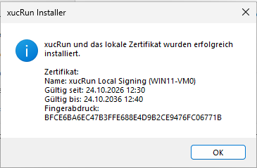

# xucRun

**Sprache:** [English](README.md) | Deutsch

**Dokumentation:** [Änderungsprotokoll](CHANGELOG.de.md) |
[Manuelle Entfernung](docs/de/MANUAL_REMOVAL.md)

**xucRun** steht für **eXecute Under User Context**.

> **Status:** xucRun befindet sich in Entwicklung. Der Quellcode kann selbst gebaut und mit
> einem lokalen Testzertifikat installiert werden.

## Motivation und Zweck

Das Programm richtet sich an Windows-Anwender, die ihren eigenen Rechner gelegentlich aus einem
Standardbenutzerkonto heraus administrieren möchten, interaktiv oder mithilfe eigener Skripte,
ohne dafür eine separate Anmeldung mit einem Administratorkonto oder bei jedem Vorgang erneut ein
Kennwort zu benötigen. Die erforderliche Berechtigung für administrative Aufgaben soll sich aus
einem Standardbenutzerkonto heraus möglichst mit einem einzigen Mausklick erteilen lassen.

Ein typischer Anwendungsfall entsteht, wenn der Anwender bewusst mit einem Standardbenutzerkonto
angemeldet bleibt, mit einem Programm oder über einen Dateimanager bestimmte Aktionen ausführen
möchte und dabei an Berechtigungsgrenzen stößt, sodass er die betreffende Aktion nur unter einem
anderen Benutzerkonto, beispielsweise einem Administratorkonto, fortsetzen kann. xucRun bindet
dafür die nativen Windows-Mechanismen in denselben Arbeitsablauf ein.

Der Anwender muss die Voraussetzungen dafür nicht vor dem ersten Aufruf vollständig einrichten. Er
kann den gewünschten Programmaufruf unmittelbar mit xucRun starten. Fehlen für diesen Aufruf noch
ein geeignetes Konto, gespeicherte Anmeldedaten oder eine Freigabe, führt xucRun interaktiv durch
die jeweils notwendigen Schritte und fragt die benötigten Angaben und Entscheidungen im laufenden
Arbeitsablauf ab. Bereits vorhandene Anmeldedaten und Freigaben werden bei späteren Aufrufen
wiederverwendet, soweit sie zum jeweiligen Aufruf passen, sodass anschließend in der Regel nur noch
eine einzige Bestätigung per Mausklick erforderlich ist.

Die grundlegenden Aktionen, Programme unter einem anderen Benutzerkonto zu starten und
administrative Rechte anzufordern, lassen sich auch mit Windows-eigenen Mitteln ausführen. xucRun
verbindet diese Möglichkeiten in einem komfortableren Ablauf und ergänzt sie um kontrollierte
Freigaben für gespeicherte Anmeldedaten. Dieser Komfort ist jedoch mit zusätzlichen
Sicherheitsrisiken verbunden, weil Anmeldedaten von xucRun gespeichert und für spätere Aufrufe
wiederverwendet werden. Wer diese Risiken nicht eingehen möchte, sollte besser Windows-eigene
Möglichkeiten wie z. B. den schnellen Benutzerwechsel nutzen.

## Vergleich mit Windows-Funktionen und anderen Lösungen

Beim schnellen Benutzerwechsel bleibt die bisherige Windows-Sitzung mit ihren geöffneten Programmen
erhalten, während sich der Anwender unter einem anderen Benutzerkonto in einer separaten Sitzung
anmeldet oder in dessen bereits geöffnete Sitzung wechselt. Anschließend kann er in die bisherige
Sitzung zurückkehren. Dieser Weg ist auch dann sinnvoll, wenn eine vollständige interaktive
Arbeitsumgebung des anderen Benutzers benötigt wird.

Gegenüber dem schnellen Benutzerwechsel bleibt der Anwender mit xucRun in seiner aktuellen Sitzung
und startet nur das benötigte Programm unter dem gewählten anderen Benutzerkonto, mit oder ohne
erhöhte Rechte. Die Windows-Benutzerkontensteuerung (User Account Control, UAC) ist die
Windows-Sicherheitsfunktion, über die ein Benutzer den Start mit Administratorrechten ausdrücklich
bestätigt. Bei einem Kontowechsel mit xucRun ist eine UAC-Bestätigung bei jedem Aufruf erforderlich:
Ohne Erhöhung bestätigt sie nur die Anwesenheit des Benutzers; bei einer Erhöhung bestätigt der
Benutzer damit zusätzlich die Administratorrechte für das Zielprogramm.

Eine weitere Windows-eigene Möglichkeit, die mehr Ähnlichkeit mit xucRun hat, ist `runas.exe`.
Damit lassen sich einzelne Programme gezielt unter einem anderen Benutzerkonto starten. Mit dem
Parameter `/savecred` werden die dafür verwendeten Anmeldedaten nach der ersten Kennworteingabe in
der Windows-Anmeldeinformationsverwaltung des angemeldeten Benutzers gespeichert. Danach kann
`runas.exe` Programme wiederholt unter einem anderen Benutzerkonto starten, ohne das Kennwort
erneut abzufragen. Bei der Verwendung von `runas.exe` bestehen jedoch einige Einschränkungen:

- Das Zielkonto muss bei jedem Aufruf mit `/user:<Konto>` angegeben werden. Sein Name steht damit
  je nach Verwendung in Skripten, Verknüpfungen oder auf der Kommandozeile.
- `runas.exe` fordert keine Erhöhung über UAC an. Ohne eine solche Erhöhung wird ein
  Administratorkonto bei aktiviertem UAC normalerweise nur mit eingeschränkten Rechten gestartet.
- Nach `/savecred` kann das Konto, dessen Anmeldedaten gespeichert wurden, ohne erneute Bestätigung
  für weitere Programmstarts verwendet werden. Dabei gibt es keine obligatorische Freigabe und
  keine Bindung an bestimmte Programme, Dateihashes, Argumente oder Arbeitsverzeichnisse.
- `runas.exe` wählt nicht automatisch ein geeignetes Konto aus, dessen Anmeldedaten mit
  `/savecred` gespeichert wurden, und bietet keine integrierte Verwaltung unterschiedlich
  weitreichender oder zeitlich begrenzter Freigaben.
- `runas.exe` reagiert empfindlich auf komplexe Programmpfade, Argumente und Sonderzeichen. Bei der
  Verwendung in Skripten oder Verknüpfungen können durch eine zusätzliche Shell oder ein
  Elevationswerkzeug weitere Parsing- und Quoting-Ebenen hinzukommen. Dadurch steigt die
  Fehleranfälligkeit besonders dann, wenn dem erhöht auszuführenden Programm komplexe Argumente
  oder Argumente mit Sonderzeichen übergeben werden müssen.

xucRun greift die Idee gespeicherter und wiederverwendbarer Anmeldedaten von `runas.exe` auf
und verbindet sie mit kontrollierten Freigaben und einem komfortableren Einsatz in Skripten,
Desktop-Verknüpfungen und anderen fest konfigurierten Aufrufen ebenso wie bei interaktiven
Aufrufen über die Kommandozeile. Der Start unter einem anderen Benutzerkonto, gespeicherte
Anmeldedaten und eine bei Bedarf weiterhin interaktive Erhöhung über UAC werden dabei in einem
Werkzeug zusammengeführt. Sind passende Anmeldedaten gespeichert, muss der Aufruf weder Zielkonto
noch Kennwort enthalten. Programmpfade, Argumente, Arbeitsverzeichnisse, Batchdateien und typische
Shell-Sonderzeichen werden kontrolliert über die notwendigen Prozessgrenzen hinweg behandelt.

Zur Veranschaulichung dient der Start des Gerätemanagers aus einem Standardbenutzerkonto als reales
Beispiel. Mit genau einem Administratorkonto, für das xucRun-Anmeldedaten gespeichert sind, genügt
über xucRun dieser Aufruf:

```cmd
xucRun.exe "%windir%\System32\mmc.exe" "%windir%\System32\devmgmt.msc"
```

Mit `runas.exe /savecred` und einem separaten Elevationswerkzeug könnte das schematische
Gegenstück beispielsweise so aussehen, wenn dieses Werkzeug die Syntax
`elevate.exe <Programm> [Argumente ...]` unterstützt:

```cmd
runas.exe /savecred /user:Administrator "elevate.exe %windir%\System32\mmc.exe %windir%\System32\devmgmt.msc"
```

Die genaue Syntax hängt vom gewählten Elevationswerkzeug ab. In der Werkzeugkette muss der
Kontoname im Aufruf stehen und die gesamte nachgelagerte Befehlszeile als ein Argument an
`runas.exe` übergeben werden. xucRun benötigt im Hauptanwendungsfall keinen Kontonamen und hält
Programm und Argumente in einem gemeinsamen Aufruf getrennt. Die UAC-Bestätigung bleibt bei beiden
Varianten interaktiv.

Ein Beispiel mit komplexeren Argumenten ist das Anlegen einer Firewallregel für ein Programm,
dessen Pfad Leerzeichen enthält:

```cmd
xucRun.exe "%windir%\System32\netsh.exe" advfirewall firewall add rule name="Lokaler Beispielserver" dir=in action=allow program="C:\Program Files\Beispielserver\server.exe" enable=yes profile=private
```

Dabei erhält `netsh.exe` mehrere Schlüssel-Wert-Argumente sowie einen Regelnamen und einen
Programmpfad mit Leerzeichen. In der Werkzeugkette aus `runas.exe` und einem separaten
Elevationswerkzeug müssten diese Anführungszeichen zusätzlich die äußere Befehlszeile für
`runas.exe` und die Auswertung durch das Elevationswerkzeug unverändert überstehen. Die dafür
erforderliche Schreibweise hängt wiederum vom konkreten Elevationswerkzeug ab.

Nach der erstmaligen Kennworteingabe kann `runas.exe /savecred /user:Administrator` dasselbe Konto,
dessen Anmeldedaten gespeichert wurden, auch für andere Programme verwenden, ohne erneut das
Kennwort oder eine obligatorische Bestätigung anzufordern. xucRun verlangt dagegen bei jedem
solchen Kontowechsel eine interaktive Anwesenheitsbestätigung über UAC. Fehlt eine passende
Freigabe, ist zusätzlich eine ausdrückliche xucRun-Freigabeentscheidung erforderlich.

`runas.exe /savecred` und xucRun verwenden voneinander getrennte, nicht kompatible Speicherungen
für Anmeldedaten. Bevor xucRun ein Konto verwendet, für das xucRun-Anmeldedaten gespeichert sind,
verlangt es eine ausdrückliche Freigabe. Diese kann eng an das aufrufende Benutzerkonto, das
Zielkonto, die beteiligten Programme und deren Dateihashes gebunden sowie zeitlich begrenzt
werden. Ändert sich
eines der gebundenen Programme, passt dessen SHA-256-Hash nicht mehr zur Freigabe. Vor einer
Übernahme der Freigabe auf die geänderte Programmversion verlangt xucRun eine ausdrückliche
Entscheidung.

Neben den Windows-eigenen Möglichkeiten gibt es Lösungen anderer Anbieter für Benutzerwechsel,
Rechteerhöhungen und die Verwaltung administrativer Zugriffe. Sie setzen je nach Anwendungsfall
andere Schwerpunkte. Eine Aufzählung einzelner Produkte wäre zwangsläufig unvollständig und könnte
durch die Auswahl unbeabsichtigt Schwerpunkte setzen. Zudem wäre sie rasch veraltet und wegen
unterschiedlicher Einsatz- und Sicherheitsmodelle nur eingeschränkt vergleichbar.

## Freigaben und UAC in xucRun

Wenn das aktuelle Windows-Konto Mitglied der Administratorengruppe ist, verwendet xucRun dieses
Konto standardmäßig auch für das gestartete Programm. Falls das Konto noch nicht erhöht ist,
fordert Windows die Zustimmung über die Benutzerkontensteuerung (UAC) an. In diesem Fall zeigt
xucRun keinen eigenen Freigabedialog und benötigt keine gespeicherte Programmfreigabe. Die
Zustimmung erfolgt ausschließlich über Windows-UAC.

Die xucRun-Programmfreigaben werden verwendet, wenn ein Programm mit den gespeicherten
Anmeldedaten eines anderen Kontos gestartet wird. Die Bindung einer xucRun-Freigabe an ein
bestimmtes Programm gilt deshalb nicht für den direkten Start unter dem eigenen
Administratorkonto.

Eine gespeicherte Freigabe allein erlaubt einem Standardbenutzer keinen vollständig dialoglosen
Start unter einem Administratorkonto. Soll das Zielprogramm ohne erhöhte Administratorrechte
laufen, zeigt Windows bei jedem Aufruf einmal UAC für das xucRun-Hilfsprogramm. Diese Abfrage
bestätigt nur die Anwesenheit des Benutzers; das Zielprogramm startet danach mit den nicht erhöhten
Rechten des Administratorkontos, für das xucRun-Anmeldedaten gespeichert sind. Soll das
Zielprogramm dagegen mit erhöhten Administratorrechten laufen, zeigt Windows die UAC-Abfrage beim
Start des Zielprogramms. Erst diese Bestätigung erteilt dem Zielprogramm die angeforderten
erhöhten Rechte.

Auch ein Start unter einem anderen Standardkonto kann eine UAC-Anwesenheitsbestätigung erfordern.
Verwendet xucRun dafür ein Administratorkonto, dient es nur zum geschützten Öffnen des
xucRun-Dialogs; das Zielprogramm läuft weiterhin unter dem gewählten Standardkonto.

Ist keine passende Freigabe aktiv, erscheint der xucRun-Freigabedialog auf einem geschützten
privaten Desktop. Normale, nicht erhöhte Programme können diesen Dialog nicht auslesen oder
steuern. Kann xucRun den Dialog dort nicht geschützt öffnen, wird der Vorgang abgebrochen.

Bei einer erhöht auszuführenden Startdatei, die für den Aufrufer beschreibbar ist, verlangt xucRun
trotz vorhandener Freigabe für jeden Start eine geschützte Risikobestätigung. Diese Zustimmung
gilt nur einmal und wird nicht gespeichert. Ist auch das Verzeichnis der Startdatei für den
Aufrufer beschreibbar, wird der erhöhte Start blockiert.

Der zentrale Anwendungsfall von xucRun ist ein angemeldeter Standardbenutzer, für den genau ein
Administratorkonto mit xucRun-Anmeldedaten gespeichert ist und Programme bei Bedarf unter diesem
Konto erhöht gestartet werden sollen. Nach der einmaligen Einrichtung genügt ein Aufruf ohne
Kontonamen und Kennwort:

```powershell
xucRun.exe regedit.exe
```

xucRun wählt das einzige Administratorkonto, für das xucRun-Anmeldedaten gespeichert sind,
automatisch aus und fordert für den erhöhten Programmstart die UAC-Bestätigung an. Das Kennwort
muss nicht erneut eingegeben werden. Kontoname und Kennwort müssen weder im xucRun-Aufruf noch in
Skripten oder Verknüpfungen stehen.

Allgemein unterstützt xucRun Programmstarts unter jedem Benutzerkonto, für das gültige
xucRun-Anmeldedaten gespeichert sind, das heißt sowohl unter Konten von Mitgliedern der
Administratorgruppe als auch unter Konten von normalen Benutzern. Die Konten können über einen
Parameter oder einen Auswahldialog bestimmt werden. Auch aufeinanderfolgende Wechsel des
Benutzerkontextes sind möglich, indem xucRun ausdrücklich als Zielprogramm eines weiteren
xucRun-Aufrufs gestartet wird. Shell-interne Befehle müssen dabei über die jeweilige Shell
aufgerufen werden.

Damit eignet sich xucRun besonders für Skripte, Batchdateien und wiederkehrende Verknüpfungen. UAC
bleibt dabei bewusst interaktiv; **xucRun ist kein Mechanismus für unbeaufsichtigte
Rechteerhöhung.**

Sind für mehrere Administratorkonten xucRun-Anmeldedaten gespeichert, lässt xucRun den Benutzer
eines davon auswählen.
Ein bestimmtes Konto kann auch direkt angegeben werden. Dabei lässt sich festlegen, ob das
Zielprogramm mit oder ohne erhöhte Administratorrechte gestartet werden soll. Kann xucRun einen
ausdrücklich erhöht angeforderten Start nicht herstellen, wird kein Programm gestartet.

Sind für einen Standardbenutzer keine xucRun-Anmeldedaten eines Administratorkontos gespeichert,
berücksichtigt xucRun stattdessen Standardkonten, für die xucRun-Anmeldedaten gespeichert sind,
und startet das Zielprogramm ohne erhöhte Administratorrechte. Fehlen die benötigten
Anmeldedaten vollständig, führt xucRun durch
die Auswahl eines Kontos und die Kennworteingabe. Anschließend setzt es den ursprünglichen Aufruf
fort.

xucRun führt den Benutzer im jeweiligen Aufruf durch alle dafür erforderlichen Konto-, Anmelde-
und Freigabeschritte. Fehlen ein Zielkonto, gespeicherte Anmeldedaten oder eine passende Freigabe,
fordert xucRun die notwendige Auswahl, Eingabe oder Bestätigung unmittelbar im laufenden Ablauf an
und setzt den ursprünglichen Aufruf anschließend fort. Kontoauswahl sowie Verwaltungs-,
Informations- und Fehlerdialoge erscheinen auf dem normalen Benutzerdesktop. Kennworteingaben,
Freigabeentscheidungen und erforderliche Risikobestätigungen zeigt xucRun dagegen auf seinem
geschützten privaten Desktop an. Die Dialoge laufen dort mit erhöhten Administratorrechten und sind
von normalen, nicht erhöhten Programmen auf dem üblichen Benutzerdesktop abgeschirmt. Windows-UAC
bleibt davon getrennt und verwendet den durch Windows konfigurierten UAC-Desktop.

Beim ersten solchen Dialog erzeugt xucRun für das aufrufende Windows-Benutzerkonto ein
zufälliges xucRun-Sicherheitsmerkmal im Format `XXXX-XXXX`. Kennwort-, Freigabe- und
Risikodialoge auf dem privaten Desktop zeigen dieses Merkmal anschließend unverändert an. Der
Benutzer sollte es nach einer vertrauenswürdig durchgeführten Installation beim bewusst
ausgelösten ersten Dialog einprägen oder sicher notieren und spätere xucRun-Dialoge nur bestätigen,
wenn es übereinstimmt. Diese erste Anzeige ist ein Vertrauensstart und lässt sich noch nicht mit
einem früheren Wert vergleichen. xucRun fordert niemals zur Eingabe dieses Merkmals auf. Das
getrennte Windows-UAC-Fenster zeigt es nicht an.

Wiederholte Starts ohne erneute Kennworteingabe setzen voraus, dass xucRun die Anmeldedaten des
Zielkontos speichert. xucRun schützt sie mit Windows-Sicherheitsmechanismen. Für einen Start unter
einem anderen Konto muss xucRun die benötigten Anmeldedaten jedoch vorübergehend verarbeiten.

Die Übereinstimmung ist ein Originalitätshinweis für den xucRun-Helperdialog, aber kein Beweis,
dass die angezeigte Operation ungefährlich ist oder vom Benutzer selbst ausgelöst wurde. Ein
Angreifer kann weiterhin legitime Dialoge auslösen und auf eine unaufmerksame Bestätigung hoffen.

Diese Maßnahmen bieten keinen vollständigen Schutz auf einem kompromittierten System. Ein
Angreifer kann täuschende oder legitime Dialoge auslösen und auf eine unaufmerksame Bestätigung
hoffen. Das Sicherheitsmerkmal hilft nur, wenn der Benutzer es tatsächlich vergleicht. xucRun
sollte deshalb nur entsprechend dem nachfolgenden Sicherheitshinweis eingesetzt werden.

## Umfang von xucRun

xucRun enthält:

- den Client `xucRun.exe`,
- den bedarfsgestarteten Brokerdienst `xucRunBroker`, der bei Bedarf automatisch gestartet wird,
  anschließend im Hintergrund läuft, die von xucRun geschützten Anmeldedaten verwaltet und
  Programmstarts unter dem gewählten Benutzerkonto ausführt,
- den Approval-Helper,
- gemeinsame Protokoll-, Serialisierungs- und Sicherheitskomponenten,
- deutsche und englische Sprachressourcen.

xucRun ist eigenständig baubar, installierbar und nutzbar.

## Voraussetzungen und Einsatzbereich

xucRun unterstützt Windows 10 und Windows 11 auf x64-Systemen. Es benötigt die aktuelle
Microsoft Visual C++ Redistributable v14 für x64.

xucRun ist für erfahrene Privatanwender und Entwickler auf selbst verwalteten Rechnern sowie in
persönlichen Entwicklungs- und Testsystemen vorgesehen. Es ist keine Lösung für unbeaufsichtigte
Rechteerhöhung, zentrale Flottenverwaltung oder besonders schutzbedürftige Systeme.

> **Wichtiger Sicherheitshinweis:** xucRun schützt gespeicherte Anmeldedaten
> mithilfe von Windows-Sicherheitsmechanismen. Damit xucRun ein Programm unter einem anderen
> Benutzerkonto starten kann, muss xucRun die benötigten Anmeldedaten jedoch vorübergehend
> verarbeiten. Ein vollständiger Schutz vor dem Auslesen oder Missbrauch durch ausreichend
> privilegierte Malware oder ein bereits kompromittiertes System kann deshalb nicht gewährleistet
> werden. Der Quellcode von xucRun wird
> offengelegt, damit die eingesetzten Schutzmaßnahmen, ihre technischen Grenzen und die
> verbleibenden Risiken nachvollzogen und unabhängig geprüft werden können. Die Offenlegung allein
> ist jedoch weder eine Sicherheitsgarantie noch der Nachweis einer unabhängigen
> Sicherheitsprüfung. Der Einsatz erfolgt eigenverantwortlich. xucRun sollte nur auf
> vertrauenswürdigen, selbst verwalteten und nicht besonders schutzbedürftigen Systemen sowie
> möglichst mit dedizierten, minimal berechtigten Zielkonten eingesetzt werden.
> Soweit gesetzlich zulässig, übernehmen der Autor und die Mitwirkenden keine Haftung für Schäden,
> Datenverluste oder sonstige Folgen, die aus der Nutzung oder fehlerhaften Anwendung von xucRun,
> aus Softwarefehlern oder Sicherheitslücken sowie durch Malware oder ein kompromittiertes System
> entstehen. Dies umfasst insbesondere den Verlust, die Offenlegung oder den Missbrauch von
> Anmeldedaten. Maßgeblich sind der Gewährleistungsausschluss und die Haftungsbegrenzung der
> [Apache License 2.0](LICENSE).

## Installation in Kürze

Für die Installation wird ein vollständiges xucRun-Paket benötigt. Der grafische Installer
signiert die installierbaren Paketdateien auf dem Zielrechner einheitlich mit einem lokalen
xucRun-Zertifikat.

### Lokales Signaturzertifikat

xucRun verwendet das Zertifikat, damit Windows und xucRun prüfen können, dass die installierten
Programmteile zu derselben Installation gehören und nicht verändert oder durch abweichend
signierte Dateien ersetzt wurden. Der Broker akzeptiert sicherheitsrelevante Anfragen nur von
passend signierten xucRun-Komponenten.

Das öffentliche Paket enthält keinen gemeinsam verwendeten privaten Schlüssel und ist nicht mit
einem kommerziell ausgestellten, öffentlich vertrauenswürdigen Herausgeberzertifikat signiert. Ein
mit xucRun verteilter, überall wiederverwendbarer privater Schlüssel würde jedem Empfänger
ermöglichen, Dateien mit derselben scheinbaren Identität zu erzeugen. Deshalb erstellt der
Installer auf dem Zielrechner ein eigenes selbstsigniertes Zertifikat oder verwendet das dort
bereits zuvor erzeugte gültige xucRun-Zertifikat erneut. Dessen privater Schlüssel ist nicht
exportierbar. Dieses Zertifikat begründet ausschließlich lokales technisches Vertrauen; es belegt
nicht die Herkunft des öffentlichen Pakets. Deshalb muss vor dem Start die veröffentlichte
Prüfsumme kontrolliert werden.

Das Standardzertifikat heißt `CN=xucRun Local Signing (<COMPUTERNAME>)`. Es wird einschließlich
seines privaten Schlüssels unter `LocalMachine\My` gespeichert und für das lokale Vertrauen
zusätzlich in `LocalMachine\Root` und `LocalMachine\TrustedPublisher` eingetragen. Bei der
Deinstallation entfernt xucRun das verifizierte Standardzertifikat einschließlich des privaten
Schlüssels und der Vertrauenseinträge.

### Grafische Installation

xucRun ist ein nicht kommerzielles Open-Source-Projekt. Die bereitgestellte Installer-Datei
besitzt derzeit keine Signatur eines öffentlich vertrauenswürdigen Herausgebers. Windows kann
deshalb beim ersten Start einen unbekannten Herausgeber melden.

Der einfachste Installationsweg ist
`xucRun-Installer-<Version>-x64.exe`, beispielsweise
`xucRun-Installer-0.9.0.2-x64.exe`. Vor dem Start sollte die Datei nur aus der
vertrauenswürdigen Veröffentlichungsquelle bezogen, ihre SHA-256-Prüfsumme mit der dort
veröffentlichten Prüfsumme verglichen und eine vorhandene Authenticode-Signatur geprüft werden.

Beim Start fordert die Windows-Benutzerkontensteuerung die erforderlichen Administratorrechte an.
Danach bietet die grafische Oberfläche Programmsprache und Maschinen-PATH zur Auswahl. Der
Installer zeigt bei einer vorhandenen Installation außerdem deren registrierte Version und den
Zeitpunkt der Installation beziehungsweise letzten Aktualisierung an. Der
Installer verwendet automatisch ein bereits vorhandenes gültiges lokales xucRun-
Codesignaturzertifikat mit privatem Schlüssel oder erzeugt das zuvor beschriebene Zertifikat. Die
Oberfläche zeigt vorab, ob ein Zertifikat wiederverwendet oder neu erstellt wird, und nennt
Gültigkeitszeitraum sowie Fingerabdruck. Anschließend signiert der Installer damit alle
installierbaren Dateien.


Der Installer zeigt die erkannte Version der Microsoft Visual C++ Runtime x64 und kennzeichnet sie
als kompatibel oder zu alt beziehungsweise als nicht gefunden. Nur wenn eine passende Runtime
fehlt, nennt der Aufforderungsdialog die erforderliche Mindestversion und bietet den geprüften
Microsoft-Download oder die Auswahl einer vorhandenen `vc_redist.x64.exe` an. Eine ausgewählte
Datei, deren Produktversion die Mindestversion unterschreitet, wird vor der Ausführung mit einer
verständlichen Versionsangabe abgelehnt. Nach einer Runtime-Installation wird die Anzeige
aktualisiert; die Erfolgsbestätigung nennt die installierte beziehungsweise aktualisierte Runtime
samt Version. Installiert werden Client, Broker, Approval-Helper und Sprachdateien nach
`%ProgramFiles%\xucRun`. Zusätzlich richtet der Installer den bedarfsgestarteten Brokerdienst und
den Deinstallationseintrag ein. Die Erfolgsbestätigung nennt außerdem das installierte
beziehungsweise wiederverwendete lokale Zertifikat mit Gültigkeitszeitraum und Fingerabdruck.



Intern verwendet der grafische Installer dasselbe mitgelieferte PowerShell-Installationsskript wie
der weiterhin unterstützte manuelle Installationsweg. Dieses prüft Paketdateien und Signaturen und
konfiguriert die gewählte Sprache. Optional kann das Installationsverzeichnis dem globalen
Maschinen-PATH hinzugefügt werden.

### Aktualisieren und deinstallieren

xucRun und das separat installierte optionale
[xucRun-Tray-Add-on](https://github.com/HT64/xucRun-Tray) verwenden eine exakte vierteilige
Versionsbindung. Bei einer erneuten Installation derselben xucRun-Version kann xucRun Tray installiert
bleiben, wenn seine registrierte Version, Dateiversion und Signierer weiterhin exakt zum
Core-Paket passen. Vor einem Versionswechsel oder der Deinstallation von xucRun muss das xucRun-Tray-Add-on
über seinen eigenen Windows-Deinstallationseintrag entfernt werden. Nach einem xucRun-Update kann
die öffentlich verfügbare Tray-Version mit derselben Versionsnummer installiert werden.
War der Brokerdienst vor einer Reparaturinstallation aktiv, wird er nach dem Dateiaustausch
automatisch wieder gestartet und damit sein vorheriger Laufzustand wiederhergestellt. Ein zuvor
bewusst gestoppter oder deaktivierter Brokerdienst bleibt gestoppt beziehungsweise deaktiviert.
Wird die xucRun-Deinstallation bei noch installiertem Tray gestartet, bleibt die Core-Installation
unverändert und ein sichtbarer Fehlerdialog fordert dazu auf, zuerst **xucRun Tray** über
**Installierte Apps** zu deinstallieren.

Für eine Aktualisierung wird der versionierte grafische Installer des neueren Pakets gestartet. Er
verwendet das bereits vorhandene gültige lokale xucRun-Zertifikat erneut und signiert damit die
neuen Paketdateien. Alternativ können die lokale Signierung und anschließend das PowerShell-
Installationsskript des neuen Pakets manuell ausgeführt werden. Gespeicherte xucRun-Anmeldedaten,
Freigaben und nicht vom Installer verwaltete INI-Einstellungen bleiben erhalten.

Die Deinstallation ist über **Installierte Apps** möglich. Alternativ wird kein separates
Deinstallationsskript benötigt, sondern das bei der Installation nach
`%ProgramFiles%\xucRun` kopierte `Install-xucRun.ps1` mit `-Uninstall` aufgerufen:

```powershell
powershell.exe -NoProfile -ExecutionPolicy Bypass `
  -File "$env:ProgramFiles\xucRun\Install-xucRun.ps1" `
  -Uninstall
```

> **Achtung:** Die Deinstallation löscht unwiderruflich alle von xucRun gespeicherten
> Anmeldedaten und Freigaben aller Windows-Benutzer sowie alle lokalen xucRun-Sicherungen,
> Sicherheitsmerkmale und zugehörigen Metadaten. Außerdem entfernt sie das lokale
> xucRun-Standardzertifikat samt privatem Schlüssel und Vertrauenseinträgen.

Vor der ersten Änderung verlangt die Deinstallation eine ausdrückliche Bestätigung dieser
unwiderruflichen Löschung. Bei Abbruch bleiben Installation und Daten unverändert. Die
Erfolgsbestätigung führt anschließend die entfernten Programmkomponenten, alle gegebenenfalls
vorhandenen gespeicherten Daten und das entfernte Zertifikat mit seinen Details auf.

Bei einem Deinstallationsfehler schreibt xucRun ein technisches Diagnoseprotokoll nach
`%ProgramData%\xucRun\InstallerLogs`. Der sichtbare Fehlerdialog zeigt den vollständigen Pfad der
konkreten Logdatei in einem kopierbaren Feld und kann den Protokollordner direkt öffnen. Das
Protokoll enthält Fehler-, Skript- und Systeminformationen, aber keine gespeicherten Kennwörter.
Der im Dialog angezeigte Dateipfad ist maßgeblich. Eine später erfolgreiche Core-Deinstallation
entfernt auch diese Diagnoseprotokolle.

Beide Installationswege und die Hinweise zur lokalen Testsignierung stehen ausführlich in der
[Installationsanleitung](docs/de/INSTALLATION.md).

Die folgenden Beispiele verwenden den Kurznamen `xucRun.exe`. Das funktioniert, wenn
`%ProgramFiles%\xucRun` während der Installation in den globalen Maschinen-PATH aufgenommen
wurde. Im grafischen Installer kann diese Option ausgewählt werden; bei der manuellen
Installation wird dafür `-AddToSystemPath` angegeben. Ohne PATH-Eintrag muss xucRun mit
vollständigem Pfad aufgerufen werden, beispielsweise
`"%ProgramFiles%\xucRun\xucRun.exe"`.

## Schnellstart

Nach der Installation können xucRun-Anmeldedaten für ein Zielkonto ausdrücklich gespeichert
werden:

```powershell
xucRun.exe /addcred Administrator
```

Wird der Kontoname weggelassen, öffnet xucRun zuerst ein Dialogfenster zur Auswahl eines
aktivierten lokalen Kontos. Anschließend erscheint unabhängig davon, ob das Konto angegeben oder
ausgewählt wurde, ein geschütztes Dialogfenster zur Kennworteingabe. Für ein Domänenkonto wird
`DOMAIN\Benutzername` angegeben.

Programme werden mit ihrem normalen Programmpfad und den anschließenden Argumenten aufgerufen:

```powershell
xucRun.exe notepad.exe
xucRun.exe regedit.exe
xucRun.exe powershell.exe -NoExit
xucRun.exe cmd.exe /c "net stop MyService"
```

Fehlen ein geeignetes Konto, gespeicherte Anmeldedaten oder eine passende Freigabe, führt xucRun
im laufenden Aufruf durch die erforderlichen Schritte.

## Anwendungsbeispiele

Gerätemanager aus einem Standardbenutzerkonto öffnen:

```cmd
xucRun.exe "%windir%\System32\mmc.exe" "%windir%\System32\devmgmt.msc"
```

Eine administrative PowerShell mit einem Skript starten:

```powershell
xucRun.exe powershell.exe -File "C:\Scripts\AdminScript.ps1"
```

Einen Windows-Dienst über `cmd.exe` stoppen:

```cmd
xucRun.exe cmd.exe /c "net stop MyService"
```

Eine Firewallregel für ein Programm mit Leerzeichen im Pfad anlegen:

```cmd
xucRun.exe "%windir%\System32\netsh.exe" advfirewall firewall add rule name="Lokaler Beispielserver" dir=in action=allow program="C:\Program Files\Beispielserver\server.exe" enable=yes profile=private
```

Eine Datei mit einem Programm unter dem gewählten Zielkonto bearbeiten:

```powershell
xucRun.exe notepad.exe "C:\Windows\System32\drivers\etc\hosts"
```

Die aktuelle PowerShell durch eine PowerShell im automatisch gewählten Benutzer- und
Berechtigungskontext ersetzen:

```powershell
PS D:\Beispiel\Projekt> xucRun.exe
```

Bei diesem parameterlosen Aufruf erkennt xucRun die direkte Eltern-Shell, schließt die bisherige
Konsole nach erfolgreichem Start und öffnet dieselbe Shell im ursprünglichen Arbeitsverzeichnis
neu. Läuft die bisherige PowerShell unter einem Standardkonto und ist genau ein
Administratorkonto mit xucRun-Anmeldedaten gespeichert, wählt xucRun dieses Konto automatisch,
fordert die Windows-UAC-Bestätigung an und startet die neue PowerShell erhöht unter diesem Konto
wieder in `D:\Beispiel\Projekt`. Das ist der typische Hauptanwendungsfall der Shell-Ersetzung.

Sind für mehrere Administratorkonten xucRun-Anmeldedaten gespeichert, erscheint stattdessen die
Kontoauswahl. Ist das
aktuelle Konto selbst ein Administrator, verwendet xucRun dieses Konto und übernimmt einen
bereits erhöhten Token direkt oder fordert andernfalls UAC an. Nur wenn für ein Standardkonto
keine xucRun-Anmeldedaten eines Administratorkontos gespeichert sind, berücksichtigt xucRun
Standardkonten, für die xucRun-Anmeldedaten gespeichert sind, und startet die Ersatz-Shell ohne
Erhöhung. Das Arbeitsverzeichnis bleibt in allen Fällen erhalten.

Die oben gezeigten Aufrufe mit einem Zielprogramm können auch in Skripten und
Desktop-Verknüpfungen verwendet werden. Kann xucRun das Zielkonto eindeutig automatisch bestimmen,
muss im Aufruf kein Kontoname stehen.

Die parameterlose Shell-Ersetzung ist dagegen für den interaktiven Aufruf aus einer unterstützten
Shell bestimmt. In einem Skript sollte sie nur verwendet werden, wenn das Schließen der bisherigen
Konsole und der interaktive Start einer Ersatz-Shell ausdrücklich beabsichtigt sind. Für eine
normale Desktop-Verknüpfung ist der parameterlose Aufruf nicht geeignet.

Unterstützte Eltern-Shells sind `cmd.exe`, `powershell.exe`, `pwsh.exe` und `tcc.exe`.

### Desktop-Verknüpfung für einen erhöhten Explorer

Eine Desktop-Verknüpfung kann ein Explorer-Fenster für ein festgelegtes Verzeichnis direkt unter
einem bestimmten Administratorkonto, für das xucRun-Anmeldedaten gespeichert sind, und mit
erhöhten Rechten öffnen. Im Feld **Ziel** der Verknüpfung steht beispielsweise:

```text
"%ProgramFiles%\xucRun\xucRun.exe" /user-elevated:Administrator "%WINDIR%\explorer.exe" "/root,"D:\Beispiel\Zielordner""
```

`/user-elevated:Administrator` sollte verwendet werden, wenn die Verknüpfung immer ein bestimmtes
Administratorkonto wählen, für das xucRun-Anmeldedaten gespeichert sind, und den Explorer
ausdrücklich mit erhöhten Rechten starten soll. Soll xucRun das passende Konto automatisch
bestimmen, wird der Schalter weggelassen. Soll der Explorer zwar unter einem bestimmten anderen
Konto, aber ohne durch xucRun erzwungene Erhöhung starten, wird stattdessen `/user:<Konto>`
verwendet.

`Administrator` ist durch das gewünschte Administratorkonto, für das xucRun-Anmeldedaten
gespeichert sind, und der Beispielpfad durch das zu öffnende Verzeichnis zu ersetzen. `/root`
setzt dieses Verzeichnis als Wurzel des neuen Explorer-Fensters. Die verschachtelten
Anführungszeichen müssen unverändert erhalten bleiben. Die gespeicherten Anmeldedaten ersetzen
nicht die interaktive Windows-UAC-Bestätigung.

### In Total Commander integrieren

xucRun kann eine neue erhöhte Total-Commander-Instanz nach seiner automatischen Kontostrategie
starten. Mitglieder der Administratorengruppe behalten ihr Konto und werden bei Bedarf über UAC
erhöht. Bei einem Standardbenutzer verwendet xucRun ein gespeichertes Administratorkonto. Der
Aufruf übernimmt den linken Pfad, den rechten Pfad und das aktive Dateipanel:

```ini
[em_TCStart_Elevated]
button=%COMMANDER_PATH%\icons\Tcmadm64000.ico
cmd=%comspec% /v:on /c
param=SET "P=%P." & SET "L=%X%P." & SET "R=%X%T." & SET Active=L & (IF "!P!" == "!R!" SET Active=R) & "%|ProgramFiles|\xucRun\xucRun.exe" "%|COMMANDER_PATH|\TOTALCMD64.EXE" /L="!L!" /R="!R!" /P=!Active!
menu=Start TC über xucRun mit erhöhten Rechten; Administratormitglieder behalten ihr Konto, Standardbenutzer wechseln zum Administrator
iconic=1

[em_TCReStart_Elevated]
button=%COMMANDER_PATH%\icons\Tcmadm64000.ico
cmd=cm_Exit,em_TCStart_Elevated
param=
menu=Neustart TC mit erhöhten Rechten
iconic=1
```

Der zweite Befehl schließt die aktuelle Total-Commander-Instanz und ruft anschließend den ersten
Befehl auf. Für den Kontowechsel eines Standardbenutzers muss mindestens ein Administratorkonto in
xucRun gespeichert sein. Sind mehrere passende Administratorkonten gespeichert, erscheint die
Kontoauswahl. Eine erforderliche Windows-UAC-Abfrage muss bestätigt werden.

xucRun kann Total Commander außerdem unter einem ausdrücklich ausgewählten anderen Windows-Konto
starten, ohne dass dieses bereits interaktiv angemeldet ist. So lassen sich Dateioperationen aus
einer normalen Benutzersitzung heraus in einem anderen Kontokontext ausführen. Für erhöhte
administrative Dateioperationen muss das Zielkonto über Administratorrechte verfügen und die
Windows-UAC-Abfrage bestätigt werden.

In `usercmd.ini` wird dafür ein benutzerdefinierter Befehl angelegt. `<Konto>` ist durch den
eingerichteten Kontonamen zu ersetzen; die Total-Commander-Variablen und das Quoting müssen
unverändert übernommen werden:

```ini
[em_TCStart_Konto]
button=%COMMANDER_EXE%
cmd="%ProgramFiles%\xucRun\xucRun.exe"
param="/hidden-monitor "%|ComSpec|" /v:on /c SET "P=%P." & SET "L=%X%P." & SET "R=%X%T." & SET Active=L & (IF "!P!" == "!R!" SET Active=R) & "%|ProgramFiles|\xucRun\xucRun.exe" /user:<Konto> "%|COMMANDER_EXE|" "/L=!L!" "/R=!R!" "/P=!Active!""
menu=Total Commander als <Konto> starten
iconic=1
```

Der Befehl verwendet xucRun bewusst zweimal, damit ein Administratorkonto als zentraler
Bevollmächtigter für die Anmeldedaten weiterer Zielkonten dienen kann. Für die eigentliche
Startfunktion ist diese Kaskade nicht erforderlich; das hier ist eine spezielle Designentscheidung
für die Art und Weise, wie die Anmeldedaten gespeichert werden. Das Beispiel zeigt zugleich, wie
xucRun auch in einer verschachtelten Prozesskette mit komplexen Pfad- und Befehlszeilenargumenten
eingesetzt werden kann. Der äußere Aufruf startet die mit
`/hidden-monitor` verborgene `cmd.exe` nach der xucRun-Standardstrategie zunächst unter diesem
Administratorkonto. Der darin ausgeführte innere xucRun-Aufruf läuft deshalb mit der SID des
Administrators und kann dessen für `<Konto>` gespeicherte Anmeldedaten verwenden. Dadurch müssen
die Anmeldedaten der weiteren Zielkonten nicht für jeden Standardbenutzer erneut gespeichert
werden; jeder Standardbenutzer benötigt nur die für ihn gespeicherten Anmeldedaten des zentralen
Administratorkontos. Ein einzelner xucRun-Aufruf des Standardbenutzers könnte dagegen nur dessen
eigene, an seine SID gebundenen Anmeldedaten verwenden. Der innere Aufruf verarbeitet
`/user:<Konto>` und startet die sichtbare Total-Commander-Instanz unter dem Zielkonto. Die
Erhöhung der äußeren Zwischenstufe wird nicht auf das Zielkonto übertragen; dessen Rechte bleiben
unverändert.

Die vorgeschaltete `cmd.exe /v:on /c` speichert die von Total Commander gelieferten Pfade zuerst
in Umgebungsvariablen und übergibt sie danach per verzögerter Variablenerweiterung an den inneren
xucRun-Aufruf. Dadurch werden auch Pfade mit Leer- und Sonderzeichen zuverlässig verarbeitet. Der
Vergleich der Pfade bestimmt zusätzlich, ob das linke oder rechte Panel aktiv ist.

Der Befehl kann beispielsweise in ein benutzerdefiniertes Menü aufgenommen werden:

```text
POPUP "Benutzer"
  MENUITEM "Total Commander für <Konto> starten", em_TCStart_Konto
END_POPUP
```

Auf dieselbe Weise können weitere Konten ergänzt werden. Dazu können für jedes weitere Konto ein
eigener Befehl in `usercmd.ini` sowie ein darauf verweisender `MENUITEM` angelegt werden.

## Kontowahl und Rechte

Ohne Benutzerschalter verwendet xucRun einen passenden aktuellen Benutzerkontext oder ein
Administratorkonto, für das xucRun-Anmeldedaten gespeichert sind. Gibt es genau ein passendes
Konto mit xucRun-Anmeldedaten, wird es automatisch gewählt; bei mehreren erscheint eine Auswahl.

| Konto mit gespeicherten Anmeldedaten wählen | Lokalen Zielbenutzer wählen |
|:---:|:---:|
|  |  |

| Aufruf | Verhalten |
|---|---|
| `xucRun.exe <Programm> [Argumente ...]` | Konto automatisch bestimmen; bei Bedarf erhöhte Rechte anfordern |
| `xucRun.exe /user <Programm> [Argumente ...]` | Konto wählen, für das xucRun-Anmeldedaten gespeichert sind, ohne zusätzliche Erhöhung durch xucRun |
| `xucRun.exe /user:<Konto> <Programm> [Argumente ...]` | bestimmtes Konto verwenden, ohne zusätzliche Erhöhung durch xucRun |
| `xucRun.exe /user-elevated <Programm> [Argumente ...]` | Administratorkonto wählen, für das xucRun-Anmeldedaten gespeichert sind, und erhöht starten |
| `xucRun.exe /user-elevated:<Konto> <Programm> [Argumente ...]` | bestimmtes Konto verwenden und erhöht starten |

Gespeicherte Anmeldedaten umgehen Windows-UAC nicht. Ist eine Erhöhung erforderlich, bleibt die
UAC-Bestätigung interaktiv. Bei einer neuen Freigabe für einen erhöhten Start können zunächst der
geschützte Freigabedialog und anschließend der UAC-Dialog für das Zielprogramm erscheinen.

## Freigaben

Vor einem noch nicht freigegebenen Start kann xucRun eine einmalige oder wiederverwendbare
Freigabe anfordern. Verfügbar sind:

- nur dieser eine Start,
- 10 Minuten,
- ein Tag,
- bis zur Abmeldung,
- dauerhaft.

Eine Freigabe kann an ein bestimmtes Programm oder an alle Programme sowie an ein bestimmtes
Zielkonto oder an alle gespeicherten Konten des aktuellen Windows-Benutzers gebunden werden.
Programmspezifische Freigaben berücksichtigen den SHA-256-Hash der Startdatei. Ändert sich die
Datei, muss die Übernahme der Freigabe auf die neue Version ausdrücklich bestätigt werden.

Eine Freigabe begrenzt nicht die Fähigkeiten des gestarteten Programms. Allgemeine oder dauerhafte
Freigaben für universelle Interpreter wie `cmd.exe`, PowerShell oder `wscript.exe` sind deshalb
besonders weitreichend.

Bei `cmd.exe`, `powershell.exe`, `pwsh.exe`, TCC und Windows Script Host weist der Freigabedialog
deshalb darauf hin, dass eine wiederverwendbare Freigabe nicht an die angezeigten Argumente
gebunden ist. Ziel, Argumente und Arbeitsverzeichnis sollten besonders sorgfältig geprüft und nach
Möglichkeit nur einmalig freigegeben werden. Bei PowerShell kann eine administrativ erzwungene
Richtlinie `AllSigned` Skriptdateien zusätzlich absichern, schützt jedoch nicht vor direkten oder
interaktiven Befehlen.

## Programme, Argumente und Sonderzeichen

Der erste Nicht-xucRun-Schalter ist das Zielprogramm. Alle folgenden Argumente gehören
ausschließlich diesem Programm:

```powershell
xucRun.exe cmd.exe /c dir
xucRun.exe /user:Administrator app.exe /config:value
```

`/c` und `/config:value` werden hier nicht von xucRun ausgewertet. Shell-interne Befehle müssen
über die jeweilige Shell gestartet werden, beispielsweise `cmd.exe /c dir` oder
`powershell.exe -Command Get-Process`.

Programmpfade und einzelne Argumente mit Leerzeichen werden wie üblich in Anführungszeichen
gesetzt. xucRun unterstützt auch Batchdateien und überträgt typische Shell-Sonderzeichen über die
zusätzlichen Prozessgrenzen. Welche Zeichen von `cmd.exe`, PowerShell oder einer anderen
aufrufenden Shell schon vor dem Start von xucRun ausgewertet werden, richtet sich weiterhin nach
dieser Shell.

Bei einem brokervermittelten Start einer `.bat`- oder `.cmd`-Datei, deren Dateiname eines der
CMD-Metazeichen `& | ( ) ! % ^` enthält, erzeugt der Broker einen temporären Wrapper mit dem Namen
`xucRun_wrapper_<128-Bit-Zufall>.bat`. Er legt ihn bevorzugt auf einem geeigneten Volume namens
`RamDisk` ab, andernfalls im `%TEMP%`-Verzeichnis des Zielkontos. Der Broker schützt den Wrapper bis
zum Ende des gestarteten Prozesses und versucht ihn anschließend oder bei einem fehlgeschlagenen
Start während der Fehlerbereinigung zu löschen. Bleibt er wegen eines Löschfehlers oder
unerwarteten Brokerendes zurück, kann ein lokaler Administrator ihn nach Freigabe manuell
entfernen. Eine automatische Nachbereinigung gibt es nicht; der Wrapper enthält keine
Anmeldedaten, gespeicherten Argumente oder wiederverwendbare Autorisierung.

## Nützliche Befehle

| Befehl | Zweck |
|---|---|
| `xucRun.exe /addcred [<Konto>]` | Anmeldedaten speichern |
| `xucRun.exe /deletecred [<Konto>]` | gespeicherte Anmeldedaten auswählen und löschen |
| `xucRun.exe /showcred` | Konten anzeigen, für die xucRun-Anmeldedaten gespeichert sind |
| `xucRun.exe /showapprovals` | gespeicherte Freigaben anzeigen |
| `xucRun.exe /resetapprovals[:<Konto>]` | Freigaben zurücksetzen |
| `xucRun.exe /info` | Version, Signierzertifikat, Brokerstatus und aktuelle Konfiguration anzeigen |
| `xucRun.exe /admin-status` | Daten aller Windows-Benutzer erhöht anzeigen und verwalten |
| `xucRun.exe /backup` | lokale Datensicherungen verwalten |
| `xucRun.exe /audit` | Sicherheitsdiagnose ausführen |
| `xucRun.exe /enable-broker` | einen deaktivierten Broker wieder aktivieren |
| `xucRun.exe /clear-all` | alle gespeicherten xucRun-Daten löschen |
| `xucRun.exe /help` | vollständige Hilfe anzeigen |

`/hidden` verbirgt das unmittelbar gestartete Zielprogramm. `/hidden-monitor` überwacht zusätzlich
dessen Exitcode und zeigt bei einem Fehler einen Hinweis. Dialoge und Kindprozesse werden dadurch
nicht verborgen oder überwacht.

## Anmeldedaten und Freigaben verwalten

`/showcred` zeigt die Zielkonten, für die xucRun-Anmeldedaten gespeichert sind, `/showapprovals`
die aktiven allgemeinen und programmspezifischen Freigaben. Die gespeicherten Kennwörter werden
dabei nicht angezeigt oder an den Client übertragen.

| Gespeicherte Anmeldedaten | Aktive Freigaben |
|:---:|:---:|
|  |  |

Ohne Kontonamen zeigt `/deletecred` eine Auswahl und verlangt vor der Löschung eine Bestätigung.
Beim Löschen eines Kontos entfernt xucRun auch dessen kontogebundene Freigaben. Profilweite
Freigaben für alle Konten bleiben bestehen.

Mit `/resetapprovals` können einzelne oder mehrere Freigaben ausgewählt und entfernt werden.
`/clear-all` ist die administrative Gesamtbereinigung. Der Befehl muss erhöht gestartet werden und
löscht nach ausdrücklicher Bestätigung alle xucRun-Anmeldedaten, Freigaben, Sicherheitsmerkmale und
zugehörigen Metadaten aller Windows-Benutzer dieses Rechners.

| Gespeicherte Anmeldedaten löschen | Freigaben zurücksetzen |
|:---:|:---:|
|  |  |

Für eine rechnerweite Übersicht zeigt `/admin-status` die gespeicherten xucRun-Daten aller
Windows-Benutzer und stellt die verfügbaren administrativen Bereinigungsaktionen bereit.


## Datensicherungen

`xucRun.exe /backup` öffnet die interaktive Verwaltung lokaler Datensicherungen. Zusätzlich stehen
folgende Befehle zur Verfügung:


```text
xucRun.exe /backup-create [<Beschreibung>]
xucRun.exe /backup-list
xucRun.exe /backup-restore
xucRun.exe /backup-restore:<Backup-ID>
xucRun.exe /backup-delete-all
```

Eine Sicherung umfasst gespeicherte Anmeldedaten, Freigaben, Sicherheitsmerkmale und zugehörige
Metadaten. Datensicherungen werden getrennt von den aktiven Anmeldedaten und Freigaben unter
`%ProgramData%\xucRun\BrokerBackups` gespeichert. Sie sind ebenfalls durch
Windows-Sicherheitsmechanismen geschützt und zusätzlich an den Rechner gebunden. Sie können deshalb
nur auf demselben Rechner wiederhergestellt werden und sind kein portabler Kennwortexport.

Die Deinstallation entfernt auch die lokal gespeicherten xucRun-Datensicherungen.

## Fehlerdiagnose

`xucRun.exe /info` zeigt unter anderem Clientversion, Name, SHA-256-Fingerabdruck und
Gültigkeitszeitraum des Signierzertifikats, Brokerstatus, aktuelles Konto und wirksame
Konfiguration. `xucRun.exe /audit` prüft sicherheitsrelevante Eigenschaften der laufenden
Installation und nennt bei gültiger Clientsignatur ebenfalls das geprüfte Zertifikat. Ist xucRun
Tray separat installiert, prüft das Audit zusätzlich dessen
installierte Dateien und Signaturen, Deinstallationsregistrierung und benutzerbezogene
Autostartaufgaben. Wurde der Brokerdienst deaktiviert, kann er mit
`xucRun.exe /enable-broker` wieder aktiviert werden. `xucRun.exe /help` zeigt die vollständige
lokale Befehlsübersicht.

| Laufzeitinformationen | Sicherheitsaudit |
|:---:|:---:|
|  |  |

Die Client-Dateiprotokollierung und die Ereignisprotokollierung des Brokers werden unter
[Konfigurationsdatei und Sprache](#konfigurationsdatei-und-sprache) beschrieben.

## Konfigurationsdatei und Sprache

xucRun verwendet die maschinenweite Konfigurationsdatei
`%ProgramFiles%\xucRun\xucRun.ini`. Der Installer legt sie an und aktualisiert bei einer
Installation oder einem Update die gewählte Sprache, ohne die übrigen vorhandenen Einstellungen
zu entfernen. Weil die Datei unter `%ProgramFiles%` liegt, sind zum manuellen Bearbeiten
normalerweise Administratorrechte erforderlich.

Die unterstützte Struktur ist:

```ini
[xucRun]
Language=de

[Logging]
ClientLogDirectory=
BrokerInformationEvents=false
```

- `Language=de` verwendet Deutsch, `Language=en` Englisch. Die Änderung gilt für neu gestartete
  xucRun-Prozesse.
- Ein fehlendes oder leeres `ClientLogDirectory` deaktiviert das Client-Dateilog. Ein eingetragener
  Pfad aktiviert es. Umgebungsvariablen werden im Kontext des jeweils startenden Clients
  aufgelöst. Der Pfad muss für jedes verwendete Client- und Wrapperkonto erreichbar und mit den
  zum Erstellen, Anhängen und Löschen der Protokolldateien erforderlichen Rechten versehen sein.
- Warnungen, Fehler sowie Dienst- und ACL-Startmeldungen schreibt der Broker immer in das
  Windows-Anwendungsereignislog unter der Quelle `xucRunBroker`.
  `BrokerInformationEvents=true` ergänzt dort routinemäßige Informationsmeldungen zur Verarbeitung
  von Pipe-Anfragen. Bei fehlendem, leerem, `false` oder anderem Wert bleiben nur diese
  zusätzlichen Informationsmeldungen deaktiviert. Änderungen gelten nach einem Neustart des
  Brokerdienstes.

Eine fehlende Konfigurationsdatei, ein ungültiger Sprachwert oder eine fehlende beziehungsweise
nicht passend signierte Sprachdatei führt aus Sicherheitsgründen zum Startabbruch statt zu einem
stillen Sprachwechsel.

## Optionales Tray

Das separat installierte optionale
[xucRun-Tray-Add-on](https://github.com/HT64/xucRun-Tray) ergänzt eine Status- und
Komfortoberfläche, deren Symbol im Benachrichtigungsbereich der Windows-Taskleiste neben der Uhr
erscheint. Es ist ein eigenständiges Projekt, zeigt Informationen aus xucRun an und erleichtert den
Zugriff auf dessen vorhandene Verwaltungsfunktionen. Es ersetzt xucRun nicht.

## Projekt unterstützen

Die Entwicklung kann freiwillig über
[Patreon](https://www.patreon.com/xucRun) unterstützt werden. Eine Unterstützung ist keine
Voraussetzung für Download oder Nutzung von xucRun und gewährt keine exklusive Software,
Funktionen, Veröffentlichungen, Downloads, persönlichen Support oder bestimmte Reaktionszeiten.

## Schwachstellen melden

Ungepatchte oder vermutete Schwachstellen dürfen nicht öffentlich gemeldet werden. Der
vertrauliche Meldeweg und die unterstützten Versionen sind in [SECURITY.de.md](SECURITY.de.md)
beschrieben.

## Selbst bauen und installieren

Die [Buildanleitung](docs/de/BUILDING.md) beschreibt die Erzeugung eines xucRun-Pakets aus dem
Quellcode. Die anschließende lokale Testsignierung, Installation, Aktualisierung und Deinstallation
stehen in der [Installationsanleitung](docs/de/INSTALLATION.md). Ist die normale Deinstallation
nicht verfügbar, listet die Anleitung zur
[manuellen Entfernung](docs/de/MANUAL_REMOVAL.md) alle xucRun-eigenen Artefakte und deren sichere
Entfernungsreihenfolge auf.

## Lizenz

xucRun steht unter der Apache License 2.0. Maßgeblich sind `LICENSE` und `NOTICE`.

Externe Codebeiträge werden derzeit nicht angenommen; Einzelheiten stehen in
[CONTRIBUTING.de.md](CONTRIBUTING.de.md).
