<!--
Purpose: Introduces xucRun, its security model, use, and documentation in German.
Approach: Combines conceptual guidance, security boundaries, examples, and links to task-specific documents.
-->
# xucRun

**Sprache:** [English](README.md) | Deutsch

**Dokumentation:** [Dateiregister](FILE_REGISTER.md) | [Änderungsprotokoll](CHANGELOG.de.md) |
[Manuelle Entfernung](docs/de/MANUAL_REMOVAL.md)

**Download:** [Aktuelle Version](https://github.com/HT64/xucRun/releases/latest)

**Selbst bauen:** [Build-Anleitung](docs/de/BUILDING.md)

**xucRun** steht für **eXecute Under User Context**.

> **Status:** xucRun wird aktiv weiterentwickelt und ist auf Windows-10- und Windows-11-Systemen
> des Autors praktisch erprobt. Weitere Änderungen sind möglich, und Fehler können nicht
> ausgeschlossen werden. Die Versionskennzeichnung 0.x.x.x dient nicht als Qualitätsbewertung,
> sondern wird beibehalten, bis mehr praktische Erfahrungen und Rückmeldungen aus anderen
> Benutzerumgebungen vorliegen.

## Überblick

xucRun führt ein [Programm, einen Befehl oder ein
Skript](#programme-argumente-und-sonderzeichen) unter dem dafür ausgewählten Benutzerkonto aus,
während der Anwender in seiner aktuellen Windows-Sitzung bleibt. Das
[Zielkonto](#kontowahl-und-rechtemodus) kann ein Standardkonto sein oder der lokalen
Administratorengruppe angehören; im zweiten Fall ist optional ein Start mit erhöhten Rechten
(Administratorrechten) möglich. Der zentrale Anwendungsfall ist ein erfahrener Windows-Anwender,
der normalerweise mit einem Standardkonto arbeitet und eine bestimmte administrative Aktion
ausführen möchte, ohne in eine separate Administratorsitzung zu wechseln oder bei jedem passenden
Aufruf Kontoname und Kennwort erneut einzugeben.

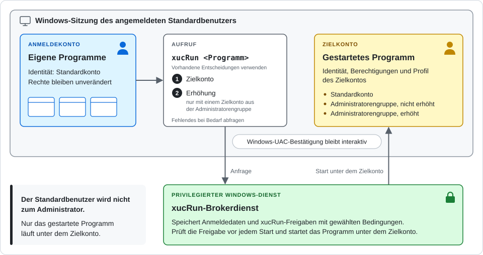

Eine gesonderte Ersteinrichtung ist nicht erforderlich; fehlende Angaben und Entscheidungen fragt
xucRun bei Bedarf ab. Bei weiteren Starts greift xucRun auf bereits eingerichtete Zielkonten,
gespeicherte Anmeldedaten und geltende Freigaben zurück und ermöglicht so eine komfortable tägliche
Nutzung. Windows-UAC bleibt, soweit erforderlich, ein interaktiver Schritt im Startvorgang.

### Warum mit einem Standardkonto arbeiten?

Unabhängig von xucRun kann ein Anwender für die tägliche Arbeit dauerhaft mit einem Konto, das
Mitglied der lokalen Administratorengruppe ist, oder mit einem Standardkonto angemeldet bleiben.
Ein Mitglied der Administratorengruppe ist berechtigt, Programme mit Administratorrechten
auszuführen. Je nach Konfiguration der Windows-Benutzerkontensteuerung (User Account Control, UAC)
stehen diese Rechte einem gestarteten Prozess bereits zur Verfügung oder werden über UAC
angefordert. Eine solche Anforderung kann grundsätzlich jedes Programm stellen.

Wer für die tägliche Arbeit ohnehin mit einem Konto arbeitet, das Mitglied der lokalen
Administratorengruppe ist, und gelegentlich Programme unter demselben Konto mit erhöhten Rechten
starten möchte, kann dafür die Windows-eigenen UAC-Mechanismen einschließlich Windows Sudo
verwenden. xucRun unterstützt auch diesen Anwendungsfall, bietet dafür allein gegenüber den
Windows-eigenen Funktionen jedoch keinen wesentlichen zusätzlichen Nutzen.

Ein Standardkonto besitzt selbst keine Administratorrechte und kann sie über UAC nicht für seine
eigene Identität erhalten. Systemweite Änderungen an Programmen, Diensten oder geschützten
Konfigurationen erfordern deshalb ein getrenntes Konto, das Mitglied der lokalen
Administratorengruppe ist; der erhöhte Prozess läuft dann unter dessen Identität. Dadurch wird
begrenzt, was versehentliche Aktionen und Prozesse im normalen Benutzerkontext ohne einen
getrennten, bewusst bestätigten Autorisierungsschritt ändern können.

Für administrative Aktionen aus dem Standardbenutzerkontext muss ein geeignetes Verfahren gewählt
werden. Dafür können Windows-eigene Funktionen oder zusätzliche Hilfsprogramme eingesetzt werden.
Insbesondere Werkzeuge, die Anmeldedaten speichern oder Autorisierungen wiederverwenden, erfordern
zusätzliche Schutzmaßnahmen und bringen eigene Risiken mit sich. Jeder Anwender muss deshalb
abwägen, ob der Nutzen der Kontotrennung den damit verbundenen Einrichtungs- und Bedienaufwand
sowie die Risiken des gewählten Verfahrens für ihn rechtfertigt.

Diese Abwägung sowie die sichere Einrichtung und Nutzung des gewählten Verfahrens setzen
ausreichende Kenntnisse der Windows-Konten-, UAC- und Berechtigungsmodelle voraus. xucRun richtet
sich deshalb an erfahrene Windows-Anwender.

### Wie xucRun administrative Aktionen aus einem Standardkonto unterstützt

**xucRun erhält diese Trennung aufrecht und behandelt Kontowahl und Erhöhung als getrennte
Entscheidungen.** Es macht den Standardbenutzer nicht vorübergehend zum Administrator und
erweitert dessen Rechte nicht.

Mit xucRun kann der angemeldete Standardbenutzer für einen Start ein vom Anmeldekonto abweichendes
Zielkonto wählen. Das Zielkonto kann auch ein anderes Standardkonto sein. Für administrative
Aktionen kann stattdessen ein Konto gewählt werden, das der lokalen Administratorengruppe
angehört; nur dann ist optional ein Start mit erhöhten Rechten möglich. Der Prozess verwendet dann
die Identität und Berechtigungen des gewählten Zielkontos, etwa beim Zugriff auf Netzwerkfreigaben.
Außerdem wird das Benutzerprofil dieses Kontos geladen. Dazu gehören beispielsweise
benutzerbezogene Profildaten, in Anwendungen gespeicherte Anmeldungen für E-Mail-Konten und
Registry-Einstellungen. `HKEY_CURRENT_USER` verweist dementsprechend auf den Registry-Hive des
Zielkontos und nicht auf den des an Windows angemeldeten Benutzers.

xucRun verbindet Windows-Kontowechsel und UAC mit von xucRun verwalteten Anmeldedaten für
Zielkonten. Diese Anmeldedaten werden geschützt gespeichert und nur verwendet, wenn eine passende
[xucRun-Freigabe](#freigabedialog-dauer-und-umfang) die angeforderte Ausführung erlaubt. Eine an ein
bestimmtes Zielkonto gebundene Freigabe kann nur für Starts unter diesem Konto verwendet werden.

Nach der einmaligen Einrichtung genügt für einen typischen Start die Angabe des Programms, Befehls
oder Skripts und der zugehörigen Argumente. Dabei müssen weder Kontoname noch Kennwort im
eigentlichen xucRun-Aufruf hinterlegt werden – unabhängig davon, ob der Start aus einer Konsole,
über ein Kontextmenü, über eine Desktopverknüpfung oder aus einem Skript erfolgt. Bereits
getroffene passende Auswahl- und Freigabeentscheidungen verwendet xucRun erneut; fehlende
Entscheidungen fragt es interaktiv ab. Eine notwendige
[Windows-UAC-Bestätigung](#verhältnis-zwischen-xucrun-freigaben-und-windows-uac) bleibt interaktiv.

## Schnellstart

Der grafische Installer bietet an, `%ProgramFiles%\xucRun` in den maschinenweiten PATH aufzunehmen,
also in den Windows-Suchpfad für Programme. Stimmt der Benutzer dieser Option zu, kann xucRun
anschließend ohne Pfadangabe über den Kurznamen `xucRun.exe` aufgerufen werden, wie in den
folgenden Beispielen. Bei der manuellen Installation wird die PATH-Option mit `-AddToSystemPath`
aktiviert. Die verfügbaren Installationswege beschreibt der Abschnitt
[Installation in Kürze](#installation-in-kürze).

`xucRun.exe` wird in den folgenden interaktiven Beispielen als Kurzname verwendet. Wenn die zuvor
genannte PATH-Option aktiviert wurde, funktioniert dieselbe Programmsuche technisch auch in
Skripten, Verknüpfungen, Aufgaben und anderen fest konfigurierten Aufrufen. Sollen solche Aufrufe
jedoch gegen eine Umleitung über das aktuelle Verzeichnis oder den Programmsuchpfad geschützt sein,
sollten sie den tatsächlichen absoluten Pfad der installierten `xucRun.exe` verwenden.

Nach der Installation können von xucRun verwaltete Anmeldedaten ausdrücklich für ein Zielkonto
gespeichert werden, also für das Konto, unter dem Programme gestartet werden sollen. Zum Beispiel:

```powershell
xucRun.exe /addcred Administrator
```

Wird der Kontoname weggelassen, öffnet xucRun zuerst ein Dialogfenster zur Auswahl eines
aktivierten lokalen Kontos. Anschließend erscheint unabhängig davon, ob das Konto angegeben oder
ausgewählt wurde, ein Dialogfenster zur Kennworteingabe auf einem separaten Windows-Desktop, den
xucRun für geschützte Eingaben verwendet. Für ein Domänenkonto wird `DOMAIN\Benutzername`
angegeben.

| 1. Lokales Zielkonto auswählen | 2. Anmeldedaten auf separatem Desktop eingeben | 3. Erfolgreiche Speicherung bestätigen |
|:---:|:---:|:---:|
| 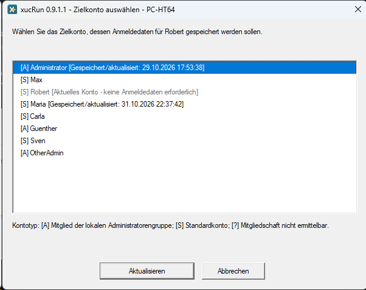 | 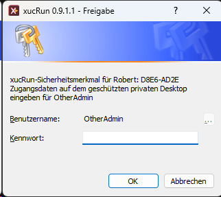 | 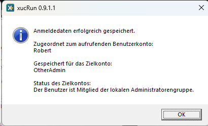 |

Die Kontokennzeichnungen unterscheiden Mitglieder der lokalen Administratorengruppe (`[A]`),
Standardkonten (`[S]`) und Konten, deren Mitgliedschaft nicht ermittelt werden konnte (`[?]`).

Programme werden mit ihrem normalen Programmpfad und den anschließenden Argumenten aufgerufen:

```powershell
xucRun.exe notepad.exe
xucRun.exe regedit.exe
xucRun.exe powershell.exe -NoExit
xucRun.exe cmd.exe /c "net stop MyService"
```

Auch die hier verwendeten Kurznamen der Zielprogramme werden über die Windows-Programmsuche
aufgelöst. Für interaktive Aufrufe ist das bequem. Sollen Skripte, Verknüpfungen, Aufgaben oder
andere fest konfigurierte Aufrufe gegen eine Umleitung des Zielprogramms geschützt sein, sollten
sie auch für das Zielprogramm dessen tatsächlichen absoluten Pfad verwenden. Die nachfolgenden
Beispiele mit `C:\Windows` nehmen den Windows-Standardpfad an; bei einem abweichenden Windows-Pfad
ist der tatsächliche absolute Pfad einzusetzen.

Das [kurze Demonstrationsvideo](docs/media/xucRun-simple-elevation.mp4) (58 Sekunden, MP4,
englische Benutzeroberfläche) zeigt, wie xucRun eine nicht erhöhte Eingabeaufforderung durch eine
unter dem konfigurierten Administratorkonto ausgeführte Eingabeaufforderung ersetzt und wie es einen
einzelnen administrativen Befehl aus der ursprünglichen Shell ausführt.

Fehlen ein geeignetes Konto, gespeicherte Anmeldedaten oder eine passende Freigabe, führt xucRun
im laufenden Aufruf durch die erforderlichen Schritte.

## Anwendungsbeispiele

Gerätemanager aus einem Standardbenutzerkonto öffnen:

```cmd
xucRun.exe "C:\Windows\System32\mmc.exe" "C:\Windows\System32\devmgmt.msc"
```

Eine administrative PowerShell mit einem Skript starten:

```powershell
xucRun.exe powershell.exe -File "C:\Scripts\AdminScript.ps1"
```

Das [kurze PowerShell-Demonstrationsvideo](docs/media/xucRun-elevated-powershell.mp4) (34 Sekunden,
MP4, englische Benutzeroberfläche) zeigt, wie eine Abfrage aktivierter Windows-Komponenten ohne
Erhöhung fehlschlägt und erfolgreich ausgeführt wird, nachdem xucRun PowerShell mit erhöhten
Rechten unter dem Administratorkonto gestartet hat. `whoami` bestätigt das Zielkonto.

Einen Windows-Dienst über `cmd.exe` stoppen:

```cmd
xucRun.exe cmd.exe /c "net stop MyService"
```

Eine Datei mit einem Programm unter dem gewählten Zielkonto bearbeiten:

```powershell
xucRun.exe notepad.exe "C:\Windows\System32\drivers\etc\hosts"
```

Thunderbird aus PowerShell unter dem Windows-Zielkonto `MailUser` mit dessen Benutzerprofil und
unverändertem Rechtemodus starten:

```powershell
& 'C:\Program Files\xucRun\xucRun.exe' `
    /user:MailUser `
    'C:\Program Files\Mozilla Thunderbird\thunderbird.exe'
```

Soll kein bestimmtes Zielkonto im Aufruf stehen, kann stattdessen `/user` ohne Kontonamen
verwendet werden. Gibt es genau ein Konto mit gespeicherten xucRun-Anmeldedaten, wählt xucRun es
automatisch. Bei mehreren solchen Konten erscheint die Zielkontoauswahl. Sind noch keine
xucRun-Anmeldedaten gespeichert, bietet xucRun die lokale Zielkontoauswahl und anschließend die
geschützte Kennworteingabe an.

xucRun wählt dabei das Windows-Konto aus, nicht ein Mailkonto innerhalb von Thunderbird. Der
Befehl setzt die Standardinstallationspfade von xucRun und Thunderbird voraus. Bei abweichenden
Pfaden sind die tatsächlichen absoluten Installationspfade einzusetzen.

Die aktuelle PowerShell durch eine PowerShell im automatisch gewählten Benutzer- und
Berechtigungskontext ersetzen:

```powershell
PS D:\Beispiel\Projekt> xucRun.exe
```

Bei diesem parameterlosen Aufruf erkennt xucRun die direkte Eltern-Shell, schließt die bisherige
Konsole nach erfolgreichem Start und öffnet dieselbe Shell im ursprünglichen Arbeitsverzeichnis
neu. Läuft die bisherige PowerShell unter einem Standardkonto und ist genau ein
Konto mit xucRun-Anmeldedaten gespeichert, das Mitglied der lokalen Administratorengruppe ist,
wählt xucRun dieses Konto automatisch, fordert die Windows-UAC-Bestätigung an und startet die neue
PowerShell erhöht unter diesem Konto wieder in `D:\Beispiel\Projekt`. Das ist der typische
Hauptanwendungsfall der Shell-Ersetzung.

Sind für mehrere solche Konten xucRun-Anmeldedaten gespeichert, erscheint stattdessen die
Kontoauswahl. Ist das aktuelle Konto selbst Mitglied der lokalen Administratorengruppe, verwendet
xucRun dieses Konto und nutzt bereits erteilte erhöhte Rechte direkt oder fordert andernfalls UAC
an. Nur wenn für ein Standardkonto keine xucRun-Anmeldedaten eines solchen Kontos gespeichert
sind, berücksichtigt xucRun Standardkonten, für die xucRun-Anmeldedaten gespeichert sind, und
startet die Ersatz-Shell ohne Erhöhung. Das Arbeitsverzeichnis bleibt in allen Fällen erhalten.

Die oben gezeigten Aufrufe mit einem Zielprogramm können auch in Skripten und
Desktop-Verknüpfungen verwendet werden. Kann xucRun das Zielkonto eindeutig automatisch bestimmen,
muss im Aufruf kein Kontoname stehen.

Für die Trennung zwischen Standardbenutzer und privilegiertem Zielkonto gilt der Grundsatz:
**Der Standardbenutzer darf die privilegierte Aktion anfordern, aber nicht unbemerkt deren
administrativ freigegebenen Inhalt verändern.**

Dieser Sicherheitsgrundsatz gilt unabhängig von xucRun: Ein weniger privilegiertes Konto darf
keine Dateien verändern können, die das Verhalten eines höher privilegierten Prozesses bestimmen.

Skripte, Verknüpfungen, geplante Aufgaben und Konfigurationsdateien, die einen xucRun-Aufruf
enthalten oder dessen Ziel, Argumente oder Arbeitsverzeichnis bestimmen, müssen deshalb selbst
vertrauenswürdig und vor unbefugten Änderungen geschützt sein. xucRun kann ihre Integrität nicht
allgemein prüfen. Konten, die solche Dateien verändern können, müssen bereits als berechtigt
gelten, den betreffenden privilegierten Aufruf zu kontrollieren. Das gilt auch für übergeordnete
Verzeichnisse, über die diese Dateien gelöscht, ersetzt, umbenannt oder umgeleitet werden könnten.
Solche Dateien dürfen nicht in gemeinsam oder unzureichend geschützten beschreibbaren
Verzeichnissen liegen. Sollen solche fest konfigurierten Aufrufe außerdem gegen eine Umleitung
ausführbarer Dateien geschützt sein, sollten deren Pfade beim Einrichten über Windows Known
Folders oder eine andere vertrauenswürdige Quelle ermittelt und anschließend absolut gespeichert
werden. Der spätere Aufruf hängt dann weder von veränderbaren Umgebungsvariablen noch von der
Programmsuche über `PATH` ab.

Die parameterlose Shell-Ersetzung ist dagegen für den interaktiven Aufruf aus einer unterstützten
Shell bestimmt. In einem Skript sollte sie nur verwendet werden, wenn das Schließen der bisherigen
Konsole und der interaktive Start einer Ersatz-Shell ausdrücklich beabsichtigt sind. Für eine
normale Desktop-Verknüpfung ist der parameterlose Aufruf nicht geeignet.

Unterstützte Eltern-Shells sind `cmd.exe`, `powershell.exe`, `pwsh.exe` und `tcc.exe`. (TCC ist
die Konsole von [Take Command von JP Software](https://jpsoft.com/).)

### Batchdatei bei Bedarf erhöht neu starten

Eine Batchdatei kann am Anfang prüfen, ob sie bereits mit erhöhten Rechten läuft. Andernfalls
startet sie sich über xucRun erneut und beendet den ursprünglichen, nicht erhöhten Durchlauf. Mit
`/user-elevated` verwendet xucRun das aktuelle Konto weiter, wenn es bereits ein
Mitglied der lokalen Administratorengruppe ist, und fordert nur bei Bedarf die UAC-Erhöhung an.
Andernfalls wählt xucRun ein Konto aus, das Mitglied dieser Gruppe ist:

```cmd
@echo off
NET SESSION >nul 2>&1
IF ERRORLEVEL 1 (
  "C:\Program Files\xucRun\xucRun.exe" /user-elevated "%~dpnx0" %*
  GOTO :eof
)

REM Ab hier folgen die Befehle, die erhöhte Rechte benötigen.
```

`%~dpnx0` liefert den vollständig qualifizierten Pfad der laufenden Batchdatei; `%*` reicht alle
ursprünglichen Argumente weiter. `GOTO :eof` verhindert, dass der nicht erhöhte Durchlauf nach dem
erneuten Start fortgesetzt wird. Die Prüfung mit `NET SESSION` setzt voraus, dass der Windows-Dienst
**Server** verfügbar ist. Das Beispiel nimmt die Windows-Standardpfade an. Beim Einrichten der
Batchdatei muss der xucRun-Pfad durch den tatsächlichen absoluten Installationspfad ersetzt werden.

### Desktop-Verknüpfung für einen erhöhten Explorer

Eine Desktop-Verknüpfung kann ein Explorer-Fenster für ein festgelegtes Verzeichnis direkt unter
einem geeigneten Konto mit erhöhten Rechten öffnen. Soll xucRun das Konto automatisch bestimmen,
steht im Feld **Ziel** der Verknüpfung beispielsweise:

```text
"C:\Program Files\xucRun\xucRun.exe" /user-elevated "C:\Windows\explorer.exe" "/root,"D:\Beispiel\Zielordner""
```

Mit `/user-elevated` verwendet xucRun das aktuelle Konto, wenn es Mitglied der lokalen
Administratorengruppe ist. Andernfalls bestimmt xucRun ein geeignetes Konto, das Mitglied der
lokalen Administratorengruppe ist und für das xucRun-Anmeldedaten gespeichert sind. Dadurch müssen
weder der Kontoname noch das Kennwort in der Verknüpfung stehen.

Soll die Verknüpfung immer ein bestimmtes Administratorkonto wählen, wird dessen Name an den
Schalter angehängt:

```text
"C:\Program Files\xucRun\xucRun.exe" /user-elevated:Administrator "C:\Windows\explorer.exe" "/root,"D:\Beispiel\Zielordner""
```

`Administrator` ist durch das gewünschte Konto zu ersetzen, das Mitglied der lokalen
Administratorengruppe ist und für das xucRun-Anmeldedaten gespeichert sind. Soll der Explorer
zwar unter einem bestimmten anderen Konto, aber ohne durch xucRun erzwungene Erhöhung starten,
wird stattdessen `/user:<Konto>` verwendet.

Die Beispiele nehmen die Windows-Standardpfade an. Beim Erstellen der Verknüpfung müssen die Pfade
zu `xucRun.exe` und `explorer.exe` durch die auf diesem System tatsächlich installierten absoluten
Pfade und der Beispielpfad durch das zu öffnende Verzeichnis ersetzt werden. `/root` setzt dieses
Verzeichnis als Wurzel des neuen Explorer-Fensters. Die verschachtelten Anführungszeichen müssen
unverändert erhalten bleiben. Die gespeicherten Anmeldedaten ersetzen nicht die interaktive
Windows-UAC-Bestätigung.

### Integration in das Explorer-Kontextmenü

Die optionale Datei [ExplorerKontextMenue.reg](ExplorerKontextMenue.reg) enthält ein vollständiges
Beispiel, das xucRun-Befehle für unterstützte Dateien, Ordner, Ordnerhintergründe und Laufwerke
ergänzt. Die Befehlseinträge für ausführbare Dateien und Ordnerhintergründe folgen beispielsweise
diesen Mustern:

```reg
[HKEY_LOCAL_MACHINE\SOFTWARE\Classes\exefile\shell\xucRun\command]
@="\"C:\\Program Files\\xucRun\\xucRun.exe\" /user-elevated \"%1\""

[HKEY_LOCAL_MACHINE\SOFTWARE\Classes\Directory\Background\shell\xucRunAdmin\command]
@="\"C:\\Program Files\\xucRun\\xucRun.exe\" /user-elevated \"C:\\Windows\\explorer.exe\" \"/root,\"%V\"\""
```

Die Datei ist ein Beispiel und kein Bestandteil des Installers. Sie entfernt zuerst die neun von
ihr verwalteten Einträge und erstellt sie anschließend unter `HKEY_LOCAL_MACHINE` neu, sodass sie
für alle Benutzer gelten. Der Import erfordert Administratorrechte, setzt eine xucRun-Installation
unter `C:\Program Files\xucRun` voraus und erzwingt für jeden enthaltenen xucRun-Befehl mit
`/user-elevated` ausdrücklich einen erhöhten Start unter einem Konto, das Mitglied der lokalen
Administratorengruppe ist.

Diese Einträge verwenden die klassische Win32-Registrierung für Explorer-Kontextmenüs unter
`Software\Classes\...\shell`. Im standardmäßigen kompakten Kontextmenü von Windows 11 stehen sie
normalerweise erst unter **Weitere Optionen anzeigen**. Wird stattdessen das klassische
Kontextmenü verwendet, erscheinen sie unmittelbar.

### Integration in Total Commander

Die folgenden Beispiele zeigen Ausschnitte der Total-Commander-Konfigurationsdatei `usercmd.ini`.
Sie wurden mit Total Commander 11.58 (64 Bit) getestet. Sie können auch mit anderen Versionen
funktionieren; deren Kompatibilität wurde jedoch nicht geprüft. Allgemeine Informationen zu Total
Commander bietet die
[offizielle Total-Commander-Webseite](https://www.ghisler.com/deutsch.htm).
Die Beispiele nehmen die Windows-Standardpfade und eine Total-Commander-Installation unter
`C:\totalcmd` an. Bei einer manuellen Übernahme müssen alle ausführbaren Pfade durch die
tatsächlichen absoluten Pfade ersetzt werden. Soll die Konfiguration gegen eine Umleitung dieser
Programme geschützt sein, muss ein Einrichtungswerkzeug die Pfade aus vertrauenswürdigen Quellen
ermitteln und ohne Umgebungsvariablen speichern.

xucRun kann eine neue erhöhte Total-Commander-Instanz nach seiner automatischen Kontostrategie
starten. Mitglieder der Administratorengruppe behalten ihr Konto und werden bei Bedarf über UAC
erhöht. Bei einem Standardbenutzer verwendet xucRun ein Konto, das Mitglied der lokalen
Administratorengruppe ist und für das xucRun-Anmeldedaten gespeichert sind. Der Aufruf übernimmt
den linken Pfad, den rechten Pfad und das aktive Dateipanel:

```ini
[em_TCStart_Elevated]
button=%COMMANDER_PATH%\icons\Tcmadm64000.ico
cmd="C:\Windows\System32\cmd.exe" /v:on /c
param=SET "P=%P." & SET "L=%X%P." & SET "R=%X%T." & SET Active=L & (IF "!P!" == "!R!" SET Active=R) & "C:\Program Files\xucRun\xucRun.exe" "C:\totalcmd\TOTALCMD64.EXE" /L="!L!" /R="!R!" /P=!Active!
menu=Start TC über xucRun mit erhöhten Rechten; Mitglieder der Administratorengruppe behalten ihr Konto, Standardbenutzer wechseln das Konto
iconic=1

[em_TCReStart_Elevated]
button=%COMMANDER_PATH%\icons\Tcmadm64000.ico
cmd=cm_Exit,em_TCStart_Elevated
param=
menu=Neustart TC mit erhöhten Rechten
iconic=1
```

Der zweite Befehl schließt die aktuelle Total-Commander-Instanz und ruft anschließend den ersten
Befehl auf. Für den Kontowechsel eines Standardbenutzers müssen in xucRun Anmeldedaten für
mindestens ein Konto gespeichert sein, das Mitglied der lokalen Administratorengruppe ist. Sind
mehrere passende Konten vorhanden, erscheint die Kontoauswahl. Eine erforderliche
Windows-UAC-Abfrage muss bestätigt werden.

Der folgende Befehl startet eine neue Total-Commander-Instanz als `LocalSystem`, das integrierte
Windows-Dienstkonto mit weitreichender Kontrolle über den Rechner. Dabei bleiben der linke Pfad,
der rechte Pfad und das aktive Dateipanel erhalten:

```ini
[em_TCStart_System]
button=%COMMANDER_PATH%\icons\Tcmadm64000.ico
cmd="C:\Program Files\xucRun\xucRun.exe"
param="/hidden-monitor "C:\Windows\System32\cmd.exe" /v:on /c SET "P=%P." & SET "L=%X%P." & SET "R=%X%T." & SET Active=L & (IF "!P!" == "!R!" SET Active=R) & "C:\Program Files\xucRun\xucRun.exe" /system "C:\totalcmd\TOTALCMD64.EXE" "/L=!L!" "/R=!R!" "/P=!Active!""
menu=Total Commander über xucRun als LocalSystem starten
iconic=1
```

Dieser Befehl muss xucRun zweimal aufrufen, weil `/system` nur aus dem erhöhten Kontext eines
Kontos verfügbar ist, das Mitglied der lokalen Administratorengruppe ist. Der äußere Aufruf
startet nach der zuvor beschriebenen automatischen Kontostrategie eine erhöhte zwischengeschaltete
Eingabeaufforderung und verbirgt sie durch `/hidden-monitor`. Der innere xucRun-Aufruf läuft
dadurch mit erhöhten Administratorrechten und startet Total Commander als `LocalSystem`. Jeder
SYSTEM-Start muss separat auf dem geschützten privaten xucRun-Desktop bestätigt werden.

Die zwischengeschaltete `cmd.exe /v:on /c` speichert die von Total Commander gelieferten Pfade
zuerst in Umgebungsvariablen und übergibt sie danach per verzögerter Variablenerweiterung an den
inneren xucRun-Aufruf. Dadurch werden auch Pfade mit Leer- und Sonderzeichen zuverlässig
verarbeitet. Der Vergleich der Pfade bestimmt zusätzlich, ob das linke oder rechte Panel aktiv
ist.

Total Commander besitzt anschließend uneingeschränkte `LocalSystem`-Rechte. Verwenden Sie diesen
Befehl nur bewusst für Wartung und Diagnose.

xucRun kann Total Commander außerdem unter einem ausdrücklich ausgewählten anderen Windows-Konto
starten, ohne dass dieses bereits interaktiv angemeldet ist. So lassen sich Dateioperationen aus
einer normalen Benutzersitzung heraus in einem anderen Kontokontext ausführen.

Für dieses Beispiel ist `<Konto>` durch den eingerichteten Kontonamen zu ersetzen; die
Total-Commander-Variablen und das Quoting müssen unverändert übernommen werden:

```ini
[em_TCStart_Konto]
button=C:\totalcmd\TOTALCMD64.EXE
cmd="C:\Program Files\xucRun\xucRun.exe"
param="/hidden-monitor "C:\Windows\System32\cmd.exe" /v:on /c SET "P=%P." & SET "L=%X%P." & SET "R=%X%T." & SET Active=L & (IF "!P!" == "!R!" SET Active=R) & "C:\Program Files\xucRun\xucRun.exe" /user:<Konto> "C:\totalcmd\TOTALCMD64.EXE" "/L=!L!" "/R=!R!" "/P=!Active!""
menu=Total Commander als <Konto> starten
iconic=1
```

Der Befehl verwendet xucRun erneut zweimal, damit ein Konto, das Mitglied der lokalen
Administratorengruppe ist, als zentraler Bevollmächtigter für die Anmeldedaten weiterer
Zielkonten dienen kann. Bei diesem Beispiel ist die Kaskade im Unterschied zum zuvor beschriebenen
LocalSystem-Beispiel für die eigentliche Startfunktion nicht erforderlich; sie ist hier eine
bewusste Designentscheidung für die Speicherung der Anmeldedaten. Der äußere Aufruf verwendet
dieselbe zuvor beschriebene verborgene, erhöhte Zwischenstufe unter diesem Konto. Der darin
ausgeführte innere xucRun-Aufruf läuft deshalb mit der Sicherheitskennung (SID), die dieses
Windows-Konto eindeutig identifiziert, und kann dessen für `<Konto>` gespeicherte Anmeldedaten
verwenden.

Dadurch müssen die Anmeldedaten der weiteren Zielkonten nicht für jeden Standardbenutzer erneut
gespeichert werden; jeder Standardbenutzer benötigt nur die für ihn gespeicherten Anmeldedaten des
zentralen Kontos. Ein einzelner xucRun-Aufruf des Standardbenutzers könnte dagegen nur dessen
eigene, an seine SID gebundenen Anmeldedaten verwenden. Der innere Aufruf verarbeitet
`/user:<Konto>` und startet die sichtbare Total-Commander-Instanz unter dem Zielkonto. Die
Erhöhung der äußeren Zwischenstufe wird nicht auf das Zielkonto übertragen; dessen Rechte bleiben
unverändert.

Die dokumentierten Startbefehle können beispielsweise in einem benutzerdefinierten Menü
zusammengefasst werden:

```text
POPUP "xucRun"
  MENUITEM "Mit erhöhten Rechten starten", em_TCStart_Elevated
  MENUITEM "Mit erhöhten Rechten neu starten", em_TCReStart_Elevated
  MENUITEM "Als LocalSystem starten", em_TCStart_System
  MENUITEM SEPARATOR
  POPUP "Als Benutzer starten"
    MENUITEM "<Konto>", em_TCStart_Konto
  END_POPUP
END_POPUP
```

Das [Demonstrationsvideo](docs/media/xucRun-with-total-commander.mp4) (1:33 Minuten, MP4,
englische Benutzeroberfläche) zeigt dieses Menü im praktischen Einsatz und veranschaulicht, wie
darüber Programme mit xucRun mit und ohne erhöhte Rechte sowie unter verschiedenen Konten
gestartet werden können.

Auf dieselbe Weise können weitere Konten ergänzt werden. Dazu können für jedes weitere Konto ein
eigener Befehl in `usercmd.ini` sowie ein darauf verweisender `MENUITEM` angelegt werden.

## Kontowahl und Rechtemodus

Kontowahl und Rechtemodus sind getrennte Entscheidungen. Ohne Benutzerschalter bestimmt xucRun
anhand des angeforderten Rechtemodus einen passenden aktuellen Benutzerkontext oder ein Zielkonto
mit gespeicherten xucRun-Anmeldedaten. Gibt es genau ein passendes Konto, wird es automatisch
gewählt; bei mehreren erscheint eine Auswahl.

| Aufruf | Verhalten |
|---|---|
| `xucRun.exe <Programm> [Argumente ...]` | Konto automatisch bestimmen; bei Bedarf erhöhte Rechte anfordern |
| `xucRun.exe /user <Programm> [Argumente ...]` | Konto wählen, für das xucRun-Anmeldedaten gespeichert sind, ohne zusätzliche Erhöhung durch xucRun |
| `xucRun.exe /user:* <Programm> [Argumente ...]` | immer ein aktiviertes lokales Konto wählen, ohne zusätzliche Erhöhung durch xucRun |
| `xucRun.exe /user:<Konto> <Programm> [Argumente ...]` | bestimmtes Konto verwenden, ohne zusätzliche Erhöhung durch xucRun |
| `xucRun.exe /user-elevated <Programm> [Argumente ...]` | aktuelles Konto verwenden, wenn es Mitglied der lokalen Administratorengruppe ist, und bei Bedarf über UAC erhöhen; andernfalls passendes Konto mit gespeicherten xucRun-Anmeldedaten wählen |
| `xucRun.exe /user-elevated:* <Programm> [Argumente ...]` | immer ein aktiviertes lokales Konto wählen, das Mitglied der lokalen Administratorengruppe ist, und erhöht starten |
| `xucRun.exe /user-elevated:<Konto> <Programm> [Argumente ...]` | bestimmtes Konto verwenden und erhöht starten; ist es kein Mitglied der lokalen Administratorengruppe, wird der Start abgebrochen |

Das [kurze Demonstrationsvideo zum Start unter einem anderen
Benutzerkonto](docs/media/xucRun-other-user-profile.mp4) (38 Sekunden, MP4, englische
Benutzeroberfläche) zeigt zunächst, wie xucRun den Windows-Dialog für Umgebungsvariablen unter einem
ausdrücklich angegebenen Standardkonto öffnet. Der dort angezeigte Name des Standardkontos und die
zugehörigen Profilpfade machen den Benutzerkontext des Zielkontos sichtbar. Anschließend zeigt
`/user:*` die interaktive Zielkontoauswahl; `whoami` bestätigt das ausgewählte Konto.

Findet `/user` keine gespeicherten xucRun-Anmeldedaten, öffnet xucRun statt eines Abbruchs
automatisch die lokale Zielkontoauswahl zum Anlegen von Anmeldedaten. Nachdem die Anmeldedaten des
gewählten Kontos über die geschützte Kennworteingabe gespeichert wurden, setzt xucRun den
ursprünglichen Programm- oder Konsolenstart fort. Das aktuelle Konto wird zum Anlegen von
Anmeldedaten nicht angeboten, weil xucRun für einen Start unter diesem Konto dessen vorhandenen
Windows-Zugriffstoken verwendet. Das aufrufende Konto muss nicht selbst Administrator sein; ein
Administratorkontext muss das geschützte Speichern jedoch interaktiv autorisieren.

Lehnt Windows die eingegebenen Anmeldedaten ab – beispielsweise weil leere Kennwörter durch die
lokale Sicherheitsrichtlinie eingeschränkt sind –, zeigt xucRun den von Windows gemeldeten Grund
auf dem geschützten Desktop an und öffnet anschließend den Eingabedialog erneut.

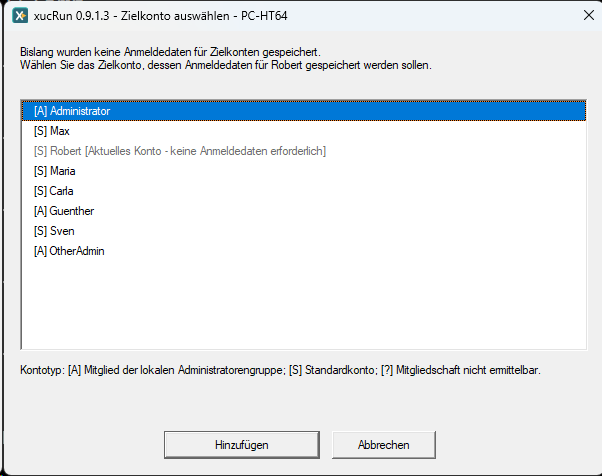

Die `:*`-Formen zeigen die lokale Zielkontoauswahl immer an, auch wenn nur ein geeignetes Konto
oder nur ein passender Anmeldedatensatz vorhanden ist. Der Dialog kennzeichnet das aktuelle Konto,
Konten mit gespeicherten xucRun-Anmeldedaten und die Mitgliedschaft in der lokalen
Administratorengruppe. Beim aktuellen Konto verwendet xucRun den vorhandenen Windows-Zugriffstoken.
Fehlen für ein anderes ausgewähltes Konto xucRun-Anmeldedaten, folgt die geschützte
Kennworteingabe; nach erfolgreicher Speicherung wird der ursprüngliche Startauftrag fortgesetzt.

Kann `/user-elevated` das aktuelle Konto nicht verwenden und findet xucRun mehrere Konten mit
gespeicherten xucRun-Anmeldedaten, die Mitglieder der lokalen Administratorengruppe sind, erscheint
die folgende Zielkontoauswahl:

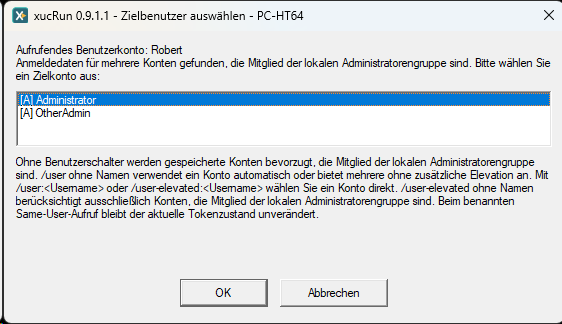

Kann `/user-elevated` das aktuelle Konto nicht verwenden und findet xucRun kein Konto mit
gespeicherten xucRun-Anmeldedaten, das Mitglied der lokalen Administratorengruppe ist, bietet
xucRun automatisch eine auf Mitglieder dieser Gruppe eingeschränkte lokale Zielkontoauswahl und
anschließend die geschützte Kennworteingabe an. Das dabei gewählte Konto wird nach erfolgreicher
Speicherung seiner Anmeldedaten als Zielkonto für den erhöhten Start verwendet.

Auch bei einem nicht erhöhten Start unter einem anderen Standardkonto kann eine auf Mitglieder der
lokalen Administratorengruppe beschränkte lokale Kontoauswahl erscheinen, wenn xucRun für diesen
Start zusätzlich die Anmeldedaten eines Kontos ausschließlich zum Öffnen des geschützten
xucRun-Freigabedialogs benötigt. Anders als die zuvor gezeigte Zielkontoauswahl ist dieser Dialog
nicht auf Konten beschränkt, für die bereits xucRun-Anmeldedaten gespeichert sind; deshalb können
zusätzliche Konten erscheinen. In diesem Fall ist das zusätzlich gewählte Konto nicht das
Zielkonto. Das Zielprogramm läuft weiterhin unter dem zuvor ausgewählten Standardkonto.

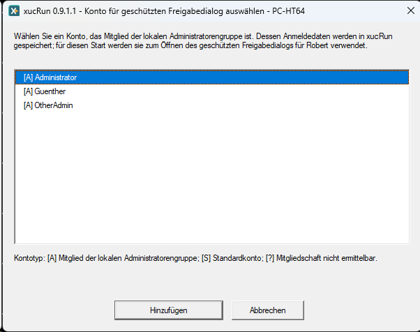

Gespeicherte Anmeldedaten ersetzen keine erforderliche Windows-UAC-Bestätigung. Einzelheiten
beschreibt
[Verhältnis zwischen xucRun-Freigaben und Windows-UAC](#verhältnis-zwischen-xucrun-freigaben-und-windows-uac).

Neben dem Start mit erhöhten Rechten unterstützt xucRun auch den umgekehrten Anwendungsfall: Ein
Programm kann ohne Erhöhung unter einem anderen, bewusst stärker eingeschränkten Konto ausgeführt
werden. Beispielsweise kann ein Programm unter einem dafür eingerichteten Standardkonto mit
engeren Datei- oder Netzwerkberechtigungen und einer eigenen benutzerbezogenen Konfiguration
ausgeführt werden. Der Prozess verwendet dabei den Windows-Zugriffstoken und das Benutzerprofil
des Zielkontos. Dies ist keine Sandbox: Die wirksamen Einschränkungen ergeben sich aus den
Gruppenmitgliedschaften, Berechtigungen und sonstigen Windows-Einstellungen des Zielkontos.

## Programme, Argumente und Sonderzeichen

Der erste Nicht-xucRun-Schalter ist das Zielprogramm. Alle folgenden Argumente gehören
ausschließlich diesem Programm:

```powershell
xucRun.exe cmd.exe /c dir
xucRun.exe /user:Administrator app.exe /config:value
```

`/c` und `/config:value` werden hier nicht von xucRun ausgewertet. Shell-interne Befehle müssen
über die jeweilige Shell gestartet werden, beispielsweise `cmd.exe /c dir` oder
`powershell.exe -Command Get-Process`.

Programmpfade und einzelne Argumente mit Leerzeichen werden wie üblich in Anführungszeichen
gesetzt. xucRun unterstützt auch Batchdateien und überträgt typische Shell-Sonderzeichen über die
zusätzlichen Prozessgrenzen. Welche Zeichen von `cmd.exe`, PowerShell oder einer anderen
aufrufenden Shell schon vor dem Start von xucRun ausgewertet werden, richtet sich weiterhin nach
dieser Shell.

Aus Sicherheitsgründen weist xucRun Zielargumente mit nicht druckbaren Steuerzeichen, etwa
Tabulatoren oder Zeilenumbrüchen, sowie mit bestimmten unsichtbaren oder bidirektionalen
Unicode-Steuerzeichen ab. Die zuvor beschriebenen Regeln für Quoting und Shell-Metazeichen gelten
unabhängig von dieser Einschränkung.

Bei einem vom xucRun-Brokerdienst – der privilegierten Komponente zur Prüfung und Ausführung
erlaubter Programmstarts – vermittelten Start einer `.bat`- oder `.cmd`-Datei, deren Dateiname eines
der CMD-Metazeichen `& | ( ) ! % ^` enthält, erzeugt der Broker einen temporären Wrapper mit dem Namen
`xucRun_wrapper_<128-Bit-Zufall>.bat`. Er legt ihn bevorzugt auf einem geeigneten Volume namens
`RamDisk` ab, andernfalls im `%TEMP%`-Verzeichnis des Zielkontos. Der Broker schützt den Wrapper bis
zum Ende des gestarteten Prozesses und versucht ihn anschließend oder bei einem fehlgeschlagenen
Start während der Fehlerbereinigung zu löschen. Bleibt er wegen eines Löschfehlers oder
unerwarteten Brokerendes zurück, kann ein lokaler Administrator ihn nach Freigabe manuell
entfernen. Eine automatische Nachbereinigung gibt es nicht; der Wrapper enthält keine
Anmeldedaten, gespeicherten Argumente oder wiederverwendbare Autorisierung.

## Nützliche Befehle

| Befehl | Zweck |
|---|---|
| `xucRun.exe /addcred [<Konto>]` | Anmeldedaten speichern |
| `xucRun.exe /deletecred [<Konto>]` | gespeicherte Anmeldedaten auswählen und löschen |
| `xucRun.exe /showcred` | Konten anzeigen, für die xucRun-Anmeldedaten gespeichert sind |
| `xucRun.exe /showapprovals` | gespeicherte Freigaben anzeigen |
| `xucRun.exe /resetapprovals[:<Konto>]` | Freigaben zurücksetzen |
| `xucRun.exe /system [<Anwendung> [Argumente...]]` | eine lokale Anwendung oder Ersatz-Shell als `LocalSystem` starten |
| `xucRun.exe /trustedinstaller [<Anwendung> [Argumente...]]` | eine lokale Anwendung oder Ersatz-Shell mit `LocalSystem`-Rechten und der TrustedInstaller-Dienstidentität starten |
| `xucRun.exe /info` | Version, Copyright, Signierzertifikat, Brokerstatus und aktuelle Konfiguration anzeigen |
| `xucRun.exe /admin-status` | Daten aller Windows-Benutzer erhöht anzeigen und verwalten |
| `xucRun.exe /backup` | lokale Datensicherungen verwalten |
| `xucRun.exe /audit` | Sicherheitsdiagnose ausführen |
| `xucRun.exe /enable-broker` | einen deaktivierten Broker wieder aktivieren |
| `xucRun.exe /clear-all` | gespeicherte Anmeldedaten, Freigaben, in geschützten xucRun-Dialogen angezeigte benutzerbezogene Merkmale und zugehörige Metadaten löschen |
| `xucRun.exe /help` | vollständige Hilfe anzeigen |

`/hidden` verbirgt das unmittelbar gestartete Zielprogramm. `/hidden-monitor` überwacht zusätzlich
dessen Exitcode und zeigt bei einem Fehler einen Hinweis. Dialoge und Kindprozesse werden dadurch
nicht verborgen oder überwacht.

`xucRun.exe` verwendet Exitcode `0` für einen erfolgreichen Vorgang und Exitcode `1`, wenn der
Vorgang fehlschlägt, abgelehnt oder abgebrochen wird. Der Exitcode eines gestarteten Zielprogramms
wird nicht als Exitcode von `xucRun.exe` zurückgegeben.

### Anwendung oder Ersatz-Shell als LocalSystem oder TrustedInstaller starten

`xucRun.exe /system [<Anwendung> [Argumente...]]` startet die angegebene lokale Anwendung unter
dem Windows-Konto `LocalSystem` in der interaktiven Sitzung des Aufrufers.
`xucRun.exe /trustedinstaller [<Anwendung> [Argumente...]]` startet sie mit `LocalSystem`-Rechten
und zusätzlich der wirksamen Dienstidentität `NT SERVICE\TrustedInstaller`.

Beide Modi stehen nur Mitgliedern der lokalen Administratorengruppe zur Verfügung. Ein noch nicht
erhöht gestarteter Administrator erhält eine Windows-UAC-Abfrage; ein bereits erhöhter
Administrator führt den Start ohne weitere UAC-Abfrage aus. Standardbenutzer werden vor einer
Erhöhungsanforderung abgewiesen. Das erhöhte Konto, das Mitglied der lokalen
Administratorengruppe ist, darf vom in der interaktiven Sitzung angemeldeten Konto abweichen;
beide Modi können deshalb auch aus einer erhöhten Ersatz-Shell in der Sitzung eines anderen
Benutzers aufgerufen werden.

Ohne Anwendung ersetzen beide Modi eine aufrufende TCC-, Eingabeaufforderungs-, Windows-
PowerShell- oder PowerShell-Core-Shell durch denselben Shelltyp unter der gewählten Identität.
Das aktuelle Arbeitsverzeichnis bleibt erhalten, die neue Shell wird in den Vordergrund gebracht
und die bisherige Shell erst nach dem bestätigten und erfolgreichen Ersatzstart geschlossen.
Unbekannte Eltern-Shells werden abgewiesen.

Keiner der beiden Modi verwendet gespeicherte Anmeldedaten oder Freigaben: `LocalSystem` und
`TrustedInstaller` sind keine Benutzerkonten mit Kennwort, und eine gespeicherte Freigabe würde
jedem späteren Start derselben Programmdatei unbemerkt vollständige Systemkontrolle gewähren.
Jeder Aufruf muss deshalb separat im signierten xucRun-Freigabehelper bestätigt werden, der die
geschützten Bestätigungsdialoge anzeigt. Der Dialog erscheint auf dem geschützten privaten
xucRun-Desktop und zeigt die genaue Programmdatei, alle Argumente und das Arbeitsverzeichnis; bei
`/trustedinstaller` ergänzt er eine besondere Warnung vor Änderungen geschützter Windows-Dateien
und Registrierungseinträge. Die Bestätigung gilt nur für diesen einen Aufruf, kann nicht
gespeichert werden und autorisiert das gewählte Programm für seine gesamte Laufzeit,
einschließlich Bedienhandlungen und Kindprozessen, die seinen privilegierten Kontext erben oder
anderweitig verwenden. Ein Dateimanager, Registrierungs-Editor, eine Shell oder ein
Skriptinterpreter ermöglicht deshalb sehr weitreichende Systemkontrolle. xucRun prüft die
Programmdatei unmittelbar vor dem Start erneut.

| Bestätigung für `/system` | Bestätigung für `/trustedinstaller` mit besonderer Warnung |
|:---:|:---:|
| 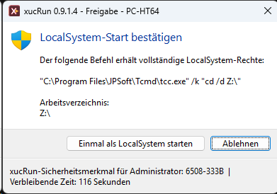 | 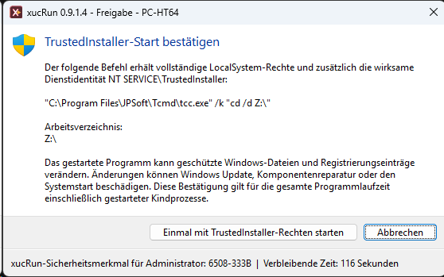 |

Der private Desktop schützt die Bestätigung vor normalen Anwendungen auf dem normalen Desktop. Er
kann jedoch nicht vor Schadsoftware schützen, die bereits mit erhöhten Administratorrechten in
derselben Anmeldesitzung ausgeführt wird. Verwenden Sie beide Modi deshalb nur aus einer
vertrauenswürdigen erhöhten Administratorsitzung.

Als `LocalSystem` ausgeführte Anwendungen besitzen weitreichende Kontrolle über den Rechner.
Insbesondere bezeichnet `HKEY_CURRENT_USER` das Profil von `LocalSystem` und nicht das Profil des
angemeldeten Benutzers.

TrustedInstaller ist keine allgemeine Berechtigungsstufe oberhalb von `LocalSystem`. Dieser Modus
verbindet `LocalSystem`-Rechte mit der TrustedInstaller-Dienstidentität und ermöglicht
zusätzlichen Zugriff daher nur auf Objekte, für die Windows dieser Identität entsprechende Rechte
gewährt. Ist der benötigte Windows-Dienst gestoppt, darf xucRun ihn starten, verändert aber weder
seine Startkonfiguration noch beendet es ihn anschließend. Ein so gestarteter Dienst läuft
deshalb zunächst weiter und beendet sich üblicherweise selbst, sobald Windows ihn nicht mehr
benötigt; ein bereits gestartetes Programm behält seine Rechte davon unabhängig. Kann xucRun die
erforderliche TrustedInstaller-Identität nicht herstellen, schlägt der Start fehl; es gibt keinen
Rückfall auf einen normalen `/system`-Start.

```cmd
xucRun.exe /system "C:\Windows\regedit.exe" /m
xucRun.exe /trustedinstaller "C:\Windows\regedit.exe"
```

Verwenden Sie beide Modi nur bewusst für Wartung und Diagnose. Die TrustedInstaller-Identität
macht manuelle Änderungen nicht zu unterstützter Windows-Komponentenwartung. Änderungen an
geschützten Dateien oder Registrierungsdaten können den Komponentenstore inkonsistent machen oder
Windows Update, Komponentenreparatur beziehungsweise Systemstart beschädigen. Verwenden Sie
Windows Update oder einen anderen dokumentierten Windows-Wartungsweg, wenn ein solcher existiert.

## Anmeldedaten und Freigaben verwalten

`/showcred` zeigt die Zielkonten, für die xucRun-Anmeldedaten gespeichert sind. `/showapprovals`
zeigt die aktiven Freigaben in getrennten Spalten für Umfang, Ziel und Aufrufbindung. Die
gespeicherten Kennwörter werden nicht angezeigt oder an den normalen xucRun-Client `xucRun.exe`
übertragen. Die verfügbaren Freigabeumfänge und ihre genaue Wirkung beschreibt der Abschnitt
[Freigabedialog, Dauer und Umfang](#freigabedialog-dauer-und-umfang).

In der Freigabenansicht öffnet ein Doppelklick auf eine Zeile oder **Details anzeigen...** in deren
Kontextmenü alle anwendbaren, nicht leeren Felder in einer schreibgeschützten, markierbaren Ansicht
zum Kopieren. Die Details enthalten den vollständigen SHA-256-Hash des Zielprogramms, sofern
vorhanden. Bei einer Freigabe für ein bestimmtes Zielkonto zeigen sie außerdem dessen SID, damit
sich das Konto eindeutig identifizieren lässt. Eine Freigabe für alle Zielkonten besitzt keine
einzelne Zielkonto-SID; deshalb wird dieses Feld dort nicht angezeigt.

In der Anmeldedatenansicht stellt **Details anzeigen...** dieselben kopierbaren Informationen zum
Zielkonto einschließlich seiner SID bereit. Ein Doppelklick auf ein Zielkonto mit Freigaben öffnet
die für dieses Konto geltenden Freigaben. Das Kontextmenü bietet dieselbe Aktion; für Zeilen ohne
Freigaben ist sie deaktiviert.

Löschaktionen bleiben ausschließlich auf den sichtbaren Schaltflächen unterhalb der Tabellen. In
beiden Ansichten kann die ausgewählte Zeile gelöscht werden. Die Anmeldedatenansicht kann außerdem
alle angezeigten Anmeldedaten löschen; deren kontogebundene Freigaben werden dabei mit entfernt,
während profilweite Freigaben für alle Zielkonten des aktuellen Windows-Benutzers gespeichert
bleiben. Die Freigabenansicht kann alle angezeigten Freigaben löschen. Jeder Löschvorgang verlangt
eine eigene Bestätigung; ohne markierte Zeile bleibt die Einzelaktion deaktiviert.

### Gespeicherte Anmeldedaten

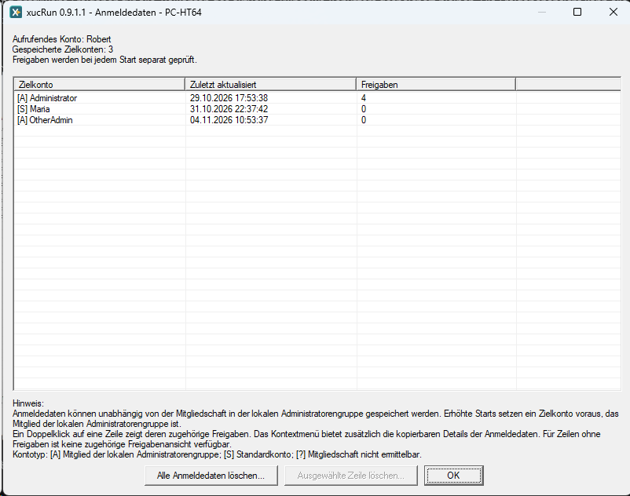

### Aktive Freigaben

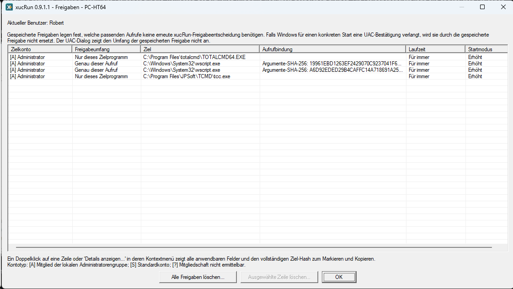

Ohne Kontonamen zeigt `/deletecred` eine Auswahl und verlangt vor der Löschung eine Bestätigung.
Beim Löschen eines Kontos entfernt xucRun auch dessen kontogebundene Freigaben. Profilweite
Freigaben für alle Konten bleiben bestehen.

Mit `/resetapprovals` können einzelne oder mehrere Freigaben ausgewählt und entfernt werden.
`/clear-all` ist der administrative Bereinigungsbefehl für aktive, vom Broker verwaltete Daten. Der
Befehl muss erhöht gestartet werden und löscht nach ausdrücklicher Bestätigung alle
xucRun-Anmeldedaten, Freigaben, in geschützten xucRun-Dialogen angezeigten benutzerbezogenen
Merkmale und zugehörigen Metadaten aller Windows-Benutzer dieses Rechners. Lokale Sicherungen
bleiben erhalten und können separat mit `/backup-delete-all` gelöscht werden.

| Gespeicherte Anmeldedaten löschen | Freigaben zurücksetzen |
|:---:|:---:|
| 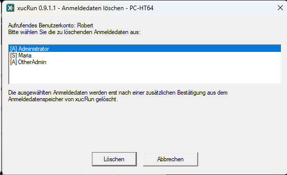 | 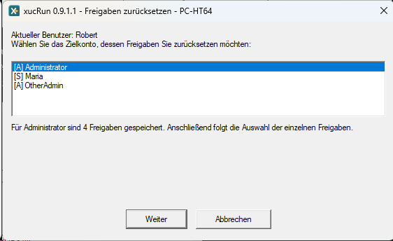 |

Für eine rechnerweite Übersicht zeigt `/admin-status` die gespeicherten xucRun-Daten aller
Windows-Benutzer und stellt die verfügbaren administrativen Bereinigungsaktionen bereit. Ein
Doppelklick auf eine Zeile oder **Details anzeigen...** in deren Kontextmenü öffnet die anwendbaren,
nicht leeren Anmeldedaten- oder Freigabefelder zum Markieren und Kopieren. Bei Anmeldedaten und
Freigaben für ein bestimmtes Zielkonto zeigen die Details außerdem die Zielkonto-SID, damit sich
das Konto eindeutig identifizieren lässt. Freigabedetails enthalten zusätzlich den vollständigen
Zielhash, sofern vorhanden.

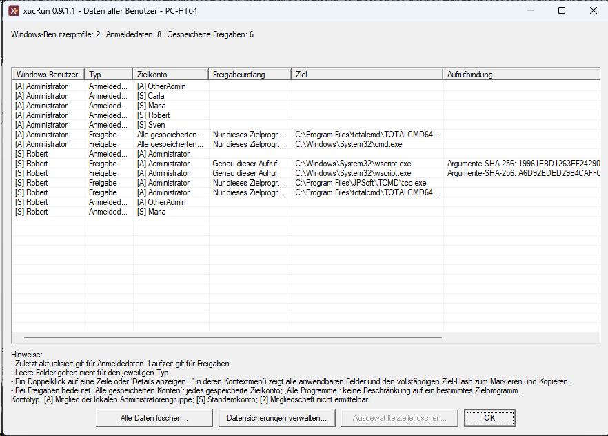

## Motivation und Zweck

Die vorangegangenen Abschnitte zeigen, wie xucRun einzelne Programme, Befehle und Skripte unter
einem ausgewählten Konto und, soweit anwendbar, mit erhöhten Rechten ausführt. Die Motivation für
diesen Ablauf ist die bewusste tägliche Arbeit mit einem Standardkonto, verbunden mit einem
praktikablen Zugriff auf gelegentliche administrative Aufgaben.

xucRun richtet sich an erfahrene Windows-Anwender, die ihren eigenen Rechner interaktiv oder
mithilfe eigener Skripte administrieren. Erreicht eine Anwendung oder ein Dateimanager eine
Berechtigungsgrenze, soll der Anwender die konkrete Aufgabe fortsetzen können, ohne sich dafür in
einer separaten Administratorsitzung anzumelden und ohne bei jedem passenden Vorgang Kontoname und
Kennwort erneut einzugeben. Nach der einmaligen Einrichtung soll dafür normalerweise eine einzige
Bestätigung per Mausklick genügen.

Vor dem ersten Aufruf müssen nicht alle Voraussetzungen vollständig eingerichtet sein. Der
Anwender kann den gewünschten Programmstart unmittelbar anfordern; xucRun fragt eine noch fehlende
Kontoauswahl, Anmeldedaten oder Freigabe im laufenden Aufruf ab. Passende Anmeldedaten und
Freigaben können anschließend bei späteren Aufrufen wiederverwendet werden.

Windows stellt die zugrunde liegenden Möglichkeiten zum Starten von Programmen unter einem anderen
Konto und zum Anfordern administrativer Rechte bereits bereit. Der Zweck von xucRun besteht darin,
sie in einem Ablauf zu verbinden und um kontrollierte Freigaben für gespeicherte Anmeldedaten zu
ergänzen. Dieser Komfort bringt zusätzliche Risiken mit sich. Wer Anmeldedaten nicht speichern und
wiederverwenden möchte, sollte stattdessen Windows-eigene Alternativen wie den schnellen
Benutzerwechsel nutzen.

Über diesen Kernablauf hinaus sind die zusätzlichen Startmodi für `LocalSystem` und die
TrustedInstaller-Dienstidentität für gezielte Wartungs- und Diagnoseaufgaben vorgesehen. Sie
erweitern die Möglichkeiten von xucRun, sind aber weder sein Ausgangspunkt noch sein gewöhnlicher
Anwendungsfall.

Wie sich dieser Ansatz von Windows-UAC, `runas`, Windows Sudo und anderen Lösungen unterscheidet,
beschreibt der folgende Abschnitt.

## Vergleich mit Windows-Funktionen und anderen Lösungen

Die folgenden Möglichkeiten überschneiden sich mit einzelnen Teilen des zuvor beschriebenen
Ablaufs, verwenden aber unterschiedliche Konto-, Sitzungs-, Anmeldedaten- und Freigabemodelle.

### Schneller Benutzerwechsel

Beim schnellen Benutzerwechsel bleibt die bisherige Windows-Sitzung mit ihren geöffneten Programmen
erhalten, während sich der Anwender unter einem anderen Benutzerkonto in einer separaten Sitzung
anmeldet oder in dessen bereits geöffnete Sitzung wechselt. Anschließend kann er in die bisherige
Sitzung zurückkehren. Dieser Weg ist auch dann sinnvoll, wenn eine vollständige interaktive
Arbeitsumgebung des anderen Benutzers benötigt wird.

Gegenüber dem schnellen Benutzerwechsel bleibt der Anwender mit xucRun in seiner aktuellen Sitzung
und startet nur das benötigte Programm unter dem gewählten anderen Benutzerkonto, mit oder ohne
erhöhte Rechte.

### Windows-UAC und Windows Sudo

Die Windows-Benutzerkontensteuerung (User Account Control, UAC) ist die Windows-Sicherheitsfunktion,
über die ein Benutzer den Start mit Administratorrechten ausdrücklich bestätigt. Abhängig vom
konkreten Startpfad und der Windows-Konfiguration kann auch ein Kontowechsel mit xucRun eine
UAC-Bestätigung erfordern; das Zusammenspiel beschreibt der Abschnitt
[Verhältnis zwischen xucRun-Freigaben und Windows-UAC](#verhältnis-zwischen-xucrun-freigaben-und-windows-uac).

[Windows Sudo](https://learn.microsoft.com/windows/advanced-settings/sudo/) startet aus einer
nicht erhöhten Konsole einen einzelnen Prozess über Windows-UAC mit Administratorrechten. Die
aktuelle Implementierung setzt dafür ein bereits administratives Konto voraus; ein
Standardbenutzer kann Windows Sudo nicht verwenden, und ein anderes Zielkonto lässt sich derzeit
nicht auswählen. Das verbreitete Unix/Linux-`sudo` kann mit der `sudoers`-Policy erfolgreiche
Authentifizierungen abhängig von
[`timestamp_timeout` und `timestamp_type`](https://www.sudo.ws/docs/man/sudoers.man/#User_Authentication)
zeitlich begrenzt wiederverwenden. Microsoft dokumentiert für Windows Sudo derzeit keinen
entsprechenden Timestamp-Mechanismus; jeder Aufruf führt über UAC.

Für die einmalige Erhöhung aus einer nicht erhöhten Konsole unter einem vorhandenen Konto, das
Mitglied der lokalen Administratorengruppe ist, ist Windows Sudo die Windows-eigene Möglichkeit.
xucRun behandelt zusätzlich den Anwendungsfall, Programme aus einem Standardkonto unter einem
anderen lokalen Konto mit gespeicherten Anmeldedaten und einmaligen oder zeitlich begrenzbaren
Freigaben zu starten. Wenn Windows für den Zielprogrammstart eine UAC-Bestätigung verlangt, bleibt
diese interaktiv.

### `runas.exe /savecred`

Eine weitere Windows-eigene Möglichkeit, die mehr Ähnlichkeit mit xucRun hat, ist
[`runas.exe`](https://learn.microsoft.com/windows-server/administration/windows-commands/runas).
Damit lassen sich einzelne Programme gezielt unter einem anderen Benutzerkonto starten. Mit dem
Parameter `/savecred` werden die dafür verwendeten Anmeldedaten nach der ersten Kennworteingabe in
der Windows-Anmeldeinformationsverwaltung des angemeldeten Benutzers gespeichert. Danach kann
`runas.exe` Programme wiederholt unter einem anderen Benutzerkonto starten, ohne das Kennwort
erneut abzufragen. Bei der Verwendung von `runas.exe` bestehen jedoch einige Einschränkungen:

- Das Zielkonto muss bei jedem Aufruf mit `/user:<Konto>` angegeben werden. Sein Name steht damit
  je nach Verwendung in Skripten, Verknüpfungen oder auf der Kommandozeile.
- `runas.exe` fordert keine Erhöhung über UAC an. Abhängig von der Windows-UAC-Konfiguration kann
  ein Konto, das Mitglied der lokalen Administratorengruppe ist, nur mit eingeschränkten Rechten
  starten, solange die Erhöhung nicht gesondert angefordert wird.
- Nach `/savecred` kann das Konto, dessen Anmeldedaten gespeichert wurden, ohne erneute Bestätigung
  für weitere Programmstarts verwendet werden. Dabei gibt es keine obligatorische Freigabe und
  keine Bindung an bestimmte Programme, Dateihashes, Argumente oder Arbeitsverzeichnisse.
- `runas.exe` wählt nicht automatisch ein geeignetes Konto aus, dessen Anmeldedaten mit
  `/savecred` gespeichert wurden, und bietet keine integrierte Verwaltung unterschiedlich
  weitreichender oder zeitlich begrenzter Freigaben.
- `runas.exe` reagiert empfindlich auf komplexe Programmpfade, Argumente und Sonderzeichen. Bei der
  Verwendung in Skripten oder Verknüpfungen können durch eine zusätzliche Shell oder ein
  Elevationswerkzeug weitere Parsing- und Quoting-Ebenen hinzukommen. Dadurch steigt die
  Fehleranfälligkeit besonders dann, wenn dem erhöht auszuführenden Programm komplexe Argumente
  oder Argumente mit Sonderzeichen übergeben werden müssen.

xucRun greift die Idee gespeicherter und wiederverwendbarer Anmeldedaten von `runas.exe` auf und
ergänzt sie um kontrollierte Freigaben. Es lässt sich in Skripten, Desktop-Verknüpfungen und
anderen fest konfigurierten Aufrufen ebenso wie bei interaktiven Aufrufen über die Kommandozeile
verwenden. Der Start unter einem anderen Benutzerkonto, gespeicherte Anmeldedaten und eine bei
Bedarf weiterhin interaktive Erhöhung über UAC werden dabei in einem Werkzeug zusammengeführt.
Sind passende Anmeldedaten gespeichert, muss der Aufruf weder Zielkonto noch Kennwort enthalten.
Programmpfade, Argumente, Arbeitsverzeichnisse, Batchdateien und typische Shell-Sonderzeichen
werden kontrolliert über die notwendigen Prozessgrenzen hinweg behandelt.

Für den unter [Anwendungsbeispiele](#anwendungsbeispiele) gezeigten Gerätemanager-Aufruf könnte das
schematische Gegenstück mit `runas.exe /savecred` und einem separaten Elevationswerkzeug
beispielsweise so aussehen, wenn dieses Werkzeug die Syntax
`elevate.exe <Programm> [Argumente ...]` unterstützt:

```cmd
runas.exe /savecred /user:Administrator "elevate.exe C:\Windows\System32\mmc.exe C:\Windows\System32\devmgmt.msc"
```

Die genaue Syntax hängt vom gewählten Elevationswerkzeug ab. In der Werkzeugkette muss der
Kontoname im Aufruf stehen und die gesamte nachgelagerte Befehlszeile als ein Argument an
`runas.exe` übergeben werden. xucRun benötigt im Hauptanwendungsfall keinen Kontonamen und hält
Programm und Argumente in einem gemeinsamen Aufruf getrennt.

Ein Beispiel mit komplexeren Argumenten ist das Anlegen einer Firewallregel für ein Programm,
dessen Pfad Leerzeichen enthält:

```cmd
xucRun.exe "C:\Windows\System32\netsh.exe" advfirewall firewall add rule name="Lokaler Beispielserver" dir=in action=allow program="C:\Program Files\Beispielserver\server.exe" enable=yes profile=private
```

Dabei erhält `netsh.exe` mehrere Schlüssel-Wert-Argumente sowie einen Regelnamen und einen
Programmpfad mit Leerzeichen. Eine Werkzeugkette aus `runas.exe` und einem separaten
Elevationswerkzeug wäre daher deutlich komplizierter; ihre zuverlässige Verwendung mit
Sonderzeichen hinge außerdem vom konkreten Elevationswerkzeug und dessen Quoting-Regeln ab.

Nach der erstmaligen Kennworteingabe kann `runas.exe /savecred /user:Administrator` dasselbe Konto,
dessen Anmeldedaten gespeichert wurden, auch für andere Programme verwenden, ohne erneut das
Kennwort oder eine obligatorische Bestätigung anzufordern. xucRun verlangt dagegen eine passende
ausdrückliche Freigabe, bevor gespeicherte Anmeldedaten verwendet werden.

`runas.exe /savecred` und xucRun verwenden voneinander getrennte, nicht kompatible Speicherungen
für Anmeldedaten. Eine xucRun-Freigabe kann eng an das aufrufende Benutzerkonto, das Zielkonto, die
beteiligten Programme und deren Dateihashes gebunden sowie zeitlich begrenzt werden. Ändert sich
eines der gebundenen Programme, passt dessen SHA-256-Hash nicht mehr zur Freigabe. Vor einer
Übernahme der Freigabe auf die geänderte Programmversion verlangt xucRun eine ausdrückliche
Entscheidung.

### Lösungen anderer Anbieter und Wahl des Ansatzes

Neben den Windows-eigenen Möglichkeiten gibt es Lösungen anderer Anbieter für Benutzerwechsel,
Rechteerhöhungen und die Verwaltung administrativer Zugriffe. Sie setzen je nach Anwendungsfall
andere Schwerpunkte und können zum Beispiel für zentrale Administration, verwaltete
Unternehmensumgebungen oder unbeaufsichtigte Automatisierung besser geeignet sein.
Eine Aufzählung einzelner Produkte wäre zwangsläufig unvollständig und könnte
durch die Auswahl unbeabsichtigt Schwerpunkte setzen. Zudem wäre sie rasch veraltet und wegen
unterschiedlicher Einsatz- und Sicherheitsmodelle nur eingeschränkt vergleichbar.

Die passende Lösung richtet sich nach den jeweiligen Anforderungen.

Wer aus einem Standardbenutzerkonto heraus Programme unter einem anderen Benutzerkonto starten
möchte und bereit ist, dessen Anmeldedaten bei jedem Start erneut einzugeben, kann dafür die
Windows-eigenen Mechanismen verwenden.

Wer dagegen wiederholte Kennworteingaben vermeiden und genauer als mit `runas /savecred`
kontrollieren möchte, welche Programme gespeicherte Anmeldedaten und administrative Rechte
verwenden dürfen, für den bietet xucRun eine frei verfügbare Lösung.

## Freigaben und Windows-UAC

### Verhältnis zwischen xucRun-Freigaben und Windows-UAC

Wenn das aktuelle Windows-Konto Mitglied der Administratorengruppe ist, verwendet xucRun dieses
Konto standardmäßig auch für das gestartete Programm. Falls das Konto noch nicht erhöht ist,
fordert Windows die Zustimmung über die Benutzerkontensteuerung (UAC) an. In diesem Fall zeigt
xucRun keinen eigenen Freigabedialog; die Zustimmung erfolgt ausschließlich über Windows-UAC.

xucRun-Programmfreigaben gelten für Starts mit den gespeicherten Anmeldedaten eines anderen
Kontos. Im vorgesehenen Ablauf aus einem nicht erhöhten Standardbenutzerkonto bleibt ein
erforderlicher Kontowechsel beziehungsweise eine erforderliche Rechteerhöhung interaktiv. Bei
einem Start ohne Erhöhung kann UAC über den xucRun-Freigabehelper die Anwesenheit des Benutzers
bestätigen; das Zielprogramm läuft danach mit den nicht erhöhten Rechten des Zielkontos. Bei einer
Erhöhung kann UAC stattdessen den Start des Zielprogramms bestätigen und ihm die angeforderten
Administratorrechte erteilen. Welche UAC-Abfrage Windows tatsächlich zeigt, hängt vom konkreten
Startpfad und der Windows-Konfiguration ab.

Eine passende wiederverwendbare Freigabe verhindert nur einen erneuten xucRun-Freigabedialog. Sie
ersetzt keine für den konkreten Start erforderliche Windows-UAC-Bestätigung. Beide Entscheidungen
haben unterschiedliche Aufgaben: xucRun prüft, ob der Aufruf zur gespeicherten Freigabe passt;
Windows-UAC bestätigt, soweit erforderlich, den konkreten Start beziehungsweise die
Rechteerhöhung.

Der Windows-UAC-Dialog zeigt nicht an, welche xucRun-Freigabe verwendet wird, wie lange sie gilt
oder ob sie an den genauen Aufruf, ein Zielprogramm oder alle Programme gebunden ist. Diese
Reichweite ist beim Anlegen der Freigabe im xucRun-Freigabedialog und später in der
Freigabenverwaltung sichtbar.

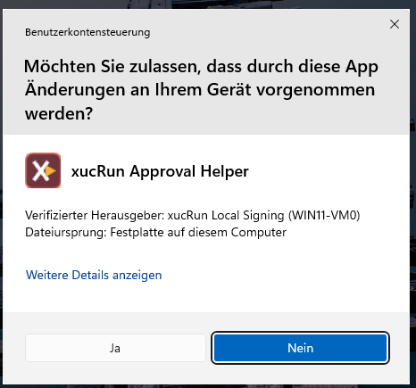

Auch ein Start unter einem anderen Standardkonto kann eine solche UAC-Anwesenheitsbestätigung
erfordern; das dafür verwendete Konto der lokalen Administratorengruppe dient dann nur zum Öffnen
des Dialogs, wie unter [Kontowahl und Rechtemodus](#kontowahl-und-rechtemodus) beschrieben.

Ist keine passende Freigabe aktiv, erscheint der xucRun-Freigabedialog auf einem separaten
Windows-Desktop. Im vorgesehenen Ablauf trennt Windows diesen Desktop von normalen, nicht erhöhten
Programmen. Kann xucRun ihn dort nicht öffnen, wird der Vorgang abgebrochen. Für eine erhöht
auszuführende, vom Aufrufer beschreibbare Startdatei ist bei jedem Start eine einmalige
Risikobestätigung erforderlich; ist auch ihr Verzeichnis beschreibbar, blockiert xucRun den
erhöhten Start.

Der Abschnitt [Kontowahl und Rechtemodus](#kontowahl-und-rechtemodus) beschreibt, wie xucRun das
Konto bestimmt, fehlende Anmeldedaten abfragt und Starts mit und ohne Erhöhung unterscheidet.
Unabhängig vom gewählten Ablauf bleibt UAC interaktiv; **xucRun ist kein Mechanismus für
unbeaufsichtigte Rechteerhöhung.**

Kontoauswahl sowie Verwaltungs-, Informations- und Fehlerdialoge erscheinen auf dem normalen
Benutzerdesktop. Kennworteingaben, Freigabeentscheidungen und Risikobestätigungen zeigt xucRun auf
einem separaten Windows-Desktop; Windows-UAC verwendet davon getrennt den konfigurierten
UAC-Desktop.

Beim ersten solchen Dialog erzeugt xucRun für das aufrufende Windows-Benutzerkonto ein
zufälliges Sicherheitsmerkmal im Format `XXXX-XXXX`. Kennwort-, Freigabe- und Risikodialoge zeigen
es anschließend unverändert an. Nach der Prüfung der Installationsdatei sollte der Benutzer es
beim bewusst ausgelösten ersten Dialog einprägen oder geschützt notieren und spätere Dialoge nur
bei Übereinstimmung bestätigen. Das Merkmal weist auf einen Dialog des xucRun-Freigabehelpers hin, beweist aber
weder die Ungefährlichkeit noch den Ursprung einer Operation. Es bietet keinen vollständigen
Schutz auf einem kompromittierten System und hilft nur, wenn der Benutzer es tatsächlich
vergleicht.

### Freigabedialog, Dauer und Umfang

**Mit jeder Freigabe legt der Anwender das Verhältnis zwischen Bedienkomfort und enger Begrenzung
selbst fest:** Je länger und weiter eine Freigabe gilt, desto mehr passende spätere Aufrufe kommen
ohne erneute xucRun-Freigabeentscheidung aus. Eine kürzere oder genauer an Programm, Aufruf und
Zielkonto gebundene Freigabe verlangt häufiger eine neue Entscheidung, begrenzt dafür aber ihre
Wiederverwendung.

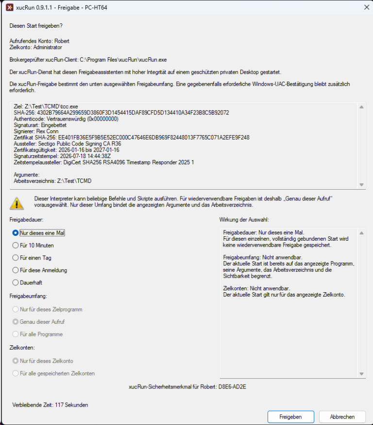

Der differenzierte Freigabedialog ermöglicht es, Freigabedauer, Programm- und Aufrufbindung sowie
die einbezogenen Zielkonten an den konkreten Anwendungsfall und das gewünschte Schutzniveau
anzupassen. Sein fester Kopfbereich oberhalb der scrollbaren Aufrufdetails kennzeichnet den
angezeigten xucRun-Clientpfad als erfolgreich vom Broker geprüft und zeigt aufrufendes Konto,
Zielkonto und geschützte Herkunft des xucRun-Freigabehelpers vor dem erläuternden UAC-Hinweis. Der
Scrollbereich zeigt ausführliche Authenticode-Informationen für das Zielprogramm. Bei einer
vertrauenswürdigen Zielsignatur umfassen sie Signierer, vollständigen
SHA-256-Zertifikatfingerabdruck, Aussteller, Zertifikatsgültigkeit, Signaturart sowie einen
vorhandenen Signaturzeitstempel und dessen Aussteller. Schlägt die Vertrauensprüfung fehl,
unterscheidet der Dialog eine fehlende Signaturzuordnung von häufigen Signatur-,
Zertifikatsketten-, Gültigkeits-, Widerrufs- und Richtlinienfehlern. Eine fehlende Zuordnung
bedeutet, dass keine auswertbare eingebettete Signatur und keine zum aktuellen Dateiinhalt passende
Windows-Katalogsignatur gefunden wurde. Eine Katalogsignatur ordnet die Datei über ihren Hash zu;
jede Byteänderung hebt diese Zuordnung auf, obwohl der Katalog und sein Zertifikat auf dem System
weiterhin existieren und der geänderten Datei nicht mehr zugerechnet werden dürfen. Der Dialog
zeigt außerdem Signierer- und Zertifikatsdetails an, die Windows für eine nicht vertrauenswürdige
Signatur noch bereitstellt. xucRun erkennt dabei sowohl direkt eingebettete
Authenticode-Signaturen als auch Windows-Katalogsignaturen. Ein unsigniertes oder nicht
vertrauenswürdiges Ziel bleibt freigebbar, weil die Signaturinformation die genaue Pfad- und
SHA-256-Identität ergänzt, aber nicht ersetzt. Als Freigabedauer stehen zur Verfügung:

- nur dieser eine Start,
- 10 Minuten,
- ein Tag,
- bis zur Abmeldung,
- dauerhaft.

Unterscheidet sich der aktuelle Start von bereits für dasselbe Zielprogramm gespeicherten
Freigaben, fassen die scrollbaren Details bis zu vier der relevantesten Freigaben zusammen und
nennen die abweichenden Bindungen, etwa Programmdatei, Zielkonto, Erhöhungsmodus, Argumente,
Arbeitsverzeichnis, Sichtbarkeit oder direktes Skript. Der Bereich „Wirkung der Auswahl“ erklärt,
ob die neue Auswahl eine separate Freigabe ergänzt, bestehende Freigaben erweitert, eine ansonsten
identische Freigabe mit anderem Erhöhungsmodus ersetzt oder weiterhin von einer weiterreichenden
Freigabe überlagert wird. Bestehende engere oder weiterreichende Freigaben werden nicht automatisch
gelöscht; `/showapprovals` bleibt die vollständige Verwaltungsansicht. Argumente werden nicht im
Klartext rekonstruiert oder angezeigt.

Bei „Nur dieses eine Mal“ gelten Freigabeumfang und Zielkontenauswahl nicht, weil die Freigabe
ausschließlich für den aktuell angezeigten Start gilt. Die betreffenden Auswahlfelder sind deshalb
deaktiviert. Eine wiederverwendbare Freigabe kann an ein bestimmtes Programm oder an alle Programme
sowie an ein bestimmtes Zielkonto oder an alle gespeicherten Konten des aktuellen Windows-Benutzers
gebunden werden. Programmspezifische Freigaben berücksichtigen den SHA-256-Hash der Startdatei.
Besitzt die Startdatei an einem freigegebenen Pfad einen anderen Hash, etwa nach einem
Programmupdate, verwendet xucRun die vorhandene Freigabe nicht automatisch weiter. Der Dialog
zeigt den alten und den neuen Hash sowie die betroffenen vorhandenen Freigaben. Der Anwender kann
die Änderung für das aktuelle Zielkonto oder für alle Zielkonten übernehmen, für die betroffene
Freigaben gelten. Beim Abbrechen bleiben die vorhandenen Freigaben unverändert und der aktuelle
Start wird abgelehnt. Die Übernahme erfasst auch Freigaben **„Genau dieser Aufruf“**; deren
Bindungen an Argumente, Arbeitsverzeichnis, Sichtbarkeit und direkt erkannte Skripte bleiben
unverändert.

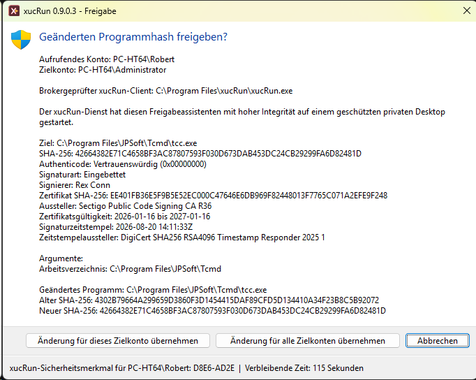

Mit **„Genau dieser Aufruf“** kann eine wiederverwendbare Freigabe zusätzlich an die exakten
Argumente, das Arbeitsverzeichnis und daran gebunden werden, ob das Programm sichtbar oder
verborgen gestartet wird. Schon eine Änderung dieser Werte erfordert dann eine neue Freigabe. Die
Argumente werden dabei nicht im Klartext gespeichert, sondern nur durch ihren SHA-256-Hash
gebunden.

Eine Freigabe begrenzt nicht die Fähigkeiten des gestarteten Programms. Allgemeine oder dauerhafte
Freigaben für universelle Interpreter wie `cmd.exe`, PowerShell oder `wscript.exe` sind deshalb
besonders weitreichend.

Bei `cmd.exe`, `powershell.exe`, `pwsh.exe`, TCC und Windows Script Host weist der Freigabedialog
deshalb auf die weiterreichenden Fähigkeiten des Interpreters hin. Eine normale
Programmfreigabe bindet die angezeigten Argumente nicht. Deshalb ist bei diesen Shells und
Interpretern für eine wiederverwendbare Freigabe „Genau dieser Aufruf“ vorausgewählt.

Wird eine wiederverwendbare Freigabe für einen dieser Interpreter dennoch auf „Nur für dieses
Zielprogramm“ oder „Für alle Programme“ geändert, verlangt xucRun auf dem geschützten Desktop eine
zweite ausdrückliche Bestätigung. Sie erklärt, dass Argumente, Skriptpfade und Skriptinhalte nicht
Teil der gespeicherten Freigabe sind und später andere Befehle oder neue beziehungsweise veränderte
Skripte ohne erneuten xucRun-Freigabedialog gestartet werden können. „Zurück zur Auswahl“ ist die
Vorgabe. Eine bewusst gespeicherte weitreichende Freigabe behält diese Wirkung, wenn sie auf einen
späteren Aufruf passt.

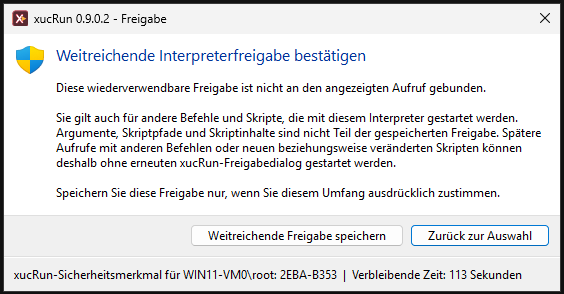

Erkennt xucRun dabei ein direkt angegebenes PowerShell-, Batch-, TCC- oder
Windows-Script-Host-Skript, bindet es dessen vollständig aufgelösten Pfad und SHA-256-Hash
zusätzlich, sofern das aufrufende Konto keinen für den Austausch relevanten Ordner verändern kann.
Die Skriptdatei selbst darf beschreibbar sein: Ändert sich ihr Inhalt später, passt ihr Hash nicht
mehr und xucRun verlangt eine neue Freigabe. Unmittelbar vor jedem Start prüft der Broker finalen
Pfad und Hash erneut und hält die geprüfte Datei bis zum Programmstart gegen Änderung und
Austausch gesperrt. Eine aktive Skriptbindung ist daran erkennbar, dass oben im Freigabedialog
das direkte Skript mit Pfad und SHA-256-Hash angezeigt wird. Der Dialog zeigt außerdem dieselben
Authenticode- und Zertifikatsdetails für das direkte Skript. Diese Information setzt keine
Skriptsignatur voraus und ersetzt nicht die Pfad- und Hashbindung. Für PowerShell ist eine
wiederverwendbare Freigabe „Genau dieser Aufruf“ nur mit einer solchen sicher gebundenen direkten
Skriptdatei verfügbar. Insbesondere `-Command`, interaktive Aufrufe und andere nicht als direkte
`-File`-Ausführung erkannte Formen können nur einmalig oder bewusst mit einem weiterreichenden
Freigabeumfang bestätigt werden.

Wird bei anderen Interpretern kein direktes Skript mit Pfad und SHA-256-Hash angezeigt, bindet
„Genau dieser Aufruf“ zwar Programmdatei, Argumente, Arbeitsverzeichnis und dieselbe Einstellung
für einen sichtbaren oder verborgenen Start, aber kein weiteres Programm und keinen Skriptinhalt.
Programme, Skripte und andere Dateien, die im Befehl genannt oder von ihm
direkt oder indirekt aufgerufen werden, können ersetzt oder inhaltlich verändert werden, ohne
dass die Freigabe dadurch ungültig wird. Das gilt beispielsweise für freien CMD-Befehlstext mit
`SET` und `CALL` sowie für Programme, die ein gebundenes Zielprogramm oder Skript anschließend
startet.

Kann dagegen ein austauschrelevanter Ordner verändert oder Pfad beziehungsweise Inhalt nicht
sicher geprüft werden, ist eine wiederverwendbare Freigabe für „Genau dieser Aufruf“ nicht
verfügbar. Der Dialog erklärt den Grund und behält die einmalige Freigabe als Vorgabe bei. Der
Anwender kann stattdessen bewusst eine wiederverwendbare Freigabe für den Interpreter oder für
alle Programme wählen. Eine solche weitreichende Freigabe bindet Argumente, Skriptpfad und
Skriptinhalt nicht und erfordert deshalb die oben beschriebene gesonderte ausdrückliche
Bestätigung. Vor jedem einzelnen Start prüft und sperrt der Broker ein erkanntes direktes Skript
dennoch erneut; diese Startprüfung bindet spätere Aufrufe nicht an den früheren Skriptinhalt. Bei
PowerShell kann eine administrativ erzwungene Richtlinie `AllSigned` Skriptdateien zusätzlich
absichern, schützt jedoch nicht vor direkten oder interaktiven Befehlen.

Aufrufende Skripte, Verknüpfungen und Konfigurationsdateien, aus denen der xucRun-Aufruf erst
erzeugt wird, werden weiterhin nicht allgemein gehasht. Die Freigabe bindet den daraus
entstehenden xucRun-Aufruf, nicht die Skript-, Verknüpfungs- oder Konfigurationsdatei, aus der er
stammt. Nachgelagerte Programme und dynamisch nachgeladene Skripte, Module,
Konfigurationsdateien, Plugins und Programmeingaben gehören ebenfalls nicht automatisch zur
Bindung. Solche Programme und Dateien sowie die für ihren Austausch relevanten Verzeichnisse
müssen deshalb weiterhin entsprechend geschützt sein. Eine vorhandene xucRun-Freigabe ist kein
Ersatz für diesen Schutz. Die übrigen Brokerprüfungen, insbesondere zu Konto, angeforderten
Rechten, Sichtbarkeit, Zielpfad und Zielprogrammhash, bleiben wirksam.

Rechte enden nicht mit dem Schließen eines Fensters. Prozesse, die ein über xucRun gestartetes
Programm selbst startet, behalten dessen Konto und Rechte und können im Hintergrund weiterlaufen,
auch wenn das ursprüngliche Fenster geschlossen wurde oder eine zeitlich begrenzte Freigabe
abgelaufen ist. Das optionale [xucRun Tray](#optionales-tray) listet die über xucRun gestarteten
Prozesse und ihre erkannten Folgeprozesse auf, auch solche ohne sichtbares Fenster.

## Umfang von xucRun

xucRun enthält:

- den Client `xucRun.exe`,
- den Brokerdienst `xucRunBroker`, der bei Bedarf automatisch gestartet wird, im Hintergrund die
  von xucRun gespeicherten Anmeldedaten verwaltet und Programmstarts unter dem gewählten
  Benutzerkonto ausführt,
- den xucRun-Freigabehelper `xucRunApproval.exe`,
- gemeinsame Protokoll-, Serialisierungs- und Sicherheitskomponenten,
- deutsche und englische Sprachressourcen.

xucRun ist eigenständig baubar, installierbar und nutzbar.

## Voraussetzungen und Einsatzbereich

xucRun unterstützt Windows 10 und Windows 11 auf x64-Systemen. Es benötigt die aktuelle
Microsoft Visual C++ Redistributable v14 für x64. Die für eine Veröffentlichung erforderliche
Mindestversion steht im zugehörigen Eintrag des [Änderungsprotokolls](CHANGELOG.de.md).

Für kontenübergreifende erhöhte Starts muss für das ausgewählte Konto, das Mitglied der lokalen
Administratorengruppe ist, der Windows-Administratorbestätigungsmodus aktiviert sein. Das betrifft
insbesondere das integrierte Konto `Administrator`, für das dieser Modus deaktiviert sein kann.
Andernfalls blockiert xucRun den Start, weil keine UAC-Bestätigung möglich wäre.

Für das integrierte Konto `Administrator` kann dieser Modus über die Windows-Sicherheitsrichtlinie
[Benutzerkontensteuerung: Administratorbestätigungsmodus für das integrierte Administratorkonto](https://learn.microsoft.com/en-us/windows/security/application-security/application-control/user-account-control/settings-and-configuration#user-account-control-settings-list)
aktiviert werden. Die entsprechende Registry-Einstellung ist der DWORD-Wert
`FilterAdministratorToken` unter
`HKEY_LOCAL_MACHINE\SOFTWARE\Microsoft\Windows\CurrentVersion\Policies\System`; der Wert `1`
aktiviert den Modus. Dadurch ändert sich das Verhalten des integrierten Kontos `Administrator`
systemweit und nicht nur bei der Verwendung mit xucRun. Anwendungen dieses Kontos werden
grundsätzlich mit einem gefilterten Token gestartet und verwenden bei benötigten
Administratorrechten das konfigurierte Windows-UAC-Erhöhungsverhalten. UAC muss systemweit
aktiviert bleiben. Nach der Änderung ist eine erneute Anmeldung erforderlich.

xucRun ist für erfahrene Privatanwender und Entwickler auf selbst verwalteten Rechnern sowie in
persönlichen Entwicklungs- und Testsystemen vorgesehen. Es ist keine Lösung für unbeaufsichtigte
Rechteerhöhung, zentrale Rechteverwaltung oder Systeme mit erhöhtem Schutzbedarf.

> **Wichtiger Sicherheitshinweis:** xucRun verwendet Windows-APIs zur Speicherung von
> Anmeldedaten. Damit xucRun ein Programm unter einem anderen
> Benutzerkonto starten kann, muss xucRun die benötigten Anmeldedaten jedoch vorübergehend
> verarbeiten. Ein vollständiger Schutz vor dem Auslesen oder Missbrauch durch ausreichend
> privilegierte Malware oder ein bereits kompromittiertes System kann deshalb nicht gewährleistet
> werden. Der Quellcode von xucRun wird
> offengelegt, damit die eingesetzten technischen Maßnahmen, ihre Grenzen und die
> verbleibenden Risiken nachvollzogen und unabhängig geprüft werden können. Die Offenlegung allein
> ist jedoch weder eine Sicherheitsgarantie noch der Nachweis einer unabhängigen
> Sicherheitsprüfung. Der Einsatz erfolgt eigenverantwortlich. xucRun sollte nur auf
> vertrauenswürdigen, selbst verwalteten Systemen ohne erhöhten Schutzbedarf sowie
> möglichst mit dedizierten, minimal berechtigten Zielkonten eingesetzt werden.
> Skripte, Verknüpfungen, geplante Aufgaben und Konfigurationsdateien, die xucRun aufrufen oder
> seine Parameter vorgeben, müssen ebenfalls vertrauenswürdig und vor unbefugten Änderungen
> geschützt sein.
> Soweit gesetzlich zulässig, übernehmen der Autor und die Mitwirkenden keine Haftung für Schäden,
> Datenverluste oder sonstige Folgen, die aus der Nutzung oder fehlerhaften Anwendung von xucRun,
> aus Softwarefehlern oder Sicherheitslücken sowie durch Malware oder ein kompromittiertes System
> entstehen. Dies umfasst insbesondere den Verlust, die Offenlegung oder den Missbrauch von
> Anmeldedaten. Maßgeblich sind der Gewährleistungsausschluss und die Haftungsbegrenzung der
> [Apache License 2.0](LICENSE).

## Sicherheitskonzept des Brokerdienstes

Eine mögliche Alternative zu einem Brokerdienst wäre, die Anmeldedaten ausschließlich durch das
normale Clientprogramm kryptografisch geschützt zu speichern. Ohne eine getrennte privilegierte
Komponente müssten ihre Entschlüsselung und Verwendung dann im Prozess und Sicherheitskontext des
aktuell angemeldeten Benutzers stattfinden. Das könnte die gespeicherten Daten gegen unmittelbares
Auslesen schützen. Die Fähigkeit zum Entschlüsseln, das vorübergehend benötigte Klartextkennwort
und die von Windows nach der Anmeldung erzeugte Berechtigung zum Starten von Prozessen lägen jedoch
im selben Sicherheitskontext wie der normale Client.

Eine Kompromittierung dieses Prozesses oder seines Benutzerkontexts könnte dann versuchen, die
legitime Entschlüsselungsfunktion zu missbrauchen, den Programmablauf zu manipulieren oder
Kennwort oder Anmeldeberechtigung aus dem Prozessspeicher auszulesen. Eine kryptografische
Speicherung allein löst dieses Problem nicht: Kann der normale Client die Daten entschlüsseln,
muss die dafür erforderliche Fähigkeit in seinem Sicherheitskontext verfügbar sein. Die
zuständige Komponente muss außerdem zuverlässig entscheiden, welcher Benutzer welches Programm
unter welchem Konto, mit welchen Argumenten und mit welchen Rechten starten darf.

xucRun trennt diese sicherheitskritische Fähigkeit deshalb in einen privilegierten Brokerdienst.
Nur der Broker speichert und entschlüsselt die Anmeldedaten, führt die Windows-Anmeldung aus und
startet das erlaubte Programm. Er prüft den tatsächlichen Aufrufer und bindet die Verwendung der
Anmeldedaten an den verifizierten Kontext des konkreten Programmstarts. Auch die verschlüsselt
gespeicherten Anmeldedaten und ihre internen Zuordnungen werden nicht an den normalen Client
ausgegeben. Sie liegen in einem durch Windows geschützten Speicher des Systemkontos und sind
zusätzlich an dieses Konto auf dem lokalen Computer gebunden. Ein normaler Benutzerprozess kann
sie deshalb nicht in seinem eigenen Sicherheitskontext entschlüsseln. Der normale Client erhält
weder das gespeicherte Kennwort noch eine Berechtigung, mit der er selbst Programme unter dem
Zielkonto starten könnte. Schlägt eine erforderliche Prüfung fehl, wird kein Programm mit den
gespeicherten Anmeldedaten gestartet; es gibt keinen Rückfall auf eine clientseitige
Entschlüsselung.

Der dafür unter dem Windows-Systemkonto `LocalSystem` laufende Dienst besitzt jedoch weitreichende
Rechte und vergrößert damit selbst die sicherheitsrelevante Angriffsfläche. Die zusätzliche
Sicherheitsgrenze erfordert deshalb eine konsequente Absicherung des Brokers.

Der Broker vertraut Identitäts-, Pfad- oder Freigabeangaben eines Clients nicht ungeprüft. Er
ermittelt den aufrufenden Prozess, den Benutzer, die Windows-Sitzung und dessen Berechtigungsstufe
über die tatsächliche lokale Verbindung und über Windows selbst. Für sicherheitsrelevante
Anfragen prüft er unter anderem den geschützten Installationsort, den tatsächlichen Programmpfad,
den Dateihash und die digitale Windows-Signatur. Der Client prüft umgekehrt, ob die Gegenstelle
seiner lokalen Verbindung tatsächlich zum registrierten xucRun-Dienst gehört. Unmittelbar vor dem
Programmstart prüft der Broker das Zielprogramm und das Arbeitsverzeichnis erneut. Er ermittelt
den tatsächlichen Programmpfad und dessen Dateihash sowie das tatsächliche Arbeitsverzeichnis
selbst und hält die geprüften Windows-Objekte bis zum Start fest. Dadurch soll verhindert werden,
dass ein bereits geprüftes Ziel zwischen Freigabe und Programmstart unbemerkt ausgetauscht wird.

Für jeden sensiblen Vorgang erzeugt der Broker einen kurzlebigen, nur einmal verwendbaren
Sicherheitsnachweis. Dieser gilt ausschließlich für den konkreten aufrufenden Prozess, Benutzer,
die Windows-Sitzung, das Zielkonto, das Zielprogramm und dessen Hash, die Argumente, das
Arbeitsverzeichnis sowie den gewünschten Start mit oder ohne erhöhte Administratorrechte. Eine
kopierte Kennung oder eine lediglich vom Client behauptete Prozessidentität genügt nicht.
Unterschiedliche xucRun-Komponenten erhalten außerdem nur die Funktionen, die sie benötigen. Das
optionale Tray kann beispielsweise Status- und Listendaten abrufen, aber keine Programme starten,
Anmeldedaten verändern oder Freigabeentscheidungen treffen.

Der Broker und seine installierten Dateien werden zusätzlich gegen Austausch und unbeabsichtigte
Erweiterung gehärtet. Vor dem produktiven Betrieb prüft der Broker unter anderem seine eigene
Signatur, den autorisierten Client, die geschützten Installationspfade sowie sicherheitsrelevante
Datei- und Verzeichnisberechtigungen. Er beschränkt, aus welchen Verzeichnissen zusätzliche
Programmbestandteile geladen werden dürfen, und verbietet bestimmte Möglichkeiten, zur Laufzeit
fremden Code einzubinden. Außerdem verwendet er in Windows integrierte Schutzmechanismen, die das
Ausnutzen von Programmfehlern erschweren. Sie verhindern unter anderem, dass reine Daten ohne
Weiteres als Programmcode ausgeführt werden, machen die Anordnung im Arbeitsspeicher weniger
vorhersehbar und erschweren die Manipulation des vorgesehenen Programmablaufs.
Programmbestandteile von Netzwerkpfaden und aus weniger vertrauenswürdigen Sicherheitskontexten
werden blockiert. Greift der Broker aufgrund eines Programmfehlers auf ein bereits geschlossenes
oder ungültiges Windows-Objekt zu, beendet Windows ihn sofort, statt ihn in einem möglicherweise
unsicheren Zustand weiterlaufen zu lassen. Ungültige, unvollständige, zu große oder für die
jeweilige xucRun-Komponente nicht erlaubte Anfragen werden abgelehnt, ohne den Vorgang
fortzusetzen. Kann der Broker eine der für ihn vorausgesetzten Windows-Schutzfunktionen nicht
aktivieren und anschließend bestätigen, nimmt er den Dienstbetrieb nicht auf.

Der Broker hält gespeicherte Kennwörter nicht dauerhaft im Klartext. Er entschlüsselt ein Kennwort
erst nach den Prüfungen und erforderlichen Freigaben für einen konkreten Vorgang und verwendet es
unmittelbar für die Windows-Anmeldung. Von xucRun kontrollierte Speicherbereiche mit dem
Klartextkennwort werden gegen Auslagerung auf den Datenträger gesperrt, nicht unnötig kopiert und
nach ihrer Verwendung überschrieben. Auch andere von xucRun verwendete Speicherbereiche mit
sensiblen Inhalten werden danach bereinigt. Kann xucRun den vorgesehenen Speicherschutz nicht
herstellen, wird der Vorgang abgebrochen. Automatische Speicherabbilder der
Windows-Fehlerberichterstattung sind für den Broker deaktiviert, damit ein Absturz nicht unnötig
sensible Speicherinhalte in einer solchen Diagnosedatei hinterlässt.

Bei der erstmaligen Eingabe eines Kennworts muss dieses zwangsläufig kurzzeitig im Speicher des
Windows-Anmeldedialogs und des geprüften xucRun-Freigabehelpers vorliegen. Der Freigabehelper
läuft dabei getrennt vom normalen Client mit erhöhten Rechten auf einem eigenen Windows-Desktop.
Im vorgesehenen Ablauf trennt Windows diesen Desktop von gewöhnlichen, nicht erhöhten Programmen.
Der Freigabehelper sendet das Kennwort über die authentisierte lokale Verbindung unmittelbar an
den Broker und überschreibt anschließend seine eigenen Speicherbereiche mit dem Kennwort. Der
normale xucRun-Client erhält das Kennwort auch in diesem Ablauf nicht.

Der Broker ist als bedarfsgestarteter Windows-Dienst konfiguriert und wird nicht allein für
Statusabfragen gestartet. Nach einer tatsächlichen Verwendung bleibt er bis zu einem
ausdrücklichen Stopp, dem Herunterfahren von Windows oder einem Dienstfehler aktiv. Im Leerlauf
hält er keine gespeicherten Kennwörter im Klartext und verursacht praktisch keine CPU-Last. Ein
automatischer Leerlauf-Stopp würde die verschlüsselt gespeicherten Anmeldedaten nicht zusätzlich
schützen, aber weitere Synchronisations- und Wiederanlaufpfade schaffen. Der Broker kann
ausdrücklich gestoppt oder deaktiviert werden; seine erneute Aktivierung erfordert Windows-UAC.

Zusammengenommen verkleinern diese Maßnahmen die Angriffsfläche, erschweren die Manipulation des
Dienstes und begrenzen die Auswirkungen eines kompromittierten normalen Benutzerprozesses. Sie
können Programmfehler, unbekannte Schwachstellen oder eine Kompromittierung des Systems jedoch
nicht vollständig ausschließen. Insbesondere bilden sie keine belastbare Schutzgrenze gegen
lokale Administratoren, andere bereits mit Systemrechten laufende und kompromittierte Prozesse,
Angriffe auf den Windows-Kernel oder eine kompromittierte Infrastruktur zum digitalen Signieren
der Programme. xucRun verwendet den Broker daher als bewusst gewählte und gehärtete
Sicherheitsgrenze, nicht als absolute Sicherheitsgarantie.

## Installation in Kürze

Für die Installation wird ein vollständiges xucRun-Paket benötigt. Der grafische Installer
signiert die installierbaren Paketdateien auf dem Zielrechner einheitlich mit einem lokalen
xucRun-Zertifikat.

Das öffentliche Binär-ZIP ist ein vollständiges Installationspaket, aber kein portables
Programmpaket. Die darin enthaltenen EXE- und DLL-Dateien dürfen nicht einzeln in ein beliebiges
Verzeichnis kopiert und als Installation verwendet werden. Verwenden Sie entweder den enthaltenen
grafischen Installer oder den in der
[Installationsanleitung](docs/de/INSTALLATION.md) beschriebenen skriptbasierten Weg. Beide richten
zusätzlich zu den Programmdateien den geschützten Installationspfad, das lokale
Signaturzertifikat, den Brokerdienst und dessen Autorisierungsbindung sowie Konfiguration und
Deinstallation ein.

### Lokales Signaturzertifikat

xucRun verwendet das Zertifikat, damit Windows und xucRun prüfen können, dass die installierten
Programmteile zu derselben Installation gehören und nicht verändert oder durch abweichend
signierte Dateien ersetzt wurden. Der Broker akzeptiert sicherheitsrelevante Anfragen nur von
passend signierten xucRun-Komponenten.

Das öffentliche Paket enthält keinen gemeinsam verwendeten privaten Schlüssel und ist nicht mit
einem kommerziell ausgestellten, öffentlich vertrauenswürdigen Herausgeberzertifikat signiert. Ein
solcher Schlüssel würde jedem Empfänger ermöglichen, Dateien mit derselben scheinbaren Identität
zu erzeugen. Deshalb erstellt der Installer ein eigenes selbstsigniertes Zertifikat auf dem
Zielrechner oder verwendet dessen vorhandenes gültiges xucRun-Zertifikat. Der private Schlüssel
ist nicht exportierbar. Dieses Zertifikat begründet nur lokales technisches Vertrauen und belegt
nicht die Herkunft des öffentlichen Pakets; deshalb muss vor dem Start die veröffentlichte
Prüfsumme kontrolliert werden.

Das Standardzertifikat heißt `CN=xucRun Local Signing (<COMPUTERNAME>)`. Es wird einschließlich
seines privaten Schlüssels unter `LocalMachine\My` gespeichert und für das lokale Vertrauen
zusätzlich in `LocalMachine\Root` und `LocalMachine\TrustedPublisher` eingetragen. Bei der
Deinstallation entfernt xucRun das verifizierte Standardzertifikat einschließlich des privaten
Schlüssels und der Vertrauenseinträge.

### Grafische Installation

xucRun ist ein nicht kommerzielles Open-Source-Projekt. Die bereitgestellte Installer-Datei
besitzt derzeit keine Signatur eines öffentlich vertrauenswürdigen Herausgebers. Windows kann
deshalb beim ersten Start einen unbekannten Herausgeber melden.

Der einfachste Installationsweg ist
`xucRun-Installer-<Version>-x64.exe`, beispielsweise
`xucRun-Installer-0.9.1.6-x64.exe`. Vor dem Start sollte die Datei nur aus den
[offiziellen xucRun-Veröffentlichungen](https://github.com/HT64/xucRun/releases) bezogen, ihre
SHA-256-Prüfsumme mit der dort veröffentlichten Prüfsumme verglichen und eine vorhandene
Authenticode-Signatur geprüft werden.

Beim Start fordert die Windows-Benutzerkontensteuerung die erforderlichen Administratorrechte an.
Danach können Programmsprache und Maschinen-PATH gewählt werden. Der Installer verwendet das
vorhandene gültige lokale xucRun-Zertifikat oder erzeugt ein neues und zeigt dessen
Gültigkeitszeitraum und Fingerabdruck an.

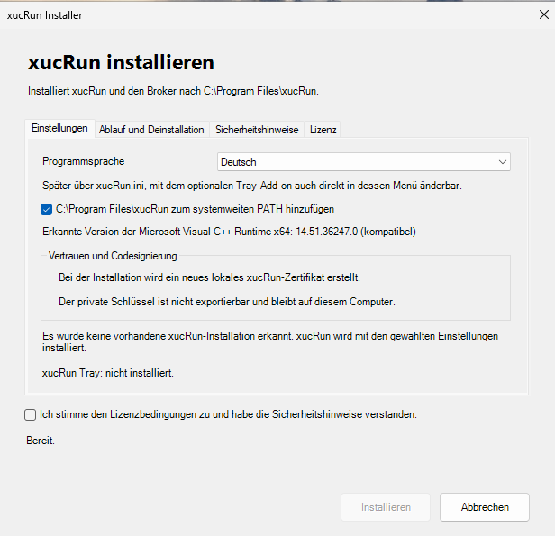

Der Installer prüft die Microsoft Visual C++ Runtime x64. Fehlt eine passende Version, bietet er
den geprüften Microsoft-Download oder eine vorhandene `vc_redist.x64.exe` an und lehnt zu alte
Versionen ab. Anschließend installiert er Client, Broker, Freigabehelper und Sprachdateien unter
`%ProgramFiles%\xucRun` und richtet Brokerdienst und Deinstallationseintrag ein. Der manuelle
Installationsweg verwendet dasselbe mitgelieferte PowerShell-Skript.

### Aktualisieren und deinstallieren

xucRun und das separat installierte optionale
[xucRun-Tray-Add-on](https://github.com/HT64/xucRun-Tray) verwenden eine exakte vierteilige
Versionsbindung. Vor einem Versionswechsel oder der Deinstallation von xucRun muss xucRun Tray
über seinen eigenen Windows-Deinstallationseintrag entfernt werden; anschließend kann die
Tray-Version mit derselben neuen Versionsnummer installiert werden. Bei einer erneuten
Installation derselben passenden Version kann Tray installiert bleiben.

Für eine Aktualisierung wird der versionierte grafische Installer des neueren Pakets gestartet. Er
verwendet das vorhandene gültige lokale xucRun-Zertifikat erneut. Gespeicherte Anmeldedaten,
Freigaben und nicht vom Installer verwaltete INI-Einstellungen bleiben erhalten.

Die Deinstallation ist über **Installierte Apps** möglich. Alternativ wird kein separates
Deinstallationsskript benötigt, sondern das bei der Installation nach
`%ProgramFiles%\xucRun` kopierte `Install-xucRun.ps1` mit `-Uninstall` aufgerufen:

```powershell
if (-not [Environment]::Is64BitProcess) {
    throw 'Die Deinstallation erfordert eine 64-Bit-PowerShell.'
}
$programFilesDirectory = [Environment]::GetFolderPath(
    [Environment+SpecialFolder]::ProgramFiles)
$windowsPowerShell = Join-Path `
    ([Environment]::SystemDirectory) `
    'WindowsPowerShell\v1.0\powershell.exe'
& $windowsPowerShell -NoProfile -ExecutionPolicy Bypass `
  -File (Join-Path $programFilesDirectory 'xucRun\Install-xucRun.ps1') `
  -Uninstall
```

> **Achtung:** Die Deinstallation löscht unwiderruflich alle von xucRun gespeicherten
> Anmeldedaten und Freigaben aller Windows-Benutzer sowie alle lokalen xucRun-Sicherungen,
> Sicherheitsmerkmale und zugehörigen Metadaten. Außerdem entfernt sie das lokale
> xucRun-Standardzertifikat samt privatem Schlüssel und Vertrauenseinträgen.

Vor der ersten Änderung verlangt die Deinstallation eine ausdrückliche Bestätigung dieser
unwiderruflichen Löschung. Bei Abbruch bleiben Installation und Daten unverändert.

Bei einem Deinstallationsfehler schreibt xucRun ein technisches Diagnoseprotokoll nach
`%ProgramData%\xucRun\InstallerLogs`; der Fehlerdialog zeigt den konkreten Dateipfad und kann den
Protokollordner öffnen. Das Protokoll enthält keine gespeicherten Kennwörter.

Beide Installationswege und die Hinweise zur lokalen Testsignierung stehen ausführlich in der
[Installationsanleitung](docs/de/INSTALLATION.md).

## Datensicherungen

`xucRun.exe /backup` öffnet die interaktive Verwaltung lokaler Datensicherungen. Zusätzlich stehen
folgende Befehle zur Verfügung:

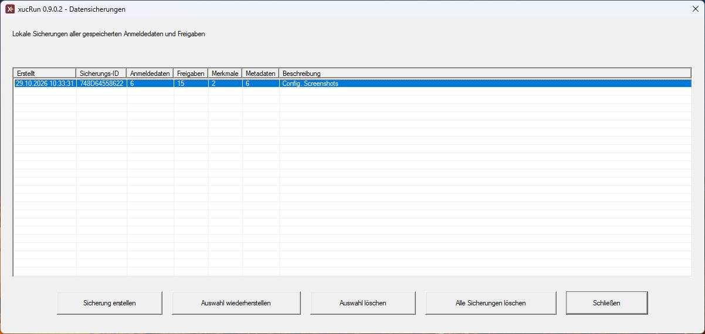

```text
xucRun.exe /backup-create [<Beschreibung>]
xucRun.exe /backup-list
xucRun.exe /backup-restore
xucRun.exe /backup-restore:<Backup-ID>
xucRun.exe /backup-delete-all
```

Eine Sicherung umfasst gespeicherte Anmeldedaten, Freigaben, Sicherheitsmerkmale und zugehörige
Metadaten. Datensicherungen werden getrennt von den aktiven Anmeldedaten und Freigaben unter
`%ProgramData%\xucRun\BrokerBackups` gespeichert. Für die Speicherung verwendet xucRun
Windows-APIs und bindet die Datensicherungen an den Rechner. xucRun stellt sie nur auf demselben
Rechner wieder her; sie sind kein portabler Kennwortexport.

Die Deinstallation entfernt auch die lokal gespeicherten xucRun-Datensicherungen.

## Fehlerdiagnose

`xucRun.exe /info` zeigt die auch vom separat installierten optionalen xucRun-Tray-Add-on
verwendeten gemeinsamen Client-Laufzeitinformationen: Version, Copyright, Pfad, Architektur,
wirksame Sprache und geladene Sprach-DLL, Signierzertifikat, aktuelles Konto einschließlich SID
und Rechteerhöhung, Konfigurationsdatei und Client-Protokollierung. Der gemeinsame
Konfigurationsabschnitt nennt außerdem das installierte Wartungsskript. Core-spezifische
Abschnitte ergänzen Brokerstatus, Broker-Informationsereignisse und Anzahlen gespeicherter Daten.
`xucRun.exe /audit` prüft sicherheitsrelevante Eigenschaften der laufenden Installation und nennt
bei gültiger Clientsignatur ebenfalls das geprüfte Zertifikat. Ist xucRun Tray separat
installiert, prüft die Diagnose zusätzlich dessen installierte Dateien und Signaturen,
Deinstallationsregistrierung und benutzerbezogene Autostartaufgaben. Wurde der Brokerdienst
deaktiviert, kann er mit `xucRun.exe /enable-broker` wieder aktiviert werden.
`xucRun.exe /help` zeigt die vollständige lokale Befehlsübersicht.

Die Diagnose prüft ausdrücklich den Dateiobjektschutz, das Authenticode-Vertrauen und den
erwarteten Signierer des installierten Wartungsskripts `Install-xucRun.ps1` sowie bei installiertem
Tray von `Install-xucRunTray.ps1`. Die Prüfung verwendet diese feste Produktdateiliste; beliebige
zusätzliche PowerShell-Dateien im Installationsverzeichnis werden nicht als xucRun-Komponenten
behandelt.
Der Bericht bestätigt außerdem, ob alle erforderlichen Windows-Schutzfunktionen des laufenden
Brokerprozesses aktiv sind. Bei Erfolg fasst er die geschützten Bereiche zusammen; bei einer
Abweichung nennt er die betroffene Schutzfunktion sowie eine Empfehlung zu Neustart und
Neuinstallation.

Meldet xucRun, dass ein erhöhter Start wegen fehlender UAC-Bestätigung blockiert wurde, ist für
das ausgewählte andere Konto, das Mitglied der lokalen Administratorengruppe ist, der
Windows-Administratorbestätigungsmodus nicht wirksam. Das kann insbesondere das integrierte Konto
`Administrator` betreffen.

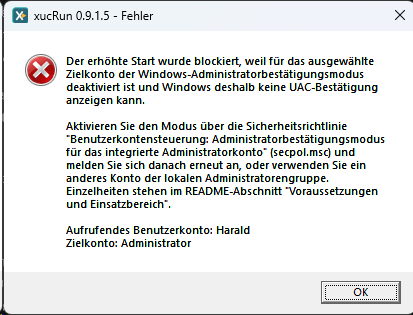

### Laufzeitinformationen

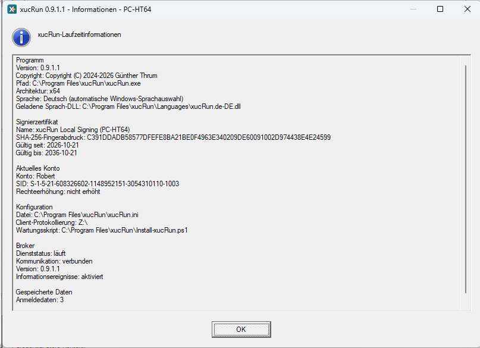

### Sicherheitsdiagnose

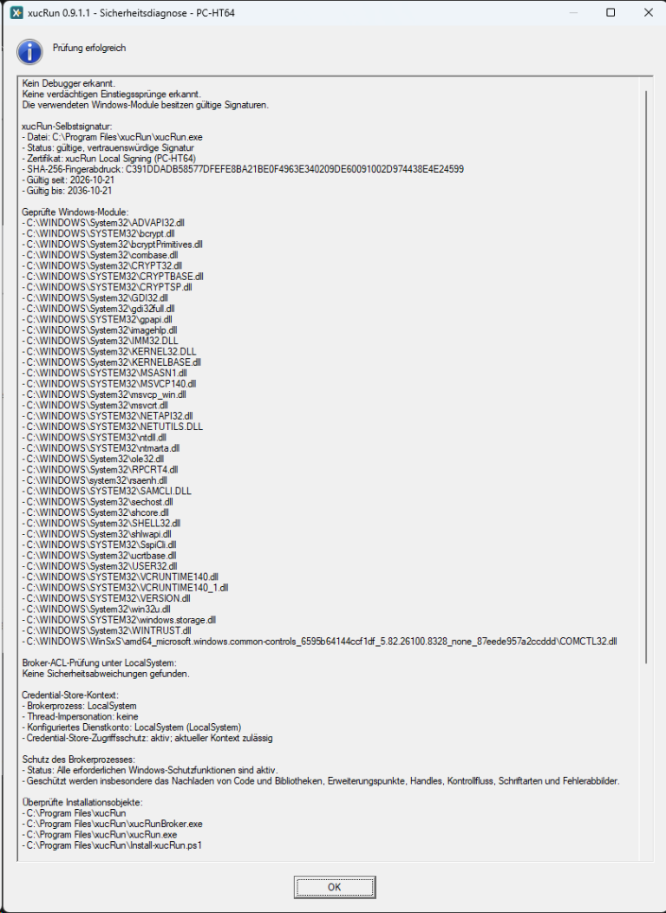

Für eine weitergehende Fehlerdiagnose kann über `ClientLogDirectory` das Client-Dateilog mit
Dateien im Format `xucRun_YYYYMMDD.log` aktiviert werden. Warnungen und Fehler des Brokers werden
immer im Windows-Anwendungsereignislog unter der Quelle `xucRunBroker` erfasst und können in der
Windows-Ereignisanzeige unter **Windows-Protokolle → Anwendung** eingesehen werden. Einzelheiten
zur Konfiguration enthält der Abschnitt
[Konfigurationsdatei und Sprache](#konfigurationsdatei-und-sprache).

## Konfigurationsdatei und Sprache

xucRun verwendet die maschinenweite Konfigurationsdatei
`%ProgramFiles%\xucRun\xucRun.ini`. Der Installer legt sie an und aktualisiert bei einer
Installation oder einem Update die gewählte Sprache, ohne die übrigen vorhandenen Einstellungen
zu entfernen. Weil die Datei unter `%ProgramFiles%` liegt, sind zum manuellen Bearbeiten
normalerweise Administratorrechte erforderlich.

Die unterstützte Struktur ist:

```ini
[xucRun]
Language=auto

[Logging]
ClientLogDirectory=
BrokerInformationEvents=false
```

Kommentarzeilen beginnen mit einem Semikolon (`;`). Kommentare sollten in eigenen Zeilen stehen
und nicht an eine Einstellung angehängt werden.

- `Language=auto` folgt der Windows-Anzeigesprache des aktuellen Benutzers und verwendet bei einer
  deutschen Anzeigesprache Deutsch, andernfalls Englisch. `Language=de` wählt ausdrücklich Deutsch,
  `Language=en` ausdrücklich Englisch. Die Änderung gilt für neu gestartete xucRun-Prozesse.
  Laufende Tray-Instanzen starten sich nach einer über xucRun gesetzten Sprachänderung neu. Eine
  manuelle externe Änderung erkennt das Tray beim nächsten Öffnen seines Kontextmenüs und startet
  sich dann neu. Andere bereits laufende xucRun-Prozesse übernehmen die Änderung nicht. Deutsch
  und Englisch werden über getrennte, signierte Sprachressourcendateien bereitgestellt. Die
  Lokalisierungsarchitektur kann um zusätzliche Sprachen erweitert werden; die aktuelle Version
  unterstützt jedoch ausschließlich Deutsch und Englisch.
- Ein fehlendes oder leeres `ClientLogDirectory` deaktiviert das Client-Dateilog. Ein eingetragener
  Pfad aktiviert es. Umgebungsvariablen werden im Kontext des jeweils startenden Clients
  aufgelöst. Der Pfad muss für jedes verwendete Client- und Wrapperkonto erreichbar und mit den
  zum Erstellen, Anhängen und Löschen der Protokolldateien erforderlichen Rechten versehen sein.
  Ist das konfigurierte Verzeichnis, insbesondere ein Netzwerkpfad, nicht erreichbar, können
  Windows-Dateisystemzeitüberschreitungen auch das Öffnen des Tray-Kontextmenüs verzögern. Das
  Tray ermittelt dabei die vorhandenen Logdateien, um die zugehörigen Aktionen und deren
  Dateianzahl zu aktualisieren.
  xucRun verändert die Zugriffsrechte des Verzeichnisses nicht. Bei einem gemeinsamen Pfad muss
  der Administrator deshalb die vorgesehenen Leser und Schreiber festlegen; Konten mit
  Änderungsrechten können die Protokolle auch verändern oder löschen.
  Änderungen gelten für neu gestartete Client- und Wrapperprozesse. Das laufende Tray liest den
  Wert beim nächsten Öffnen seines Kontextmenüs neu; bis dahin verwendet es seine bisherige
  Loggingkonfiguration. In jedes aufgelöste Protokollverzeichnis schreibt xucRun pro Tag eine
  datierte Protokolldatei, rotiert oder löscht Client-Protokolle jedoch nicht automatisch. Diese
  Protokolle können Programmpfade, Kontonamen, Befehlszeilen und Argumente des Zielprogramms
  enthalten. Kennwörter oder andere Geheimnisse sollten deshalb nicht als Befehlszeilenargumente
  übergeben werden.
- Warnungen, Fehler sowie Dienst- und ACL-Startmeldungen schreibt der Broker immer in das
  Windows-Anwendungsereignislog unter der Quelle `xucRunBroker`.
  `BrokerInformationEvents=true` ergänzt dort routinemäßige Informationsmeldungen zur Verarbeitung
  von Pipe-Anfragen. Bei fehlendem, leerem, `false` oder anderem Wert bleiben nur diese
  zusätzlichen Informationsmeldungen deaktiviert. Änderungen gelten nach einem Neustart des
  Brokerdienstes; ein Neustart von Client oder Tray genügt nicht.

Eine fehlende Konfigurationsdatei, ein ungültiger Sprachwert oder eine fehlende beziehungsweise
nicht passend signierte Sprachdatei führt aus Sicherheitsgründen zum Startabbruch statt zu einem
stillen Sprachwechsel.

## Optionales Tray

Das separat installierte optionale
[xucRun-Tray-Add-on](https://github.com/HT64/xucRun-Tray) ergänzt eine Status- und
Bedienoberfläche, deren Symbol im Benachrichtigungsbereich der Windows-Taskleiste neben der Uhr
erscheint. Es ist ein eigenständiges Projekt, zeigt Informationen aus xucRun an und stellt den
Zugriff auf dessen vorhandene Verwaltungsfunktionen bereit. Über sein Menü lässt sich die
computerweite xucRun-Sprache auf Automatisch, Deutsch oder Englisch setzen. Laufende
Tray-Instanzen werden nach der Änderung neu gestartet; für andere xucRun-Prozesse gilt sie beim
nächsten Start.

Das Tray ist insbesondere bei der Inbetriebnahme, bei der Kontrolle des Betriebszustands und bei
späteren Änderungen an Anmeldedaten, Freigaben, Sprache, Protokollierung oder Brokerzustand
hilfreich. xucRun und sein Brokerdienst bleiben ohne ein installiertes oder laufendes Tray
vollständig nutzbar; das Tray kann daher dauerhaft oder nur bei Bedarf verwendet werden.
Einzelheiten zum manuellen Start und zum Start bei der Windows-Anmeldung enthält die Dokumentation
des Tray-Projekts.

## Persönliche Notiz zur Entstehung von xucRun

Der Ausgangspunkt für xucRun war ein über Jahre wiederkehrender Bedarf auf mehreren Rechnern im
privaten Umfeld, von denen einige auch von anderen Personen genutzt wurden. Ich arbeite
grundsätzlich mit Windows-Standardkonten, muss aber dennoch einzelne Programme mit erhöhten
Rechten oder unter einem anderen Konto starten, ohne dafür in eine separate Sitzung zu wechseln
oder bei jedem Start dieselben Anmeldedaten einzugeben. Ein zentraler Anwendungsfall ist das Öffnen
eines Dateimanagers im Kontext eines anderen Kontos aus meiner bestehenden Sitzung heraus; die
daraus hervorgegangenen
[Konfigurationsbeispiele für Total Commander](#integration-in-total-commander) sind weiter oben
dokumentiert. Über die Jahre verband ich dafür frei verfügbare Tools und Windows-eigene Befehle in
zunehmend komplexen Skripten. Als diese Kombination meinen Anforderungen nicht mehr vollständig
gerecht wurde, entwickelte ich eine eigenständige native Lösung in C++.

Nachdem mit der Zeit immer mehr Arbeit in dieses Werkzeug für den eigenen Gebrauch geflossen war,
erschien es mir irgendwann zu schade, es nur für mich zu behalten. Deshalb entschied ich mich, es
als öffentliches Open-Source-Projekt auf GitHub zu veröffentlichen. Aus dieser Entscheidung
entstand jedoch ein erheblicher zusätzlicher Aufwand: Um xucRun für die Nutzung durch andere
aufzubereiten und seinen Einsatz, seine Funktionsweise sowie seine Grenzen nachvollziehbar zu
erklären, mussten insbesondere das Sicherheitsmodell, die Funktionen zur Verwaltung
gespeicherter Anmeldedaten und Programmfreigaben, die Konfigurations- und Diagnosefunktionen, die
Benutzeroberflächen und ihre Dialoge, die Installer, die Lokalisierung, die Dokumentation und die
automatisierten Tests systematisch weiterentwickelt und ausgearbeitet werden.

Ein wesentlicher Teil dieses Aufwands entstand aus dem Ziel, den zusätzlichen Bedienkomfort nicht
durch eine pauschale, weitreichende Freigabe zu erkaufen. Stattdessen sollen Anwender das
Verhältnis zwischen Bedienkomfort und enger Begrenzung für ihren konkreten Anwendungsfall selbst
festlegen und die Wirkung ihrer Auswahl nachvollziehen können. Daraus entwickelte sich unter
anderem der unter
[Freigabedialog, Dauer und Umfang](#freigabedialog-dauer-und-umfang) beschriebene differenzierte
Freigabedialog.

KI-gestützte Entwicklungswerkzeuge haben mir dabei geholfen, diesen zusätzlichen Aufwand als
Einzelentwickler zu bewältigen. Dabei setzte ich sie in zahlreichen interaktiven Arbeitsschritten
unterstützend ein. Die jeweiligen Entwicklungsstände nutzte ich bei meinen alltäglichen Tätigkeiten
am Rechner selbst und entwickelte xucRun auf Grundlage dieser Erfahrungen weiter. Erst nachdem
xucRun auf diese Weise einen aus meiner Sicht angemessenen Reifegrad erreicht hatte, stellte ich
die erste öffentliche Version bereit.

Die fachlichen Entscheidungen und die Verantwortung für das Ergebnis liegen weiterhin bei mir.

Die ausführliche Darstellung der Sicherheitsaspekte kann auf den ersten Blick ungewöhnlich
kritisch wirken, insbesondere im Vergleich mit einer knappen Produktbeschreibung. Sie ist jedoch
eine bewusste Folge der Veröffentlichung: Gerade weil xucRun gespeicherte Anmeldedaten verarbeitet
und einen privilegierten Dienst verwendet, sah ich mich mit der Entscheidung zur Veröffentlichung
in der Verantwortung, die damit verbundenen Sicherheitsfragen, die getroffenen Schutzmaßnahmen
und die verbleibenden Grenzen ausführlich und nachvollziehbar darzustellen. Diese Ausführlichkeit
ist weder als Aussage zu verstehen, xucRun sei unsicherer als weniger ausführlich dokumentierte
Werkzeuge, noch als Zusage, alle Risiken erkannt oder ausgeschlossen zu haben.

Kommerzielle Interessen verfolge ich mit xucRun nicht. Ebenso beabsichtige ich nicht, daraus ein
kommerzielles Produkt zu machen und dafür einen bestimmten Funktionsumfang, Fehlerfreiheit,
dauerhafte Verfügbarkeit, Support oder Weiterentwicklung zuzusagen.

Es würde mich freuen, wenn xucRun auch anderen Privatanwendern ebenso nützlich ist wie mir. Ich
wäre auch offen dafür, xucRun zu einem späteren Zeitpunkt gemeinsam mit anderen weiterzuentwickeln
und zu pflegen.

## Projekt unterstützen

Die Entwicklung kann freiwillig über
[Patreon](https://www.patreon.com/xucRun) unterstützt werden. Beiträge können auch dabei helfen,
die Nutzungskosten KI-gestützter Entwicklungswerkzeuge zu decken. Eine Unterstützung ist keine
Voraussetzung für Download oder Nutzung von xucRun und gewährt keine exklusive Software,
Funktionen, Veröffentlichungen, Downloads, persönlichen Support oder bestimmte Reaktionszeiten.

## Schwachstellen melden

Ungepatchte oder vermutete Schwachstellen dürfen nicht öffentlich gemeldet werden. Der
vertrauliche Meldeweg und die unterstützten Versionen sind in [SECURITY.de.md](SECURITY.de.md)
beschrieben.

## Selbst bauen und installieren

Die [Buildanleitung](docs/de/BUILDING.md) beschreibt die Erzeugung eines xucRun-Pakets aus dem
Quellcode. Die anschließende lokale Testsignierung, Installation, Aktualisierung und Deinstallation
stehen in der [Installationsanleitung](docs/de/INSTALLATION.md). Ist die normale Deinstallation
nicht verfügbar, listet die Anleitung zur
[manuellen Entfernung](docs/de/MANUAL_REMOVAL.md) die vom Verfahren erfassten xucRun-eigenen
Artefakte und die erforderliche Entfernungsreihenfolge.

## Lizenz

xucRun steht unter der Apache License 2.0. Maßgeblich sind `LICENSE` und `NOTICE`.

Externe Codebeiträge werden derzeit nicht angenommen; Einzelheiten stehen in
[CONTRIBUTING.de.md](CONTRIBUTING.de.md).
