# xucRun

**Sprache:** [English](README.md) | Deutsch

**Dokumentation:** [Änderungsprotokoll](CHANGELOG.de.md) |
[Manuelle Entfernung](docs/de/MANUAL_REMOVAL.md)

**Download:** [Aktuelle Version](https://github.com/HT64/xucRun/releases/latest)

**xucRun** steht für **eXecute Under User Context**.

> **Status:** xucRun befindet sich in Entwicklung. Die Dokumentation beschreibt das vorgesehene
> Verhalten. Der aktuelle Stand kann Fehler enthalten, davon abweichen und sich ändern. Der
> Quellcode kann selbst gebaut und mit einem lokalen Testzertifikat installiert werden.

## Motivation und Zweck

xucRun deckt mehrere Anwendungsfälle ab, in denen ein Programm mit erhöhten Rechten oder unter
einem anderen Benutzerkonto – wahlweise mit oder ohne Rechteerhöhung – ausgeführt werden soll.

Das Programm richtet sich an erfahrene Windows-Anwender, die ihren eigenen Rechner gelegentlich
aus einem Standardbenutzerkonto heraus administrieren möchten, interaktiv oder mithilfe eigener
Skripte, ohne dafür eine separate Anmeldung mit einem Administratorkonto oder bei jedem Vorgang
erneut ein Kennwort zu benötigen. Die erforderliche Berechtigung für administrative Aufgaben
soll sich aus einem Standardbenutzerkonto heraus möglichst mit einem einzigen Mausklick erteilen
lassen.

Ein typischer Anwendungsfall entsteht, wenn der Anwender bewusst mit einem Standardbenutzerkonto
angemeldet bleibt, mit einem Programm oder über einen Dateimanager bestimmte Aktionen ausführen
möchte und dabei an Berechtigungsgrenzen stößt, sodass er die betreffende Aktion nur unter einem
anderen Benutzerkonto, beispielsweise einem Administratorkonto, fortsetzen kann. xucRun bindet
dafür die nativen Windows-Mechanismen in denselben Arbeitsablauf ein.

Der Anwender muss die Voraussetzungen dafür nicht vor dem ersten Aufruf vollständig einrichten. Er
kann den gewünschten Programmaufruf unmittelbar mit xucRun starten. Fehlen für diesen Aufruf noch
ein geeignetes Konto, gespeicherte Anmeldedaten oder eine Freigabe, führt xucRun interaktiv durch
die jeweils notwendigen Schritte und fragt die benötigten Angaben und Entscheidungen im laufenden
Arbeitsablauf ab. Bereits vorhandene Anmeldedaten und Freigaben werden bei späteren Aufrufen
wiederverwendet, soweit sie zum jeweiligen Aufruf passen, sodass anschließend in der Regel nur noch
eine einzige Bestätigung per Mausklick erforderlich ist.

Die grundlegenden Aktionen, Programme unter einem anderen Benutzerkonto zu starten und
administrative Rechte anzufordern, lassen sich auch mit Windows-eigenen Mitteln ausführen. xucRun
verbindet diese Möglichkeiten in einem Ablauf und ergänzt sie um kontrollierte Freigaben für
gespeicherte Anmeldedaten. Das Speichern und Wiederverwenden der Anmeldedaten ist mit zusätzlichen
Sicherheitsrisiken verbunden. Wer diese Risiken nicht eingehen möchte, sollte besser
Windows-eigene Möglichkeiten wie z. B. den schnellen Benutzerwechsel nutzen.

## Vergleich mit Windows-Funktionen und anderen Lösungen

Beim schnellen Benutzerwechsel bleibt die bisherige Windows-Sitzung mit ihren geöffneten Programmen
erhalten, während sich der Anwender unter einem anderen Benutzerkonto in einer separaten Sitzung
anmeldet oder in dessen bereits geöffnete Sitzung wechselt. Anschließend kann er in die bisherige
Sitzung zurückkehren. Dieser Weg ist auch dann sinnvoll, wenn eine vollständige interaktive
Arbeitsumgebung des anderen Benutzers benötigt wird.

Gegenüber dem schnellen Benutzerwechsel bleibt der Anwender mit xucRun in seiner aktuellen Sitzung
und startet nur das benötigte Programm unter dem gewählten anderen Benutzerkonto, mit oder ohne
erhöhte Rechte. Die Windows-Benutzerkontensteuerung (User Account Control, UAC) ist die
Windows-Sicherheitsfunktion, über die ein Benutzer den Start mit Administratorrechten ausdrücklich
bestätigt. Abhängig vom konkreten Startpfad und der Windows-Konfiguration kann ein Kontowechsel mit
xucRun eine UAC-Bestätigung erfordern. Bei einem Start ohne Erhöhung kann UAC über den
xucRun-Helfer die Anwesenheit des Benutzers bestätigen; bei einer Erhöhung kann UAC stattdessen
den Start des Zielprogramms bestätigen und ihm die angeforderten Administratorrechte erteilen.

Eine weitere Windows-eigene Möglichkeit, die mehr Ähnlichkeit mit xucRun hat, ist `runas.exe`.
Damit lassen sich einzelne Programme gezielt unter einem anderen Benutzerkonto starten. Mit dem
Parameter `/savecred` werden die dafür verwendeten Anmeldedaten nach der ersten Kennworteingabe in
der Windows-Anmeldeinformationsverwaltung des angemeldeten Benutzers gespeichert. Danach kann
`runas.exe` Programme wiederholt unter einem anderen Benutzerkonto starten, ohne das Kennwort
erneut abzufragen. Bei der Verwendung von `runas.exe` bestehen jedoch einige Einschränkungen:

- Das Zielkonto muss bei jedem Aufruf mit `/user:<Konto>` angegeben werden. Sein Name steht damit
  je nach Verwendung in Skripten, Verknüpfungen oder auf der Kommandozeile.
- `runas.exe` fordert keine Erhöhung über UAC an. Ohne eine solche Erhöhung wird ein
  Administratorkonto bei aktiviertem UAC normalerweise nur mit eingeschränkten Rechten gestartet.
- Nach `/savecred` kann das Konto, dessen Anmeldedaten gespeichert wurden, ohne erneute Bestätigung
  für weitere Programmstarts verwendet werden. Dabei gibt es keine obligatorische Freigabe und
  keine Bindung an bestimmte Programme, Dateihashes, Argumente oder Arbeitsverzeichnisse.
- `runas.exe` wählt nicht automatisch ein geeignetes Konto aus, dessen Anmeldedaten mit
  `/savecred` gespeichert wurden, und bietet keine integrierte Verwaltung unterschiedlich
  weitreichender oder zeitlich begrenzter Freigaben.
- `runas.exe` reagiert empfindlich auf komplexe Programmpfade, Argumente und Sonderzeichen. Bei der
  Verwendung in Skripten oder Verknüpfungen können durch eine zusätzliche Shell oder ein
  Elevationswerkzeug weitere Parsing- und Quoting-Ebenen hinzukommen. Dadurch steigt die
  Fehleranfälligkeit besonders dann, wenn dem erhöht auszuführenden Programm komplexe Argumente
  oder Argumente mit Sonderzeichen übergeben werden müssen.

xucRun greift die Idee gespeicherter und wiederverwendbarer Anmeldedaten von `runas.exe` auf und
ergänzt sie um kontrollierte Freigaben. Es lässt sich in Skripten, Desktop-Verknüpfungen und
anderen fest konfigurierten Aufrufen ebenso wie bei interaktiven Aufrufen über die Kommandozeile
verwenden. Der Start unter einem anderen Benutzerkonto, gespeicherte Anmeldedaten und eine bei
Bedarf weiterhin interaktive Erhöhung über UAC werden dabei in einem Werkzeug zusammengeführt.
Sind passende Anmeldedaten gespeichert, muss der Aufruf weder Zielkonto noch Kennwort enthalten.
Programmpfade, Argumente, Arbeitsverzeichnisse, Batchdateien und typische Shell-Sonderzeichen
werden kontrolliert über die notwendigen Prozessgrenzen hinweg behandelt.

Zur Veranschaulichung dient der Start des Gerätemanagers aus einem Standardbenutzerkonto als reales
Beispiel. Mit genau einem Administratorkonto, für das xucRun-Anmeldedaten gespeichert sind, genügt
über xucRun dieser Aufruf:

```cmd
xucRun.exe "%windir%\System32\mmc.exe" "%windir%\System32\devmgmt.msc"
```

Mit `runas.exe /savecred` und einem separaten Elevationswerkzeug könnte das schematische
Gegenstück beispielsweise so aussehen, wenn dieses Werkzeug die Syntax
`elevate.exe <Programm> [Argumente ...]` unterstützt:

```cmd
runas.exe /savecred /user:Administrator "elevate.exe %windir%\System32\mmc.exe %windir%\System32\devmgmt.msc"
```

Die genaue Syntax hängt vom gewählten Elevationswerkzeug ab. In der Werkzeugkette muss der
Kontoname im Aufruf stehen und die gesamte nachgelagerte Befehlszeile als ein Argument an
`runas.exe` übergeben werden. xucRun benötigt im Hauptanwendungsfall keinen Kontonamen und hält
Programm und Argumente in einem gemeinsamen Aufruf getrennt. Die UAC-Bestätigung bleibt bei beiden
Varianten interaktiv.

Ein Beispiel mit komplexeren Argumenten ist das Anlegen einer Firewallregel für ein Programm,
dessen Pfad Leerzeichen enthält:

```cmd
xucRun.exe "%windir%\System32\netsh.exe" advfirewall firewall add rule name="Lokaler Beispielserver" dir=in action=allow program="C:\Program Files\Beispielserver\server.exe" enable=yes profile=private
```

Dabei erhält `netsh.exe` mehrere Schlüssel-Wert-Argumente sowie einen Regelnamen und einen
Programmpfad mit Leerzeichen. Eine Werkzeugkette aus `runas.exe` und einem separaten
Elevationswerkzeug wäre daher deutlich komplizierter; ihre zuverlässige Verwendung mit
Sonderzeichen hinge außerdem vom konkreten Elevationswerkzeug und dessen Quoting-Regeln ab.

Nach der erstmaligen Kennworteingabe kann `runas.exe /savecred /user:Administrator` dasselbe Konto,
dessen Anmeldedaten gespeichert wurden, auch für andere Programme verwenden, ohne erneut das
Kennwort oder eine obligatorische Bestätigung anzufordern. xucRun verlangt dagegen eine passende
ausdrückliche Freigabe, bevor gespeicherte Anmeldedaten verwendet werden. Jede für den konkreten
Start erforderliche Windows-UAC-Bestätigung bleibt interaktiv.

`runas.exe /savecred` und xucRun verwenden voneinander getrennte, nicht kompatible Speicherungen
für Anmeldedaten. Eine xucRun-Freigabe kann eng an das aufrufende Benutzerkonto, das Zielkonto, die
beteiligten Programme und deren Dateihashes gebunden sowie zeitlich begrenzt werden. Ändert sich
eines der gebundenen Programme, passt dessen SHA-256-Hash nicht mehr zur Freigabe. Vor einer
Übernahme der Freigabe auf die geänderte Programmversion verlangt xucRun eine ausdrückliche
Entscheidung.

Neben den Windows-eigenen Möglichkeiten gibt es Lösungen anderer Anbieter für Benutzerwechsel,
Rechteerhöhungen und die Verwaltung administrativer Zugriffe. Sie setzen je nach Anwendungsfall
andere Schwerpunkte. Eine Aufzählung einzelner Produkte wäre zwangsläufig unvollständig und könnte
durch die Auswahl unbeabsichtigt Schwerpunkte setzen. Zudem wäre sie rasch veraltet und wegen
unterschiedlicher Einsatz- und Sicherheitsmodelle nur eingeschränkt vergleichbar.

## Freigaben und UAC in xucRun

Wenn das aktuelle Windows-Konto Mitglied der Administratorengruppe ist, verwendet xucRun dieses
Konto standardmäßig auch für das gestartete Programm. Falls das Konto noch nicht erhöht ist,
fordert Windows die Zustimmung über die Benutzerkontensteuerung (UAC) an. In diesem Fall zeigt
xucRun keinen eigenen Freigabedialog; die Zustimmung erfolgt ausschließlich über Windows-UAC.

xucRun-Programmfreigaben gelten für Starts mit den gespeicherten Anmeldedaten eines anderen
Kontos. Im vorgesehenen Ablauf aus einem nicht erhöhten Standardbenutzerkonto bleibt ein
erforderlicher Kontowechsel beziehungsweise eine erforderliche Rechteerhöhung interaktiv. Bei
einem Start ohne Erhöhung kann UAC über das xucRun-Hilfsprogramm die Anwesenheit des Benutzers
bestätigen; das Zielprogramm läuft danach mit den nicht erhöhten Rechten des Zielkontos. Bei einer
Erhöhung kann UAC stattdessen den Start des Zielprogramms bestätigen und ihm die angeforderten
Administratorrechte erteilen. Welche UAC-Abfrage Windows tatsächlich zeigt, hängt vom konkreten
Startpfad und der Windows-Konfiguration ab.

Eine passende wiederverwendbare Freigabe verhindert nur einen erneuten xucRun-Freigabedialog. Sie
ersetzt keine für den konkreten Start erforderliche Windows-UAC-Bestätigung. Beide Entscheidungen
haben unterschiedliche Aufgaben: xucRun prüft, ob der Aufruf zur gespeicherten Freigabe passt;
Windows-UAC bestätigt, soweit erforderlich, den konkreten Start beziehungsweise die
Rechteerhöhung.

Der Windows-UAC-Dialog zeigt nicht an, welche xucRun-Freigabe verwendet wird, wie lange sie gilt
oder ob sie an den genauen Aufruf, ein Zielprogramm oder alle Programme gebunden ist. Diese
Reichweite ist beim Anlegen der Freigabe im xucRun-Freigabedialog und später in der
Freigabenverwaltung sichtbar.

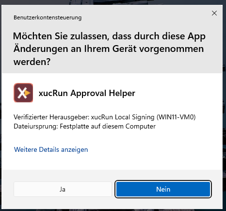

Auch ein Start unter einem anderen Standardkonto kann eine UAC-Anwesenheitsbestätigung erfordern.
Verwendet xucRun dafür ein Administratorkonto, dient es nur zum Öffnen des xucRun-Dialogs auf dem
separaten Windows-Desktop; das Zielprogramm läuft weiterhin unter dem gewählten Standardkonto.

Ist keine passende Freigabe aktiv, erscheint der xucRun-Freigabedialog auf einem separaten
Windows-Desktop. Im vorgesehenen Ablauf trennt Windows diesen Desktop von normalen, nicht erhöhten
Programmen. Kann xucRun ihn dort nicht öffnen, wird der Vorgang abgebrochen. Für eine erhöht
auszuführende, vom Aufrufer beschreibbare Startdatei ist bei jedem Start eine einmalige
Risikobestätigung erforderlich; ist auch ihr Verzeichnis beschreibbar, blockiert xucRun den
erhöhten Start.

Der zentrale Anwendungsfall von xucRun ist ein angemeldeter Standardbenutzer, für den genau ein
Administratorkonto mit xucRun-Anmeldedaten gespeichert ist und Programme bei Bedarf unter diesem
Konto erhöht gestartet werden sollen. Nach der einmaligen Einrichtung genügt ein Aufruf ohne
Kontonamen und Kennwort:

```powershell
xucRun.exe regedit.exe
```

xucRun wählt dieses Konto automatisch und fordert die UAC-Bestätigung für den erhöhten Start an.
Das Kennwort muss nicht erneut eingegeben werden und muss ebenso wenig wie der Kontoname im
Aufruf, in Skripten oder Verknüpfungen stehen. Mehrere oder ausdrücklich angegebene Zielkonten
sowie Starts ohne Erhöhung beschreibt der Abschnitt
[Kontowahl und Rechte](#kontowahl-und-rechte). UAC bleibt interaktiv; **xucRun ist kein
Mechanismus für unbeaufsichtigte Rechteerhöhung.**

Fehlen ein Zielkonto, gespeicherte Anmeldedaten oder eine passende Freigabe, fragt xucRun die
erforderliche Auswahl, Eingabe oder Bestätigung im laufenden Aufruf ab. Kontoauswahl sowie
Verwaltungs-, Informations- und Fehlerdialoge erscheinen auf dem normalen Benutzerdesktop.
Kennworteingaben, Freigabeentscheidungen und Risikobestätigungen zeigt xucRun auf einem separaten
Windows-Desktop; Windows-UAC verwendet davon getrennt den konfigurierten UAC-Desktop.

Beim ersten solchen Dialog erzeugt xucRun für das aufrufende Windows-Benutzerkonto ein
zufälliges Sicherheitsmerkmal im Format `XXXX-XXXX`. Kennwort-, Freigabe- und Risikodialoge zeigen
es anschließend unverändert an. Nach der Prüfung der Installationsdatei sollte der Benutzer es
beim bewusst ausgelösten ersten Dialog einprägen oder geschützt notieren und spätere Dialoge nur
bei Übereinstimmung bestätigen. Das Merkmal weist auf den xucRun-Helperdialog hin, beweist aber
weder die Ungefährlichkeit noch den Ursprung einer Operation. Es bietet keinen vollständigen
Schutz auf einem kompromittierten System und hilft nur, wenn der Benutzer es tatsächlich
vergleicht.

## Umfang von xucRun

xucRun enthält:

- den Client `xucRun.exe`,
- den Brokerdienst `xucRunBroker`, der bei Bedarf automatisch gestartet wird, im Hintergrund die
  von xucRun gespeicherten Anmeldedaten verwaltet und Programmstarts unter dem gewählten
  Benutzerkonto ausführt,
- den Approval-Helper,
- gemeinsame Protokoll-, Serialisierungs- und Sicherheitskomponenten,
- deutsche und englische Sprachressourcen.

xucRun ist eigenständig baubar, installierbar und nutzbar.

## Voraussetzungen und Einsatzbereich

xucRun unterstützt Windows 10 und Windows 11 auf x64-Systemen. Es benötigt die aktuelle
Microsoft Visual C++ Redistributable v14 für x64. Die für eine Veröffentlichung erforderliche
Mindestversion steht im zugehörigen Eintrag des [Änderungsprotokolls](CHANGELOG.de.md).

Für kontenübergreifende erhöhte Starts muss für das ausgewählte Administratorkonto der
Windows-Administratorbestätigungsmodus aktiviert sein. Das betrifft insbesondere das integrierte
Konto `Administrator`, für das dieser Modus deaktiviert sein kann. Andernfalls blockiert xucRun
den Start, weil keine UAC-Bestätigung möglich wäre.

Für das integrierte Konto `Administrator` kann dieser Modus über die Windows-Sicherheitsrichtlinie
[Benutzerkontensteuerung: Administratorbestätigungsmodus für das integrierte Administratorkonto](https://learn.microsoft.com/en-us/windows/security/application-security/application-control/user-account-control/settings-and-configuration#user-account-control-settings-list)
aktiviert werden. Die entsprechende Registry-Einstellung ist der DWORD-Wert
`FilterAdministratorToken` unter
`HKEY_LOCAL_MACHINE\SOFTWARE\Microsoft\Windows\CurrentVersion\Policies\System`; der Wert `1`
aktiviert den Modus. Dadurch ändert sich das Verhalten des integrierten Kontos `Administrator`
systemweit und nicht nur bei der Verwendung mit xucRun. Anwendungen dieses Kontos werden
grundsätzlich mit einem gefilterten Token gestartet und verwenden bei benötigten
Administratorrechten das konfigurierte Windows-UAC-Erhöhungsverhalten. UAC muss systemweit
aktiviert bleiben. Nach der Änderung ist eine erneute Anmeldung erforderlich.

xucRun ist für erfahrene Privatanwender und Entwickler auf selbst verwalteten Rechnern sowie in
persönlichen Entwicklungs- und Testsystemen vorgesehen. Es ist keine Lösung für unbeaufsichtigte
Rechteerhöhung, zentrale Rechteverwaltung oder Systeme mit erhöhtem Schutzbedarf.

> **Wichtiger Sicherheitshinweis:** xucRun verwendet Windows-APIs zur Speicherung von
> Anmeldedaten. Damit xucRun ein Programm unter einem anderen
> Benutzerkonto starten kann, muss xucRun die benötigten Anmeldedaten jedoch vorübergehend
> verarbeiten. Ein vollständiger Schutz vor dem Auslesen oder Missbrauch durch ausreichend
> privilegierte Malware oder ein bereits kompromittiertes System kann deshalb nicht gewährleistet
> werden. Der Quellcode von xucRun wird
> offengelegt, damit die eingesetzten technischen Maßnahmen, ihre Grenzen und die
> verbleibenden Risiken nachvollzogen und unabhängig geprüft werden können. Die Offenlegung allein
> ist jedoch weder eine Sicherheitsgarantie noch der Nachweis einer unabhängigen
> Sicherheitsprüfung. Der Einsatz erfolgt eigenverantwortlich. xucRun sollte nur auf
> vertrauenswürdigen, selbst verwalteten Systemen ohne erhöhten Schutzbedarf sowie
> möglichst mit dedizierten, minimal berechtigten Zielkonten eingesetzt werden.
> Skripte, Verknüpfungen, geplante Aufgaben und Konfigurationsdateien, die xucRun aufrufen oder
> seine Parameter vorgeben, müssen ebenfalls vertrauenswürdig und vor unbefugten Änderungen
> geschützt sein.
> Soweit gesetzlich zulässig, übernehmen der Autor und die Mitwirkenden keine Haftung für Schäden,
> Datenverluste oder sonstige Folgen, die aus der Nutzung oder fehlerhaften Anwendung von xucRun,
> aus Softwarefehlern oder Sicherheitslücken sowie durch Malware oder ein kompromittiertes System
> entstehen. Dies umfasst insbesondere den Verlust, die Offenlegung oder den Missbrauch von
> Anmeldedaten. Maßgeblich sind der Gewährleistungsausschluss und die Haftungsbegrenzung der
> [Apache License 2.0](LICENSE).

## Sicherheitskonzept des Brokerdienstes

Eine mögliche Alternative zu einem Brokerdienst wäre, die Anmeldedaten ausschließlich durch das
normale Clientprogramm kryptografisch geschützt zu speichern. Ohne eine getrennte privilegierte
Komponente müssten ihre Entschlüsselung und Verwendung dann im Prozess und Sicherheitskontext des
aktuell angemeldeten Benutzers stattfinden. Das könnte die gespeicherten Daten gegen unmittelbares
Auslesen schützen. Die Fähigkeit zum Entschlüsseln, das vorübergehend benötigte Klartextkennwort
und die von Windows nach der Anmeldung erzeugte Berechtigung zum Starten von Prozessen lägen jedoch
im selben Sicherheitskontext wie der normale Client.

Eine Kompromittierung dieses Prozesses oder seines Benutzerkontexts könnte dann versuchen, die
legitime Entschlüsselungsfunktion zu missbrauchen, den Programmablauf zu manipulieren oder
Kennwort oder Anmeldeberechtigung aus dem Prozessspeicher auszulesen. Eine kryptografische
Speicherung allein löst dieses Problem nicht: Kann der normale Client die Daten entschlüsseln,
muss die dafür erforderliche Fähigkeit in seinem Sicherheitskontext verfügbar sein. Die
zuständige Komponente muss außerdem zuverlässig entscheiden, welcher Benutzer welches Programm
unter welchem Konto, mit welchen Argumenten und mit welchen Rechten starten darf.

xucRun trennt diese sicherheitskritische Fähigkeit deshalb in einen privilegierten Brokerdienst.
Nur der Broker speichert, entschlüsselt und verwendet die Anmeldedaten. Er prüft den tatsächlichen
Aufrufer und bindet ihre Verwendung an den Benutzer, die Windows-Sitzung, das Zielkonto, das
Zielprogramm und dessen Dateihash, die Argumente, das Arbeitsverzeichnis sowie den angeforderten
Start mit oder ohne erhöhte Administratorrechte. Auch die verschlüsselt gespeicherten
Anmeldedaten und ihre internen Zuordnungen werden nicht an den normalen Client ausgegeben. Sie
liegen in einem durch Windows geschützten Speicher des Systemkontos und sind zusätzlich an dieses
Konto auf dem lokalen Computer gebunden. Ein normaler Benutzerprozess kann sie deshalb nicht in
seinem eigenen Sicherheitskontext entschlüsseln.

Anschließend führt der Broker die Windows-Anmeldung und den erlaubten Programmstart selbst aus.
Der normale Client erhält weder das gespeicherte Kennwort noch eine Berechtigung, mit der er
selbst Programme unter dem Zielkonto starten könnte. Schlägt eine erforderliche Prüfung fehl,
wird kein Programm mit den gespeicherten Anmeldedaten gestartet; es gibt keinen Rückfall auf eine
clientseitige Entschlüsselung.

Ein unter dem Windows-Systemkonto `LocalSystem` laufender Dienst besitzt jedoch weitreichende
Rechte und vergrößert damit selbst die sicherheitsrelevante Angriffsfläche. xucRun verwendet diese
Architektur nicht, weil ein Hintergrunddienst an sich sicherer wäre, sondern um die Verwendung
gespeicherter Anmeldedaten und die Entscheidung über erlaubte Programmstarts vom normalen
Benutzerprozess zu trennen. Diese zusätzliche Sicherheitsgrenze erfordert ihrerseits eine
konsequente Absicherung des Brokers.

Der Broker vertraut Identitäts-, Pfad- oder Freigabeangaben eines Clients nicht ungeprüft. Er
ermittelt den aufrufenden Prozess, den Benutzer, die Windows-Sitzung und dessen Berechtigungsstufe
über die tatsächliche lokale Verbindung und über Windows selbst. Für sicherheitsrelevante
Anfragen prüft er unter anderem den geschützten Installationsort, den tatsächlichen Programmpfad,
den Dateihash und die digitale Windows-Signatur. Er beschränkt außerdem, welche Funktionen die
jeweilige xucRun-Komponente verwenden darf. Der Client prüft umgekehrt, ob die Gegenstelle seiner
lokalen Verbindung tatsächlich zum registrierten xucRun-Dienst gehört. Unmittelbar vor dem
Programmstart prüft der Broker das Zielprogramm und das Arbeitsverzeichnis erneut. Er ermittelt den
tatsächlichen Programmpfad und dessen Dateihash sowie das tatsächliche Arbeitsverzeichnis selbst
und hält die geprüften Windows-Objekte bis zum Start fest. Dadurch soll verhindert werden, dass ein
bereits geprüftes Ziel zwischen Freigabe und Programmstart unbemerkt ausgetauscht wird.

Für jeden sensiblen Vorgang erzeugt der Broker einen kurzlebigen, nur einmal verwendbaren
Sicherheitsnachweis. Dieser gilt ausschließlich für den konkreten aufrufenden Prozess, Benutzer,
die Windows-Sitzung, das Zielkonto, das Zielprogramm und dessen Hash, die Argumente, das
Arbeitsverzeichnis sowie den gewünschten Start mit oder ohne erhöhte Administratorrechte. Eine
kopierte Kennung oder eine lediglich vom Client behauptete Prozessidentität genügt nicht.
Unterschiedliche xucRun-Komponenten erhalten außerdem nur die Funktionen, die sie benötigen. Das
optionale Tray kann beispielsweise Status- und Listendaten abrufen, aber keine Programme starten,
Anmeldedaten verändern oder Freigabeentscheidungen treffen.

Der Broker und seine installierten Dateien werden zusätzlich gegen Austausch und unbeabsichtigte
Erweiterung gehärtet. Vor dem produktiven Betrieb prüft der Broker unter anderem seine eigene
Signatur, den autorisierten Client, die geschützten Installationspfade sowie sicherheitsrelevante
Datei- und Verzeichnisberechtigungen. Er beschränkt, aus welchen Verzeichnissen zusätzliche
Programmbestandteile geladen werden dürfen, und verbietet bestimmte Möglichkeiten, zur Laufzeit
fremden Code einzubinden. Außerdem verwendet er in Windows integrierte Schutzmechanismen, die das
Ausnutzen von Programmfehlern erschweren. Sie verhindern unter anderem, dass reine Daten ohne
Weiteres als Programmcode ausgeführt werden, machen die Anordnung im Arbeitsspeicher weniger
vorhersehbar und erschweren die Manipulation des vorgesehenen Programmablaufs.
Programmbestandteile von Netzwerkpfaden und aus weniger vertrauenswürdigen Sicherheitskontexten
werden blockiert. Greift der Broker aufgrund eines Programmfehlers auf ein bereits geschlossenes
oder ungültiges Windows-Objekt zu, beendet Windows ihn sofort, statt ihn in einem möglicherweise
unsicheren Zustand weiterlaufen zu lassen. Ungültige, unvollständige, zu große oder für die
jeweilige xucRun-Komponente nicht erlaubte Anfragen werden abgelehnt, ohne den Vorgang
fortzusetzen. Kann der Broker eine der für ihn vorausgesetzten Windows-Schutzfunktionen nicht
aktivieren und anschließend bestätigen, nimmt er den Dienstbetrieb nicht auf.

Der Broker hält gespeicherte Kennwörter nicht dauerhaft im Klartext. Er entschlüsselt ein Kennwort
erst nach den Prüfungen und erforderlichen Freigaben für einen konkreten Vorgang und verwendet es
unmittelbar für die Windows-Anmeldung. Von xucRun kontrollierte Speicherbereiche mit dem
Klartextkennwort werden gegen Auslagerung auf den Datenträger gesperrt, nicht unnötig kopiert und
nach ihrer Verwendung überschrieben. Auch andere von xucRun verwendete Speicherbereiche mit
sensiblen Inhalten werden danach bereinigt. Kann xucRun den vorgesehenen Speicherschutz nicht
herstellen, wird der Vorgang abgebrochen. Automatische Speicherabbilder der
Windows-Fehlerberichterstattung sind für den Broker deaktiviert, damit ein Absturz nicht unnötig
sensible Speicherinhalte in einer solchen Diagnosedatei hinterlässt.

Bei der erstmaligen Eingabe eines Kennworts muss dieses zwangsläufig kurzzeitig im Speicher des
Windows-Anmeldedialogs und des geprüften xucRun-Hilfsprogramms vorliegen. Das Hilfsprogramm läuft
dabei getrennt vom normalen Client mit erhöhten Rechten auf einem eigenen Windows-Desktop. Im
vorgesehenen Ablauf trennt Windows diesen Desktop von gewöhnlichen, nicht erhöhten Programmen. Das
Hilfsprogramm sendet das Kennwort über die authentisierte lokale Verbindung unmittelbar an den
Broker und überschreibt anschließend seine eigenen Speicherbereiche mit dem Kennwort. Der normale
xucRun-Client erhält das Kennwort auch in diesem Ablauf nicht.

Der Broker ist als bedarfsgestarteter Windows-Dienst konfiguriert und wird nicht allein für
Statusabfragen gestartet. Nach einer tatsächlichen Verwendung bleibt er bis zu einem
ausdrücklichen Stopp, dem Herunterfahren von Windows oder einem Dienstfehler aktiv. Im Leerlauf
hält er keine gespeicherten Kennwörter im Klartext und verursacht praktisch keine CPU-Last. Ein
automatischer Leerlauf-Stopp würde die verschlüsselt gespeicherten Anmeldedaten nicht zusätzlich
schützen, aber weitere Synchronisations- und Wiederanlaufpfade schaffen. Der Broker kann
ausdrücklich gestoppt oder deaktiviert werden; seine erneute Aktivierung erfordert Windows-UAC.

Zusammengenommen verkleinern diese Maßnahmen die Angriffsfläche, erschweren die Manipulation des
Dienstes und begrenzen die Auswirkungen eines kompromittierten normalen Benutzerprozesses. Sie
können Programmfehler, unbekannte Schwachstellen oder eine Kompromittierung des Systems jedoch
nicht vollständig ausschließen. Insbesondere bilden sie keine belastbare Schutzgrenze gegen
lokale Administratoren, andere bereits mit Systemrechten laufende und kompromittierte Prozesse,
Angriffe auf den Windows-Kernel oder eine kompromittierte Infrastruktur zum digitalen Signieren
der Programme. xucRun verwendet den Broker daher als bewusst gewählte und gehärtete
Sicherheitsgrenze, nicht als absolute Sicherheitsgarantie.

## Installation in Kürze

Für die Installation wird ein vollständiges xucRun-Paket benötigt. Der grafische Installer
signiert die installierbaren Paketdateien auf dem Zielrechner einheitlich mit einem lokalen
xucRun-Zertifikat.

### Lokales Signaturzertifikat

xucRun verwendet das Zertifikat, damit Windows und xucRun prüfen können, dass die installierten
Programmteile zu derselben Installation gehören und nicht verändert oder durch abweichend
signierte Dateien ersetzt wurden. Der Broker akzeptiert sicherheitsrelevante Anfragen nur von
passend signierten xucRun-Komponenten.

Das öffentliche Paket enthält keinen gemeinsam verwendeten privaten Schlüssel und ist nicht mit
einem kommerziell ausgestellten, öffentlich vertrauenswürdigen Herausgeberzertifikat signiert. Ein
solcher Schlüssel würde jedem Empfänger ermöglichen, Dateien mit derselben scheinbaren Identität
zu erzeugen. Deshalb erstellt der Installer ein eigenes selbstsigniertes Zertifikat auf dem
Zielrechner oder verwendet dessen vorhandenes gültiges xucRun-Zertifikat. Der private Schlüssel
ist nicht exportierbar. Dieses Zertifikat begründet nur lokales technisches Vertrauen und belegt
nicht die Herkunft des öffentlichen Pakets; deshalb muss vor dem Start die veröffentlichte
Prüfsumme kontrolliert werden.

Das Standardzertifikat heißt `CN=xucRun Local Signing (<COMPUTERNAME>)`. Es wird einschließlich
seines privaten Schlüssels unter `LocalMachine\My` gespeichert und für das lokale Vertrauen
zusätzlich in `LocalMachine\Root` und `LocalMachine\TrustedPublisher` eingetragen. Bei der
Deinstallation entfernt xucRun das verifizierte Standardzertifikat einschließlich des privaten
Schlüssels und der Vertrauenseinträge.

### Grafische Installation

xucRun ist ein nicht kommerzielles Open-Source-Projekt. Die bereitgestellte Installer-Datei
besitzt derzeit keine Signatur eines öffentlich vertrauenswürdigen Herausgebers. Windows kann
deshalb beim ersten Start einen unbekannten Herausgeber melden.

Der einfachste Installationsweg ist
`xucRun-Installer-<Version>-x64.exe`, beispielsweise
`xucRun-Installer-0.9.0.3-x64.exe`. Vor dem Start sollte die Datei nur aus den
[offiziellen xucRun-Veröffentlichungen](https://github.com/HT64/xucRun/releases) bezogen, ihre
SHA-256-Prüfsumme mit der dort veröffentlichten Prüfsumme verglichen und eine vorhandene
Authenticode-Signatur geprüft werden.

Beim Start fordert die Windows-Benutzerkontensteuerung die erforderlichen Administratorrechte an.
Danach können Programmsprache und Maschinen-PATH gewählt werden. Der Installer verwendet das
vorhandene gültige lokale xucRun-Zertifikat oder erzeugt ein neues und zeigt dessen
Gültigkeitszeitraum und Fingerabdruck an.

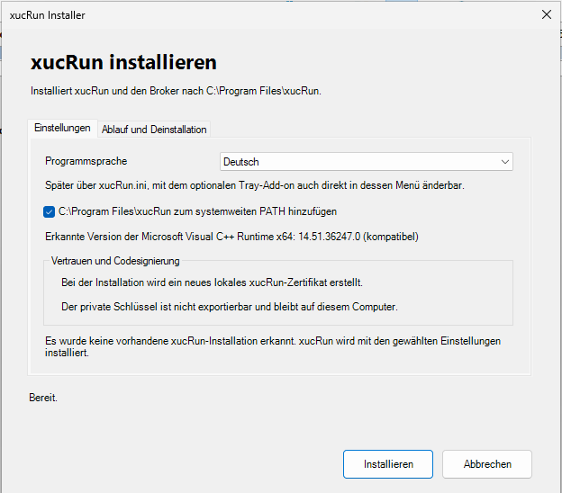

Der Installer prüft die Microsoft Visual C++ Runtime x64. Fehlt eine passende Version, bietet er
den geprüften Microsoft-Download oder eine vorhandene `vc_redist.x64.exe` an und lehnt zu alte
Versionen ab. Anschließend installiert er Client, Broker, Approval-Helper und Sprachdateien unter
`%ProgramFiles%\xucRun` und richtet Brokerdienst und Deinstallationseintrag ein. Der manuelle
Installationsweg verwendet dasselbe mitgelieferte PowerShell-Skript.

### Aktualisieren und deinstallieren

xucRun und das separat installierte optionale
[xucRun-Tray-Add-on](https://github.com/HT64/xucRun-Tray) verwenden eine exakte vierteilige
Versionsbindung. Vor einem Versionswechsel oder der Deinstallation von xucRun muss xucRun Tray
über seinen eigenen Windows-Deinstallationseintrag entfernt werden; anschließend kann die
Tray-Version mit derselben neuen Versionsnummer installiert werden. Bei einer erneuten
Installation derselben passenden Version kann Tray installiert bleiben.

Für eine Aktualisierung wird der versionierte grafische Installer des neueren Pakets gestartet. Er
verwendet das vorhandene gültige lokale xucRun-Zertifikat erneut. Gespeicherte Anmeldedaten,
Freigaben und nicht vom Installer verwaltete INI-Einstellungen bleiben erhalten.

Die Deinstallation ist über **Installierte Apps** möglich. Alternativ wird kein separates
Deinstallationsskript benötigt, sondern das bei der Installation nach
`%ProgramFiles%\xucRun` kopierte `Install-xucRun.ps1` mit `-Uninstall` aufgerufen:

```powershell
powershell.exe -NoProfile -ExecutionPolicy Bypass `
  -File "$env:ProgramFiles\xucRun\Install-xucRun.ps1" `
  -Uninstall
```

> **Achtung:** Die Deinstallation löscht unwiderruflich alle von xucRun gespeicherten
> Anmeldedaten und Freigaben aller Windows-Benutzer sowie alle lokalen xucRun-Sicherungen,
> Sicherheitsmerkmale und zugehörigen Metadaten. Außerdem entfernt sie das lokale
> xucRun-Standardzertifikat samt privatem Schlüssel und Vertrauenseinträgen.

Vor der ersten Änderung verlangt die Deinstallation eine ausdrückliche Bestätigung dieser
unwiderruflichen Löschung. Bei Abbruch bleiben Installation und Daten unverändert.

Bei einem Deinstallationsfehler schreibt xucRun ein technisches Diagnoseprotokoll nach
`%ProgramData%\xucRun\InstallerLogs`; der Fehlerdialog zeigt den konkreten Dateipfad und kann den
Protokollordner öffnen. Das Protokoll enthält keine gespeicherten Kennwörter.

Beide Installationswege und die Hinweise zur lokalen Testsignierung stehen ausführlich in der
[Installationsanleitung](docs/de/INSTALLATION.md).

Die folgenden Beispiele verwenden den Kurznamen `xucRun.exe`. Das funktioniert, wenn
`%ProgramFiles%\xucRun` während der Installation in den globalen Maschinen-PATH aufgenommen
wurde. Im grafischen Installer kann diese Option ausgewählt werden; bei der manuellen
Installation wird dafür `-AddToSystemPath` angegeben. Ohne PATH-Eintrag muss xucRun mit
vollständigem Pfad aufgerufen werden, beispielsweise
`"%ProgramFiles%\xucRun\xucRun.exe"`.

## Schnellstart

Nach der Installation können xucRun-Anmeldedaten für ein Zielkonto ausdrücklich gespeichert
werden:

```powershell
xucRun.exe /addcred Administrator
```

Wird der Kontoname weggelassen, öffnet xucRun zuerst ein Dialogfenster zur Auswahl eines
aktivierten lokalen Kontos. Anschließend erscheint unabhängig davon, ob das Konto angegeben oder
ausgewählt wurde, ein Dialogfenster zur Kennworteingabe auf dem separaten Windows-Desktop. Für ein
Domänenkonto wird `DOMAIN\Benutzername` angegeben.

| Anmeldedateneingabe auf separatem Desktop | Bestätigung gespeicherter Anmeldedaten |
|:---:|:---:|
| 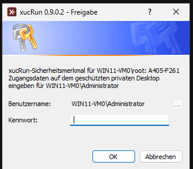 | 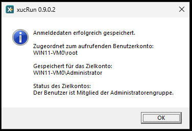 |

Programme werden mit ihrem normalen Programmpfad und den anschließenden Argumenten aufgerufen:

```powershell
xucRun.exe notepad.exe
xucRun.exe regedit.exe
xucRun.exe powershell.exe -NoExit
xucRun.exe cmd.exe /c "net stop MyService"
```

Fehlen ein geeignetes Konto, gespeicherte Anmeldedaten oder eine passende Freigabe, führt xucRun
im laufenden Aufruf durch die erforderlichen Schritte.

## Anwendungsbeispiele

Gerätemanager aus einem Standardbenutzerkonto öffnen:

```cmd
xucRun.exe "%windir%\System32\mmc.exe" "%windir%\System32\devmgmt.msc"
```

Eine administrative PowerShell mit einem Skript starten:

```powershell
xucRun.exe powershell.exe -File "C:\Scripts\AdminScript.ps1"
```

Einen Windows-Dienst über `cmd.exe` stoppen:

```cmd
xucRun.exe cmd.exe /c "net stop MyService"
```

Eine Datei mit einem Programm unter dem gewählten Zielkonto bearbeiten:

```powershell
xucRun.exe notepad.exe "C:\Windows\System32\drivers\etc\hosts"
```

Die aktuelle PowerShell durch eine PowerShell im automatisch gewählten Benutzer- und
Berechtigungskontext ersetzen:

```powershell
PS D:\Beispiel\Projekt> xucRun.exe
```

Bei diesem parameterlosen Aufruf erkennt xucRun die direkte Eltern-Shell, schließt die bisherige
Konsole nach erfolgreichem Start und öffnet dieselbe Shell im ursprünglichen Arbeitsverzeichnis
neu. Läuft die bisherige PowerShell unter einem Standardkonto und ist genau ein
Administratorkonto mit xucRun-Anmeldedaten gespeichert, wählt xucRun dieses Konto automatisch,
fordert die Windows-UAC-Bestätigung an und startet die neue PowerShell erhöht unter diesem Konto
wieder in `D:\Beispiel\Projekt`. Das ist der typische Hauptanwendungsfall der Shell-Ersetzung.

Sind für mehrere Administratorkonten xucRun-Anmeldedaten gespeichert, erscheint stattdessen die
Kontoauswahl. Ist das
aktuelle Konto selbst ein Administrator, verwendet xucRun dieses Konto und nutzt bereits erteilte
erhöhte Rechte direkt oder fordert andernfalls UAC an. Nur wenn für ein
Standardkonto keine xucRun-Anmeldedaten eines Administratorkontos gespeichert sind,
berücksichtigt xucRun Standardkonten, für die xucRun-Anmeldedaten gespeichert sind, und startet
die Ersatz-Shell ohne Erhöhung. Das Arbeitsverzeichnis bleibt in allen Fällen erhalten.

Die oben gezeigten Aufrufe mit einem Zielprogramm können auch in Skripten und
Desktop-Verknüpfungen verwendet werden. Kann xucRun das Zielkonto eindeutig automatisch bestimmen,
muss im Aufruf kein Kontoname stehen.

Für die Trennung zwischen Standardbenutzer und privilegiertem Zielkonto gilt der Grundsatz:
**Der Standardbenutzer darf die privilegierte Aktion anfordern, aber nicht unbemerkt deren
administrativ freigegebenen Inhalt verändern.**

Das ist kein xucRun-spezifisches Problem, sondern gilt allgemein, wenn ein weniger privilegiertes
Konto Dateien verändern kann, die das Verhalten eines höher privilegierten Prozesses bestimmen.

Skripte, Verknüpfungen, geplante Aufgaben und Konfigurationsdateien, die einen xucRun-Aufruf
enthalten oder dessen Ziel, Argumente oder Arbeitsverzeichnis bestimmen, müssen deshalb selbst
vertrauenswürdig und vor unbefugten Änderungen geschützt sein. xucRun kann ihre Integrität nicht
allgemein prüfen. Konten, die solche Dateien verändern können, müssen bereits als berechtigt
gelten, den betreffenden privilegierten Aufruf zu kontrollieren. Das gilt auch für übergeordnete
Verzeichnisse, über die diese Dateien gelöscht, ersetzt, umbenannt oder umgeleitet werden könnten.
Solche Dateien dürfen nicht in gemeinsam oder unzureichend geschützten beschreibbaren
Verzeichnissen liegen.

Die parameterlose Shell-Ersetzung ist dagegen für den interaktiven Aufruf aus einer unterstützten
Shell bestimmt. In einem Skript sollte sie nur verwendet werden, wenn das Schließen der bisherigen
Konsole und der interaktive Start einer Ersatz-Shell ausdrücklich beabsichtigt sind. Für eine
normale Desktop-Verknüpfung ist der parameterlose Aufruf nicht geeignet.

Unterstützte Eltern-Shells sind `cmd.exe`, `powershell.exe`, `pwsh.exe` und `tcc.exe`.

### Batchdatei bei Bedarf erhöht neu starten

Eine Batchdatei kann am Anfang prüfen, ob sie bereits mit erhöhten Rechten läuft. Andernfalls
startet sie sich über xucRun erneut und beendet den ursprünglichen, nicht erhöhten Durchlauf. Mit
`/user-elevated` wählt xucRun ein Administratorkonto aus und fordert die erforderliche
UAC-Bestätigung an:

```cmd
@echo off
NET SESSION >nul 2>&1
IF ERRORLEVEL 1 (
  "%ProgramFiles%\xucRun\xucRun.exe" /user-elevated "%~dpnx0" %*
  GOTO :eof
)

REM Ab hier folgen die Befehle, die erhöhte Rechte benötigen.
```

`%~dpnx0` liefert den vollständig qualifizierten Pfad der laufenden Batchdatei; `%*` reicht alle
ursprünglichen Argumente weiter. `GOTO :eof` verhindert, dass der nicht erhöhte Durchlauf nach dem
erneuten Start fortgesetzt wird. Die Prüfung mit `NET SESSION` setzt voraus, dass der Windows-Dienst
**Server** verfügbar ist.

### Desktop-Verknüpfung für einen erhöhten Explorer

Eine Desktop-Verknüpfung kann ein Explorer-Fenster für ein festgelegtes Verzeichnis direkt unter
einem bestimmten Administratorkonto, für das xucRun-Anmeldedaten gespeichert sind, und mit
erhöhten Rechten öffnen. Im Feld **Ziel** der Verknüpfung steht beispielsweise:

```text
"%ProgramFiles%\xucRun\xucRun.exe" /user-elevated:Administrator "%WINDIR%\explorer.exe" "/root,"D:\Beispiel\Zielordner""
```

`/user-elevated:Administrator` sollte verwendet werden, wenn die Verknüpfung immer ein bestimmtes
Administratorkonto wählen, für das xucRun-Anmeldedaten gespeichert sind, und den Explorer
ausdrücklich mit erhöhten Rechten starten soll. Soll xucRun das passende Konto automatisch
bestimmen, wird der Schalter weggelassen. Soll der Explorer zwar unter einem bestimmten anderen
Konto, aber ohne durch xucRun erzwungene Erhöhung starten, wird stattdessen `/user:<Konto>`
verwendet.

`Administrator` ist durch das gewünschte Administratorkonto, für das xucRun-Anmeldedaten
gespeichert sind, und der Beispielpfad durch das zu öffnende Verzeichnis zu ersetzen. `/root`
setzt dieses Verzeichnis als Wurzel des neuen Explorer-Fensters. Die verschachtelten
Anführungszeichen müssen unverändert erhalten bleiben. Die gespeicherten Anmeldedaten ersetzen
nicht die interaktive Windows-UAC-Bestätigung.

### Integration in das Explorer-Kontextmenü

Die optionale Datei [ExplorerKontextMenue.reg](ExplorerKontextMenue.reg) enthält ein vollständiges
Beispiel, das xucRun-Befehle für unterstützte Dateien, Ordner, Ordnerhintergründe und Laufwerke
ergänzt. Die Befehlseinträge für ausführbare Dateien und Ordnerhintergründe folgen beispielsweise
diesen Mustern:

```reg
[HKEY_LOCAL_MACHINE\SOFTWARE\Classes\exefile\shell\xucRun\command]
@="\"C:\\Program Files\\xucRun\\xucRun.exe\" /user-elevated \"%1\""

[HKEY_LOCAL_MACHINE\SOFTWARE\Classes\Directory\Background\shell\xucRunAdmin\command]
@="\"C:\\Program Files\\xucRun\\xucRun.exe\" /user-elevated \"C:\\Windows\\explorer.exe\" \"/root,\"%V\"\""
```

Die Datei ist ein Beispiel und kein Bestandteil des Installers. Sie entfernt zuerst die neun von
ihr verwalteten Einträge und erstellt sie anschließend unter `HKEY_LOCAL_MACHINE` neu, sodass sie
für alle Benutzer gelten. Der Import erfordert Administratorrechte, setzt eine xucRun-Installation
unter `C:\Program Files\xucRun` voraus und erzwingt für jeden enthaltenen xucRun-Befehl mit
`/user-elevated` ausdrücklich ein erhöhtes Administratorkonto.

Diese Einträge verwenden die klassische Win32-Registrierung für Explorer-Kontextmenüs unter
`Software\Classes\...\shell`. Im standardmäßigen kompakten Kontextmenü von Windows 11 stehen sie
normalerweise erst unter **Weitere Optionen anzeigen**. Wird stattdessen das klassische
Kontextmenü verwendet, erscheinen sie unmittelbar.

### Integration in Total Commander

Die folgenden Beispiele zeigen Ausschnitte der Total-Commander-Konfigurationsdatei `usercmd.ini`.
Sie wurden mit Total Commander 11.58 (64 Bit) getestet. Sie können auch mit anderen Versionen
funktionieren; deren Kompatibilität wurde jedoch nicht geprüft. Allgemeine Informationen zu Total
Commander bietet die
[offizielle Total-Commander-Webseite](https://www.ghisler.com/deutsch.htm).

xucRun kann eine neue erhöhte Total-Commander-Instanz nach seiner automatischen Kontostrategie
starten. Mitglieder der Administratorengruppe behalten ihr Konto und werden bei Bedarf über UAC
erhöht. Bei einem Standardbenutzer verwendet xucRun ein gespeichertes Administratorkonto. Der
Aufruf übernimmt den linken Pfad, den rechten Pfad und das aktive Dateipanel:

```ini
[em_TCStart_Elevated]
button=%COMMANDER_PATH%\icons\Tcmadm64000.ico
cmd=%comspec% /v:on /c
param=SET "P=%P." & SET "L=%X%P." & SET "R=%X%T." & SET Active=L & (IF "!P!" == "!R!" SET Active=R) & "%|ProgramFiles|\xucRun\xucRun.exe" "%|COMMANDER_PATH|\TOTALCMD64.EXE" /L="!L!" /R="!R!" /P=!Active!
menu=Start TC über xucRun mit erhöhten Rechten; Administratormitglieder behalten ihr Konto, Standardbenutzer wechseln zum Administrator
iconic=1

[em_TCReStart_Elevated]
button=%COMMANDER_PATH%\icons\Tcmadm64000.ico
cmd=cm_Exit,em_TCStart_Elevated
param=
menu=Neustart TC mit erhöhten Rechten
iconic=1
```

Der zweite Befehl schließt die aktuelle Total-Commander-Instanz und ruft anschließend den ersten
Befehl auf. Für den Kontowechsel eines Standardbenutzers muss mindestens ein Administratorkonto in
xucRun gespeichert sein. Sind mehrere passende Administratorkonten gespeichert, erscheint die
Kontoauswahl. Eine erforderliche Windows-UAC-Abfrage muss bestätigt werden.

Der folgende Befehl startet eine neue Total-Commander-Instanz als `LocalSystem`. Dabei bleiben der
linke Pfad, der rechte Pfad und das aktive Dateipanel erhalten:

```ini
[em_TCStart_System]
button=%COMMANDER_PATH%\icons\Tcmadm64000.ico
cmd="%ProgramFiles%\xucRun\xucRun.exe"
param="/hidden-monitor "%|ComSpec|" /v:on /c SET "P=%P." & SET "L=%X%P." & SET "R=%X%T." & SET Active=L & (IF "!P!" == "!R!" SET Active=R) & "%|ProgramFiles|\xucRun\xucRun.exe" /system "%|COMMANDER_EXE|" "/L=!L!" "/R=!R!" "/P=!Active!""
menu=Total Commander über xucRun als LocalSystem starten
iconic=1
```

Dieser Befehl muss xucRun zweimal aufrufen, weil `/system` nur aus einem erhöhten
Administratorkontext verfügbar ist. Der äußere Aufruf startet nach der zuvor beschriebenen
automatischen Kontostrategie eine erhöhte zwischengeschaltete Eingabeaufforderung und verbirgt sie
durch `/hidden-monitor`. Der innere xucRun-Aufruf läuft dadurch mit erhöhten Administratorrechten
und startet Total Commander als `LocalSystem`. Jeder SYSTEM-Start muss separat auf dem geschützten
privaten xucRun-Desktop bestätigt werden.

Die zwischengeschaltete `cmd.exe /v:on /c` speichert die von Total Commander gelieferten Pfade
zuerst in Umgebungsvariablen und übergibt sie danach per verzögerter Variablenerweiterung an den
inneren xucRun-Aufruf. Dadurch werden auch Pfade mit Leer- und Sonderzeichen zuverlässig
verarbeitet. Der Vergleich der Pfade bestimmt zusätzlich, ob das linke oder rechte Panel aktiv
ist.

Total Commander besitzt anschließend uneingeschränkte `LocalSystem`-Rechte. Verwenden Sie diesen
Befehl nur bewusst für Wartung und Diagnose.

xucRun kann Total Commander außerdem unter einem ausdrücklich ausgewählten anderen Windows-Konto
starten, ohne dass dieses bereits interaktiv angemeldet ist. So lassen sich Dateioperationen aus
einer normalen Benutzersitzung heraus in einem anderen Kontokontext ausführen. Für erhöhte
administrative Dateioperationen muss das Zielkonto über Administratorrechte verfügen und die
Windows-UAC-Abfrage bestätigt werden.

Für dieses Beispiel ist `<Konto>` durch den eingerichteten Kontonamen zu ersetzen; die
Total-Commander-Variablen und das Quoting müssen unverändert übernommen werden:

```ini
[em_TCStart_Konto]
button=%COMMANDER_EXE%
cmd="%ProgramFiles%\xucRun\xucRun.exe"
param="/hidden-monitor "%|ComSpec|" /v:on /c SET "P=%P." & SET "L=%X%P." & SET "R=%X%T." & SET Active=L & (IF "!P!" == "!R!" SET Active=R) & "%|ProgramFiles|\xucRun\xucRun.exe" /user:<Konto> "%|COMMANDER_EXE|" "/L=!L!" "/R=!R!" "/P=!Active!""
menu=Total Commander als <Konto> starten
iconic=1
```

Der Befehl verwendet xucRun erneut zweimal, damit ein Administratorkonto als zentraler
Bevollmächtigter für die Anmeldedaten weiterer Zielkonten dienen kann. Bei diesem Beispiel ist die
Kaskade im Unterschied zum zuvor beschriebenen LocalSystem-Beispiel für die eigentliche
Startfunktion nicht erforderlich; sie ist hier eine bewusste Designentscheidung für die
Speicherung der Anmeldedaten. Der äußere Aufruf verwendet dieselbe zuvor beschriebene verborgene,
erhöhte Administrator-Zwischenstufe. Der darin ausgeführte innere xucRun-Aufruf läuft deshalb mit
der SID des Administrators und kann dessen für `<Konto>` gespeicherte Anmeldedaten verwenden.
Dadurch müssen die Anmeldedaten der weiteren Zielkonten nicht für jeden Standardbenutzer erneut
gespeichert werden; jeder Standardbenutzer benötigt nur die für ihn gespeicherten Anmeldedaten des
zentralen Administratorkontos. Ein einzelner xucRun-Aufruf des Standardbenutzers könnte dagegen
nur dessen eigene, an seine SID gebundenen Anmeldedaten verwenden. Der innere Aufruf verarbeitet
`/user:<Konto>` und startet die sichtbare Total-Commander-Instanz unter dem Zielkonto. Die
Erhöhung der äußeren Zwischenstufe wird nicht auf das Zielkonto übertragen; dessen Rechte bleiben
unverändert.

Der Befehl kann beispielsweise in ein benutzerdefiniertes Menü aufgenommen werden:

```text
POPUP "Benutzer"
  MENUITEM "Total Commander für <Konto> starten", em_TCStart_Konto
END_POPUP
```

Auf dieselbe Weise können weitere Konten ergänzt werden. Dazu können für jedes weitere Konto ein
eigener Befehl in `usercmd.ini` sowie ein darauf verweisender `MENUITEM` angelegt werden.

## Kontowahl und Rechte

Ohne Benutzerschalter verwendet xucRun einen passenden aktuellen Benutzerkontext oder ein
Administratorkonto, für das xucRun-Anmeldedaten gespeichert sind. Gibt es genau ein passendes
Konto mit xucRun-Anmeldedaten, wird es automatisch gewählt; bei mehreren erscheint eine Auswahl.

| Konto mit gespeicherten Anmeldedaten wählen | Lokalen Zielbenutzer wählen |
|:---:|:---:|
| 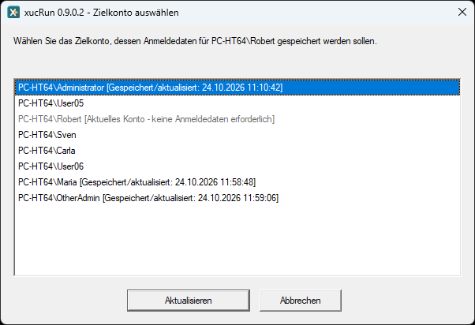 | 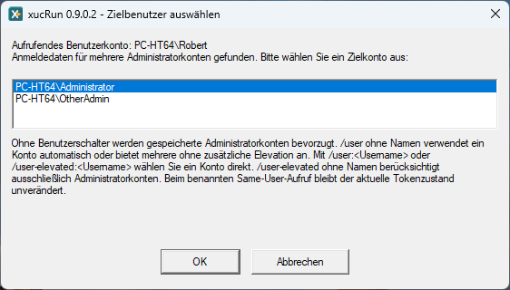 |

| Aufruf | Verhalten |
|---|---|
| `xucRun.exe <Programm> [Argumente ...]` | Konto automatisch bestimmen; bei Bedarf erhöhte Rechte anfordern |
| `xucRun.exe /user <Programm> [Argumente ...]` | Konto wählen, für das xucRun-Anmeldedaten gespeichert sind, ohne zusätzliche Erhöhung durch xucRun |
| `xucRun.exe /user:<Konto> <Programm> [Argumente ...]` | bestimmtes Konto verwenden, ohne zusätzliche Erhöhung durch xucRun |
| `xucRun.exe /user-elevated <Programm> [Argumente ...]` | Administratorkonto wählen, für das xucRun-Anmeldedaten gespeichert sind, und erhöht starten |
| `xucRun.exe /user-elevated:<Konto> <Programm> [Argumente ...]` | bestimmtes Konto verwenden und erhöht starten |

Sind beim ersten Aufruf mit `/user-elevated` noch keine Anmeldedaten für ein geeignetes
Administratorkonto gespeichert, bietet xucRun automatisch die Auswahl eines Administratorkontos
und die geschützte Kennworteingabe an. Nach erfolgreicher Speicherung wird der ursprüngliche
Startauftrag fortgesetzt. `/addcred` kann weiterhin verwendet werden, um Anmeldedaten unabhängig
von einem Startauftrag vorab zu speichern.

Gespeicherte Anmeldedaten umgehen Windows-UAC nicht. Ist eine Erhöhung erforderlich, bleibt die
UAC-Bestätigung interaktiv. Bei einer neuen Freigabe für einen erhöhten Start können zunächst der
Freigabedialog auf dem separaten Desktop und anschließend der UAC-Dialog für das Zielprogramm
erscheinen. Für kontenübergreifende erhöhte Starts muss für das ausgewählte Administratorkonto der
Windows-Administratorbestätigungsmodus aktiviert sein. Stellt Windows stattdessen bereits einen
vollständig erhöhten Token bereit, blockiert xucRun den Start, weil keine UAC-Bestätigung möglich
wäre. Das kann insbesondere das integrierte Konto `Administrator` betreffen.

## Freigaben

**Mit jeder Freigabe legt der Anwender das Verhältnis zwischen Bedienkomfort und enger Begrenzung
selbst fest:** Je länger und weiter eine Freigabe gilt, desto mehr passende spätere Aufrufe kommen
ohne erneute xucRun-Freigabeentscheidung aus. Eine kürzere oder genauer an Programm, Aufruf und
Zielkonto gebundene Freigabe verlangt häufiger eine neue Entscheidung, begrenzt dafür aber ihre
Wiederverwendung.

Der differenzierte Freigabedialog ermöglicht es, Freigabedauer, Programm- und Aufrufbindung sowie
die einbezogenen Zielkonten an den konkreten Anwendungsfall und das gewünschte Schutzniveau
anzupassen. Er erklärt die Wirkung der aktuellen Auswahl und zeigt außerdem den Signaturstatus des
Zielprogramms; xucRun erkennt dabei sowohl direkt eingebettete Authenticode-Signaturen als auch
vertrauenswürdige Windows-Katalogsignaturen. Als Freigabedauer stehen zur Verfügung:

- nur dieser eine Start,
- 10 Minuten,
- ein Tag,
- bis zur Abmeldung,
- dauerhaft.

Das Verhältnis einer wiederverwendbaren Freigabe zu einer weiterhin erforderlichen
Windows-UAC-Bestätigung beschreibt der Abschnitt
[Freigaben und UAC in xucRun](#freigaben-und-uac-in-xucrun).

Bei „Nur dieses eine Mal“ gelten Freigabeumfang und Zielkontenauswahl nicht, weil die Freigabe
ausschließlich für den aktuell angezeigten Start gilt. Die betreffenden Auswahlfelder sind deshalb
deaktiviert. Eine wiederverwendbare Freigabe kann an ein bestimmtes Programm oder an alle Programme
sowie an ein bestimmtes Zielkonto oder an alle gespeicherten Konten des aktuellen Windows-Benutzers
gebunden werden. Programmspezifische Freigaben berücksichtigen den SHA-256-Hash der Startdatei.
Ändert sich die Datei, muss die Übernahme der Freigabe auf die neue Version ausdrücklich bestätigt
werden.

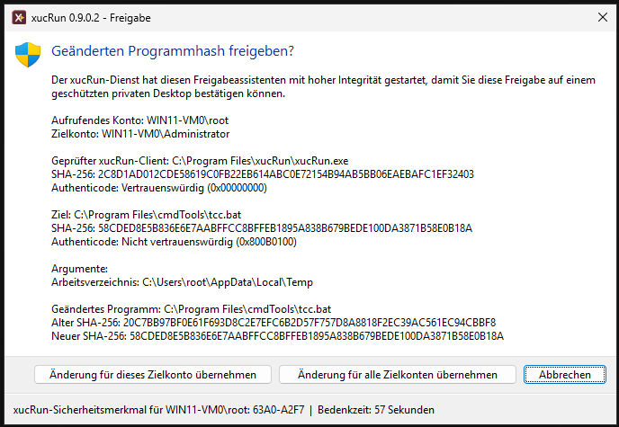

Mit **„Genau dieser Aufruf“** kann eine wiederverwendbare Freigabe zusätzlich an die exakten
Argumente, das Arbeitsverzeichnis und daran gebunden werden, ob das Programm sichtbar oder
verborgen gestartet wird. Schon eine Änderung dieser Werte erfordert dann eine neue Freigabe. Die
Argumente werden dabei nicht im Klartext gespeichert, sondern nur durch ihren SHA-256-Hash
gebunden.

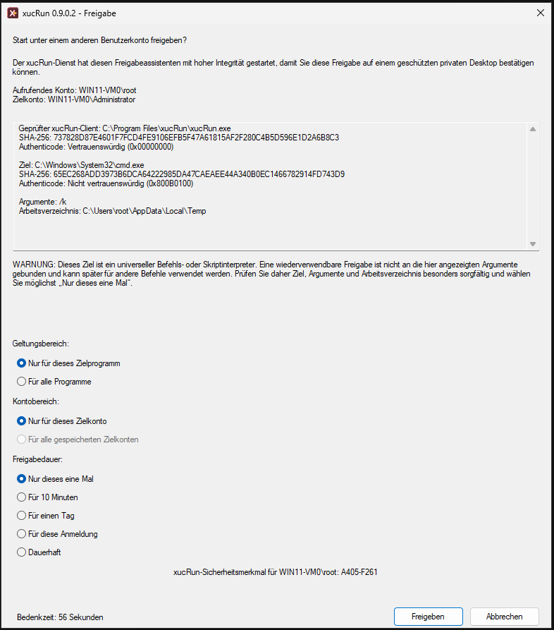

Eine Freigabe begrenzt nicht die Fähigkeiten des gestarteten Programms. Allgemeine oder dauerhafte
Freigaben für universelle Interpreter wie `cmd.exe`, PowerShell oder `wscript.exe` sind deshalb
besonders weitreichend.

Bei `cmd.exe`, `powershell.exe`, `pwsh.exe`, TCC und Windows Script Host weist der Freigabedialog
deshalb auf die weiterreichenden Fähigkeiten des Interpreters hin. Eine normale
Programmfreigabe bindet die angezeigten Argumente nicht. Deshalb ist bei diesen Shells und
Interpretern für eine wiederverwendbare Freigabe „Genau dieser Aufruf“ vorausgewählt.

Wird eine wiederverwendbare Freigabe für einen dieser Interpreter dennoch auf „Nur für dieses
Zielprogramm“ oder „Für alle Programme“ geändert, verlangt xucRun auf dem geschützten Desktop eine
zweite ausdrückliche Bestätigung. Sie erklärt, dass Argumente, Skriptpfade und Skriptinhalte nicht
Teil der gespeicherten Freigabe sind und später andere Befehle oder neue beziehungsweise veränderte
Skripte ohne erneuten xucRun-Freigabedialog gestartet werden können. „Zurück zur Auswahl“ ist die
Vorgabe. Eine bewusst gespeicherte weitreichende Freigabe behält diese Wirkung, wenn sie auf einen
späteren Aufruf passt.

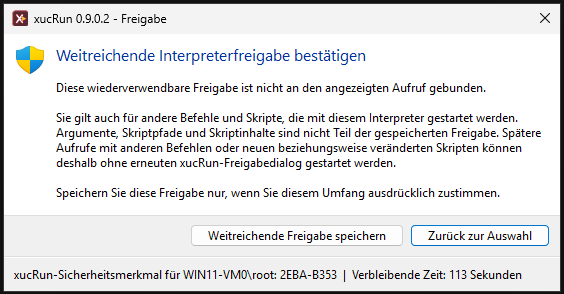

Erkennt xucRun dabei ein direkt angegebenes PowerShell-, Batch-, TCC- oder
Windows-Script-Host-Skript, bindet es dessen vollständig aufgelösten Pfad und SHA-256-Hash
zusätzlich, sofern das aufrufende Konto keinen für den Austausch relevanten Ordner verändern kann.
Die Skriptdatei selbst darf beschreibbar sein: Ändert sich ihr Inhalt später, passt ihr Hash nicht
mehr und xucRun verlangt eine neue Freigabe. Unmittelbar vor jedem Start prüft der Broker finalen
Pfad und Hash erneut und hält die geprüfte Datei bis zum Programmstart gegen Änderung und
Austausch gesperrt. Eine aktive Skriptbindung ist daran erkennbar, dass oben im Freigabedialog
das direkte Skript mit Pfad und SHA-256-Hash angezeigt wird. Für PowerShell ist eine
wiederverwendbare Freigabe „Genau dieser Aufruf“ nur mit einer solchen sicher gebundenen direkten
Skriptdatei verfügbar. Insbesondere `-Command`, interaktive Aufrufe und andere nicht als direkte
`-File`-Ausführung erkannte Formen können nur einmalig oder bewusst mit einem weiterreichenden
Freigabeumfang bestätigt werden.

Wird bei anderen Interpretern kein direktes Skript mit Pfad und SHA-256-Hash angezeigt, bindet
„Genau dieser Aufruf“ zwar Programmdatei, Argumente, Arbeitsverzeichnis und dieselbe Einstellung
für einen sichtbaren oder verborgenen Start, aber kein weiteres Programm und keinen Skriptinhalt.
Programme, Skripte und andere Dateien, die im Befehl genannt oder von ihm
direkt oder indirekt aufgerufen werden, können ersetzt oder inhaltlich verändert werden, ohne
dass die Freigabe dadurch ungültig wird. Das gilt beispielsweise für freien CMD-Befehlstext mit
`SET` und `CALL` sowie für Programme, die ein gebundenes Zielprogramm oder Skript anschließend
startet.

Kann dagegen ein austauschrelevanter Ordner verändert oder Pfad beziehungsweise Inhalt nicht
sicher geprüft werden, ist eine wiederverwendbare Freigabe für „Genau dieser Aufruf“ nicht
verfügbar. Der Dialog erklärt den Grund und behält die einmalige Freigabe als Vorgabe bei. Der
Anwender kann stattdessen bewusst eine wiederverwendbare Freigabe für den Interpreter oder für
alle Programme wählen. Eine solche weitreichende Freigabe bindet Argumente, Skriptpfad und
Skriptinhalt nicht und erfordert deshalb die oben beschriebene gesonderte ausdrückliche
Bestätigung. Vor jedem einzelnen Start prüft und sperrt der Broker ein erkanntes direktes Skript
dennoch erneut; diese Startprüfung bindet spätere Aufrufe nicht an den früheren Skriptinhalt. Bei
PowerShell kann eine administrativ erzwungene Richtlinie `AllSigned` Skriptdateien zusätzlich
absichern, schützt jedoch nicht vor direkten oder interaktiven Befehlen.

Aufrufende Skripte, Verknüpfungen und Konfigurationsdateien, aus denen der xucRun-Aufruf erst
erzeugt wird, werden weiterhin nicht allgemein gehasht. Die Freigabe bindet den daraus
entstehenden xucRun-Aufruf, nicht die Skript-, Verknüpfungs- oder Konfigurationsdatei, aus der er
stammt. Nachgelagerte Programme und dynamisch nachgeladene Skripte, Module,
Konfigurationsdateien, Plugins und Programmeingaben gehören ebenfalls nicht automatisch zur
Bindung. Solche Programme und Dateien sowie die für ihren Austausch relevanten Verzeichnisse
müssen deshalb weiterhin entsprechend geschützt sein. Eine vorhandene xucRun-Freigabe ist kein
Ersatz für diesen Schutz. Die übrigen Brokerprüfungen, insbesondere zu Konto, angeforderten
Rechten, Sichtbarkeit, Zielpfad und Zielprogrammhash, bleiben wirksam.

## Programme, Argumente und Sonderzeichen

Der erste Nicht-xucRun-Schalter ist das Zielprogramm. Alle folgenden Argumente gehören
ausschließlich diesem Programm:

```powershell
xucRun.exe cmd.exe /c dir
xucRun.exe /user:Administrator app.exe /config:value
```

`/c` und `/config:value` werden hier nicht von xucRun ausgewertet. Shell-interne Befehle müssen
über die jeweilige Shell gestartet werden, beispielsweise `cmd.exe /c dir` oder
`powershell.exe -Command Get-Process`.

Programmpfade und einzelne Argumente mit Leerzeichen werden wie üblich in Anführungszeichen
gesetzt. xucRun unterstützt auch Batchdateien und überträgt typische Shell-Sonderzeichen über die
zusätzlichen Prozessgrenzen. Welche Zeichen von `cmd.exe`, PowerShell oder einer anderen
aufrufenden Shell schon vor dem Start von xucRun ausgewertet werden, richtet sich weiterhin nach
dieser Shell.

Bei einem brokervermittelten Start einer `.bat`- oder `.cmd`-Datei, deren Dateiname eines der
CMD-Metazeichen `& | ( ) ! % ^` enthält, erzeugt der Broker einen temporären Wrapper mit dem Namen
`xucRun_wrapper_<128-Bit-Zufall>.bat`. Er legt ihn bevorzugt auf einem geeigneten Volume namens
`RamDisk` ab, andernfalls im `%TEMP%`-Verzeichnis des Zielkontos. Der Broker schützt den Wrapper bis
zum Ende des gestarteten Prozesses und versucht ihn anschließend oder bei einem fehlgeschlagenen
Start während der Fehlerbereinigung zu löschen. Bleibt er wegen eines Löschfehlers oder
unerwarteten Brokerendes zurück, kann ein lokaler Administrator ihn nach Freigabe manuell
entfernen. Eine automatische Nachbereinigung gibt es nicht; der Wrapper enthält keine
Anmeldedaten, gespeicherten Argumente oder wiederverwendbare Autorisierung.

## Nützliche Befehle

| Befehl | Zweck |
|---|---|
| `xucRun.exe /addcred [<Konto>]` | Anmeldedaten speichern |
| `xucRun.exe /deletecred [<Konto>]` | gespeicherte Anmeldedaten auswählen und löschen |
| `xucRun.exe /showcred` | Konten anzeigen, für die xucRun-Anmeldedaten gespeichert sind |
| `xucRun.exe /showapprovals` | gespeicherte Freigaben anzeigen |
| `xucRun.exe /resetapprovals[:<Konto>]` | Freigaben zurücksetzen |
| `xucRun.exe /system [<Anwendung> [Argumente...]]` | eine lokale Anwendung oder Ersatz-Shell als `LocalSystem` starten |
| `xucRun.exe /info` | Version, Copyright, Signierzertifikat, Brokerstatus und aktuelle Konfiguration anzeigen |
| `xucRun.exe /admin-status` | Daten aller Windows-Benutzer erhöht anzeigen und verwalten |
| `xucRun.exe /backup` | lokale Datensicherungen verwalten |
| `xucRun.exe /audit` | Sicherheitsdiagnose ausführen |
| `xucRun.exe /enable-broker` | einen deaktivierten Broker wieder aktivieren |
| `xucRun.exe /clear-all` | gespeicherte Anmeldedaten, Freigaben, Sicherheitsmerkmale und zugehörige Metadaten löschen |
| `xucRun.exe /help` | vollständige Hilfe anzeigen |

`/hidden` verbirgt das unmittelbar gestartete Zielprogramm. `/hidden-monitor` überwacht zusätzlich
dessen Exitcode und zeigt bei einem Fehler einen Hinweis. Dialoge und Kindprozesse werden dadurch
nicht verborgen oder überwacht.

### Anwendung oder Ersatz-Shell als LocalSystem starten

`xucRun.exe /system [<Anwendung> [Argumente...]]` startet die angegebene lokale Anwendung oder
ohne angegebene Anwendung eine Ersatz-Shell unter dem Windows-Konto `LocalSystem` in der
interaktiven Sitzung des Aufrufers. Dieser Modus steht nur Mitgliedern der lokalen
Administratorengruppe zur Verfügung. Ein noch nicht erhöht gestarteter Administrator erhält eine
Windows-UAC-Abfrage; ein bereits erhöhter Administrator führt den Start ohne weitere UAC-Abfrage
aus. Standardbenutzer werden vor einer Erhöhungsanforderung abgewiesen.

Ohne Anwendung ersetzt `xucRun.exe /system` eine aufrufende TCC-, Eingabeaufforderungs-, Windows-
PowerShell- oder PowerShell-Core-Shell durch dieselbe Shell unter `LocalSystem`. Das aktuelle
Arbeitsverzeichnis bleibt erhalten, die neue Shell wird in den Vordergrund gebracht und die
bisherige Shell erst nach erfolgreichem Start des Ersatzes geschlossen.

Das erhöhte Administratorkonto darf vom in der interaktiven Sitzung angemeldeten Konto abweichen.
Dadurch kann `/system` aus einer erhöhten Ersatz-Shell in der Sitzung eines anderen Benutzers
aufgerufen werden.

`/system` verwendet keine gespeicherten Anmeldedaten oder Freigaben. Jeder Start muss separat im
signierten xucRun-Freigabehelper bestätigt werden. Der Dialog erscheint auf dem geschützten
privaten xucRun-Desktop und zeigt die genaue Programmdatei, alle Argumente und das
Arbeitsverzeichnis. Die Bestätigung gilt nur für diesen einen Aufruf und kann nicht gespeichert
werden. xucRun prüft die Programmdatei unmittelbar vor dem Start erneut.

Der private Desktop schützt die Bestätigung vor normalen Anwendungen auf dem normalen Desktop. Er
kann jedoch nicht vor Schadsoftware schützen, die bereits mit erhöhten Administratorrechten in
derselben Anmeldesitzung ausgeführt wird. Verwenden Sie `/system` deshalb nur aus einer
vertrauenswürdigen erhöhten Administratorsitzung.

```cmd
xucRun.exe /system "%SystemRoot%\regedit.exe" /m
```

Als `LocalSystem` ausgeführte Anwendungen besitzen weitreichende Kontrolle über den Rechner.
Insbesondere bezeichnet `HKEY_CURRENT_USER` das Profil von `LocalSystem` und nicht das Profil des
angemeldeten Benutzers. Verwenden Sie diesen Modus nur bewusst für Wartung und Diagnose.

## Anmeldedaten und Freigaben verwalten

`/showcred` zeigt die Zielkonten, für die xucRun-Anmeldedaten gespeichert sind. `/showapprovals`
zeigt die aktiven allgemeinen, zielprogrammspezifischen und an einen genauen Aufruf gebundenen
Freigaben; Freigabeumfang, Ziel, Aufrufbindung und Zielhash stehen dabei in getrennten Spalten. Die
gespeicherten Kennwörter werden nicht angezeigt oder an den Client übertragen. In beiden
grafischen Listen kann die ausgewählte Zeile unmittelbar gelöscht werden. Die Anmeldedatenansicht
kann außerdem alle angezeigten Anmeldedaten löschen; deren kontogebundene Freigaben werden dabei
mit entfernt, profilweite Freigaben bleiben gespeichert. Die Freigabenansicht kann alle
angezeigten Freigaben löschen. Jeder Löschvorgang verlangt eine eigene Bestätigung; ohne markierte
Zeile bleibt die Einzelaktion deaktiviert.

| Gespeicherte Anmeldedaten | Aktive Freigaben |
|:---:|:---:|
| 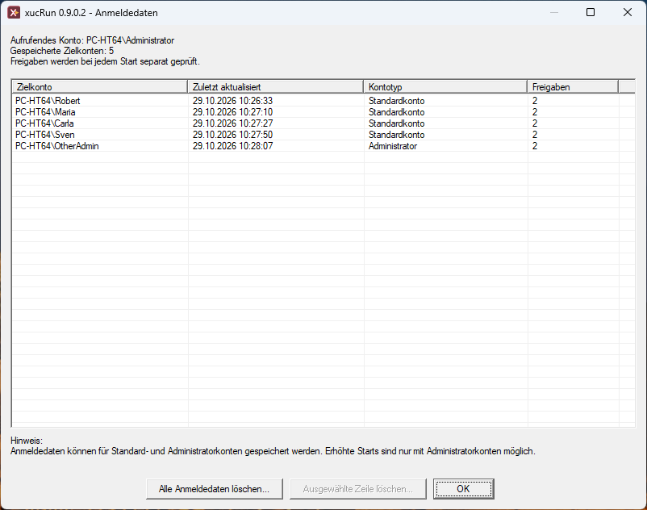 | 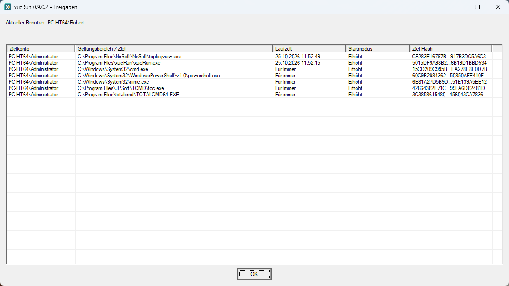 |

Ohne Kontonamen zeigt `/deletecred` eine Auswahl und verlangt vor der Löschung eine Bestätigung.
Beim Löschen eines Kontos entfernt xucRun auch dessen kontogebundene Freigaben. Profilweite
Freigaben für alle Konten bleiben bestehen.

Mit `/resetapprovals` können einzelne oder mehrere Freigaben ausgewählt und entfernt werden.
`/clear-all` ist der administrative Bereinigungsbefehl für aktive, vom Broker verwaltete Daten. Der
Befehl muss erhöht gestartet werden und löscht nach ausdrücklicher Bestätigung alle
xucRun-Anmeldedaten, Freigaben, Sicherheitsmerkmale und zugehörigen Metadaten aller
Windows-Benutzer dieses Rechners. Lokale Sicherungen bleiben erhalten und können separat mit
`/backup-delete-all` gelöscht werden.

| Gespeicherte Anmeldedaten löschen | Freigaben zurücksetzen |
|:---:|:---:|
| 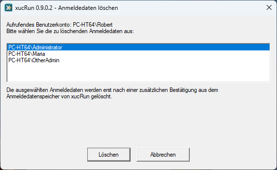 | 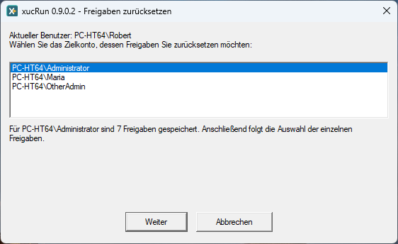 |

Für eine rechnerweite Übersicht zeigt `/admin-status` die gespeicherten xucRun-Daten aller
Windows-Benutzer und stellt die verfügbaren administrativen Bereinigungsaktionen bereit.

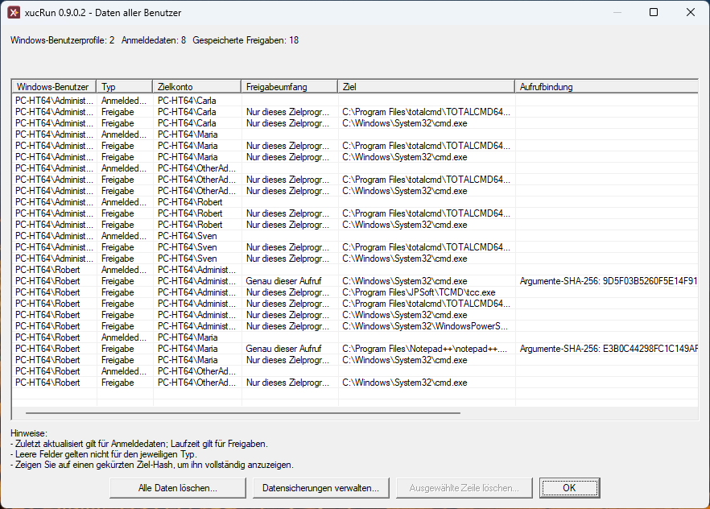

## Datensicherungen

`xucRun.exe /backup` öffnet die interaktive Verwaltung lokaler Datensicherungen. Zusätzlich stehen
folgende Befehle zur Verfügung:

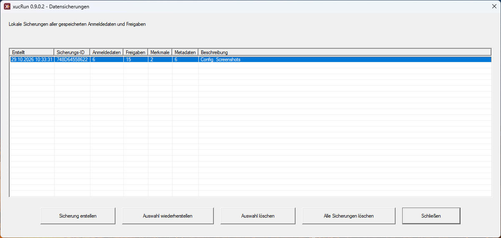

```text
xucRun.exe /backup-create [<Beschreibung>]
xucRun.exe /backup-list
xucRun.exe /backup-restore
xucRun.exe /backup-restore:<Backup-ID>
xucRun.exe /backup-delete-all
```

Eine Sicherung umfasst gespeicherte Anmeldedaten, Freigaben, Sicherheitsmerkmale und zugehörige
Metadaten. Datensicherungen werden getrennt von den aktiven Anmeldedaten und Freigaben unter
`%ProgramData%\xucRun\BrokerBackups` gespeichert. Für die Speicherung verwendet xucRun
Windows-APIs und bindet die Datensicherungen an den Rechner. xucRun stellt sie nur auf demselben
Rechner wieder her; sie sind kein portabler Kennwortexport.

Die Deinstallation entfernt auch die lokal gespeicherten xucRun-Datensicherungen.

## Fehlerdiagnose

`xucRun.exe /info` zeigt unter anderem Clientversion, Copyright, Name, SHA-256-Fingerabdruck und
Gültigkeitszeitraum des Signierzertifikats, Brokerstatus, aktuelles Konto und wirksame
Konfiguration. `xucRun.exe /audit` prüft sicherheitsrelevante Eigenschaften der laufenden
Installation und nennt bei gültiger Clientsignatur ebenfalls das geprüfte Zertifikat. Ist xucRun
Tray separat installiert, prüft die Diagnose zusätzlich dessen
installierte Dateien und Signaturen, Deinstallationsregistrierung und benutzerbezogene
Autostartaufgaben. Wurde der Brokerdienst deaktiviert, kann er mit
`xucRun.exe /enable-broker` wieder aktiviert werden. `xucRun.exe /help` zeigt die vollständige
lokale Befehlsübersicht.

Meldet xucRun, dass ein erhöhter Start wegen fehlender UAC-Bestätigung blockiert wurde, ist für
das ausgewählte andere Administratorkonto der Windows-Administratorbestätigungsmodus nicht
wirksam. Das kann insbesondere das integrierte Konto `Administrator` betreffen.

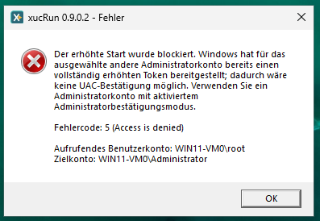

| Laufzeitinformationen | Sicherheitsdiagnose |
|:---:|:---:|
| 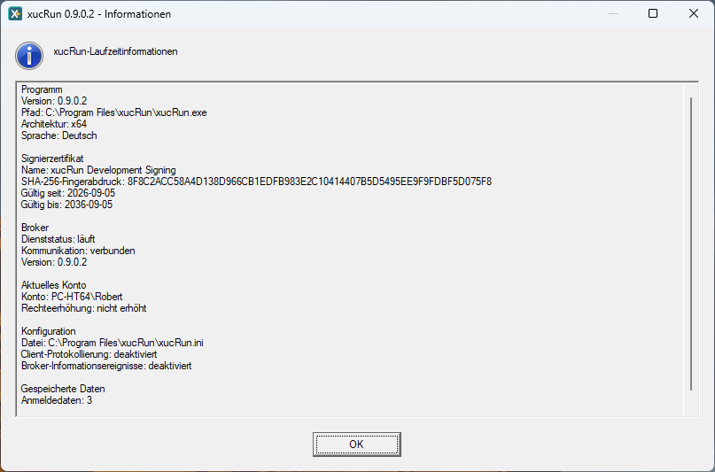 | 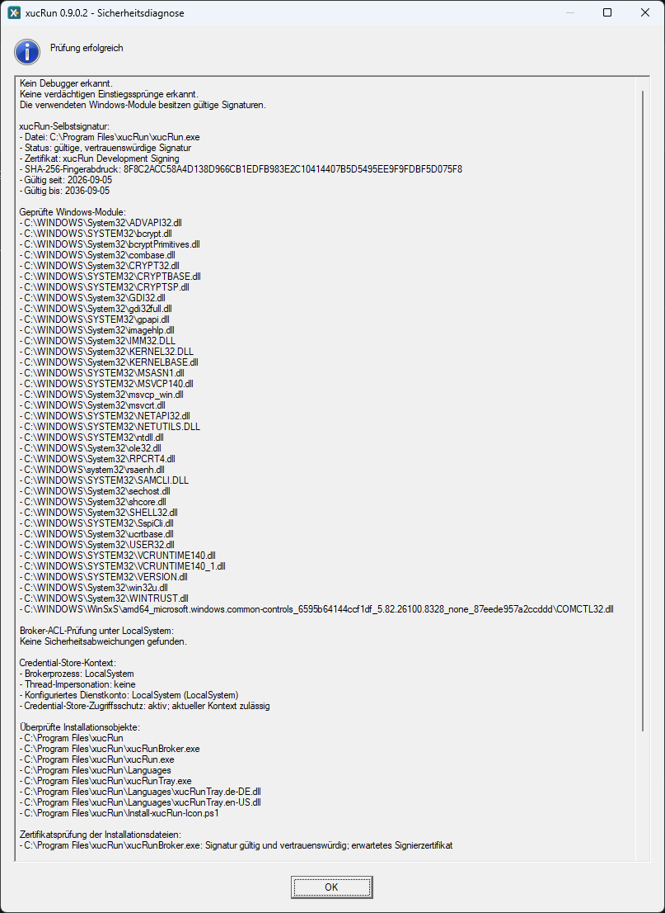 |

Für eine weitergehende Fehlerdiagnose kann über `ClientLogDirectory` das Client-Dateilog mit
Dateien im Format `xucRun_YYYYMMDD.log` aktiviert werden. Warnungen und Fehler des Brokers werden
immer im Windows-Anwendungsereignislog unter der Quelle `xucRunBroker` erfasst und können in der
Windows-Ereignisanzeige unter **Windows-Protokolle → Anwendung** eingesehen werden. Einzelheiten
zur Konfiguration enthält der Abschnitt
[Konfigurationsdatei und Sprache](#konfigurationsdatei-und-sprache).

## Konfigurationsdatei und Sprache

xucRun verwendet die maschinenweite Konfigurationsdatei
`%ProgramFiles%\xucRun\xucRun.ini`. Der Installer legt sie an und aktualisiert bei einer
Installation oder einem Update die gewählte Sprache, ohne die übrigen vorhandenen Einstellungen
zu entfernen. Weil die Datei unter `%ProgramFiles%` liegt, sind zum manuellen Bearbeiten
normalerweise Administratorrechte erforderlich.

Die unterstützte Struktur ist:

```ini
[xucRun]
Language=auto

[Logging]
ClientLogDirectory=
BrokerInformationEvents=false
```

Kommentarzeilen beginnen mit einem Semikolon (`;`). Kommentare sollten in eigenen Zeilen stehen
und nicht an eine Einstellung angehängt werden.

- `Language=auto` folgt der Windows-Anzeigesprache des aktuellen Benutzers und verwendet bei einer
  deutschen Anzeigesprache Deutsch, andernfalls Englisch. `Language=de` wählt ausdrücklich Deutsch,
  `Language=en` ausdrücklich Englisch. Die Änderung gilt für neu gestartete xucRun-Prozesse.
- Ein fehlendes oder leeres `ClientLogDirectory` deaktiviert das Client-Dateilog. Ein eingetragener
  Pfad aktiviert es. Umgebungsvariablen werden im Kontext des jeweils startenden Clients
  aufgelöst. Der Pfad muss für jedes verwendete Client- und Wrapperkonto erreichbar und mit den
  zum Erstellen, Anhängen und Löschen der Protokolldateien erforderlichen Rechten versehen sein.
  xucRun verändert die Zugriffsrechte des Verzeichnisses nicht. Bei einem gemeinsamen Pfad muss
  der Administrator deshalb die vorgesehenen Leser und Schreiber festlegen; Konten mit
  Änderungsrechten können die Protokolle auch verändern oder löschen.
  Änderungen gelten für neu gestartete Clientprozesse. In jedes aufgelöste Protokollverzeichnis
  schreibt xucRun pro Tag eine datierte Protokolldatei, rotiert oder löscht Client-Protokolle
  jedoch nicht automatisch. Diese Protokolle können Programmpfade, Kontonamen, Befehlszeilen und
  Argumente des Zielprogramms enthalten. Kennwörter oder andere Geheimnisse sollten deshalb nicht
  als Befehlszeilenargumente übergeben werden.
- Warnungen, Fehler sowie Dienst- und ACL-Startmeldungen schreibt der Broker immer in das
  Windows-Anwendungsereignislog unter der Quelle `xucRunBroker`.
  `BrokerInformationEvents=true` ergänzt dort routinemäßige Informationsmeldungen zur Verarbeitung
  von Pipe-Anfragen. Bei fehlendem, leerem, `false` oder anderem Wert bleiben nur diese
  zusätzlichen Informationsmeldungen deaktiviert. Änderungen gelten nach einem Neustart des
  Brokerdienstes.

Eine fehlende Konfigurationsdatei, ein ungültiger Sprachwert oder eine fehlende beziehungsweise
nicht passend signierte Sprachdatei führt aus Sicherheitsgründen zum Startabbruch statt zu einem
stillen Sprachwechsel.

## Optionales Tray

Das separat installierte optionale
[xucRun-Tray-Add-on](https://github.com/HT64/xucRun-Tray) ergänzt eine Status- und
Bedienoberfläche, deren Symbol im Benachrichtigungsbereich der Windows-Taskleiste neben der Uhr
erscheint. Es ist ein eigenständiges Projekt, zeigt Informationen aus xucRun an und stellt den
Zugriff auf dessen vorhandene Verwaltungsfunktionen bereit. Über sein Menü lässt sich die
computerweite xucRun-Sprache auf Automatisch, Deutsch oder Englisch setzen. Laufende
Tray-Instanzen werden nach der Änderung neu gestartet; für andere xucRun-Prozesse gilt sie beim
nächsten Start. Das Tray-Add-on ersetzt xucRun nicht.

## Persönliche Notiz zur Entstehung von xucRun

Der Ausgangspunkt für xucRun war ein über Jahre wiederkehrender Bedarf auf mehreren Rechnern im
privaten Umfeld, von denen einige auch andere Familienmitglieder nutzten. Für die meisten
Tätigkeiten am Windows-Rechner nutze ich Standardbenutzerkonten, denen ich bewusst keine
Mitgliedschaft in der Administratorengruppe einräume. Einzelne Programme möchte ich bei Bedarf
dennoch mit erhöhten Rechten starten können, ohne dafür jedes Mal in eine separate
Administratorsitzung wechseln oder einen Benutzernamen und ein Kennwort eingeben zu müssen.
Gleichzeitig soll jeder solche Start weiterhin eine ausdrückliche Bestätigung erfordern, wobei
dafür ein einziger Mausklick genügen soll. Ein zentraler Anwendungsfall besteht für mich darin, aus
meiner bestehenden Windows-Sitzung heraus einen Dateimanager im Benutzerkontext eines anderen
Kontos öffnen zu können, ohne dafür in dessen separate Sitzung wechseln zu müssen. Die daraus
hervorgegangenen konkreten
[Konfigurationsbeispiele für Total Commander](#integration-in-total-commander) sind im
entsprechenden Abschnitt dokumentiert. Mit der Zeit kamen weitere Anforderungen und Funktionen
hinzu, etwa Desktopverknüpfungen für festgelegte Programmstarts mit erhöhten Rechten, bei Bedarf
verbunden mit einem Benutzerwechsel, sowie das direkte Ersetzen einer laufenden Shell durch eine
Shell im passenden Benutzer- und Berechtigungskontext. Über die Jahre nutzte ich dafür verschiedene
frei verfügbare Tools und Windows-eigene Befehle. Diese band ich in eigene Skripte ein, die mit der
Zeit immer komplexer wurden. Es zeigte sich jedoch, dass diese Kombination meinen Anforderungen
nicht vollständig gerecht wurde. Daraufhin entwickelte ich eine eigenständige native Lösung in
C++.

Nachdem mit der Zeit immer mehr Arbeit in dieses Werkzeug für den eigenen Gebrauch geflossen war,
erschien es mir irgendwann zu schade, es nur für mich zu behalten. Deshalb entschied ich mich, es
als öffentliches Open-Source-Projekt auf GitHub zu veröffentlichen. Aus dieser Entscheidung
entstand jedoch ein erheblicher zusätzlicher Aufwand: Um xucRun für die Nutzung durch andere
aufzubereiten und seinen Einsatz, seine Funktionsweise sowie seine Grenzen nachvollziehbar zu
erklären, mussten insbesondere das Sicherheitsmodell, die Funktionen zur Verwaltung
gespeicherter Anmeldedaten und Programmfreigaben, die Konfigurations- und Diagnosefunktionen, die
Benutzeroberflächen und ihre Dialoge, die Installer, die Lokalisierung, die Dokumentation und die
automatisierten Tests systematisch weiterentwickelt und ausgearbeitet werden.

Ein wesentlicher Teil dieses Aufwands entstand aus dem Ziel, den zusätzlichen Bedienkomfort nicht
durch eine pauschale, weitreichende Freigabe zu erkaufen. Stattdessen wollte ich Anwendern
ermöglichen, das Verhältnis zwischen Bedienkomfort und enger Begrenzung für ihren konkreten
Anwendungsfall selbst festzulegen und die Wirkung ihrer Auswahl nachvollziehen zu können. Daraus
entwickelte sich unter anderem der differenzierte Freigabedialog. Dieser mag auf den ersten Blick
komplex wirken. Bei einer wiederverwendbaren Freigabe ist die differenzierte Auswahl jedoch in der
Regel nur einmal zu treffen. Passende spätere Aufrufe verwenden die gespeicherte Entscheidung, bis
sie abläuft, zurückgesetzt wird oder aufgrund einer Änderung nicht mehr passt. Die Erläuterungen
im Dialog sollen diese Entscheidung unterstützen. Die zugrunde liegenden Zusammenhänge zwischen
Windows-Benutzerkonten, UAC, Rechteerhöhung, Programmen, Interpretern und wiederverwendbaren
Freigaben setzen dennoch entsprechende Kenntnisse der Windows-Mechanismen voraus; der Dialog kann
dieses Verständnis nicht ersetzen.

KI-gestützte Entwicklungswerkzeuge haben mir dabei geholfen, diesen zusätzlichen Aufwand als
Einzelentwickler zu bewältigen. Dabei setzte ich sie in zahlreichen interaktiven Arbeitsschritten
unterstützend ein. Die jeweiligen Entwicklungsstände nutzte ich bei meinen alltäglichen Tätigkeiten
am Rechner selbst und entwickelte xucRun auf Grundlage dieser Erfahrungen weiter. Erst nachdem
xucRun auf diese Weise einen aus meiner Sicht angemessenen Reifegrad erreicht hatte, stellte ich
die erste öffentliche Version bereit.
Die fachlichen Entscheidungen und die Verantwortung für das Ergebnis liegen weiterhin bei mir.

Die ausführliche Darstellung der Sicherheitsaspekte kann auf den ersten Blick ungewöhnlich
kritisch wirken, insbesondere im Vergleich mit einer knappen Produktbeschreibung. Sie ist jedoch
eine bewusste Folge der Veröffentlichung: Gerade weil xucRun gespeicherte Anmeldedaten verarbeitet
und einen privilegierten Dienst verwendet, sah ich mich mit der Entscheidung zur Veröffentlichung
in der Verantwortung, die damit verbundenen Sicherheitsfragen, die getroffenen Schutzmaßnahmen
und die verbleibenden Grenzen ausführlich und nachvollziehbar darzustellen. Diese Ausführlichkeit
ist weder als Aussage zu verstehen, xucRun sei unsicherer als weniger ausführlich dokumentierte
Werkzeuge, noch als Zusage, alle Risiken erkannt oder ausgeschlossen zu haben.

Kommerzielle Interessen verfolge ich mit xucRun nicht. Ebenso beabsichtige ich nicht, daraus ein
kommerzielles Produkt zu machen und dafür einen bestimmten Funktionsumfang, Fehlerfreiheit,
dauerhafte Verfügbarkeit, Support oder Weiterentwicklung zuzusagen.

Es würde mich freuen, wenn xucRun auch anderen Privatanwendern ebenso nützlich ist wie mir. Ich
wäre auch offen dafür, xucRun zu einem späteren Zeitpunkt gemeinsam mit anderen weiterzuentwickeln
und zu pflegen.

## Projekt unterstützen

Die Entwicklung kann freiwillig über
[Patreon](https://www.patreon.com/xucRun) unterstützt werden. Beiträge können auch dabei helfen,
die Nutzungskosten KI-gestützter Entwicklungswerkzeuge zu decken. Eine Unterstützung ist keine
Voraussetzung für Download oder Nutzung von xucRun und gewährt keine exklusive Software,
Funktionen, Veröffentlichungen, Downloads, persönlichen Support oder bestimmte Reaktionszeiten.

## Schwachstellen melden

Ungepatchte oder vermutete Schwachstellen dürfen nicht öffentlich gemeldet werden. Der
vertrauliche Meldeweg und die unterstützten Versionen sind in [SECURITY.de.md](SECURITY.de.md)
beschrieben.

## Selbst bauen und installieren

Die [Buildanleitung](docs/de/BUILDING.md) beschreibt die Erzeugung eines xucRun-Pakets aus dem
Quellcode. Die anschließende lokale Testsignierung, Installation, Aktualisierung und Deinstallation
stehen in der [Installationsanleitung](docs/de/INSTALLATION.md). Ist die normale Deinstallation
nicht verfügbar, listet die Anleitung zur
[manuellen Entfernung](docs/de/MANUAL_REMOVAL.md) die vom Verfahren erfassten xucRun-eigenen
Artefakte und die erforderliche Entfernungsreihenfolge.

## Lizenz

xucRun steht unter der Apache License 2.0. Maßgeblich sind `LICENSE` und `NOTICE`.

Externe Codebeiträge werden derzeit nicht angenommen; Einzelheiten stehen in
[CONTRIBUTING.de.md](CONTRIBUTING.de.md).
