# xucRun

**Language:** English | [Deutsch](README.de.md)

**Documentation:** [Changelog](CHANGELOG.md) |
[Manual removal](docs/en/MANUAL_REMOVAL.md)

**Download:** [Latest release](https://github.com/HT64/xucRun/releases/latest)

**xucRun** stands for **eXecute Under User Context**.

> **Status:** xucRun is under development. The documentation describes the intended behavior. The
> current state may contain defects, differ from that behavior, and change. The source can be built
> and installed with a local test certificate.

## Motivation and purpose

xucRun covers several use cases in which a program needs to run with elevated privileges or under
another user account, optionally with elevated privileges.

The program is intended for Windows users who occasionally need to administer their own computer
while remaining signed in with a standard user account, either interactively or through their own
scripts, without signing in separately with an administrator account or entering a password again
for every operation. The required permission for administrative tasks should be grantable from a
standard user account with as little as a single mouse click.

A typical use case arises when a user deliberately remains signed in with a standard user account,
tries to perform an action in an application or file manager, and reaches a permission boundary.
The action can then continue only under another user account, such as an administrator account.
xucRun integrates the native Windows mechanisms required for this into the same workflow.

The user does not need to configure every prerequisite before the first invocation. The requested
program can be started with xucRun immediately. If a suitable account, stored credentials, or an
approval is still missing, xucRun interactively guides the user through the necessary steps and
requests the required information and decisions as part of the current workflow. Existing
credentials and approvals are reused for later invocations when they match the request, so that
only a single confirmation click is normally required afterward.

The basic operations of starting programs under another user account and requesting administrative
rights are also available through Windows itself. xucRun combines these capabilities in one
workflow and adds controlled approvals for stored credentials. Storing and reusing credentials
creates additional security risks. Users who do not want to accept these risks should use native
Windows alternatives such as Fast User Switching instead.

## Comparison with Windows features and other solutions

Fast User Switching keeps the current Windows session and its open programs running while the user
signs in to a separate session under another account or switches to that account's existing
session. The user can then return to the previous session. This approach is also useful when the
complete interactive working environment of the other user is required.

In contrast to Fast User Switching, xucRun keeps the user in the current session and starts only
the required program under the selected other account, with or without elevated privileges.
Windows User Account Control (UAC) is the Windows security feature through which a user explicitly
confirms a start with administrator privileges. An account switch with xucRun requires UAC
confirmation on every invocation: without elevation, it only confirms the user's presence; with
elevation, the user also confirms the administrator privileges for the target program.

Another built-in Windows option with more similarity to xucRun is `runas.exe`. It can start
individual programs under another account. With `/savecred`, the credentials used for this are
stored in the signed-in user's Windows Credential Manager after the password is entered once.
Afterward, `runas.exe` can repeatedly start programs under the other account without asking for
the password again. However, `runas.exe` has several limitations:

- The target account must be specified with `/user:<Account>` on every invocation. Depending on
  usage, its name therefore appears in scripts, shortcuts, or the command line.
- `runas.exe` does not request elevation through UAC. With UAC enabled, an administrator account
  normally starts with restricted privileges unless elevation is requested separately.
- After `/savecred`, the account whose credentials were stored can be used for further program
  starts without another confirmation. There is no mandatory approval and no binding to
  particular programs, file hashes, arguments, or working directories.
- `runas.exe` does not automatically select a suitable account whose credentials were stored with
  `/savecred` and provides no integrated management of approvals with different scopes or
  expiration periods.
- `runas.exe` is sensitive to complex program paths, arguments, and special characters. When it
  is used in scripts or shortcuts, an additional shell or elevation tool can add further parsing
  and quoting layers. This increases the risk of errors, especially when the elevated program
  needs complex arguments or arguments containing special characters.

xucRun adopts the idea of stored and reusable credentials from `runas.exe` and adds controlled
approvals. It can be used in scripts, desktop shortcuts, other fixed invocations, and interactive
command-line use. Starting a program under another account, stored credentials, and interactive
UAC elevation when required are combined in one tool. When suitable credentials are stored, the
invocation needs neither the target account nor its password. Program paths, arguments, working
directories, batch files, and common shell special characters are handled in a controlled manner
across the required process boundaries.

Starting Device Manager from a standard user account provides a practical example. With exactly
one administrator account for which xucRun credentials are stored, this invocation is sufficient:

```cmd
xucRun.exe "%windir%\System32\mmc.exe" "%windir%\System32\devmgmt.msc"
```

With `runas.exe /savecred` and a separate elevation tool, a schematic equivalent could look as
follows if that tool supports the syntax `elevate.exe <Program> [Arguments ...]`:

```cmd
runas.exe /savecred /user:Administrator "elevate.exe %windir%\System32\mmc.exe %windir%\System32\devmgmt.msc"
```

The exact syntax depends on the selected elevation tool. In this tool chain, the account name must
appear in the invocation, and the complete downstream command line must be passed to `runas.exe`
as one argument. In its main use case, xucRun does not require an account name and keeps the
program and its arguments separate within one invocation. UAC confirmation remains interactive in
both variants.

A more complex example creates a firewall rule for a program whose path contains spaces:

```cmd
xucRun.exe "%windir%\System32\netsh.exe" advfirewall firewall add rule name="Local example server" dir=in action=allow program="C:\Program Files\ExampleServer\server.exe" enable=yes profile=private
```

Here, `netsh.exe` receives several key-value arguments as well as a rule name and a program path
containing spaces. In a tool chain consisting of `runas.exe` and a separate elevation tool, these
quotation marks would also have to survive the outer command line for `runas.exe` and the
elevation tool's parsing unchanged. The required notation again depends on the particular
elevation tool.

After the password is entered once, `runas.exe /savecred /user:Administrator` can use the same
account whose credentials were stored for other programs without requesting the password or a
mandatory confirmation again. xucRun instead requires interactive presence confirmation through
UAC for every such account switch. If no suitable approval exists, an explicit xucRun approval
decision is also required.

`runas.exe /savecred` and xucRun use separate, incompatible credential storage. Before xucRun uses
an account for which xucRun credentials are stored, it requires an explicit approval. That
approval can be bound closely to the calling user account, the target account, the participating
programs and their file hashes, and it can be time-limited. If one of the bound programs changes,
its SHA-256 hash no longer matches the approval. xucRun requires an explicit decision before
transferring the approval to the changed program version.

In addition to built-in Windows features, other vendors provide solutions for account switching,
elevation, and administrative access management. They emphasize different aspects depending on
the use case. A list of individual products would inevitably be incomplete and could
unintentionally emphasize particular solutions through the selection itself. It would also
quickly become outdated and allow only limited comparison because their usage and security models
differ.

## Approvals and UAC in xucRun

If the current Windows account is a member of the Administrators group, xucRun uses this account
for the started program by default. If the account is not yet elevated, Windows requests consent
through User Account Control (UAC). In this case, xucRun does not display its own approval dialog
and does not require a stored program approval. Consent is handled exclusively by Windows UAC.

xucRun program approvals are used when a program is started with the stored credentials of
another account. Binding an xucRun approval to a specific program therefore does not apply to a
direct launch under the current administrator account.

A stored approval alone does not allow a standard user to start a program under an administrator
account without any dialogs. If the target program is to run without elevated administrator
privileges, Windows displays UAC once for the xucRun helper on every invocation. This prompt only
confirms the user's presence; the target program then starts with the stored administrator
account's non-elevated privileges. If the target program is to run with elevated administrator
privileges, Windows displays the UAC prompt when starting the target program. Only this
confirmation grants the requested elevated privileges to the target program.

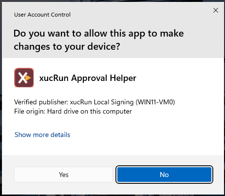

Starting a program under another standard account can also require UAC presence confirmation. If
xucRun uses an administrator account for this purpose, that account is used only to open the
xucRun dialog on the separate Windows desktop; the target program continues to run under the
selected standard account.

If no suitable approval is active, the xucRun approval dialog appears on a separate Windows
desktop. In the intended workflow, Windows separates this desktop from normal, non-elevated
programs. If xucRun cannot open the dialog there, the operation is aborted. Software defects and
malware already running with administrator or SYSTEM privileges are outside this protection
boundary.

For an executable that is to be started elevated but is writable by the caller, xucRun requires a
risk confirmation on the separate desktop for every start despite an existing approval. This
consent applies once only and is not stored. If the executable's directory is also writable by the
caller, the elevated start is blocked.

xucRun's central use case is a signed-in standard user for whom exactly one administrator account
has been stored in xucRun and programs are to be started elevated under that account when needed.
After the one-time setup, an invocation without account name and password is sufficient:

```powershell
xucRun.exe regedit.exe
```

xucRun automatically selects the only administrator account for which xucRun credentials are
stored and requests UAC confirmation for the elevated program start. The password does not need
to be entered again. Neither the account name nor the password has to appear in the xucRun
invocation, scripts, or shortcuts.

In general, xucRun supports starting programs under any user account for which valid xucRun
credentials are stored, including both members of the Administrators group and standard users.
Accounts can be selected through a parameter or a dialog. Consecutive user-context switches are
also possible by explicitly starting xucRun as the target program of another xucRun invocation.
Shell-internal commands must be invoked through the corresponding shell.

This makes xucRun particularly suitable for scripts, batch files, and recurring shortcuts. UAC
deliberately remains interactive; **xucRun is not a mechanism for unattended elevation.**

If xucRun credentials are stored for several administrator accounts, xucRun lets the user select
one. A particular account can also be specified directly. The user can choose whether the target
program is to start with or without elevated administrator privileges. If xucRun cannot establish
an explicitly requested elevated start, no program is started.

If a standard user has no administrator-account credentials stored by xucRun, xucRun instead
considers standard accounts for which xucRun credentials are stored and starts the target program
without elevated administrator privileges. If the required credentials are completely missing,
xucRun guides the user through account selection and password entry and then continues the
original invocation.

For each invocation, xucRun guides the user through all required account, credential, and approval
steps. If a target account, stored credentials, or a suitable approval is missing, xucRun requests
the required selection, input, or confirmation directly in the current workflow and then
continues the original invocation. Account selection, management, information, and error dialogs
appear on the normal user desktop. Password entry, approval decisions, and required risk
confirmations instead appear on a separate Windows desktop. These dialogs run with elevated
administrator privileges. In the intended workflow, Windows separates this desktop from normal,
non-elevated programs. Software defects and malware already running with administrator or SYSTEM
privileges are outside this protection boundary. Windows UAC remains separate and uses the UAC
desktop configured by Windows.

For the first such dialog, xucRun creates a random xucRun security identifier in the format
`XXXX-XXXX` for the calling Windows user account. Password, approval, and risk dialogs on the
private desktop then display this identifier unchanged. After verifying the installation against
the published checksum, the user should remember or record the identifier in a location accessible
only to that user during the first deliberately initiated dialog and confirm later xucRun dialogs
only when it matches. This initial display establishes trust and cannot yet be compared with an
earlier value. xucRun does not ask the user to enter this identifier. The separate Windows UAC
window does not display it.

Repeated starts without entering the password again require xucRun to store the target account
credentials. xucRun uses Windows APIs for this storage. In the intended workflow, passwords are
not passed through the command line or to the target program. Starting a program under another
account nevertheless requires xucRun to process the credentials temporarily.

A matching identifier indicates that the dialog originates from the xucRun helper, but it does
not prove that the displayed operation is safe or was initiated by the user. An attacker can still
trigger legitimate dialogs and hope that the user confirms them without sufficient attention.

These measures do not provide complete protection on a compromised system. An attacker can
trigger deceptive or legitimate dialogs and hope that the user confirms them without sufficient
attention. The security identifier helps only if the user actually compares it. xucRun should
therefore be used only as described in the security notice below.

## xucRun scope

xucRun contains:

- the `xucRun.exe` client,
- the demand-start `xucRunBroker` service, which starts automatically when needed, then runs in the
  background, manages credentials stored by xucRun, and starts programs under the selected user
  account,
- the Approval Helper,
- shared protocol, serialization, and security components,
- German and English language resources.

xucRun can be built, installed, and used independently.

## Requirements and intended use

xucRun supports Windows 10 and Windows 11 on x64 systems. It requires the current Microsoft
Visual C++ Redistributable v14 for x64.

xucRun is intended for experienced private users and developers on self-managed computers and in
personal development and test systems. It is not a solution for unattended elevation, centralized
privilege management, or systems requiring an elevated level of protection.

> **Important security notice:** xucRun uses Windows APIs to store credentials. For xucRun to
> start a program under another user account, however, xucRun
> must process the required credentials temporarily. Complete protection against reading or
> misuse by sufficiently privileged malware or an already compromised system therefore cannot be
> guaranteed. The source code of xucRun is
> disclosed so that the implemented technical measures, their limits, and the remaining
> risks can be understood and independently reviewed. Disclosure alone is neither a security
> guarantee nor evidence of an independent security audit. Use xucRun at your own responsibility.
> xucRun should be used only on trusted, self-managed systems that do not require an elevated level
> of protection, and preferably with dedicated target accounts having the minimum
> required privileges. To the extent permitted by law, the author and contributors accept
> no liability for damage, data loss, or other consequences arising from the use or incorrect use
> of xucRun, software defects or security vulnerabilities, malware, or a compromised system. This
> includes, in particular, the loss, disclosure, or misuse of credentials. The disclaimer of
> warranty and limitation of liability in the [Apache License 2.0](LICENSE) govern.

## Installation overview

Installation requires a complete xucRun package. The graphical installer signs all installable
package files consistently on the target computer with a local xucRun certificate.

### Local signing certificate

xucRun uses the certificate so that Windows and xucRun can verify that the installed program
components belong to the same installation and have not been changed or replaced with differently
signed files. The broker accepts security-sensitive requests only from matching signed xucRun
components.

The public package does not contain a shared private key and is not signed with a commercially
issued, publicly trusted publisher certificate. Shipping one reusable private key with xucRun
would allow every recipient to create files that appear to have the same identity. Instead, the
installer creates a unique self-signed certificate on the target computer, or reuses the valid
xucRun certificate previously created there. Its private key is non-exportable. This establishes a
local technical trust relationship; it does not prove the public package's origin. Therefore,
verify the release checksum before starting the installer.

The standard certificate is named `CN=xucRun Local Signing (<COMPUTERNAME>)`. It is stored in
`LocalMachine\My` with its private key and added to `LocalMachine\Root` and
`LocalMachine\TrustedPublisher` for trust on that computer. The verified standard certificate,
including its private key and trust entries, is removed when xucRun is uninstalled.

### Graphical installation

xucRun is a non-commercial open-source project. The provided installer is currently not
signed by a publicly trusted publisher. Windows may therefore report an unknown publisher when
it is first started.

The easiest installation method is
`xucRun-Installer-<Version>-x64.exe`, for example
`xucRun-Installer-0.9.0.2-x64.exe`. Before starting it, obtain the file only from the
[official xucRun releases](https://github.com/HT64/xucRun/releases), compare its SHA-256 checksum
with the checksum published there, and verify any available Authenticode signature.

When started, Windows User Account Control requests the required administrator rights. The
graphical interface then offers a choice of application language and machine PATH behavior. The
installer also shows the registered version and installation or last-update time for an existing
installation. The
installer automatically reuses an existing valid local xucRun code-signing certificate with its
private key or creates the certificate described above. The interface shows in advance whether a
certificate will be reused or created and displays its validity period and fingerprint. It then
signs all installable files with that certificate.

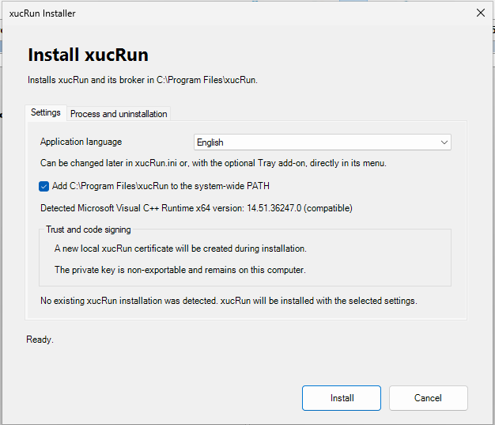

The **Process and uninstallation** tab explains temporary extraction, runtime handling, local
signing, installed components, and removal behavior before installation begins.

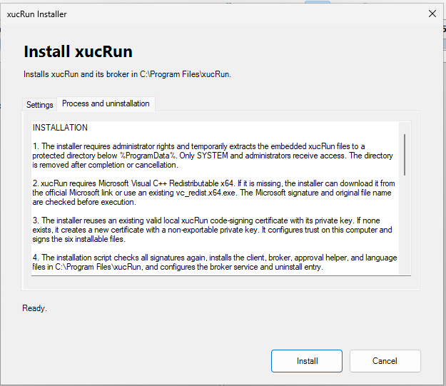

The installer displays the detected Microsoft Visual C++ Runtime x64 version and identifies it as
compatible or too old, or reports that it was not found. Only when a compatible runtime is
missing does the prompt state the required minimum version and offer either a verified Microsoft
download or an existing `vc_redist.x64.exe`. A selected file whose product version is below the
minimum is rejected with a clear version message before it is executed. The display is updated
after runtime installation. The success confirmation also reports the installed or updated runtime
and its version. It installs the client, broker, approval helper, and language files under
`%ProgramFiles%\xucRun`. It also configures the demand-start broker service and uninstall entry.
The success confirmation identifies the installed or reused local certificate with its validity
period and thumbprint.

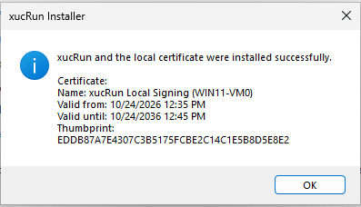

Internally, the graphical installer uses the same included PowerShell installation script as the
supported manual installation method. The script verifies the package files and signatures and
sets the selected language. The installation directory can optionally be added to the global
machine PATH.

### Update and uninstall

xucRun and the separately installed optional
[xucRun Tray add-on](https://github.com/HT64/xucRun-Tray) use an exact four-part version match.
When reinstalling the same xucRun version, Tray can remain installed if its registered version,
file version, and signer still match the Core package exactly. Before changing versions or
removing xucRun, remove xucRun Tray add-on through its separate Windows uninstall entry. After an
xucRun update, install the publicly available Tray release with the same version.
If the broker service was running before a repair installation, it is restarted automatically
after the files have been replaced, restoring its previous running state. A broker service that
was deliberately stopped or disabled remains stopped or disabled.
If xucRun uninstall is started while Tray is still installed, the Core installation remains
unchanged and a visible error dialog instructs the user to uninstall **xucRun Tray** through
**Installed apps** first.

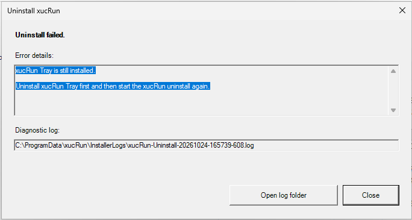

To update xucRun, start the versioned graphical installer from the newer package. It reuses the
existing valid local xucRun certificate and signs the new package files with it. Alternatively,
run the local signing workflow and then the PowerShell installation script from the new package.
Stored xucRun credentials, approvals, and INI settings not managed by the installer are preserved.

Uninstall through **Installed apps**. Alternatively, no separate uninstallation script is needed:
run the installed `Install-xucRun.ps1` under `%ProgramFiles%\xucRun` with `-Uninstall`:

```powershell
powershell.exe -NoProfile -ExecutionPolicy Bypass `
  -File "$env:ProgramFiles\xucRun\Install-xucRun.ps1" `
  -Uninstall
```

> **Warning:** Uninstall permanently deletes all credentials and approvals stored by xucRun for
> every Windows user, together with all local xucRun backups, security markers, and associated
> metadata. It also removes the standard local xucRun certificate, including its private key and
> trust entries.

Before making the first change, uninstall requires explicit confirmation of this permanent
deletion. Cancelling leaves the installation and its data unchanged. The success confirmation
then lists the removed program components, all stored data that may have been present, and the
removed certificate with its details.

| Permanent-deletion confirmation | Successful uninstallation |
|:---:|:---:|
| 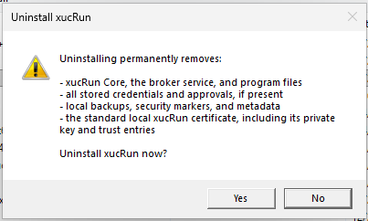 | 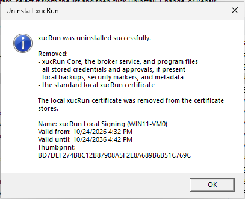 |

If uninstall fails, xucRun writes a technical diagnostic log under
`%ProgramData%\xucRun\InstallerLogs`. The visible error dialog shows the full path of the specific
log file in a copyable field and can open the log folder directly. The log contains error, script,
and system information, but no stored passwords. The file path shown in the dialog is
authoritative. A later successful Core uninstall also removes these diagnostic logs.

Both installation methods and the local test-signing instructions are described in detail in the
[installation guide](docs/en/INSTALLATION.md).

The following examples use the short name `xucRun.exe`. This works when
`%ProgramFiles%\xucRun` was added to the global machine PATH during installation. Select this
option in the graphical installer or specify `-AddToSystemPath` during manual installation.
Without the PATH entry, invoke xucRun by its full path, for example
`"%ProgramFiles%\xucRun\xucRun.exe"`.

## Quick start

After installation, xucRun credentials for a target account can be stored explicitly:

```powershell
xucRun.exe /addcred Administrator
```

If the account name is omitted, xucRun first opens a dialog for selecting an enabled local
account. A password-entry dialog on the separate Windows desktop then appears regardless of
whether the account was specified or selected. Specify `DOMAIN\UserName` for a domain account.

| Credential entry on separate desktop | Stored credential confirmation |
|:---:|:---:|
| 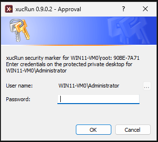 | 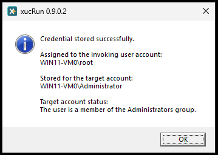 |

Run programs by specifying their normal path followed by their arguments:

```powershell
xucRun.exe notepad.exe
xucRun.exe regedit.exe
xucRun.exe powershell.exe -NoExit
xucRun.exe cmd.exe /c "net stop MyService"
```

If a suitable account, stored credentials, or an applicable approval is missing, xucRun guides
the user through the required steps during the current invocation.

## Usage examples

Open Device Manager from a standard user account:

```cmd
xucRun.exe "%windir%\System32\mmc.exe" "%windir%\System32\devmgmt.msc"
```

Start an administrative PowerShell script:

```powershell
xucRun.exe powershell.exe -File "C:\Scripts\AdminScript.ps1"
```

Stop a Windows service through `cmd.exe`:

```cmd
xucRun.exe cmd.exe /c "net stop MyService"
```

Create a firewall rule for a program whose path contains spaces:

```cmd
xucRun.exe "%windir%\System32\netsh.exe" advfirewall firewall add rule name="Local example server" dir=in action=allow program="C:\Program Files\ExampleServer\server.exe" enable=yes profile=private
```

Edit a file with a program running under the selected target account:

```powershell
xucRun.exe notepad.exe "C:\Windows\System32\drivers\etc\hosts"
```

Replace the current PowerShell with a PowerShell running in the automatically selected user and
privilege context:

```powershell
PS D:\Example\Project> xucRun.exe
```

For this invocation without parameters, xucRun detects the direct parent shell, closes the
existing console after a successful start, and reopens the same shell in the original working
directory. If the existing PowerShell runs under a standard account and credentials for exactly
one administrator account are stored in xucRun, xucRun selects that account automatically,
requests Windows UAC confirmation, and starts the new PowerShell elevated under that account back
in `D:\Example\Project`. This is the typical primary use case for shell replacement.

If xucRun credentials are stored for several administrator accounts, an account selection dialog
appears instead. If the current account is itself an administrator, xucRun uses that account and
either reuses an already elevated token or requests UAC. Only when no administrator-account
credentials are stored by xucRun for a standard account does xucRun consider standard accounts
for which xucRun credentials are stored and start the replacement shell without elevation. The
working directory is preserved in every case.

The invocations shown above that specify a target program can also be used in scripts and desktop
shortcuts. If xucRun can determine the target account unambiguously and automatically, the
invocation does not need to name an account.

Shell replacement without parameters, in contrast, is intended for interactive invocation from a
supported shell. It should be used in a script only when closing the existing console and
interactively starting a replacement shell is explicitly intended. An invocation without
parameters is not suitable for a normal desktop shortcut.

Supported parent shells are `cmd.exe`, `powershell.exe`, `pwsh.exe`, and `tcc.exe`.

### Desktop shortcut for an elevated Explorer

A desktop shortcut can open an Explorer window for a fixed directory directly under a specific
administrator account for which xucRun credentials are stored and with elevated privileges. For
example, enter the following in the shortcut's **Target** field:

```text
"%ProgramFiles%\xucRun\xucRun.exe" /user-elevated:Administrator "%WINDIR%\explorer.exe" "/root,"D:\Example\TargetFolder""
```

Use `/user-elevated:Administrator` when the shortcut must always select one particular
administrator account for which xucRun credentials are stored and explicitly start Explorer with
elevated privileges. Omit the switch when xucRun should determine the suitable account
automatically. If Explorer should run under a specific different account without elevation being
enforced by xucRun, use `/user:<Account>` instead.

Replace `Administrator` with the required administrator account for which xucRun credentials are
stored and the example path with the directory to open. `/root` makes this directory the root of
the new Explorer window. The nested quotation marks must remain unchanged. Stored credentials do
not replace the interactive Windows UAC confirmation.

### Integrate with Total Commander

The following examples were tested with Total Commander 11.58 (64-bit). They may also work with
other versions, but their compatibility has not been verified.

xucRun can start a new elevated Total Commander instance according to its automatic account
strategy. Members of the Administrators group retain their account and are elevated through UAC
when necessary. For a standard user, xucRun uses a stored administrator account. The invocation
preserves the left path, right path, and active file panel:

```ini
[em_TCStart_Elevated]
button=%COMMANDER_PATH%\icons\Tcmadm64000.ico
cmd=%comspec% /v:on /c
param=SET "P=%P." & SET "L=%X%P." & SET "R=%X%T." & SET Active=L & (IF "!P!" == "!R!" SET Active=R) & "%|ProgramFiles|\xucRun\xucRun.exe" "%|COMMANDER_PATH|\TOTALCMD64.EXE" /L="!L!" /R="!R!" /P=!Active!
menu=Start TC elevated through xucRun; administrator members retain their account, standard users switch to an administrator
iconic=1

[em_TCReStart_Elevated]
button=%COMMANDER_PATH%\icons\Tcmadm64000.ico
cmd=cm_Exit,em_TCStart_Elevated
param=
menu=Restart TC with elevated privileges
iconic=1
```

The second command closes the current Total Commander instance and then invokes the first command.
For a standard-user account switch, at least one administrator account must be stored in xucRun.
If several matching administrator accounts are stored, the account selection dialog is shown. Any
required Windows UAC prompt must be confirmed.

xucRun can also start Total Commander under an explicitly selected different Windows account
without that account already being signed in interactively. This allows file operations to be
performed in another account context from a standard user session. For elevated administrative
file operations, the target account must have administrator privileges and the Windows UAC prompt
must be confirmed.

Create a user-defined command in `usercmd.ini`. Replace `<Account>` with the configured account
name and keep the Total Commander variables and quoting unchanged:

```ini
[em_TCStart_Account]
button=%COMMANDER_EXE%
cmd="%ProgramFiles%\xucRun\xucRun.exe"
param="/hidden-monitor "%|ComSpec|" /v:on /c SET "P=%P." & SET "L=%X%P." & SET "R=%X%T." & SET Active=L & (IF "!P!" == "!R!" SET Active=R) & "%|ProgramFiles|\xucRun\xucRun.exe" /user:<Account> "%|COMMANDER_EXE|" "/L=!L!" "/R=!R!" "/P=!Active!""
menu=Launch Total Commander as <Account>
iconic=1
```

The command deliberately invokes xucRun twice so that an administrator account can act as the
central authorized principal for the credentials of additional target accounts. This cascade is
not required for the launch itself; this is a specific design decision about how the credentials
are stored. The example also shows how xucRun can be used in a nested process chain with complex
path and command-line arguments. The outer invocation first starts the `cmd.exe` hidden by
`/hidden-monitor` under that administrator account according to xucRun's default strategy. The
inner xucRun invocation therefore runs with the administrator's SID and can use the credentials
that administrator stored for `<Account>`. This avoids storing the credentials of every additional
target account separately for every standard user; each standard user needs only the credentials
stored for the central administrator account. A single xucRun invocation by the standard user
could instead use only that user's own SID-bound credentials. The inner invocation processes
`/user:<Account>` and starts the visible Total Commander instance under the target account.
Elevation of the outer intermediate stage is not transferred to the target account; its
privileges remain unchanged.

The intermediate `cmd.exe /v:on /c` first stores the paths supplied by Total Commander in
environment variables and then passes them to the inner xucRun invocation through delayed
variable expansion. This also handles paths containing spaces and special characters reliably.
Comparing the paths additionally determines whether the left or right panel is active.

For example, the command can be added to a custom menu:

```text
POPUP "User"
  MENUITEM "Start Total Commander for <Account>", em_TCStart_Account
END_POPUP
```

Additional accounts can be added in the same way. For each additional account, you can create a
separate command in `usercmd.ini` and a corresponding `MENUITEM`.

## Account selection and privileges

Without a user switch, xucRun uses a suitable current user context or an administrator account
for which xucRun credentials are stored. If exactly one account with matching xucRun
credentials is available, it is selected automatically; if several match, a selection dialog is
shown.

| Select an account with stored credentials | Select a local target user |
|:---:|:---:|
| 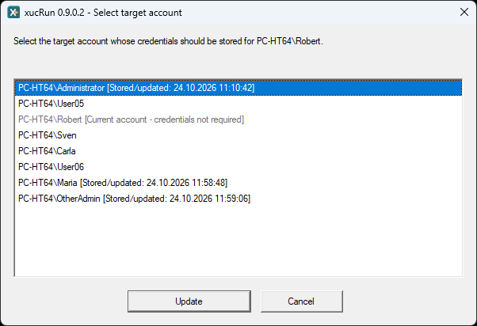 | 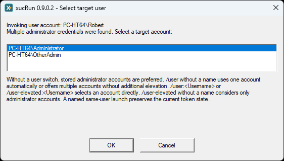 |

| Invocation | Behavior |
|---|---|
| `xucRun.exe <Program> [Arguments ...]` | determine the account automatically and request elevation when required |
| `xucRun.exe /user <Program> [Arguments ...]` | select an account for which xucRun credentials are stored, without additional elevation by xucRun |
| `xucRun.exe /user:<Account> <Program> [Arguments ...]` | use a specific account without additional elevation by xucRun |
| `xucRun.exe /user-elevated <Program> [Arguments ...]` | select an administrator account for which xucRun credentials are stored and start elevated |
| `xucRun.exe /user-elevated:<Account> <Program> [Arguments ...]` | use a specific account and start elevated |

Stored credentials do not bypass Windows UAC. When elevation is required, UAC confirmation remains
interactive. For a new approval involving an elevated start, the approval dialog on the separate
desktop may appear first, followed by the UAC dialog for the target program.

## Approvals

Before a start that has not yet been approved, xucRun can request a one-time or reusable approval.
The available durations are:

- this start only,
- 10 minutes,
- one day,
- until sign-out,
- permanently.

An approval can be bound to one program or all programs and to one target account or all stored
accounts of the current Windows user. Program-specific approvals include the SHA-256 hash of the
executable. If the file changes, transferring the approval to the new version requires explicit
confirmation.

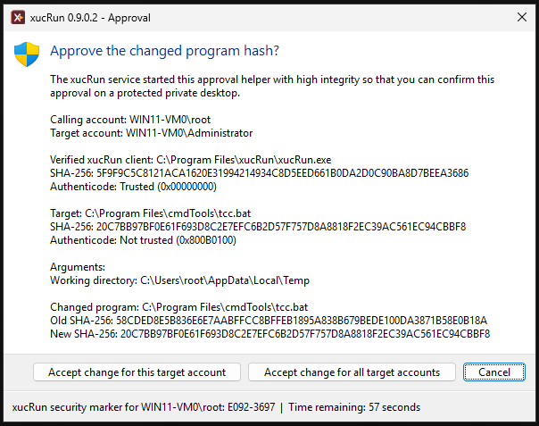

An approval does not restrict what the started program can do. General or permanent approvals for
universal interpreters such as `cmd.exe`, PowerShell, or `wscript.exe` are therefore particularly
powerful.

For `cmd.exe`, `powershell.exe`, `pwsh.exe`, TCC, and Windows Script Host, the approval dialog
therefore explains that a reusable approval is not bound to the displayed arguments. Carefully
verify the target, arguments, and working directory, and use a one-time approval whenever
possible. For PowerShell, an administratively enforced `AllSigned` policy can additionally protect
script files, but does not protect against direct or interactive commands.

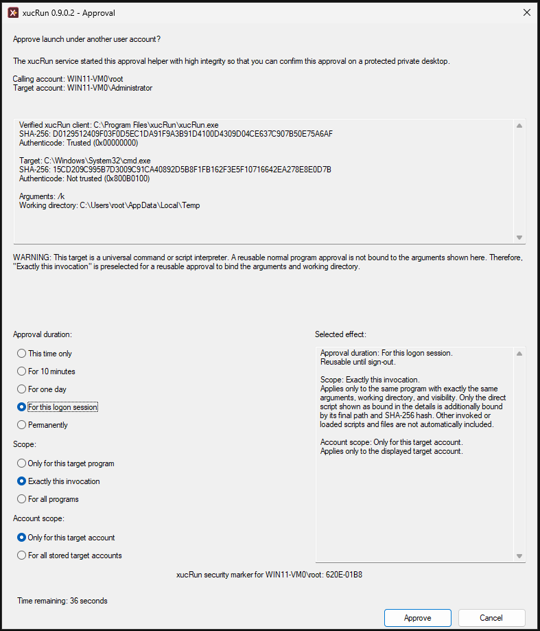

## Programs, arguments, and special characters

The first argument that is not an xucRun switch is the target program. All following arguments
belong exclusively to that program:

```powershell
xucRun.exe cmd.exe /c dir
xucRun.exe /user:Administrator app.exe /config:value
```

Here, `/c` and `/config:value` are not interpreted by xucRun. Shell-internal commands must be run
through their shell, for example `cmd.exe /c dir` or
`powershell.exe -Command Get-Process`.

Enclose program paths and individual arguments containing spaces in quotation marks as usual.
xucRun also supports batch files and carries common shell special characters across the additional
process boundaries. Characters that `cmd.exe`, PowerShell, or another calling shell evaluates
before xucRun starts remain subject to that shell's rules.

For a broker-mediated launch of a `.bat` or `.cmd` file whose file name contains one of the CMD
metacharacters `& | ( ) ! % ^`, the broker creates a temporary wrapper named
`xucRun_wrapper_<128-bit-random-value>.bat`. It stores the wrapper preferably on a suitable volume
named `RamDisk`, or otherwise in the target account's `%TEMP%` directory. The broker protects the
wrapper until the launched process exits and then attempts to delete it, or does so during error
cleanup if the launch fails. If a deletion error or unexpected broker termination leaves it
behind, a local administrator can remove it after it has been released. There is no later
automatic cleanup; the wrapper contains no credentials, stored arguments, or reusable
authorization.

## Useful commands

| Command | Purpose |
|---|---|
| `xucRun.exe /addcred [<Account>]` | store credentials |
| `xucRun.exe /deletecred [<Account>]` | select and delete stored credentials |
| `xucRun.exe /showcred` | show accounts for which xucRun credentials are stored |
| `xucRun.exe /showapprovals` | show stored approvals |
| `xucRun.exe /resetapprovals[:<Account>]` | reset approvals |
| `xucRun.exe /info` | show versions, signing certificate, broker status, and current configuration |
| `xucRun.exe /admin-status` | show and manage data for all Windows users with elevation |
| `xucRun.exe /backup` | manage local backups |
| `xucRun.exe /audit` | run security diagnostics |
| `xucRun.exe /enable-broker` | re-enable a disabled broker |
| `xucRun.exe /clear-all` | delete all stored xucRun data |
| `xucRun.exe /help` | show complete help |

`/hidden` hides the directly started target program. `/hidden-monitor` also monitors its exit code
and displays a notice when it fails. Dialogs and child processes are not hidden or monitored by
these options.

## Managing credentials and approvals

`/showcred` lists target accounts for which xucRun credentials are stored, and `/showapprovals`
lists active general and program-specific approvals. Stored passwords are neither displayed nor
returned to the client.

| Stored credentials | Active approvals |
|:---:|:---:|
| 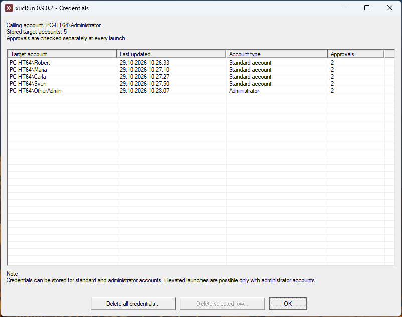 | 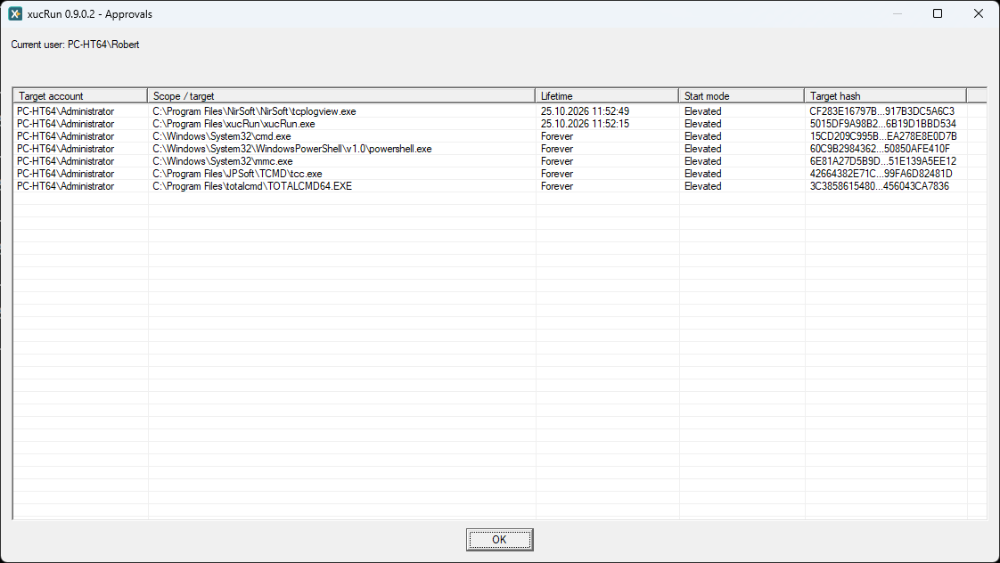 |

Without an account name, `/deletecred` presents a selection and asks for confirmation before
deletion. Deleting an account also removes approvals bound to that account. Profile-wide approvals
for all accounts remain in place.

Use `/resetapprovals` to select and remove individual or multiple approvals. `/clear-all` is the
administrative full cleanup command. It must be run elevated and, after explicit confirmation,
deletes all xucRun credentials, approvals, security identifiers, and associated metadata for every
Windows user on the computer.

| Delete stored credentials | Reset approvals |
|:---:|:---:|
| 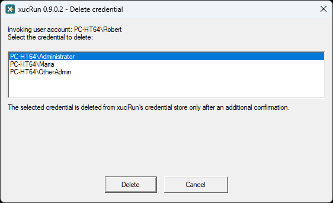 | 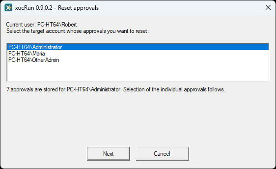 |

For a computer-wide overview, `/admin-status` displays the stored xucRun data of all Windows users
and provides the available administrative cleanup actions.

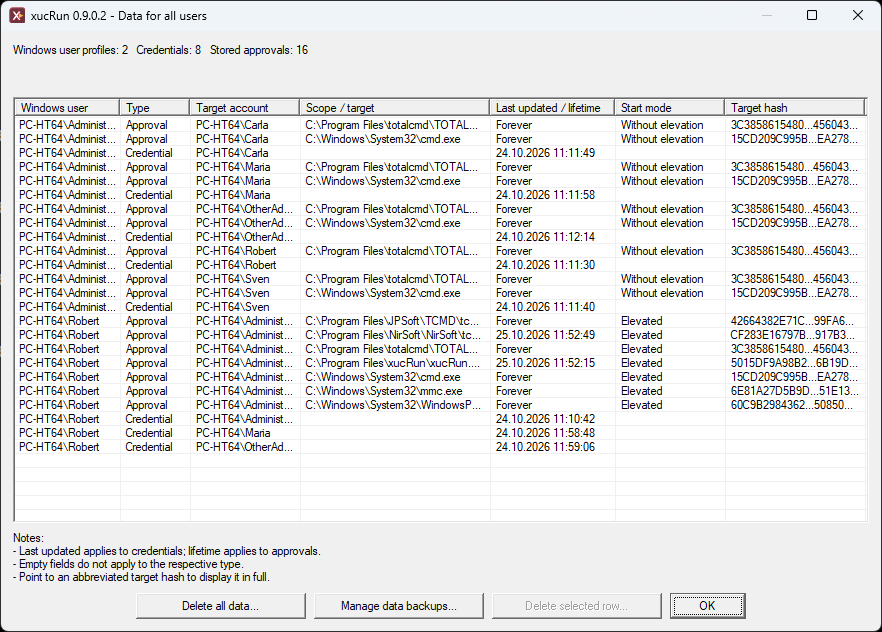

## Backups

`xucRun.exe /backup` opens the interactive local backup manager. The following commands are also
available:

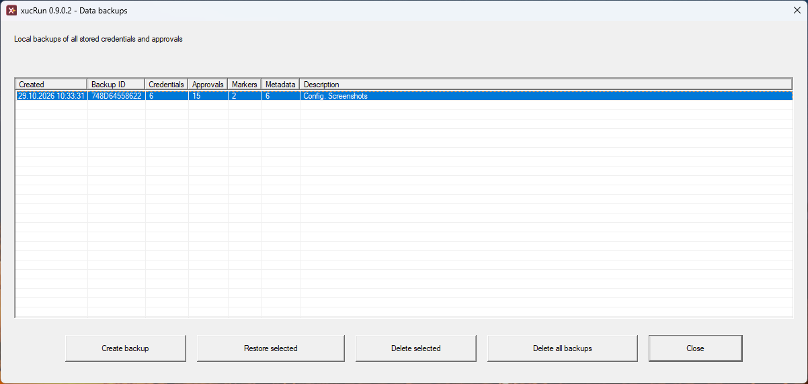

```text
xucRun.exe /backup-create [<Description>]
xucRun.exe /backup-list
xucRun.exe /backup-restore
xucRun.exe /backup-restore:<Backup-ID>
xucRun.exe /backup-delete-all
```

A backup contains stored credentials, approvals, security identifiers, and associated metadata.
Backups are stored separately from the active credentials and approvals under
`%ProgramData%\xucRun\BrokerBackups`. xucRun uses Windows APIs for storage and binds the backups to
the computer. xucRun restores them only on the same computer; they are not a portable password
export.

Uninstalling xucRun also removes locally stored xucRun backups.

## Troubleshooting

`xucRun.exe /info` shows information including the client version, signing certificate name,
SHA-256 fingerprint and validity period, broker status, current account, and effective
configuration. `xucRun.exe /audit` checks security-relevant properties of the running installation
and also identifies the verified certificate when the client signature is valid. If xucRun Tray
is installed separately, the audit also checks its installed
files and signatures, uninstall registration, and per-user autostart tasks. If the broker service
was disabled,
`xucRun.exe /enable-broker` enables it again. `xucRun.exe /help` displays the complete local
command overview.

| Runtime information | Security audit |
|:---:|:---:|
| 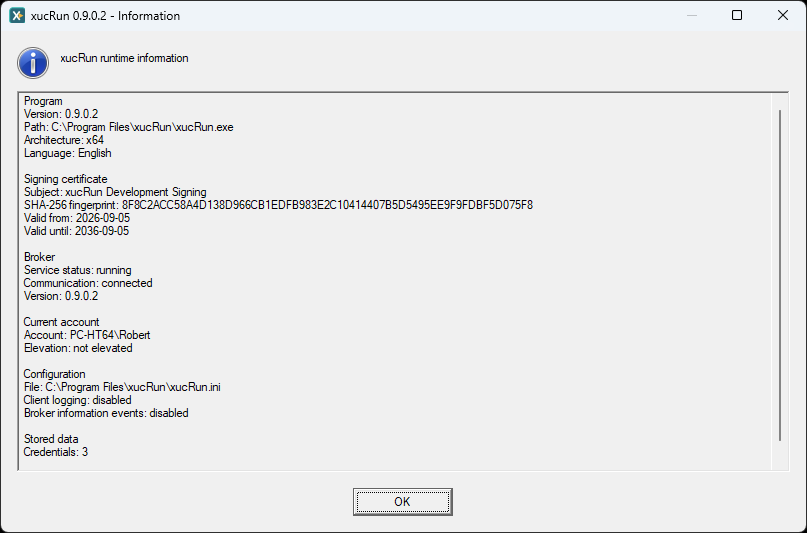 | 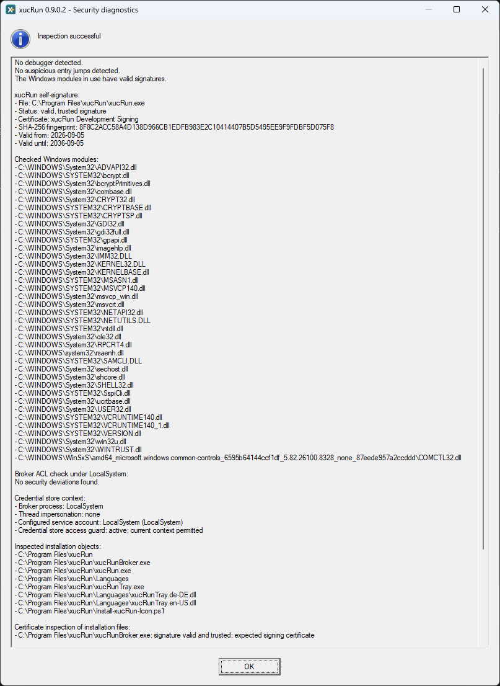 |

For additional diagnostics, `ClientLogDirectory` can be configured to enable client log files
named `xucRun_YYYYMMDD.log`. Broker warnings and errors are always written to the Windows
Application event log under the `xucRunBroker` source and can be viewed in Windows Event Viewer
under **Windows Logs → Application**. See
[Configuration file and language](#configuration-file-and-language) for configuration details.

## Configuration file and language

xucRun uses the machine-wide configuration file
`%ProgramFiles%\xucRun\xucRun.ini`. The installer creates it and updates the selected language
during installation or an update without removing the other existing settings. Because the file
is located under `%ProgramFiles%`, administrator privileges are normally required to edit it
manually.

The supported structure is:

```ini
[xucRun]
Language=en

[Logging]
ClientLogDirectory=
BrokerInformationEvents=false
```

Comment lines begin with a semicolon (`;`). Comments should be placed on separate lines rather
than appended to a setting.

- `Language=de` selects German and `Language=en` selects English. The change applies to newly
  started xucRun processes.
- A missing or empty `ClientLogDirectory` disables client file logging. Specifying a path enables
  it. Environment variables are expanded in the context of each starting client. The path must
  be accessible to every client and wrapper account in use, with the permissions required to
  create, append to, and delete log files. Changes apply to newly started client processes. For
  each resolved log directory, xucRun appends to one dated log file per day but does not
  automatically rotate or delete client logs. These logs can contain program paths, account names,
  command lines, and target arguments. Protect the directory accordingly, and do not pass
  passwords or other secrets as command-line arguments.
- The broker always writes warnings, errors, and service and ACL startup messages to the Windows
  Application event log under the `xucRunBroker` source. `BrokerInformationEvents=true`
  additionally logs routine information about pipe request processing there. If the setting is
  missing, empty, `false`, or has any other value, only these additional information events remain
  disabled. Changes take effect after the broker service is restarted.

A missing configuration file, invalid language value, or missing or incorrectly signed language
file causes startup to fail for security reasons instead of silently falling back to another
language.

## Optional Tray

The separately installed optional
[xucRun Tray add-on](https://github.com/HT64/xucRun-Tray) provides a status and control
interface whose icon appears in the notification area of the Windows taskbar next to the clock. It
is a separate project that displays information from xucRun and provides access to existing xucRun
management functions. It does not replace xucRun.

## A personal note on the origins of xucRun

The starting point for xucRun was a recurring need over many years across several computers in a
private setting, some of which were also used by other members of my family. For most tasks on
Windows computers, I use standard user accounts that I deliberately keep out of the Administrators
group. Even so, I want to be able to start individual programs with elevated privileges when
needed, without having to switch to a separate administrator session or enter a username and
password each time. At the same time, every such launch should still require explicit
confirmation, with a single mouse click being sufficient. One central use case for me is being
able to open a file manager in another account's user context from within my existing Windows
session, without switching to that account's separate session. The resulting
[specific configuration examples for Total Commander](#integrate-with-total-commander) are
documented in the corresponding section. Over time, new requirements and features were added,
such as desktop shortcuts for fixed elevated program launches, combined with a user switch when
required, and directly replacing a running shell with one in the appropriate user and privilege
context. Over the years, I used various freely available utilities and built-in Windows commands. I
incorporated these into my own scripts, which became increasingly complex over time. However, this
combination did not fully meet my requirements. This led me to develop a dedicated native solution
in C++.

As more and more work went into what had originally been a tool for my own use, it eventually
seemed a shame to keep it to myself. I therefore decided to publish it as a public open-source
project on GitHub. That decision, however, created a substantial amount of additional work:
preparing xucRun for use by others and clearly explaining its intended use, internal workings, and
limitations required systematically developing and refining its security model, the management of
stored credentials and program approvals, configuration and diagnostic functionality, user
interfaces and their dialogs, installers, localization, documentation, and automated tests.

AI-assisted development tools helped me manage this additional workload as a sole developer. I used
them in a supporting role across numerous interactive development steps. Throughout this process, I
used successive development versions in my everyday computer work and continued developing xucRun
based on that experience. Only after xucRun had reached what I considered an appropriate level of
maturity in this way did I make the first public version available. The technical decisions and
responsibility for the result remain mine.

I do not pursue commercial interests with xucRun. Nor do I intend to turn it into a commercial
product and make commitments regarding a particular feature set, absence of defects, continued
availability, support, or future development.

I would be glad if xucRun proved as useful to other individual users as it has been to me. I would
also be open to maintaining and developing xucRun together with others in the future.

## Support the project

Development can be supported voluntarily on
[Patreon](https://www.patreon.com/xucRun). Contributions can also help cover the usage costs of
AI-assisted development tools. Supporting the project is not required to download or use xucRun
and does not provide exclusive software, features, releases, downloads, personal support, or
specific response times.

## Reporting vulnerabilities

Do not disclose an unpatched or suspected vulnerability publicly. The confidential reporting
process and supported versions are documented in [SECURITY.md](SECURITY.md).

## Build and install

The [build instructions](docs/en/BUILDING.md) describe how to create an xucRun package from source.
The [installation instructions](docs/en/INSTALLATION.md) cover local test signing, installation,
updates, and uninstall. If the normal uninstaller is unavailable, the
[manual removal instructions](docs/en/MANUAL_REMOVAL.md) list all xucRun-owned artifacts and the
safe removal order.

## License

xucRun is licensed under the Apache License 2.0. `LICENSE` and `NOTICE` are authoritative.

External code contributions are not accepted at this time. See
[CONTRIBUTING.md](CONTRIBUTING.md) for details.
