<!--
Purpose: Introduces xucRun, its security model, use, and documentation in English.
Approach: Combines conceptual guidance, security boundaries, examples, and links to task-specific documents.
-->
# xucRun

**Language:** English | [Deutsch](README.de.md)

**Documentation:** [File register](FILE_REGISTER.md) | [Changelog](CHANGELOG.md) |
[Manual removal](docs/en/MANUAL_REMOVAL.md)

**Download:** [Latest release](https://github.com/HT64/xucRun/releases/latest)

**Build from source:** [Build instructions](docs/en/BUILDING.md)

**xucRun** stands for **eXecute Under User Context**.

> **Status:** xucRun is actively maintained and continues to evolve. It has been proven in
> practical use on the author's Windows 10 and Windows 11 systems. Further changes are possible,
> and defects cannot be ruled out. The 0.x.x.x version designation is not intended as a quality
> rating; it will be retained until more practical experience and feedback from other user
> environments are available.

## Overview

xucRun runs a [program, command, or script](#programs-arguments-and-special-characters) under the
user account selected for that purpose while the user remains in the current Windows session. The
[target account](#account-selection-and-privilege-mode) can be a standard account or belong to the
local Administrators group; in the latter case, the launch can optionally use elevated privileges
(administrator rights). Its central use case is an experienced Windows user who normally works
from a standard account and wants to perform a specific administrative action without switching
to a separate administrator session or entering the account name and password again for every
matching invocation.

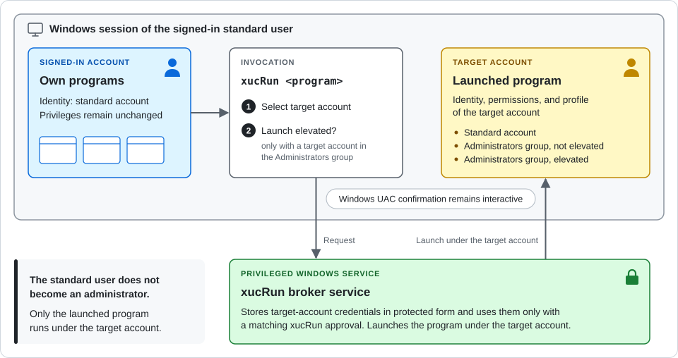

No separate initial setup is required; xucRun asks for missing information and decisions as
needed. For subsequent launches, it uses previously configured target accounts, stored
credentials, and applicable approvals, enabling convenient day-to-day use. Where required,
Windows UAC remains an interactive step in the launch process.

### Why work from a standard account?

Independently of xucRun, a user can remain signed in for everyday work with either an account that
belongs to the local Administrators group or a standard account. A member of the Administrators
group is authorized to run programs with administrator rights. Depending on the Windows User
Account Control (UAC) configuration, a launched process either already has those rights or
requests them through UAC. Any program can make such a request.

A user who already works from an account that belongs to the local Administrators group and wants
to occasionally launch programs with elevated privileges under that same account can use
Windows' built-in UAC mechanisms, including Sudo for Windows. xucRun also supports this use case,
but for that purpose alone offers no substantial additional benefit over the built-in Windows
features.

A standard account has no administrator rights of its own and cannot obtain them through UAC for
its own identity. System-wide changes to programs, services, or protected configuration therefore
require a separate account that belongs to the local Administrators group; the elevated process
runs under that account's identity. This limits what accidental actions and processes running in
the user's normal context can change without a separate, deliberate authorization step.

A suitable method must be chosen for performing administrative actions from the standard-user
context. Users can use built-in Windows features or additional tools for this purpose. In
particular, tools that store credentials or reuse authorization decisions require additional
safeguards and introduce risks of their own. Each user must therefore decide whether the benefit
of account separation justifies the associated setup and operational effort and the risks of the
chosen method.

Making this assessment and securely configuring and using the chosen method require sufficient
knowledge of Windows account, UAC, and permission models. xucRun is therefore intended for
experienced Windows users.

### How xucRun supports administrative actions from a standard account

**xucRun preserves this separation and treats account selection and elevation as separate
decisions.** It does not temporarily turn the standard user into an administrator or add
administrative privileges to that account.

With xucRun, the signed-in standard user can select a target account other than the signed-in
account for a launch. The target account can also be another standard account. For administrative
actions, the user can instead select an account that belongs to the local Administrators group;
only then can the launch optionally use elevated privileges. The process then uses the identity
and permissions of the selected target account, including when accessing network shares. The user
profile of that account is also loaded. Examples include per-user profile data, email-account
sign-ins stored in applications, and registry settings. Accordingly, `HKEY_CURRENT_USER` refers to
the target account's registry hive, not to the signed-in user's hive.

xucRun combines Windows account switching and UAC with credentials managed by xucRun for target
accounts. These credentials are stored in protected form and are used only when a matching
[xucRun approval](#approval-dialog-duration-and-scope) allows the requested execution. An approval
bound to a specific target account can be used only for starts under that account.

After the initial setup, specifying the program, command, or script and its arguments is
sufficient for a typical launch. Neither the account name nor the password then needs to be stored
in the xucRun invocation, whether it is launched from a console, a context menu, a desktop
shortcut, or a script. xucRun reuses matching selection and approval decisions already made and
obtains missing decisions interactively. Required
[Windows UAC confirmation](#relationship-between-xucrun-approvals-and-windows-uac) remains interactive.

## Quick start

The graphical installer offers to add `%ProgramFiles%\xucRun` to the machine-wide PATH, the
Windows search path for programs. If the user agrees to this option, xucRun can afterward be
invoked without specifying a path by using the short name `xucRun.exe`, as in the following
examples. For manual installation, enable the PATH option with `-AddToSystemPath`. The available
installation methods are described under [Installation overview](#installation-overview).

The following interactive examples use `xucRun.exe` as a short name. When the PATH option
described above is enabled, the same executable search also works technically in scripts,
shortcuts, tasks, and other fixed invocations. To protect such invocations against redirection
through the current directory or executable search path, use the actual absolute path of the
installed `xucRun.exe`.

After installation, credentials managed by xucRun can be stored explicitly for a target account,
meaning the account under which programs will be started. For example:

```powershell
xucRun.exe /addcred Administrator
```

If the account name is omitted, xucRun first opens a dialog for selecting an enabled local
account. A password-entry dialog then appears on a separate Windows desktop used by xucRun for
protected input, regardless of whether the account was specified or selected. Specify
`DOMAIN\UserName` for a domain account.

| 1. Select a local target account | 2. Enter credentials on the separate desktop | 3. Confirm successful storage |
|:---:|:---:|:---:|
| 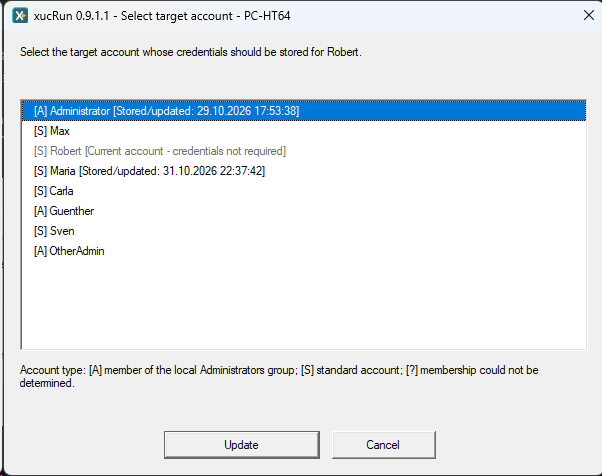 | 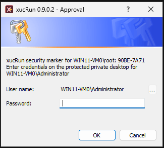 | 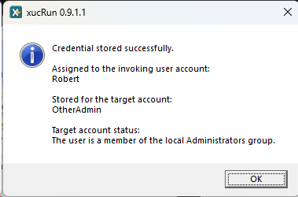 |

The account markers identify members of the local Administrators group (`[A]`), standard accounts
(`[S]`), and accounts whose membership could not be determined (`[?]`).

Run programs by specifying their normal path followed by their arguments:

```powershell
xucRun.exe notepad.exe
xucRun.exe regedit.exe
xucRun.exe powershell.exe -NoExit
xucRun.exe cmd.exe /c "net stop MyService"
```

The target-program short names used here are also resolved through Windows executable search.
This is convenient for interactive invocations. To protect scripts, shortcuts, tasks, or other
fixed invocations against target-program redirection, also use the target program's actual
absolute path. The following examples using `C:\Windows` assume the standard Windows path; if
Windows is installed elsewhere, use its actual absolute path.

The [short demonstration video](docs/media/xucRun-simple-elevation.mp4) (58 seconds, MP4, English
user interface) shows how xucRun replaces a non-elevated Command Prompt with one running under the
configured administrator account and how it runs an individual administrative command from the
original shell.

If a suitable account, stored credentials, or an applicable approval is missing, xucRun guides
the user through the required steps during the current invocation.

## Usage examples

Open Device Manager from a standard user account:

```cmd
xucRun.exe "C:\Windows\System32\mmc.exe" "C:\Windows\System32\devmgmt.msc"
```

Start an administrative PowerShell script:

```powershell
xucRun.exe powershell.exe -File "C:\Scripts\AdminScript.ps1"
```

The [short PowerShell demonstration video](docs/media/xucRun-elevated-powershell.mp4) (34 seconds,
MP4, English user interface) shows an online Windows-feature query failing without elevation and
succeeding after xucRun starts PowerShell with elevated privileges under the administrator
account. `whoami` confirms the target account.

Stop a Windows service through `cmd.exe`:

```cmd
xucRun.exe cmd.exe /c "net stop MyService"
```

Edit a file with a program running under the selected target account:

```powershell
xucRun.exe notepad.exe "C:\Windows\System32\drivers\etc\hosts"
```

Start Thunderbird from PowerShell under the `MailUser` Windows target account with that account's
user profile and unchanged privilege mode:

```powershell
& 'C:\Program Files\xucRun\xucRun.exe' `
    /user:MailUser `
    'C:\Program Files\Mozilla Thunderbird\thunderbird.exe'
```

To keep a specific target account out of the invocation, use `/user` without an account name
instead. If exactly one account has stored xucRun credentials, xucRun selects it automatically.
If several accounts do, the target-account selection is shown. If no xucRun credentials have been
stored yet, xucRun offers local target-account selection followed by protected password entry.

xucRun selects the Windows account, not a mail account within Thunderbird. The command assumes
the default installation paths of xucRun and Thunderbird. If either path differs, use the actual
absolute installation paths.

Replace the current PowerShell with a PowerShell running in the automatically selected user and
privilege context:

```powershell
PS D:\Example\Project> xucRun.exe
```

For this invocation without parameters, xucRun detects the direct parent shell, closes the
existing console after a successful start, and reopens the same shell in the original working
directory. If the existing PowerShell runs under a standard account and credentials for exactly
one account that is a member of the local Administrators group are stored in xucRun, xucRun
selects that account automatically, requests Windows UAC confirmation, and starts the new
PowerShell elevated under that account back in `D:\Example\Project`. This is the typical primary
use case for shell replacement.

If xucRun credentials are stored for several such accounts, an account selection dialog appears
instead. If the current account is itself a member of the local Administrators group, xucRun uses
that account and either uses its existing elevated privileges directly or requests UAC. Only when
no credentials for such an account are stored by xucRun for a standard account does xucRun
consider standard accounts for which xucRun credentials are stored and start the replacement shell
without elevation. The working directory is preserved in every case.

The invocations shown above that specify a target program can also be used in scripts and desktop
shortcuts. If xucRun can determine the target account unambiguously and automatically, the
invocation does not need to name an account.

The separation between the standard user and the privileged target account follows this
principle: **A standard user may request the privileged action, but must not be able to change its
administratively approved content without that change being detected.**

This security principle applies independently of xucRun: A less privileged account must not be
able to modify files that determine the behavior of a more privileged process.

Scripts, shortcuts, scheduled tasks, and configuration files that contain an xucRun invocation or
determine its target, arguments, or working directory must therefore themselves be trusted and
protected against unauthorized modification. xucRun cannot generally verify their integrity.
Accounts that can modify such files must already be trusted to control the corresponding
privileged invocation. This also applies to parent directories through which these files could be
deleted, replaced, renamed, or redirected. Such files must not be stored in shared or
insufficiently protected writable directories. To additionally protect these fixed invocations
against executable redirection, resolve their paths through Windows Known Folders or another
trusted source when configuring the integration and then store them as absolute paths. The later
invocation then depends on neither mutable environment variables nor executable search through
`PATH`.

Shell replacement without parameters, in contrast, is intended for interactive invocation from a
supported shell. It should be used in a script only when closing the existing console and
interactively starting a replacement shell is explicitly intended. An invocation without
parameters is not suitable for a normal desktop shortcut.

Supported parent shells are `cmd.exe`, `powershell.exe`, `pwsh.exe`, and `tcc.exe`. (TCC is the
console of [Take Command from JP Software](https://jpsoft.com/).)

### Relaunch a batch file with elevated privileges when needed

A batch file can check at startup whether it is already running with elevated privileges.
Otherwise, it relaunches itself through xucRun and ends the original non-elevated run. With
`/user-elevated`, xucRun reuses the current account when it is already a member of the local
Administrators group and requests UAC elevation only if necessary. Otherwise, xucRun selects
another account that is a member of this group:

```cmd
@echo off
NET SESSION >nul 2>&1
IF ERRORLEVEL 1 (
  "C:\Program Files\xucRun\xucRun.exe" /user-elevated "%~dpnx0" %*
  GOTO :eof
)

REM Commands requiring elevated privileges follow here.
```

`%~dpnx0` returns the fully qualified path of the running batch file; `%*` forwards all original
arguments. `GOTO :eof` prevents the non-elevated run from continuing after the relaunch. The
`NET SESSION` check requires the Windows **Server** service to be available. The example assumes
the standard Windows paths. When configuring the batch file, replace the xucRun path with the
actual absolute installation path.

### Desktop shortcut for an elevated Explorer

A desktop shortcut can open an Explorer window for a fixed directory directly under a suitable
account with elevated privileges. To let xucRun determine the account automatically, enter the
following in the shortcut's **Target** field:

```text
"C:\Program Files\xucRun\xucRun.exe" /user-elevated "C:\Windows\explorer.exe" "/root,"D:\Example\TargetFolder""
```

With `/user-elevated`, xucRun uses the current account when it is a member of the local
Administrators group. Otherwise, xucRun determines a suitable account that is a member of the
local Administrators group and for which xucRun credentials are stored. This means that neither
the account name nor its password has to appear in the shortcut.

If the shortcut must always select one particular administrator account, append its name to the
switch:

```text
"C:\Program Files\xucRun\xucRun.exe" /user-elevated:Administrator "C:\Windows\explorer.exe" "/root,"D:\Example\TargetFolder""
```

Replace `Administrator` with the required account that is a member of the local Administrators
group and for which xucRun credentials are stored. If Explorer should run under a specific
different account without elevation being enforced by xucRun, use `/user:<Account>` instead.

The examples assume the standard Windows paths. When creating the shortcut, replace the paths to
`xucRun.exe` and `explorer.exe` with their actual absolute paths on that system, and replace the
example path with the directory to open. `/root` makes this directory the root of the new Explorer
window. The nested quotation marks must remain unchanged. Stored credentials do not replace the
interactive Windows UAC confirmation.

### Explorer context-menu integration

The optional [ExplorerKontextMenue.reg](ExplorerKontextMenue.reg) file contains a complete example
that adds xucRun commands for supported files, folders, folder backgrounds, and drives. For
example, its command entries for executable files and folder backgrounds follow these patterns:

```reg
[HKEY_LOCAL_MACHINE\SOFTWARE\Classes\exefile\shell\xucRun\command]
@="\"C:\\Program Files\\xucRun\\xucRun.exe\" /user-elevated \"%1\""

[HKEY_LOCAL_MACHINE\SOFTWARE\Classes\Directory\Background\shell\xucRunAdmin\command]
@="\"C:\\Program Files\\xucRun\\xucRun.exe\" /user-elevated \"C:\\Windows\\explorer.exe\" \"/root,\"%V\"\""
```

The file is an example rather than part of the installer. It first removes the nine entries it
manages and then recreates them under `HKEY_LOCAL_MACHINE`, so they apply to all users. Importing
it requires administrator rights, assumes that xucRun is installed under
`C:\Program Files\xucRun`, and makes every included xucRun command explicitly require an elevated
launch under an account that is a member of the local Administrators group through
`/user-elevated`.

These entries use the classic Win32 Explorer context-menu registration under
`Software\Classes\...\shell`. In the standard compact context menu on Windows 11, they normally
appear under **Show more options**. When the classic context menu is used instead, they appear
directly.

### Total Commander integration

The following examples show excerpts from Total Commander's `usercmd.ini` configuration file.
They were tested with Total Commander 11.58 (64-bit). They may also work with other versions, but
their compatibility has not been verified. For general information about Total Commander, visit
the [official Total Commander website](https://www.ghisler.com/).
The examples assume the standard Windows paths and a Total Commander installation under
`C:\totalcmd`. When copying them manually, replace every executable path with the actual absolute
path. To protect the configuration against redirection of these programs, a setup tool must
resolve the paths from trusted sources and store them without environment variables.

xucRun can start a new elevated Total Commander instance according to its automatic account
strategy. Members of the Administrators group retain their account and are elevated through UAC
when necessary. For a standard user, xucRun uses an account that is a member of the local
Administrators group and for which xucRun credentials are stored. The invocation preserves the
left path, right path, and active file panel:

```ini
[em_TCStart_Elevated]
button=%COMMANDER_PATH%\icons\Tcmadm64000.ico
cmd="C:\Windows\System32\cmd.exe" /v:on /c
param=SET "P=%P." & SET "L=%X%P." & SET "R=%X%T." & SET Active=L & (IF "!P!" == "!R!" SET Active=R) & "C:\Program Files\xucRun\xucRun.exe" "C:\totalcmd\TOTALCMD64.EXE" /L="!L!" /R="!R!" /P=!Active!
menu=Start TC elevated through xucRun; Administrators-group members retain their account, standard users switch accounts
iconic=1

[em_TCReStart_Elevated]
button=%COMMANDER_PATH%\icons\Tcmadm64000.ico
cmd=cm_Exit,em_TCStart_Elevated
param=
menu=Restart TC with elevated privileges
iconic=1
```

The second command closes the current Total Commander instance and then invokes the first command.
For a standard-user account switch, xucRun credentials must be stored for at least one account
that is a member of the local Administrators group. If several matching accounts are available,
the account selection dialog is shown. Any required Windows UAC prompt must be confirmed.

The following command starts a new Total Commander instance as `LocalSystem`, Windows' built-in
service account with extensive control over the computer. It preserves the left path, right path,
and active file panel:

```ini
[em_TCStart_System]
button=%COMMANDER_PATH%\icons\Tcmadm64000.ico
cmd="C:\Program Files\xucRun\xucRun.exe"
param="/hidden-monitor "C:\Windows\System32\cmd.exe" /v:on /c SET "P=%P." & SET "L=%X%P." & SET "R=%X%T." & SET Active=L & (IF "!P!" == "!R!" SET Active=R) & "C:\Program Files\xucRun\xucRun.exe" /system "C:\totalcmd\TOTALCMD64.EXE" "/L=!L!" "/R=!R!" "/P=!Active!""
menu=Start Total Commander as LocalSystem through xucRun
iconic=1
```

This command must invoke xucRun twice because `/system` is available only from an elevated context
of an account that is a member of the local Administrators group. The outer invocation uses the
automatic account strategy described above to start an elevated intermediate Command Prompt and
hides it through `/hidden-monitor`. The inner xucRun invocation therefore runs with elevated
administrator rights and starts Total Commander as `LocalSystem`. Every SYSTEM launch must be
confirmed separately on xucRun's protected private desktop.

The intermediate `cmd.exe /v:on /c` first stores the paths supplied by Total Commander in
environment variables and then passes them to the inner xucRun invocation through delayed
variable expansion. This handles paths containing spaces and special characters reliably.
Comparing the paths additionally determines whether the left or right panel is active.

Total Commander then has unrestricted `LocalSystem` access. Use this command only for deliberate
maintenance and diagnostic work.

xucRun can also start Total Commander under an explicitly selected different Windows account
without that account already being signed in interactively. This allows file operations to be
performed in another account context from a standard user session.

For this example, replace `<Account>` with the configured account name and keep the Total
Commander variables and quoting unchanged:

```ini
[em_TCStart_Account]
button=C:\totalcmd\TOTALCMD64.EXE
cmd="C:\Program Files\xucRun\xucRun.exe"
param="/hidden-monitor "C:\Windows\System32\cmd.exe" /v:on /c SET "P=%P." & SET "L=%X%P." & SET "R=%X%T." & SET Active=L & (IF "!P!" == "!R!" SET Active=R) & "C:\Program Files\xucRun\xucRun.exe" /user:<Account> "C:\totalcmd\TOTALCMD64.EXE" "/L=!L!" "/R=!R!" "/P=!Active!""
menu=Launch Total Commander as <Account>
iconic=1
```

The command again invokes xucRun twice so that an account that is a member of the local
Administrators group can act as the central authorized principal for the credentials of additional
target accounts. In this example, unlike in the LocalSystem example above, the cascade is not
required for the launch itself; here it is a deliberate design decision about how the credentials
are stored. The outer invocation uses the same hidden, elevated intermediate stage under that
account described above. The inner xucRun invocation therefore runs with that account's security
identifier (SID), which uniquely identifies the Windows account, and can use the credentials it
stored for `<Account>`. This avoids storing the credentials of every additional target account
separately for every standard user; each standard user needs only the credentials stored for the
central account. A single xucRun invocation by the standard user could instead use only that
user's own SID-bound credentials. The inner invocation processes `/user:<Account>` and starts the
visible Total Commander instance under the target account. Elevation of the outer intermediate
stage is not transferred to the target account; its privileges remain unchanged.

For example, the documented start commands can be grouped in a custom menu:

```text
POPUP "xucRun"
  MENUITEM "Start with elevated privileges", em_TCStart_Elevated
  MENUITEM "Restart with elevated privileges", em_TCReStart_Elevated
  MENUITEM "Start as LocalSystem", em_TCStart_System
  MENUITEM SEPARATOR
  POPUP "Start as user"
    MENUITEM "<Account>", em_TCStart_Account
  END_POPUP
END_POPUP
```

The [demonstration video](docs/media/xucRun-with-total-commander.mp4) (1:33, MP4, English user
interface) shows this menu in practical use and illustrates how it can start programs through
xucRun with and without elevated privileges and under different accounts.

Additional accounts can be added in the same way. For each additional account, you can create a
separate command in `usercmd.ini` and a corresponding `MENUITEM`.

## Account selection and privilege mode

Account selection and privilege mode are separate decisions. Without a user switch, xucRun uses
the requested privilege mode to determine a suitable current user context or target account with
stored xucRun credentials. If exactly one account matches, it is selected automatically; if
several match, a selection dialog is shown.

| Invocation | Behavior |
|---|---|
| `xucRun.exe <Program> [Arguments ...]` | determine the account automatically and request elevation when required |
| `xucRun.exe /user <Program> [Arguments ...]` | select an account for which xucRun credentials are stored, without additional elevation by xucRun |
| `xucRun.exe /user:* <Program> [Arguments ...]` | always select an enabled local account, without additional elevation by xucRun |
| `xucRun.exe /user:<Account> <Program> [Arguments ...]` | use a specific account without additional elevation by xucRun |
| `xucRun.exe /user-elevated <Program> [Arguments ...]` | use the current account when it is a member of the local Administrators group and request UAC elevation if necessary; otherwise select a suitable account with stored xucRun credentials |
| `xucRun.exe /user-elevated:* <Program> [Arguments ...]` | always select an enabled local account that is a member of the local Administrators group and start elevated |
| `xucRun.exe /user-elevated:<Account> <Program> [Arguments ...]` | use a specific account and start elevated; abort if it is not a member of the local Administrators group |

The [short demonstration video about launching under another user
account](docs/media/xucRun-other-user-profile.mp4) (38 seconds, MP4, English user interface) first
shows xucRun opening the Windows environment-variables dialog under an explicitly specified
standard account. The displayed standard-account name and associated profile paths make the target
account's user context visible. It then shows interactive target-account selection with `/user:*`;
`whoami` confirms the selected account.

If `/user` finds no stored xucRun credentials, xucRun automatically opens local target-account
selection for credential creation instead of aborting. After the selected account's credentials
have been stored through protected password entry, xucRun continues the original program or
console launch. The current account is not offered for credential creation because xucRun uses
its existing Windows access token for a launch under that account. The invoking account does not
itself have to be an administrator, but an administrator context must authorize protected
credential storage interactively.

If Windows rejects the entered credentials—for example because the local security policy
restricts blank passwords—xucRun displays the reason reported by Windows on the protected desktop
and then opens the credential dialog again.

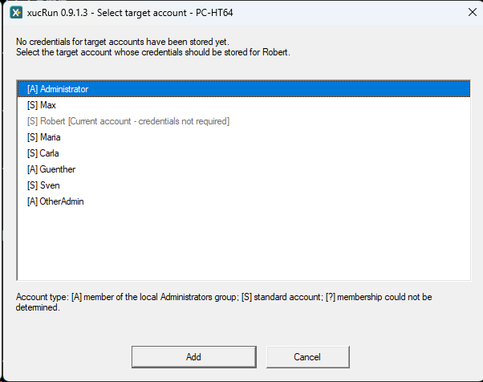

The `:*` forms always show the local target-account selection, even when only one suitable
account or stored credential is available. The dialog identifies the current account, accounts
with stored xucRun credentials, and membership in the local Administrators group. For the current
account, xucRun uses the existing Windows access token. Selecting another account without stored
xucRun credentials starts protected password entry and continues the original launch after the
credentials have been stored successfully.

If `/user-elevated` cannot use the current account and xucRun finds multiple accounts with stored
xucRun credentials that are members of the local Administrators group, the following
target-account selection appears:

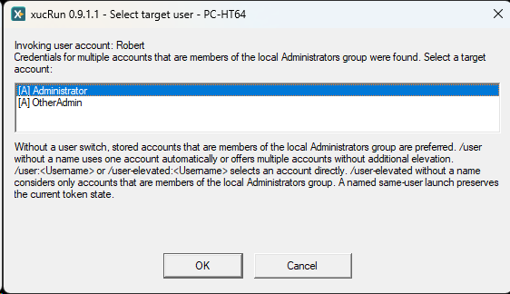

If `/user-elevated` cannot use the current account and xucRun finds no account with stored xucRun
credentials that is a member of the local Administrators group, xucRun instead automatically
offers local target-account selection restricted to members of that group, followed by protected
password entry. After its credentials have been stored successfully, the selected account is used
as the target account for the elevated launch.

A non-elevated launch under another standard account can show a local account selection restricted
to members of the local Administrators group when, for this launch, xucRun also requires
credentials for an account solely to open the protected xucRun approval dialog. Unlike the
target-account selection shown above, this dialog is not limited to accounts for which xucRun
credentials are already stored; additional accounts can therefore appear. In this case, the
additionally selected account is not the target account. The target program continues to run
under the previously selected standard account.

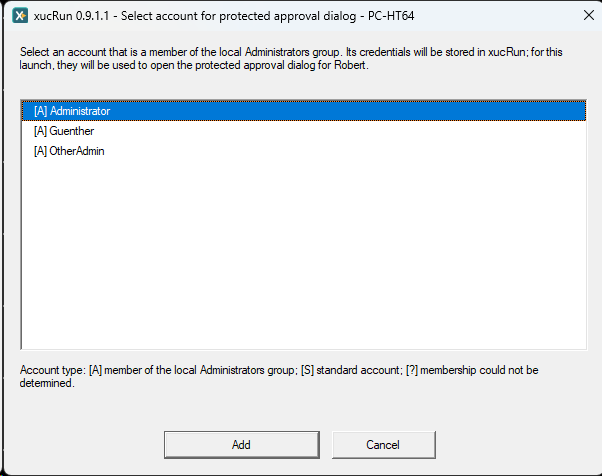

Stored credentials do not replace a required Windows UAC confirmation. For details, see
[Relationship between xucRun approvals and Windows UAC](#relationship-between-xucrun-approvals-and-windows-uac).

In addition to starting programs with elevated privileges, xucRun also supports the opposite use
case: a program can run without elevation under another, deliberately more restricted account.
For example, an application can run under a dedicated standard account with narrower file or
network permissions and its own user-specific configuration. The process uses the Windows access
token and user profile of the target account. This is not a sandbox: the effective restrictions
depend on the target account's group memberships, permissions, and other Windows settings.

## Programs, arguments, and special characters

The first argument that is not an xucRun switch is the target program. All following arguments
belong exclusively to that program:

```powershell
xucRun.exe cmd.exe /c dir
xucRun.exe /user:Administrator app.exe /config:value
```

Here, `/c` and `/config:value` are not interpreted by xucRun. Shell-internal commands must be run
through their shell, for example `cmd.exe /c dir` or
`powershell.exe -Command Get-Process`.

Enclose program paths and individual arguments containing spaces in quotation marks as usual.
xucRun also supports batch files and carries common shell special characters across the additional
process boundaries. Characters that `cmd.exe`, PowerShell, or another calling shell evaluates
before xucRun starts remain subject to that shell's rules.

For security reasons, xucRun rejects target arguments containing non-printing control characters,
such as tabs or line breaks, as well as certain invisible or bidirectional Unicode control
characters. The quoting and shell-metacharacter rules described above apply independently of this
restriction.

For a launch handled by the xucRun broker service—the privileged component that verifies and
performs permitted program starts—of a `.bat` or `.cmd` file whose file name contains one of the
CMD metacharacters `& | ( ) ! % ^`, the broker creates a temporary wrapper named
`xucRun_wrapper_<128-bit-random-value>.bat`. It stores the wrapper preferably on a suitable volume
named `RamDisk`, or otherwise in the target account's `%TEMP%` directory. The broker protects the
wrapper until the launched process exits and then attempts to delete it, or does so during error
cleanup if the launch fails. If a deletion error or unexpected broker termination leaves it
behind, a local administrator can remove it after it has been released. There is no later
automatic cleanup; the wrapper contains no credentials, stored arguments, or reusable
authorization.

## Useful commands

| Command | Purpose |
|---|---|
| `xucRun.exe /addcred [<Account>]` | store credentials |
| `xucRun.exe /deletecred [<Account>]` | select and delete stored credentials |
| `xucRun.exe /showcred` | show accounts for which xucRun credentials are stored |
| `xucRun.exe /showapprovals` | show stored approvals |
| `xucRun.exe /resetapprovals[:<Account>]` | reset approvals |
| `xucRun.exe /system [<Application> [Arguments...]]` | start a local application or replacement shell as `LocalSystem` |
| `xucRun.exe /trustedinstaller [<Application> [Arguments...]]` | start a local application or replacement shell with `LocalSystem` privileges and the TrustedInstaller service identity |
| `xucRun.exe /info` | show version, copyright, signing certificate, broker status, and current configuration |
| `xucRun.exe /admin-status` | show and manage data for all Windows users with elevation |
| `xucRun.exe /backup` | manage local backups |
| `xucRun.exe /audit` | run security diagnostics |
| `xucRun.exe /enable-broker` | re-enable a disabled broker |
| `xucRun.exe /clear-all` | delete stored credentials, approvals, per-user identifiers shown in protected xucRun dialogs, and associated metadata |
| `xucRun.exe /help` | show complete help |

`/hidden` hides the directly started target program. `/hidden-monitor` also monitors its exit code
and displays a notice when it fails. Dialogs and child processes are not hidden or monitored by
these options.

`xucRun.exe` uses exit code `0` for a successful operation and exit code `1` when the operation
fails, is rejected, or is cancelled. The exit code of a launched target program is not returned as
the exit code of `xucRun.exe`.

### Starting an application or replacement shell as LocalSystem or TrustedInstaller

`xucRun.exe /system [<Application> [Arguments...]]` starts the specified local application as the
Windows `LocalSystem` account in the caller's interactive session.
`xucRun.exe /trustedinstaller [<Application> [Arguments...]]` starts it with `LocalSystem`
privileges plus the effective `NT SERVICE\TrustedInstaller` service identity.

Both modes are available only to members of the local Administrators group. An administrator who
is not already elevated receives one Windows UAC consent prompt; an already elevated
administrator performs the launch without another UAC prompt. Standard users are rejected before
an elevation request. The elevated account that is a member of the local Administrators group may
differ from the account signed in to the interactive session, so both modes can also be invoked
from an elevated replacement shell in another user's session.

Without an application, both modes replace an invoking TCC, Command Prompt, Windows PowerShell,
or PowerShell Core shell with the same shell type running under the selected identity. The
current working directory is preserved, the new shell is brought to the foreground, and the
previous shell is closed only after the confirmed replacement started successfully. Unknown
parent shells are rejected.

Neither mode uses stored credentials or approvals: `LocalSystem` and `TrustedInstaller` are not
user accounts with a password, and a stored approval would silently grant full system control to
every later launch of the same executable. Every invocation must therefore be confirmed
separately in the signed xucRun Approval Helper, the component that presents protected
confirmation dialogs.
The dialog appears on xucRun's protected private desktop and shows the exact executable, all
arguments, and the working directory; for `/trustedinstaller` it adds a specific warning about
changes to protected Windows files and registry entries. The confirmation applies only to that
invocation and cannot be stored, and it authorizes the selected program for its entire lifetime,
including operations performed through its user interface and child processes that inherit or
otherwise use its privileged context. A file manager, Registry Editor, shell, or script
interpreter therefore provides very broad system control. xucRun revalidates the executable
immediately before starting it.

| `/system` confirmation | `/trustedinstaller` confirmation with its specific warning |
|:---:|:---:|
| 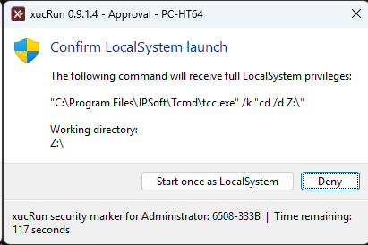 | 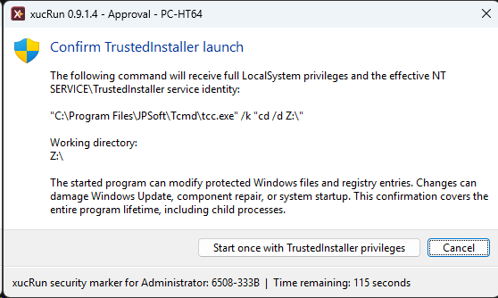 |

The private desktop protects the confirmation from ordinary applications on the normal desktop.
It cannot protect against malicious software that is already running with elevated administrator
rights in the same logon session. Use both modes only from a trusted elevated administrator
session.

Applications running as `LocalSystem` have extensive control over the computer. In particular,
`HKEY_CURRENT_USER` refers to the `LocalSystem` profile rather than the signed-in user's profile.

TrustedInstaller is not a general privilege level above `LocalSystem`. This mode combines
`LocalSystem` rights with the TrustedInstaller service identity and therefore adds access only to
objects for which Windows grants that identity additional rights. If the required Windows service
is stopped, xucRun may start it but does not change its startup configuration or stop it
afterward. A service started this way therefore keeps running at first and usually stops itself
once Windows no longer needs it; a program that has already started keeps its rights regardless.
If xucRun cannot establish the required TrustedInstaller identity, the launch fails; there is no
fallback to a normal `/system` launch.

```cmd
xucRun.exe /system "C:\Windows\regedit.exe" /m
xucRun.exe /trustedinstaller "C:\Windows\regedit.exe"
```

Use both modes only for deliberate maintenance and diagnostic work. The TrustedInstaller identity
does not turn manual changes into supported Windows component servicing. Editing protected files
or registry data can make the component store inconsistent or damage Windows Update, component
repair, or system startup. Use Windows Update or another documented Windows servicing mechanism
whenever one exists.

## Managing credentials and approvals

`/showcred` lists target accounts for which xucRun credentials are stored. `/showapprovals` lists
active approvals in separate columns for scope, target, and invocation binding. Stored passwords
are neither displayed nor returned to the normal xucRun client, `xucRun.exe`. The available
approval scopes and their precise effects are described under
[Approval dialog, duration, and scope](#approval-dialog-duration-and-scope).

In the approval view, double-clicking a row or choosing **Show details...** from its context menu
opens all applicable nonempty fields in a read-only, selectable view for copying. The details
include the target program's complete SHA-256 hash when present. For approvals tied to a specific
target account, they also show its SID so that the account can be identified unambiguously. An
approval for all target accounts has no single target account SID, so that field is omitted.

In the credential view, **Show details...** provides the same copyable target account information,
including its SID. Double-clicking a target account with approvals opens the approvals that apply
to that account. The context menu provides the same action; it is unavailable for rows without
approvals.

Delete actions remain exclusively on the visible buttons below the tables. A selected row can be
deleted from either view. The credential view can also delete all displayed credentials; their
account-bound approvals are removed with them, while profile-wide approvals that apply to every
target account of the current Windows user remain stored. The approval view can delete all
displayed approvals. Each deletion requires a separate confirmation, and the selected-row action
remains disabled until a row is selected.

### Stored credentials

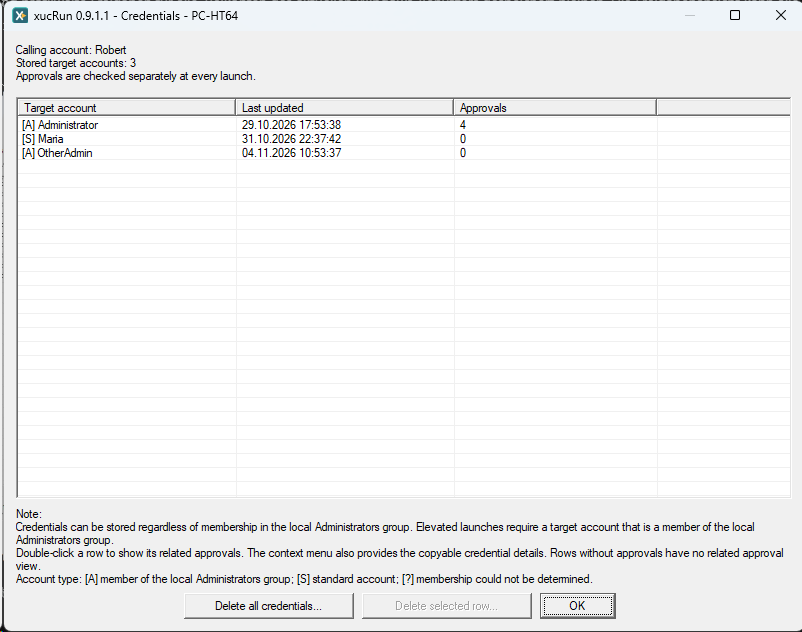

### Active approvals

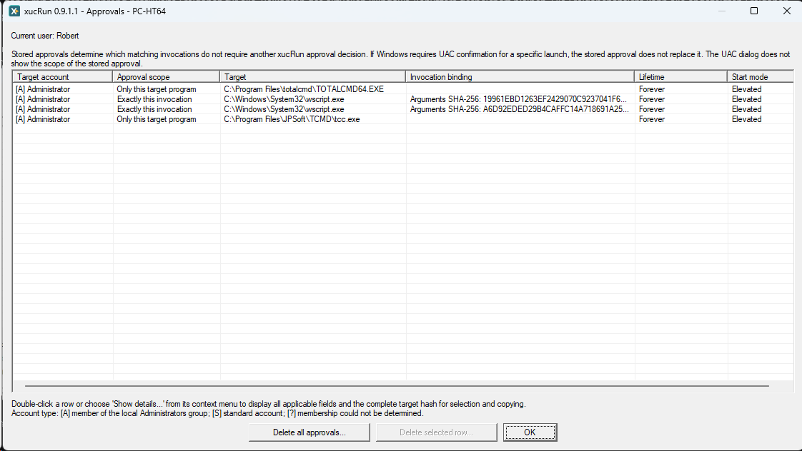

Without an account name, `/deletecred` presents a selection and asks for confirmation before
deletion. Deleting an account also removes approvals bound to that account. Profile-wide approvals
for all accounts remain in place.

Use `/resetapprovals` to select and remove individual or multiple approvals. `/clear-all` is the
administrative cleanup command for active broker-managed data. It must be run elevated and, after
explicit confirmation, deletes all xucRun credentials, approvals, per-user identifiers shown in
protected xucRun dialogs, and associated metadata for every Windows user on the computer. Local
backups are retained and can be removed separately with `/backup-delete-all`.

| Delete stored credentials | Reset approvals |
|:---:|:---:|
| 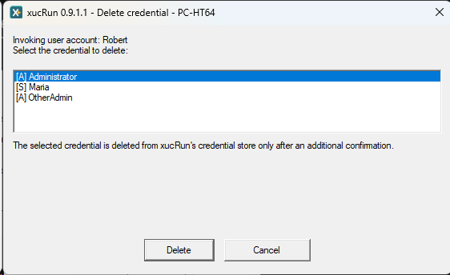 | 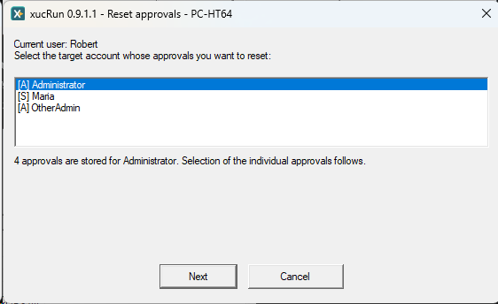 |

For a computer-wide overview, `/admin-status` displays the stored xucRun data of all Windows users
and provides the available administrative cleanup actions. Double-clicking a row or choosing
**Show details...** from its context menu opens the applicable nonempty credential or approval
fields for selection and copying. Credential details and approvals tied to a specific target
account show the target account SID so that the account can be identified unambiguously.
Approval details also include the complete target hash when present.

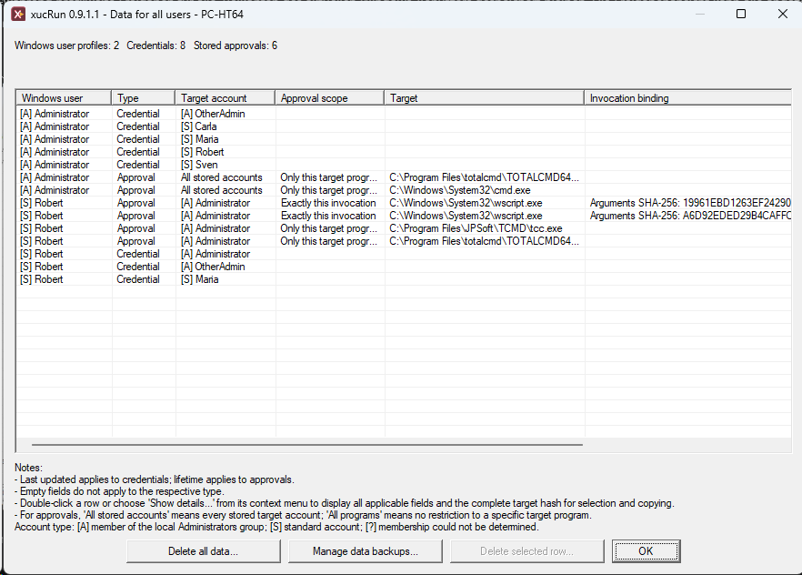

## Motivation and purpose

The preceding sections show how xucRun runs individual programs, commands, and scripts under a
selected account and, where applicable, with elevated privileges. The motivation behind this
workflow is the deliberate use of a standard account for everyday work while retaining practical
access to occasional administrative tasks.

xucRun is intended for experienced Windows users who administer their own computer interactively
or through their own scripts. When an application or file manager reaches a permission boundary,
the user should be able to continue the specific task without signing in to a separate
administrator session and without entering an account name and password again for every matching
operation. After the one-time setup, a single confirmation click should normally be sufficient.

The first invocation should not require every prerequisite to have been configured in advance.
The user can issue the intended program start directly; xucRun requests a missing account
selection, credentials, or approval as part of that invocation. Matching credentials and
approvals can then be reused for later invocations.

Windows already provides the underlying operations for starting programs under another account
and requesting administrative rights. xucRun's purpose is to combine them in one workflow and add
controlled approvals for stored credentials. This convenience introduces additional risks.
Users who do not want to store and reuse credentials should use native alternatives such as Fast
User Switching instead.

Beyond this core workflow, the additional launch modes for `LocalSystem` and the TrustedInstaller
service identity are intended for specific maintenance and diagnostic tasks. They extend xucRun's
capabilities but are neither its starting point nor its ordinary use case.

How this approach differs from Windows UAC, `runas`, Windows Sudo, and other solutions is
described in the following section.

## Comparison with Windows features and other solutions

The following options overlap with individual parts of the workflow described above, but use
different account, session, credential, and approval models.

### Fast User Switching

Fast User Switching keeps the current Windows session and its open programs running while the user
signs in to a separate session under another account or switches to that account's existing
session. The user can then return to the previous session. This approach is also useful when the
complete interactive working environment of the other user is required.

In contrast to Fast User Switching, xucRun keeps the user in the current session and starts only
the required program under the selected other account, with or without elevated privileges.

### Windows UAC and Sudo for Windows

Windows User Account Control (UAC) is the Windows security feature through which a user explicitly
confirms a start with administrator privileges. Depending on the specific launch path and Windows
configuration, an account switch with xucRun can also require UAC confirmation; the interaction is
described under
[Relationship between xucRun approvals and Windows UAC](#relationship-between-xucrun-approvals-and-windows-uac).

[Sudo for Windows](https://learn.microsoft.com/windows/advanced-settings/sudo/) starts a single
process with administrator privileges from an unelevated console through Windows UAC. Its current
implementation requires the invoking account to already have administrator privileges; a standard
user cannot use Sudo for Windows, and another target account cannot currently be selected. The
commonly used Unix/Linux `sudo` with the `sudoers` policy can reuse successful authentication for
a period controlled by
[`timestamp_timeout` and `timestamp_type`](https://www.sudo.ws/docs/man/sudoers.man/#User_Authentication).
Microsoft currently documents no corresponding timestamp mechanism for Sudo for Windows; every
invocation goes through UAC.

For one-time elevation from an unelevated console under an existing account that is a member of
the local Administrators group, Sudo for Windows is the native Windows option. xucRun additionally
covers starting programs from a standard account under another local account by using stored
credentials and approvals that can be single-use or time-limited. If Windows requires UAC
confirmation for the target launch, that confirmation remains interactive.

### `runas.exe /savecred`

Another built-in Windows option with more similarity to xucRun is
[`runas.exe`](https://learn.microsoft.com/windows-server/administration/windows-commands/runas).
It can start individual programs under another account. With `/savecred`, the credentials used for
this are stored in the signed-in user's Windows Credential Manager after the password is entered
once.
Afterward, `runas.exe` can repeatedly start programs under the other account without asking for
the password again. However, `runas.exe` has several limitations:

- The target account must be specified with `/user:<Account>` on every invocation. Depending on
  usage, its name therefore appears in scripts, shortcuts, or the command line.
- `runas.exe` does not request elevation through UAC. Depending on the Windows UAC configuration,
  an account that is a member of the local Administrators group may start with restricted
  privileges unless elevation is requested separately.
- After `/savecred`, the account whose credentials were stored can be used for further program
  starts without another confirmation. There is no mandatory approval and no binding to
  particular programs, file hashes, arguments, or working directories.
- `runas.exe` does not automatically select a suitable account whose credentials were stored with
  `/savecred` and provides no integrated management of approvals with different scopes or
  expiration periods.
- `runas.exe` is sensitive to complex program paths, arguments, and special characters. When it
  is used in scripts or shortcuts, an additional shell or elevation tool can add further parsing
  and quoting layers. This increases the risk of errors, especially when the elevated program
  needs complex arguments or arguments containing special characters.

xucRun adopts the idea of stored and reusable credentials from `runas.exe` and adds controlled
approvals. It can be used in scripts, desktop shortcuts, other fixed invocations, and interactive
command-line use. Starting a program under another account, stored credentials, and interactive
UAC elevation when required are combined in one tool. When suitable credentials are stored, the
invocation needs neither the target account nor its password. Program paths, arguments, working
directories, batch files, and common shell special characters are handled in a controlled manner
across the required process boundaries.

For the Device Manager invocation shown under [Usage examples](#usage-examples), a schematic
equivalent using `runas.exe /savecred` and a separate elevation tool could look as follows if that
tool supports the syntax `elevate.exe <Program> [Arguments ...]`:

```cmd
runas.exe /savecred /user:Administrator "elevate.exe C:\Windows\System32\mmc.exe C:\Windows\System32\devmgmt.msc"
```

The exact syntax depends on the selected elevation tool. In this tool chain, the account name must
appear in the invocation, and the complete downstream command line must be passed to `runas.exe`
as one argument. In its main use case, xucRun does not require an account name and keeps the
program and its arguments separate within one invocation.

A more complex example creates a firewall rule for a program whose path contains spaces:

```cmd
xucRun.exe "C:\Windows\System32\netsh.exe" advfirewall firewall add rule name="Local example server" dir=in action=allow program="C:\Program Files\ExampleServer\server.exe" enable=yes profile=private
```

Here, `netsh.exe` receives several key-value arguments as well as a rule name and a program path
containing spaces. A toolchain consisting of `runas.exe` and a separate elevation tool would
therefore be considerably more complex; its reliable use with special characters would also
depend on the specific elevation tool and its quoting rules.

After the password is entered once, `runas.exe /savecred /user:Administrator` can use the same
account whose credentials were stored for other programs without requesting the password or a
mandatory confirmation again. xucRun instead requires a suitable explicit approval before stored
credentials are used.

`runas.exe /savecred` and xucRun use separate, incompatible credential storage. An xucRun approval
can be bound closely to the calling user account, the target account, the participating programs
and their file hashes, and it can be time-limited. If one of the bound programs changes,
its SHA-256 hash no longer matches the approval. xucRun requires an explicit decision before
transferring the approval to the changed program version.

### Third-party solutions and choosing an approach

In addition to native Windows options, third-party solutions are available for switching user
accounts, elevating privileges, and managing administrative access. Depending on the use case,
they focus on different priorities and may be better suited, for example, to centralized
administration, managed enterprise environments, or unattended automation. Listing individual
products would inevitably be incomplete and might unintentionally emphasize certain options
through the selection. Such a list would also quickly become outdated and would allow only
limited comparison because the products use different operational and security models.

The appropriate solution depends on the specific requirements.

Users who want to start programs under another user account from a standard account and are
willing to re-enter that account's credentials for every launch can use the native Windows
mechanisms.

For users who instead want to avoid entering passwords repeatedly while retaining more precise
control than `runas /savecred` provides over which programs may use stored credentials and
administrative privileges, xucRun provides a freely available solution.

## Approvals and Windows UAC

### Relationship between xucRun approvals and Windows UAC

If the current Windows account is a member of the Administrators group, xucRun uses this account
for the started program by default. If the account is not yet elevated, Windows requests consent
through User Account Control (UAC). In this case, xucRun does not display its own approval dialog
and consent is handled exclusively by Windows UAC.

xucRun program approvals apply to starts using another account's stored credentials. In the
intended workflow from a non-elevated standard user account, a required account switch or
elevation remains interactive. For a launch without elevation, UAC can confirm the user's presence
through the xucRun Approval Helper, after which the target program runs with the target account's
non-elevated privileges. With elevation, UAC can instead confirm the target program start and
grant it the requested administrator privileges. The UAC prompt that Windows actually displays
depends on the specific launch path and Windows configuration.

A matching reusable approval only avoids another xucRun approval dialog. It does not replace any
Windows UAC confirmation required for the specific launch. The two decisions serve different
purposes: xucRun verifies that the invocation matches the stored approval; Windows UAC, where
required, confirms the specific launch or elevation.

The Windows UAC dialog does not show which xucRun approval is being used, how long it remains
valid, or whether it is bound to the exact invocation, one target program, or all programs. That
scope is shown when the approval is created in the xucRun approval dialog and later in the
approval management view.

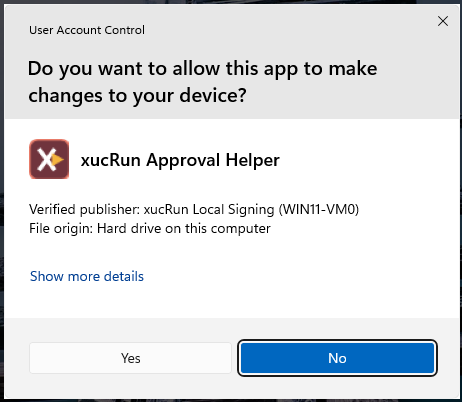

Starting a program under another standard account can also require such a UAC presence
confirmation; the local Administrators group member used for it then serves only to open the
dialog, as described under
[Account selection and privilege mode](#account-selection-and-privilege-mode).

If no suitable approval is active, the xucRun approval dialog appears on a separate Windows
desktop. In the intended workflow, Windows separates this desktop from normal, non-elevated
programs. If xucRun cannot open it there, the operation is aborted. An elevated executable
writable by the caller requires a one-time risk confirmation for every start; if its directory is
also writable, xucRun blocks the elevated start.

[Account selection and privilege mode](#account-selection-and-privilege-mode) describes how
xucRun determines the account, requests missing credentials, and distinguishes starts with and
without elevation. Regardless of the selected path, UAC remains interactive; **xucRun is not a
mechanism for unattended elevation.**

Account selection, management, information, and error dialogs appear on the normal user desktop.
Password entry, approval decisions, and risk confirmations appear on a separate Windows desktop;
Windows UAC separately uses the configured UAC desktop.

For the first such dialog, xucRun creates a random xucRun dialog security identifier in the format
`XXXX-XXXX`. This is not a Windows account security identifier (SID). Password, approval, and risk
dialogs then display it unchanged. After verifying the installation, the user should remember or
securely record it during the first deliberately initiated dialog and confirm later dialogs only
when it matches. The identifier indicates an xucRun Approval Helper dialog but does not prove that an
operation is safe or user-initiated. It does not provide complete protection on a compromised
system and helps only when the user actually compares it.

### Approval dialog, duration, and scope

**With each approval, the user determines the balance between convenience and narrow scope:**
The longer and broader an approval is, the more matching later invocations can proceed without
another xucRun approval decision. A shorter approval or one bound more precisely to a program,
invocation, and target account requires a new decision more often but limits how broadly it can
be reused.

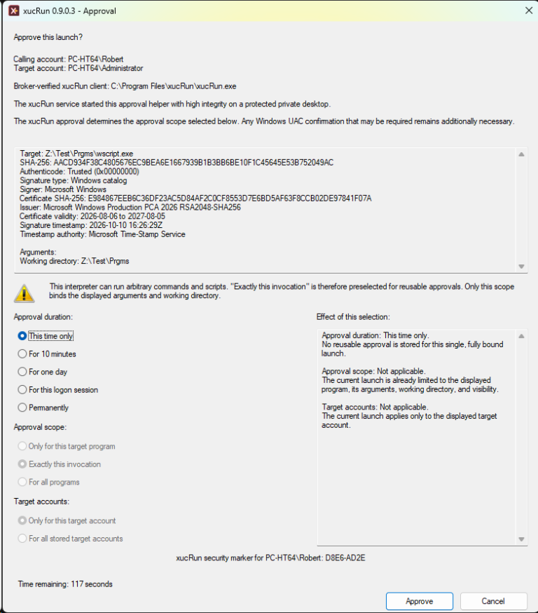

The differentiated approval dialog allows the approval duration, program and invocation binding,
and included target accounts to be adapted to the specific use case and desired level of
protection. Its fixed header above the scrollable launch details identifies the xucRun client path
as successfully verified by the broker and shows the calling account, target account, and
protected Approval Helper origin before the explanatory UAC note. The scrollable area shows
detailed Authenticode information for the target program. For a trusted target signature, these
details include the signer, full SHA-256 certificate fingerprint, issuer, certificate validity
period, signature type, and any available timestamp and timestamp authority. If trust verification
fails, the dialog distinguishes a missing signature association from common signature,
certificate-chain, validity, revocation, and policy failures. A missing association means that no
usable embedded signature and no Windows catalog signature matching the current file contents was
found. A catalog signature associates the file through its hash; changing any byte breaks that
association, even though the catalog and its certificate continue to exist on the system and must
no longer be attributed to the changed file. The dialog also shows any signer and certificate
details that Windows can still provide for an untrusted signature. xucRun recognizes both embedded
Authenticode signatures and Windows catalog signatures. An unsigned or untrusted target remains
approvable because the signature information supplements rather than replaces the exact path and
SHA-256 identity. The available approval durations are:

- this start only,
- 10 minutes,
- one day,
- until sign-out,
- permanently.

If the current launch differs from approvals already stored for the same target program, the
scrollable details summarize up to four of the most relevant approvals and name the differing
bindings, such as the program file, target account, elevation mode, arguments, working directory,
visibility, or direct script. The "Effect of this selection" area explains whether the new choice
adds a separate approval, broadens existing approvals, replaces an otherwise identical approval
with a different elevation mode, or remains overlaid by a broader approval. Existing narrower or
broader approvals are not deleted automatically; `/showapprovals` remains the complete management
view. Plain-text arguments are not reconstructed or displayed.

For "This start only," approval scope and target accounts do not apply because the approval applies only to
the currently displayed launch. The corresponding controls are therefore disabled. A reusable
approval can be bound to one program or all programs and to one target account or all stored
accounts of the current Windows user. Program-specific approvals include the SHA-256 hash of the
executable. If the executable at an approved path has a different hash, for example after a
program update, xucRun does not reuse the existing approval automatically. The dialog shows the
old and new hashes and the affected existing approvals. The user can transfer the change for the
current target account or for all target accounts covered by the affected approvals. Cancelling
leaves the existing approvals unchanged and rejects the current launch. The transfer also applies
to **"Exactly this invocation"** approvals; their argument, working-directory, visibility, and
direct-script bindings remain unchanged.

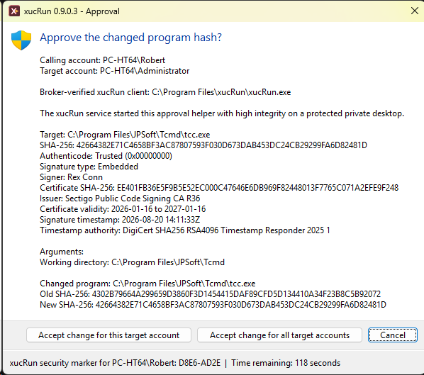

With **"Exactly this invocation,"** a reusable approval can additionally be bound to the exact
arguments, the working directory, and whether the program is started visibly or hidden. Any change
to these values then requires a new approval. The arguments are not stored in clear text; only
their SHA-256 hash is retained as the binding.

An approval does not restrict what the started program can do. General or permanent approvals for
universal interpreters such as `cmd.exe`, PowerShell, or `wscript.exe` are therefore particularly
powerful.

For `cmd.exe`, `powershell.exe`, `pwsh.exe`, TCC, and Windows Script Host, the approval dialog
therefore warns about the interpreter's broader capabilities. A normal program approval does not
bind the displayed arguments. Therefore, "Exactly this invocation" is preselected for reusable
approvals involving these shells and interpreters.

If a reusable approval for one of these interpreters is nevertheless changed to "Only for this
target program" or "For all programs," xucRun requires a second explicit confirmation on the
protected desktop. It explains that arguments, script paths, and script contents are not part of
the stored approval and that different commands or new or modified scripts can later start without
another xucRun approval dialog. Returning to the selection is the default. An intentionally stored
broad approval retains this broad effect when it matches a later invocation.

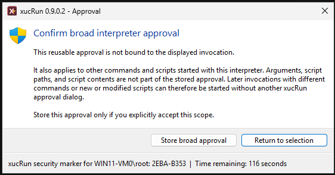

If xucRun recognizes a directly specified PowerShell, batch, TCC, or Windows Script Host script, it
additionally binds the script's fully resolved path and SHA-256 hash, provided that the calling
account cannot modify a folder relevant to replacing the script. The script file itself may be
writable: if its contents change later, its hash no longer matches and xucRun requires a new
approval. Immediately before every launch, the broker rechecks the final path and hash and keeps
the verified file locked against modification and replacement until the program starts. An active
script binding is visible when the direct script's path and SHA-256 hash are shown at the top of
the approval dialog. The dialog also shows the same Authenticode and certificate details for the
direct script. This information does not require a script to be signed and does not replace the
path and hash binding. For PowerShell, a reusable "Exactly this invocation" approval is available
only with such a safely bound direct script. In particular, `-Command`, interactive invocations,
and other forms not recognized as direct `-File` execution can be approved only once or
deliberately with a broader approval scope.

For other interpreters, if no direct script with its path and SHA-256 hash is shown,
"Exactly this invocation" still binds the program file, arguments, working directory, and the
setting for a visible or hidden launch, but no additional program or script contents. Programs,
scripts, and other files named in the command or
invoked by it directly or indirectly can be replaced or modified without invalidating the
approval. Examples include free CMD command text using `SET` and `CALL` and programs subsequently
started by a bound target program or script.

If a folder relevant to replacement can be modified, or if the path or contents cannot be verified
safely, a reusable approval for "Exactly this invocation" is not available. The dialog explains
why and keeps the one-time approval as the default. The user can instead deliberately select a
reusable approval for the interpreter or for all programs. Such a broad approval does not bind
arguments, the script path, or script contents and therefore requires the separate explicit
confirmation described above. Before each individual launch, the broker still rechecks and locks
a recognized direct script; this launch-time check does not bind later invocations to the earlier
script contents. For PowerShell, an administratively enforced `AllSigned` policy can additionally
protect script files, but does not protect against direct or interactive commands.

Calling scripts, shortcuts, and configuration files from which the xucRun invocation is first
generated are still not generally hashed. The approval binds the resulting xucRun invocation, not
the script, shortcut, or configuration file from which it originated. Dynamically loaded scripts,
modules, configuration files, plugins, program inputs, and downstream programs are likewise not
automatically included. Such programs and files, as well as directories through which they could
be replaced, must therefore remain appropriately protected. An existing xucRun approval is not a
substitute for this protection. The other broker checks, particularly those for the account,
requested privileges, visibility, target path, and target-program hash, remain effective.

Privileges do not end when a window is closed. Processes started by a program that was launched
through xucRun keep its account and privileges and can continue to run in the background after
the original window has been closed or a time-limited approval has expired. The optional
[xucRun Tray](#optional-tray) lists the processes started through xucRun and their recognized
follow-up processes, including those without a visible window.

## xucRun scope

xucRun contains:

- the `xucRun.exe` client,
- the `xucRunBroker` service, which starts automatically when needed, manages credentials stored by
  xucRun in the background, and starts programs under the selected user account,
- the xucRun Approval Helper `xucRunApproval.exe`,
- shared protocol, serialization, and security components,
- German and English language resources.

xucRun can be built, installed, and used independently.

## Requirements and intended use

xucRun supports Windows 10 and Windows 11 on x64 systems. It requires the current Microsoft
Visual C++ Redistributable v14 for x64. The minimum version required for a release is listed in
the corresponding [changelog](CHANGELOG.md) entry.

For elevated cross-account launches, Windows Admin Approval Mode must be enabled for the selected
account that is a member of the local Administrators group. This particularly affects the built-in
`Administrator` account, for which this mode may be disabled. Otherwise, xucRun blocks the launch
because UAC confirmation would not be possible.

For the built-in `Administrator` account, this mode can be enabled through the Windows security
policy [User Account Control: Admin Approval Mode for the Built-in Administrator account](https://learn.microsoft.com/en-us/windows/security/application-security/application-control/user-account-control/settings-and-configuration#user-account-control-settings-list).
The corresponding registry setting is the `FilterAdministratorToken` DWORD value under
`HKEY_LOCAL_MACHINE\SOFTWARE\Microsoft\Windows\CurrentVersion\Policies\System`; a value of `1`
enables the mode. This changes the system-wide behavior of the built-in `Administrator` account,
not only its behavior when used with xucRun. Applications run by this account generally start with
a filtered token and use the configured Windows UAC elevation behavior when administrative
privileges are required. UAC must remain enabled system-wide. Sign out and back in after changing
the setting.

xucRun is intended for experienced private users and developers on self-managed computers and in
personal development and test systems. It is not a solution for unattended elevation, centralized
privilege management, or systems requiring an elevated level of protection.

> **Important security notice:** xucRun uses Windows APIs to store credentials. For xucRun to
> start a program under another user account, however, xucRun
> must process the required credentials temporarily. Complete protection against reading or
> misuse by sufficiently privileged malware or an already compromised system therefore cannot be
> guaranteed. The source code of xucRun is
> disclosed so that the implemented technical measures, their limits, and the remaining
> risks can be understood and independently reviewed. Disclosure alone is neither a security
> guarantee nor evidence of an independent security audit. Use xucRun at your own responsibility.
> xucRun should be used only on trusted, self-managed systems that do not require an elevated level
> of protection, and preferably with dedicated target accounts having the minimum
> required privileges. Scripts, shortcuts, scheduled tasks, and configuration files that invoke
> xucRun or provide its parameters must also be trusted and protected against unauthorized
> modification.
> To the extent permitted by law, the author and contributors accept
> no liability for damage, data loss, or other consequences arising from the use or incorrect use
> of xucRun, software defects or security vulnerabilities, malware, or a compromised system. This
> includes, in particular, the loss, disclosure, or misuse of credentials. The disclaimer of
> warranty and limitation of liability in the [Apache License 2.0](LICENSE) govern.

## Broker service security model

One possible alternative to a broker service would be for the normal client alone to store the
credentials under cryptographic protection. Without a separate privileged component, decryption
and use would then have to take place in the process and security context of the currently signed-
in user. This could protect the stored data against direct extraction. However, the ability to
decrypt it, the temporarily required clear-text password, and the permission Windows creates
after logon to start processes would be in the same security context as the normal client.

A compromise of that process or its user context could then attempt to misuse the legitimate
decryption function, manipulate the program flow, or read the password or logon permission from
process memory. Cryptographic storage alone does not solve this problem: if the normal client can
decrypt the data, the capability required to do so must be available in its security context. The
responsible component must also reliably decide which user may start which program under which
account, with which arguments, and with which privileges.

xucRun therefore separates this security-sensitive capability into a privileged broker service.
Only the broker stores and decrypts credentials, performs the Windows logon, and starts the
permitted program. It verifies the actual caller and binds credential use to the verified context
of the specific program start. The encrypted stored credentials and their internal associations
are also not provided to the normal client. They reside in storage protected by Windows for the
system account and are additionally bound to that account on the local computer. A normal user
process therefore cannot decrypt them in its own security context. The normal client receives
neither the stored password nor a permission with which it could start programs under the target
account itself. If a required check fails, no program is started with the stored credentials;
there is no fallback to client-side decryption.

The service used for this purpose runs under the Windows `LocalSystem` account, has extensive
privileges, and therefore itself increases the security-relevant attack surface. This additional
security boundary requires systematic protection of the broker.

The broker does not trust identity, path, or approval information merely asserted by a client. It
derives the calling process, user, Windows session, and privilege level from the actual local
connection and from Windows itself. For security-sensitive requests, it checks, among other
properties, the protected installation location, actual program path, file hash, and Windows
digital signature. The client in turn verifies that the other end of its local connection belongs
to the registered xucRun service. Immediately before starting the program, the broker checks the
target program and working directory again. It determines the actual program path and its file
hash as well as the actual working directory itself and keeps the verified Windows objects open
until the start. This is intended to prevent a previously checked target from being replaced
unnoticed between approval and program start.

For each sensitive operation, the broker creates a short-lived security proof that can be used
only once. It applies only to the specific calling process, user, Windows session, target account,
target program and its hash, arguments, working directory, and the requested start with or without
elevated administrator privileges. A copied identifier or a process identity merely asserted by
the client is not sufficient. Different xucRun components also receive only the functions they
require. For example, the optional Tray can retrieve status and list data, but it cannot start
programs, change credentials, or make approval decisions.

The broker and its installed files are additionally hardened against replacement and unintended
extension. Before entering productive operation, the broker checks, among other properties, its
own signature, the authorized client, protected installation paths, and security-relevant file
and directory permissions. It restricts the directories from which additional program components
may be loaded and prohibits certain ways of introducing foreign code at runtime. It also uses
built-in Windows protections that make exploitation of programming errors more difficult. Among
other measures, they prevent data from being executed as program code without further checks,
make the arrangement of process memory less predictable, and make manipulation of the intended
program flow more difficult. Program components from network locations and less trusted security
contexts are blocked. If a programming error causes the broker to access a closed or invalid
Windows object, Windows terminates it immediately instead of allowing it to continue in a
potentially unsafe state. Invalid, incomplete, oversized, or unauthorized requests from an xucRun
component are rejected without continuing the operation. If the broker cannot enable and then
verify one of its required Windows protections, it does not enter service operation.

The broker does not keep stored passwords permanently in clear text. It decrypts a password only
after the checks and required approvals for a specific operation and uses it immediately for the
Windows logon. Memory areas containing the clear-text password and controlled by xucRun are locked
against paging to disk, are not copied unnecessarily, and are overwritten after use. Other memory
areas used by xucRun for sensitive contents are also cleared afterward. If xucRun cannot establish
the required memory protection, the operation is aborted. Automatic Windows Error Reporting
memory dumps are disabled for the broker so that a crash does not unnecessarily place sensitive
memory contents in such a diagnostic file.

When a password is entered for the first time, it must necessarily be present briefly in the
memory of the Windows credential dialog and the verified xucRun Approval Helper. The Approval
Helper runs separately from the normal client with elevated privileges on its own Windows desktop.
In the intended workflow, Windows separates this desktop from ordinary, non-elevated programs. The
Approval Helper sends the password directly to the broker over the authenticated local connection
and then overwrites its own memory areas containing the password. The normal xucRun client does
not receive the password in this workflow either.

The broker is configured as a demand-start Windows service and is not started for status queries
alone. After actual use, it remains active until it is explicitly stopped, Windows shuts down, or
the service fails. While idle, it keeps no stored passwords in clear text and uses practically no
CPU time. An automatic idle stop would not further protect the encrypted stored credentials but
would create additional synchronization and restart paths. The broker can be explicitly stopped
or disabled; re-enabling it requires Windows UAC.

Taken together, these measures reduce the attack surface, make manipulation of the service more
difficult, and limit the consequences of a compromised normal user process. They cannot
completely exclude software defects, unknown vulnerabilities, or system compromise. In
particular, they do not provide a reliable security boundary against local administrators, other
compromised processes already running with system privileges, attacks on the Windows kernel, or
compromised infrastructure used to digitally sign the programs. xucRun therefore uses the broker
as a deliberately chosen and hardened security boundary, not as an absolute security guarantee.

## Installation overview

Installation requires a complete xucRun package. The graphical installer signs all installable
package files consistently on the target computer with a local xucRun certificate.

The public binary ZIP is a complete installation package, but it is not a portable application
package. Do not copy individual EXE or DLL files from it to an arbitrary directory and treat that
as an installation. Use either the included graphical installer or the script-based method
described in the [installation guide](docs/en/INSTALLATION.md). In addition to the program files,
both methods configure the protected installation path, local signing certificate, broker service
and its authorization binding, configuration, and uninstall support.

### Local signing certificate

xucRun uses the certificate so that Windows and xucRun can verify that the installed program
components belong to the same installation and have not been changed or replaced with differently
signed files. The broker accepts security-sensitive requests only from matching signed xucRun
components.

The public package does not contain a shared private key and is not signed with a commercially
issued, publicly trusted publisher certificate. Such a key would allow every recipient to create
files that appear to have the same identity. Instead, the installer creates a unique self-signed
certificate on the target computer or reuses its existing valid xucRun certificate. The private
key is non-exportable. This establishes only local technical trust and does not prove the public
package's origin; therefore, verify the release checksum before starting the installer.

The standard certificate is named `CN=xucRun Local Signing (<COMPUTERNAME>)`. It is stored in
`LocalMachine\My` with its private key and added to `LocalMachine\Root` and
`LocalMachine\TrustedPublisher` for trust on that computer. The verified standard certificate,
including its private key and trust entries, is removed when xucRun is uninstalled.

### Graphical installation

xucRun is a non-commercial open-source project. The provided installer is currently not
signed by a publicly trusted publisher. Windows may therefore report an unknown publisher when
it is first started.

The easiest installation method is
`xucRun-Installer-<Version>-x64.exe`, for example
`xucRun-Installer-0.9.1.6-x64.exe`. Before starting it, obtain the file only from the
[official xucRun releases](https://github.com/HT64/xucRun/releases), compare its SHA-256 checksum
with the checksum published there, and verify any available Authenticode signature.

When started, Windows User Account Control requests the required administrator rights. The
graphical interface then offers a choice of application language and machine PATH behavior. The
installer reuses the existing valid local xucRun certificate or creates a new one and displays its
validity period and fingerprint.

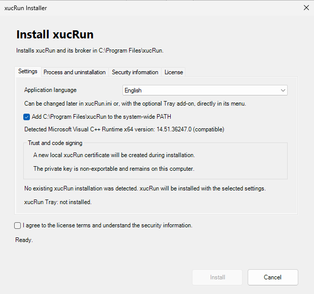

The installer checks the Microsoft Visual C++ Runtime x64. If no compatible version is present,
it offers a verified Microsoft download or an existing `vc_redist.x64.exe` and rejects versions
that are too old. It then installs the client, broker, Approval Helper, and language files under
`%ProgramFiles%\xucRun` and configures the broker service and uninstall entry. The manual
installation method uses the same included PowerShell script.

### Update and uninstall

xucRun and the separately installed optional
[xucRun Tray add-on](https://github.com/HT64/xucRun-Tray) use an exact four-part version match.
Before changing xucRun versions or uninstalling it, remove xucRun Tray through its own Windows
uninstall entry; afterward, install the Tray release with the same new version. Tray can remain
installed when reinstalling the same matching version.

To update xucRun, start the versioned graphical installer from the newer package. It reuses the
existing valid local xucRun certificate. Stored credentials, approvals, and INI settings not
managed by the installer are preserved.

Uninstall through **Installed apps**. Alternatively, no separate uninstallation script is needed:
run the installed `Install-xucRun.ps1` under `%ProgramFiles%\xucRun` with `-Uninstall`:

```powershell
if (-not [Environment]::Is64BitProcess) {
    throw 'Uninstallation requires 64-bit PowerShell.'
}
$programFilesDirectory = [Environment]::GetFolderPath(
    [Environment+SpecialFolder]::ProgramFiles)
$windowsPowerShell = Join-Path `
    ([Environment]::SystemDirectory) `
    'WindowsPowerShell\v1.0\powershell.exe'
& $windowsPowerShell -NoProfile -ExecutionPolicy Bypass `
  -File (Join-Path $programFilesDirectory 'xucRun\Install-xucRun.ps1') `
  -Uninstall
```

> **Warning:** Uninstall permanently deletes all credentials and approvals stored by xucRun for
> every Windows user, together with all local xucRun backups, security markers, and associated
> metadata. It also removes the standard local xucRun certificate, including its private key and
> trust entries.

Before making the first change, uninstall requires explicit confirmation of this permanent
deletion. Cancelling leaves the installation and its data unchanged.

If uninstall fails, xucRun writes a technical diagnostic log under
`%ProgramData%\xucRun\InstallerLogs`; the error dialog shows the specific file path and can open
the log folder. The log contains no stored passwords.

Both installation methods and the local test-signing instructions are described in detail in the
[installation guide](docs/en/INSTALLATION.md).

## Backups

`xucRun.exe /backup` opens the interactive local backup manager. The following commands are also
available:

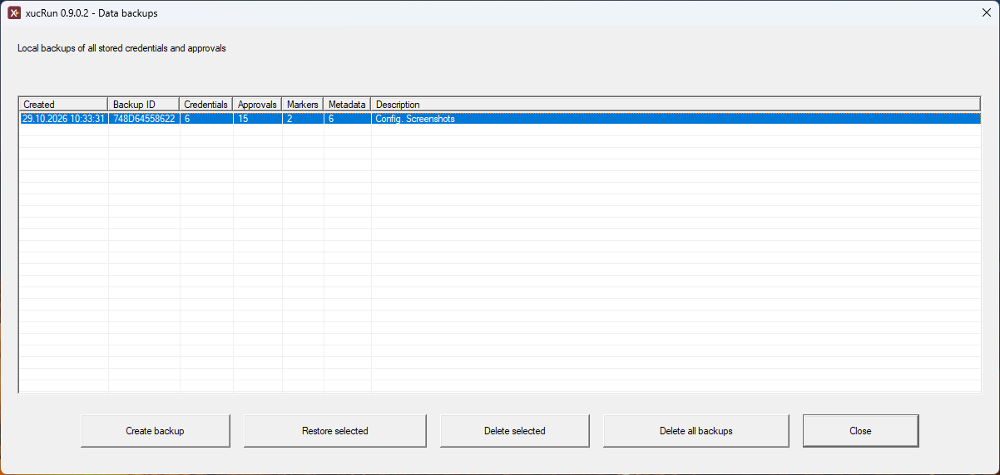

```text
xucRun.exe /backup-create [<Description>]
xucRun.exe /backup-list
xucRun.exe /backup-restore
xucRun.exe /backup-restore:<Backup-ID>
xucRun.exe /backup-delete-all
```

A backup contains stored credentials, approvals, xucRun dialog security identifiers, and
associated metadata.
Backups are stored separately from the active credentials and approvals under
`%ProgramData%\xucRun\BrokerBackups`. xucRun uses Windows APIs for storage and binds the backups to
the computer. xucRun restores them only on the same computer; they are not a portable password
export.

Uninstalling xucRun also removes locally stored xucRun backups.

## Troubleshooting

`xucRun.exe /info` shows the shared client runtime information also used by the separately
installed optional xucRun Tray add-on: version, copyright, path, architecture, effective language
and loaded language DLL, signing certificate, current account including SID and elevation,
configuration file, and client logging. The common configuration section also identifies the
installed maintenance script. Core-specific sections add broker status, broker information
events, and stored-data counts.
`xucRun.exe /audit` checks security-relevant properties of the running installation and also
identifies the verified certificate when the client signature is valid. If xucRun Tray is
installed separately, the diagnostics also check its installed files and signatures, uninstall
registration, and per-user autostart tasks. If the broker service was disabled,
`xucRun.exe /enable-broker` enables it again. `xucRun.exe /help` displays the complete local command
overview.

The diagnostics explicitly verify the file protection, Authenticode trust, and expected signer
of the installed `Install-xucRun.ps1` maintenance script and, when Tray is installed,
`Install-xucRunTray.ps1`. The check uses this fixed product-file list rather than treating
arbitrary additional PowerShell files in the installation directory as xucRun components.
The report also confirms whether all required Windows protections of the running broker process
are active. A successful report summarizes the protected areas; a deviation identifies the
affected protection and provides a restart and reinstall recommendation.

If xucRun reports that an elevated launch was blocked because UAC confirmation was unavailable,
Windows Admin Approval Mode is not effective for the selected different account that is a member
of the local Administrators group. This can particularly affect the built-in `Administrator`
account.

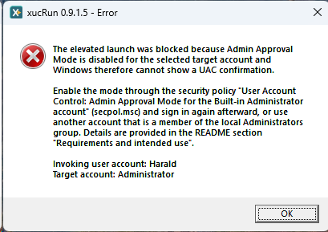

### Runtime information

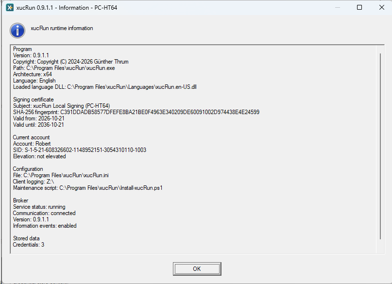

### Security diagnostics

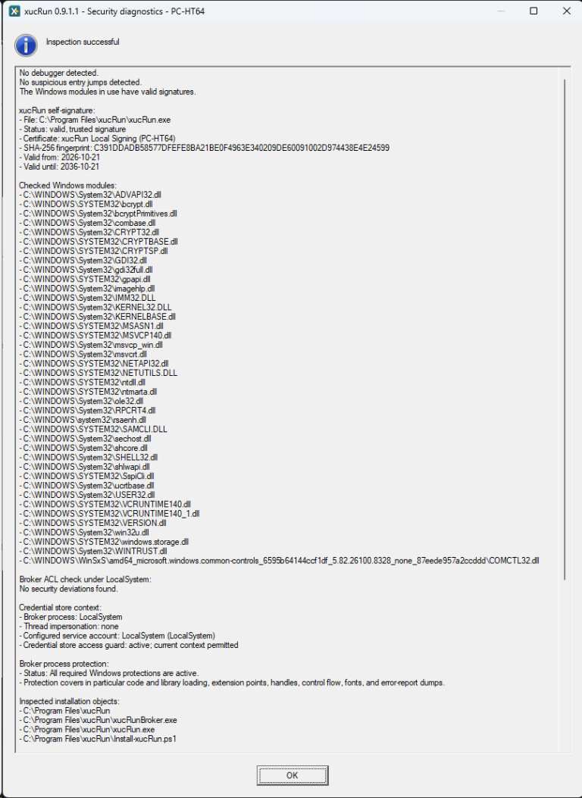

For additional diagnostics, `ClientLogDirectory` can be configured to enable client log files
named `xucRun_YYYYMMDD.log`. Broker warnings and errors are always written to the Windows
Application event log under the `xucRunBroker` source and can be viewed in Windows Event Viewer
under **Windows Logs → Application**. See
[Configuration file and language](#configuration-file-and-language) for configuration details.

## Configuration file and language

xucRun uses the machine-wide configuration file
`%ProgramFiles%\xucRun\xucRun.ini`. The installer creates it and updates the selected language
during installation or an update without removing the other existing settings. Because the file
is located under `%ProgramFiles%`, administrator privileges are normally required to edit it
manually.

The supported structure is:

```ini
[xucRun]
Language=auto

[Logging]
ClientLogDirectory=
BrokerInformationEvents=false
```

Comment lines begin with a semicolon (`;`). Comments should be placed on separate lines rather
than appended to a setting.

- `Language=auto` follows the current user's Windows display language, selecting German for a
  German display language and English otherwise. `Language=de` selects German explicitly, and
  `Language=en` selects English explicitly. The change applies to newly started xucRun processes.
  Running Tray instances restart after a language change made through xucRun. Tray detects a
  manual external change when its context menu is next opened and then restarts itself. Other
  already running xucRun processes do not adopt the change. German and English are provided
  through separate, signed language resource files. The localization architecture can be extended
  with additional languages, but the current version supports only German and English.
- A missing or empty `ClientLogDirectory` disables client file logging. Specifying a path enables
  it. Environment variables are expanded in the context of each starting client. The path must
  be accessible to every client and wrapper account in use, with the permissions required to
  create, append to, and delete log files. xucRun does not change the directory's access
  permissions. If the configured directory, especially a network path, is unavailable, Windows
  file-system timeouts can also delay the opening of the Tray context menu. The Tray enumerates
  the existing log files at that point to update the corresponding actions and file count. For a
  shared path, the administrator must therefore define the intended readers
  and writers; accounts with modify access can also alter or delete the logs. Changes apply to
  newly started client and wrapper processes. Running Tray reloads the value when its context menu
  is next opened; until then, it continues to use its previous logging configuration. For each
  resolved log directory, xucRun appends to one dated log file per day but does not automatically
  rotate or delete client logs. These logs can contain program paths, account names, command
  lines, and target arguments. Do not pass passwords or other secrets as command-line arguments.
- The broker always writes warnings, errors, and service and ACL startup messages to the Windows
  Application event log under the `xucRunBroker` source. `BrokerInformationEvents=true`
  additionally logs routine information about pipe request processing there. If the setting is
  missing, empty, `false`, or has any other value, only these additional information events remain
  disabled. Changes take effect after the broker service is restarted; restarting the client or
  Tray is not sufficient.

A missing configuration file, invalid language value, or missing or incorrectly signed language
file causes startup to fail for security reasons instead of silently falling back to another
language.

## Optional Tray

The separately installed optional
[xucRun Tray add-on](https://github.com/HT64/xucRun-Tray) provides a status and control
interface whose icon appears in the notification area of the Windows taskbar next to the clock. It
is a separate project that displays information from xucRun and provides access to existing xucRun
management functions. Its menu can set the machine-wide xucRun language to Automatic, German, or
English. Running Tray instances restart after the change, and the setting applies to newly started
xucRun processes.

The Tray is particularly helpful during initial setup, when checking the operating state, and when
later changing credentials, approvals, language, logging, or broker state. xucRun and its broker
service remain fully usable without the Tray being installed or running, so the Tray can be used
continuously or only when needed. Details about manual startup and startup at Windows logon are
documented in the Tray project.

## A personal note on the origins of xucRun

The starting point for xucRun was a recurring need over many years across several computers in a
private setting, some of which were also used by other people. I generally work with standard
Windows accounts but still need to start individual programs with elevated privileges or under
another account without switching to a separate session or entering the same credentials for
every launch. One central use case is opening a file manager in another account's context from my
existing session; the resulting [configuration examples for Total Commander](#total-commander-integration)
are documented above. Over the years, I combined freely available utilities and built-in Windows
commands in increasingly complex scripts. As this combination no longer fully met my requirements,
I developed a dedicated native solution in C++.

As more and more work went into what had originally been a tool for my own use, it eventually
seemed a shame to keep it to myself. I therefore decided to publish it as a public open-source
project on GitHub. That decision, however, created a substantial amount of additional work:
preparing xucRun for use by others and clearly explaining its intended use, internal workings, and
limitations required systematically developing and refining its security model, the management of
stored credentials and program approvals, configuration and diagnostic functionality, user
interfaces and their dialogs, installers, localization, documentation, and automated tests.

A significant part of this effort resulted from the aim of not achieving the additional
convenience through a blanket, broad approval. Instead, users should be able to determine the
balance between convenience and narrow scope for their specific use case and understand the
effect of their selection. This led, among other things, to the differentiated approval dialog
described under [Approval dialog, duration, and scope](#approval-dialog-duration-and-scope).

AI-assisted development tools helped me manage this additional workload as a sole developer. I used
them in a supporting role across numerous interactive development steps. Throughout this process, I
used successive development versions in my everyday computer work and continued developing xucRun
based on that experience. Only after xucRun had reached what I considered an appropriate level of
maturity in this way did I make the first public version available. The technical decisions and
responsibility for the result remain mine.

The detailed discussion of security considerations may initially appear unusually critical,
particularly when compared with a brief product description. It is, however, a deliberate
consequence of publication: precisely because xucRun processes stored credentials and uses a
privileged service, I considered it my responsibility, when deciding to publish it, to describe
the associated security considerations, the safeguards implemented, and the remaining
limitations in detail and in a way that can be understood. This level of detail should be
understood neither as a claim that xucRun is less secure than tools with less detailed
documentation nor as an assurance that all risks have been identified or eliminated.

I do not pursue commercial interests with xucRun. Nor do I intend to turn it into a commercial
product and make commitments regarding a particular feature set, absence of defects, continued
availability, support, or future development.

I would be glad if xucRun proved as useful to other individual users as it has been to me. I would
also be open to maintaining and developing xucRun together with others in the future.

## Support the project

Development can be supported voluntarily on
[Patreon](https://www.patreon.com/xucRun). Contributions can also help cover the usage costs of
AI-assisted development tools. Supporting the project is not required to download or use xucRun
and does not provide exclusive software, features, releases, downloads, personal support, or
specific response times.

## Reporting vulnerabilities

Do not disclose an unpatched or suspected vulnerability publicly. The confidential reporting
process and supported versions are documented in [SECURITY.md](SECURITY.md).

## Build and install

The [build instructions](docs/en/BUILDING.md) describe how to create an xucRun package from source.
The [installation instructions](docs/en/INSTALLATION.md) cover local test signing, installation,
updates, and uninstall. If the normal uninstaller is unavailable, the
[manual removal instructions](docs/en/MANUAL_REMOVAL.md) document the xucRun-owned artifacts
covered by the procedure and the required removal sequence.

## License

xucRun is licensed under the Apache License 2.0. `LICENSE` and `NOTICE` are authoritative.

External code contributions are not accepted at this time. See
[CONTRIBUTING.md](CONTRIBUTING.md) for details.
