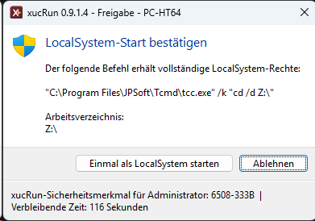
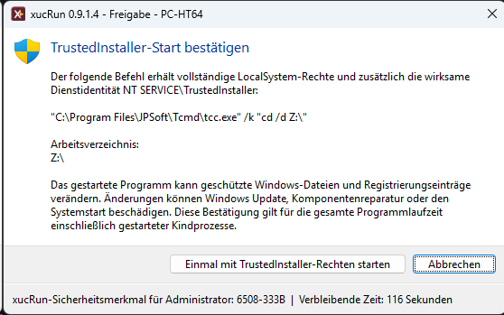
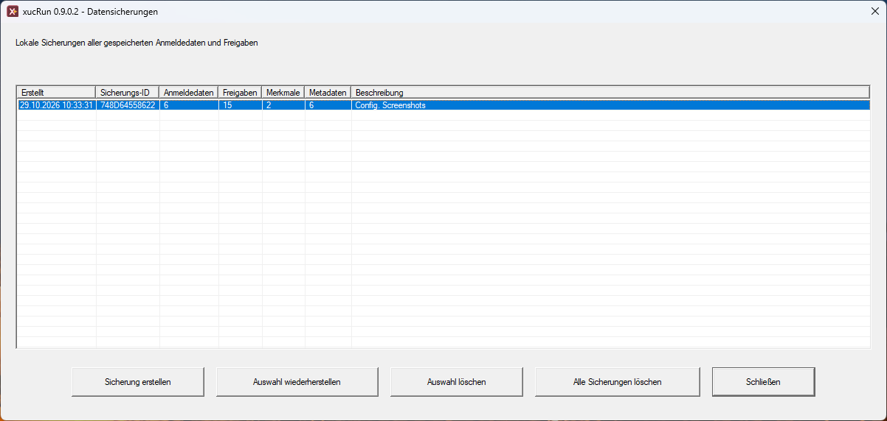
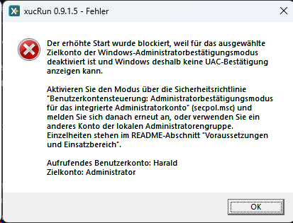
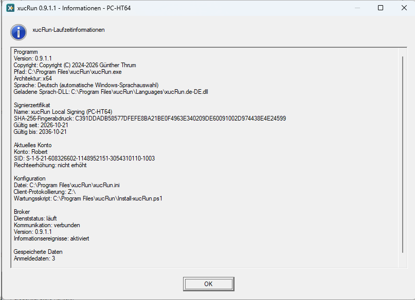
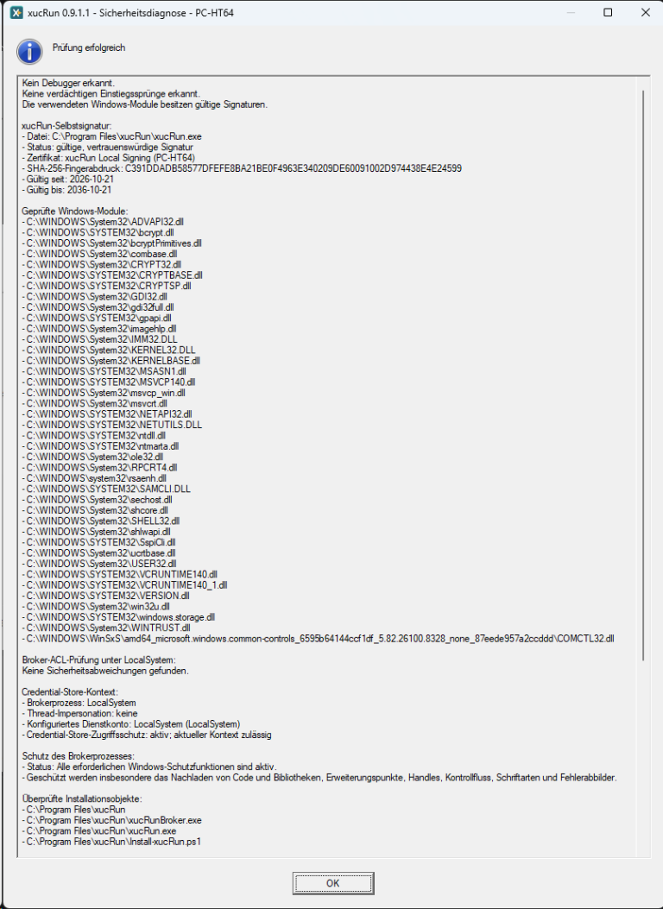

<!--
Purpose: Enthält die vollständige xucRun-Befehls- und Konfigurationsreferenz.
Approach: Ordnet Syntax, erweiterte Befehle, Konfiguration, Datensicherungen und Diagnose zum Nachschlagen.
-->
# Befehls- und Konfigurationsreferenz

**Sprache:** [English](../en/REFERENCE.md) | Deutsch

Diese Referenz bündelt Aufrufsyntax, erweiterte Startmodi, Konfiguration, Datensicherungen und Diagnose. Geführte Arbeitsabläufe stehen unter [xucRun verwenden](USAGE.md).

## Programme, Argumente und Sonderzeichen


Der erste Nicht-xucRun-Schalter ist das Zielprogramm. Alle folgenden Argumente gehören
ausschließlich diesem Programm:

```powershell
xucRun.exe cmd.exe /c dir
xucRun.exe /user:Administrator app.exe /config:value
```

`/c` und `/config:value` werden hier nicht von xucRun ausgewertet. Shell-interne Befehle müssen
über die jeweilige Shell gestartet werden, beispielsweise `cmd.exe /c dir` oder
`powershell.exe -Command Get-Process`.

Programmpfade und einzelne Argumente mit Leerzeichen werden wie üblich in Anführungszeichen
gesetzt. xucRun unterstützt auch Batchdateien und überträgt typische Shell-Sonderzeichen über die
zusätzlichen Prozessgrenzen. Welche Zeichen von `cmd.exe`, PowerShell oder einer anderen
aufrufenden Shell schon vor dem Start von xucRun ausgewertet werden, richtet sich weiterhin nach
dieser Shell.

Aus Sicherheitsgründen weist xucRun Zielargumente mit nicht druckbaren Steuerzeichen, etwa
Tabulatoren oder Zeilenumbrüchen, sowie mit bestimmten unsichtbaren oder bidirektionalen
Unicode-Steuerzeichen ab. Die zuvor beschriebenen Regeln für Quoting und Shell-Metazeichen gelten
unabhängig von dieser Einschränkung.

Bei einem vom xucRun-Brokerdienst – der privilegierten Komponente zur Prüfung und Ausführung
erlaubter Programmstarts – vermittelten Start einer `.bat`- oder `.cmd`-Datei, deren Dateiname eines
der CMD-Metazeichen `& | ( ) ! % ^` enthält, erzeugt der Broker einen temporären Wrapper mit dem Namen
`xucRun_wrapper_<128-Bit-Zufall>.bat`. Er legt ihn bevorzugt auf einem geeigneten Volume namens
`RamDisk` ab, andernfalls im `%TEMP%`-Verzeichnis des Zielkontos. Der Broker schützt den Wrapper bis
zum Ende des gestarteten Prozesses und versucht ihn anschließend oder bei einem fehlgeschlagenen
Start während der Fehlerbereinigung zu löschen. Bleibt er wegen eines Löschfehlers oder
unerwarteten Brokerendes zurück, kann ein lokaler Administrator ihn nach Freigabe manuell
entfernen. Eine automatische Nachbereinigung gibt es nicht; der Wrapper enthält keine
Anmeldedaten, gespeicherten Argumente oder wiederverwendbare Autorisierung.

## Nützliche Befehle


| Befehl | Zweck |
|---|---|
| `xucRun.exe /addcred [<Konto>]` | Anmeldedaten speichern |
| `xucRun.exe /deletecred [<Konto>]` | gespeicherte Anmeldedaten auswählen und löschen |
| `xucRun.exe /showcred` | Konten anzeigen, für die xucRun-Anmeldedaten gespeichert sind |
| `xucRun.exe /showapprovals` | gespeicherte Freigaben anzeigen |
| `xucRun.exe /resetapprovals[:<Konto>]` | Freigaben zurücksetzen |
| `xucRun.exe /system [<Anwendung> [Argumente...]]` | eine lokale Anwendung oder Ersatz-Shell als `LocalSystem` starten |
| `xucRun.exe /trustedinstaller [<Anwendung> [Argumente...]]` | eine lokale Anwendung oder Ersatz-Shell mit `LocalSystem`-Rechten und der TrustedInstaller-Dienstidentität starten |
| `xucRun.exe /info` | Version, Copyright, Apache License 2.0, Signierzertifikat, Brokerstatus und aktuelle Konfiguration anzeigen |
| `xucRun.exe /admin-status` | Daten aller Windows-Benutzer erhöht anzeigen und verwalten |
| `xucRun.exe /backup` | lokale Datensicherungen verwalten |
| `xucRun.exe /audit` | Sicherheitsdiagnose ausführen |
| `xucRun.exe /enable-broker` | einen deaktivierten Broker wieder aktivieren |
| `xucRun.exe /clear-all` | gespeicherte Anmeldedaten, Freigaben, in geschützten xucRun-Dialogen angezeigte benutzerbezogene Merkmale und zugehörige Metadaten löschen |
| `xucRun.exe /help` | vollständige Hilfe anzeigen |

`/hidden` verbirgt das unmittelbar gestartete Zielprogramm. `/hidden-monitor` überwacht zusätzlich
dessen Exitcode und zeigt bei einem Fehler einen Hinweis. Dialoge und Kindprozesse werden dadurch
nicht verborgen oder überwacht.

`xucRun.exe` verwendet Exitcode `0` für einen erfolgreichen Vorgang und Exitcode `1`, wenn der
Vorgang fehlschlägt, abgelehnt oder abgebrochen wird. Der Exitcode eines gestarteten Zielprogramms
wird nicht als Exitcode von `xucRun.exe` zurückgegeben.

### Anwendung oder Ersatz-Shell als LocalSystem oder TrustedInstaller starten

`xucRun.exe /system [<Anwendung> [Argumente...]]` startet die angegebene lokale Anwendung unter
dem Windows-Konto `LocalSystem` in der interaktiven Sitzung des Aufrufers.
`xucRun.exe /trustedinstaller [<Anwendung> [Argumente...]]` startet sie mit `LocalSystem`-Rechten
und zusätzlich der wirksamen Dienstidentität `NT SERVICE\TrustedInstaller`.

Beide Modi stehen nur Mitgliedern der lokalen Administratorengruppe zur Verfügung. Ein noch nicht
erhöht gestarteter Administrator erhält eine Windows-UAC-Abfrage; ein bereits erhöhter
Administrator führt den Start ohne weitere UAC-Abfrage aus. Standardbenutzer werden vor einer
Erhöhungsanforderung abgewiesen. Das erhöhte Konto, das Mitglied der lokalen
Administratorengruppe ist, darf vom in der interaktiven Sitzung angemeldeten Konto abweichen;
beide Modi können deshalb auch aus einer erhöhten Ersatz-Shell in der Sitzung eines anderen
Benutzers aufgerufen werden.

Ohne Anwendung ersetzen beide Modi eine aufrufende TCC-, Eingabeaufforderungs-, Windows-
PowerShell- oder PowerShell-Core-Shell durch denselben Shelltyp unter der gewählten Identität.
Das aktuelle Arbeitsverzeichnis bleibt erhalten, die neue Shell wird in den Vordergrund gebracht
und die bisherige Shell erst nach dem bestätigten und erfolgreichen Ersatzstart geschlossen.
Unbekannte Eltern-Shells werden abgewiesen.

Keiner der beiden Modi verwendet gespeicherte Anmeldedaten oder Freigaben: `LocalSystem` und
`TrustedInstaller` sind keine Benutzerkonten mit Kennwort, und eine gespeicherte Freigabe würde
jedem späteren Start derselben Programmdatei unbemerkt vollständige Systemkontrolle gewähren.
Jeder Aufruf muss deshalb separat im signierten xucRun-Freigabehelper bestätigt werden, der die
geschützten Bestätigungsdialoge anzeigt. Der Dialog erscheint auf dem geschützten privaten
xucRun-Desktop und zeigt die genaue Programmdatei, alle Argumente und das Arbeitsverzeichnis; bei
`/trustedinstaller` ergänzt er eine besondere Warnung vor Änderungen geschützter Windows-Dateien
und Registrierungseinträge. Die Bestätigung gilt nur für diesen einen Aufruf, kann nicht
gespeichert werden und autorisiert das gewählte Programm für seine gesamte Laufzeit,
einschließlich Bedienhandlungen und Kindprozessen, die seinen privilegierten Kontext erben oder
anderweitig verwenden. Ein Dateimanager, Registrierungs-Editor, eine Shell oder ein
Skriptinterpreter ermöglicht deshalb sehr weitreichende Systemkontrolle. xucRun prüft die
Programmdatei unmittelbar vor dem Start erneut.

| Bestätigung für `/system` | Bestätigung für `/trustedinstaller` mit besonderer Warnung |
|:---:|:---:|
|  |  |

Der private Desktop schützt die Bestätigung vor normalen Anwendungen auf dem normalen Desktop. Er
kann jedoch nicht vor Schadsoftware schützen, die bereits mit erhöhten Administratorrechten in
derselben Anmeldesitzung ausgeführt wird. Verwenden Sie beide Modi deshalb nur aus einer
vertrauenswürdigen erhöhten Administratorsitzung.

Als `LocalSystem` ausgeführte Anwendungen besitzen weitreichende Kontrolle über den Rechner.
Insbesondere bezeichnet `HKEY_CURRENT_USER` das Profil von `LocalSystem` und nicht das Profil des
angemeldeten Benutzers.

TrustedInstaller ist keine allgemeine Berechtigungsstufe oberhalb von `LocalSystem`. Dieser Modus
verbindet `LocalSystem`-Rechte mit der TrustedInstaller-Dienstidentität und ermöglicht
zusätzlichen Zugriff daher nur auf Objekte, für die Windows dieser Identität entsprechende Rechte
gewährt. Ist der benötigte Windows-Dienst gestoppt, darf xucRun ihn starten, verändert aber weder
seine Startkonfiguration noch beendet es ihn anschließend. Ein so gestarteter Dienst läuft
deshalb zunächst weiter und beendet sich üblicherweise selbst, sobald Windows ihn nicht mehr
benötigt; ein bereits gestartetes Programm behält seine Rechte davon unabhängig. Kann xucRun die
erforderliche TrustedInstaller-Identität nicht herstellen, schlägt der Start fehl; es gibt keinen
Rückfall auf einen normalen `/system`-Start.

```cmd
xucRun.exe /system "C:\Windows\regedit.exe" /m
xucRun.exe /trustedinstaller "C:\Windows\regedit.exe"
```

Verwenden Sie beide Modi nur bewusst für Wartung und Diagnose. Die TrustedInstaller-Identität
macht manuelle Änderungen nicht zu unterstützter Windows-Komponentenwartung. Änderungen an
geschützten Dateien oder Registrierungsdaten können den Komponentenstore inkonsistent machen oder
Windows Update, Komponentenreparatur beziehungsweise Systemstart beschädigen. Verwenden Sie
Windows Update oder einen anderen dokumentierten Windows-Wartungsweg, wenn ein solcher existiert.

## Datensicherungen


`xucRun.exe /backup` öffnet die interaktive Verwaltung lokaler Datensicherungen. Zusätzlich stehen
folgende Befehle zur Verfügung:



```text
xucRun.exe /backup-create [<Beschreibung>]
xucRun.exe /backup-list
xucRun.exe /backup-restore
xucRun.exe /backup-restore:<Backup-ID>
xucRun.exe /backup-delete-all
```

Eine Sicherung umfasst gespeicherte Anmeldedaten, Freigaben, Sicherheitsmerkmale und zugehörige
Metadaten. Datensicherungen werden getrennt von den aktiven Anmeldedaten und Freigaben unter
`%ProgramData%\xucRun\BrokerBackups` gespeichert. Für die Speicherung verwendet xucRun
Windows-APIs und bindet die Datensicherungen an den Rechner. xucRun stellt sie nur auf demselben
Rechner wieder her; sie sind kein portabler Kennwortexport.

Auch die [Deinstallation](INSTALLATION.md#aktualisieren) entfernt die lokalen Sicherungen.

## Fehlerdiagnose


`xucRun.exe /info` zeigt die auch vom separat installierten optionalen xucRun-Tray-Add-on
verwendeten gemeinsamen Client-Laufzeitinformationen: Version, Copyright, Pfad, Architektur,
wirksame Sprache und geladene Sprach-DLL, Signierzertifikat, aktuelles Konto einschließlich SID
und Rechteerhöhung, Konfigurationsdatei und Client-Protokollierung. Der gemeinsame
Konfigurationsabschnitt nennt außerdem das installierte Wartungsskript. Core-spezifische
Abschnitte ergänzen Brokerstatus, Broker-Informationsereignisse und Anzahlen gespeicherter Daten.
`xucRun.exe /audit` prüft sicherheitsrelevante Eigenschaften der laufenden Installation und nennt
bei gültiger Clientsignatur ebenfalls das geprüfte Zertifikat. Ist xucRun Tray separat
installiert, prüft die Diagnose zusätzlich dessen installierte Dateien und Signaturen,
Deinstallationsregistrierung und benutzerbezogene Autostartaufgaben. Wurde der Brokerdienst
deaktiviert, kann er mit `xucRun.exe /enable-broker` wieder aktiviert werden.
`xucRun.exe /help` zeigt die vollständige lokale Befehlsübersicht.

Die Diagnose prüft ausdrücklich den Dateiobjektschutz, das Authenticode-Vertrauen und den
erwarteten Signierer des installierten Wartungsskripts `Install-xucRun.ps1` sowie bei installiertem
Tray von `Install-xucRunTray.ps1`. Die Prüfung verwendet diese feste Produktdateiliste; beliebige
zusätzliche PowerShell-Dateien im Installationsverzeichnis werden nicht als xucRun-Komponenten
behandelt.
Der Bericht bestätigt außerdem, ob alle erforderlichen Windows-Schutzfunktionen des laufenden
Brokerprozesses aktiv sind. Bei Erfolg fasst er die geschützten Bereiche zusammen; bei einer
Abweichung nennt er die betroffene Schutzfunktion sowie eine Empfehlung zu Neustart und
Neuinstallation.

Meldet xucRun, dass ein erhöhter Start wegen fehlender UAC-Bestätigung blockiert wurde, ist für
das ausgewählte andere Konto, das Mitglied der lokalen Administratorengruppe ist, der
Windows-Administratorbestätigungsmodus nicht wirksam. Das kann insbesondere das integrierte Konto
`Administrator` betreffen.



### Laufzeitinformationen



### Sicherheitsdiagnose



Für eine weitergehende Fehlerdiagnose kann über `ClientLogDirectory` das Client-Dateilog mit
Dateien im Format `xucRun_YYYYMMDD.log` aktiviert werden. Warnungen und Fehler des Brokers werden
immer im Windows-Anwendungsereignislog unter der Quelle `xucRunBroker` erfasst und können in der
Windows-Ereignisanzeige unter **Windows-Protokolle → Anwendung** eingesehen werden. Einzelheiten
zur Konfiguration enthält der Abschnitt
[Konfigurationsdatei und Sprache](#konfigurationsdatei-und-sprache).

## Konfigurationsdatei und Sprache


xucRun verwendet die maschinenweite Konfigurationsdatei
`%ProgramFiles%\xucRun\xucRun.ini`. Der Installer legt sie an und aktualisiert bei einer
Installation oder einem Update die gewählte Sprache, ohne die übrigen vorhandenen Einstellungen
zu entfernen. Weil die Datei unter `%ProgramFiles%` liegt, sind zum manuellen Bearbeiten
normalerweise Administratorrechte erforderlich.

Die unterstützte Struktur ist:

```ini
[xucRun]
Language=auto

[Logging]
ClientLogDirectory=
BrokerInformationEvents=false
```

Kommentarzeilen beginnen mit einem Semikolon (`;`). Kommentare sollten in eigenen Zeilen stehen
und nicht an eine Einstellung angehängt werden.

- `Language=auto` folgt der Windows-Anzeigesprache des aktuellen Benutzers und verwendet bei einer
  deutschen Anzeigesprache Deutsch, andernfalls Englisch. `Language=de` wählt ausdrücklich Deutsch,
  `Language=en` ausdrücklich Englisch. Die Änderung gilt für neu gestartete xucRun-Prozesse.
  Laufende Tray-Instanzen starten sich nach einer über xucRun gesetzten Sprachänderung neu. Eine
  manuelle externe Änderung erkennt das Tray beim nächsten Öffnen seines Kontextmenüs und startet
  sich dann neu. Andere bereits laufende xucRun-Prozesse übernehmen die Änderung nicht. Deutsch
  und Englisch werden über getrennte, signierte Sprachressourcendateien bereitgestellt. Die
  Lokalisierungsarchitektur kann um zusätzliche Sprachen erweitert werden; die aktuelle Version
  unterstützt jedoch ausschließlich Deutsch und Englisch.
- Ein fehlendes oder leeres `ClientLogDirectory` deaktiviert das Client-Dateilog. Ein eingetragener
  Pfad aktiviert es. Umgebungsvariablen werden im Kontext des jeweils startenden Clients
  aufgelöst. Der Pfad muss für jedes verwendete Client- und Wrapperkonto erreichbar und mit den
  zum Erstellen, Anhängen und Löschen der Protokolldateien erforderlichen Rechten versehen sein.
  Ist das konfigurierte Verzeichnis, insbesondere ein Netzwerkpfad, nicht erreichbar, können
  Windows-Dateisystemzeitüberschreitungen auch das Öffnen des Tray-Kontextmenüs verzögern. Das
  Tray ermittelt dabei die vorhandenen Logdateien, um die zugehörigen Aktionen und deren
  Dateianzahl zu aktualisieren.
  xucRun verändert die Zugriffsrechte des Verzeichnisses nicht. Bei einem gemeinsamen Pfad muss
  der Administrator deshalb die vorgesehenen Leser und Schreiber festlegen; Konten mit
  Änderungsrechten können die Protokolle auch verändern oder löschen.
  Änderungen gelten für neu gestartete Client- und Wrapperprozesse. Das laufende Tray liest den
  Wert beim nächsten Öffnen seines Kontextmenüs neu; bis dahin verwendet es seine bisherige
  Loggingkonfiguration. In jedes aufgelöste Protokollverzeichnis schreibt xucRun pro Tag eine
  datierte Protokolldatei, rotiert oder löscht Client-Protokolle jedoch nicht automatisch. Diese
  Protokolle können Programmpfade, Kontonamen, Befehlszeilen und Argumente des Zielprogramms
  enthalten. Kennwörter oder andere Geheimnisse sollten deshalb nicht als Befehlszeilenargumente
  übergeben werden.
- Warnungen, Fehler sowie Dienst- und ACL-Startmeldungen schreibt der Broker immer in das unter
  [Fehlerdiagnose](#fehlerdiagnose) genannte Ereignisprotokoll.
  `BrokerInformationEvents=true` ergänzt dort routinemäßige Informationsmeldungen zur Verarbeitung
  von Pipe-Anfragen. Bei fehlendem, leerem, `false` oder anderem Wert bleiben nur diese
  zusätzlichen Informationsmeldungen deaktiviert. Änderungen gelten nach einem Neustart des
  Brokerdienstes; ein Neustart von Client oder Tray genügt nicht.

Eine fehlende Konfigurationsdatei, ein ungültiger Sprachwert oder eine fehlende beziehungsweise
nicht passend signierte Sprachdatei führt aus Sicherheitsgründen zum Startabbruch statt zu einem
stillen Sprachwechsel.
