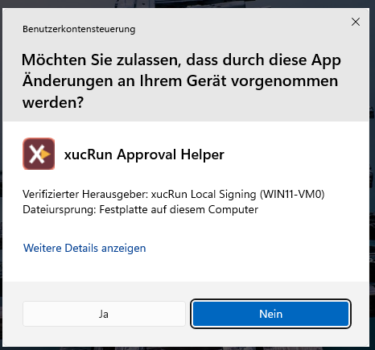
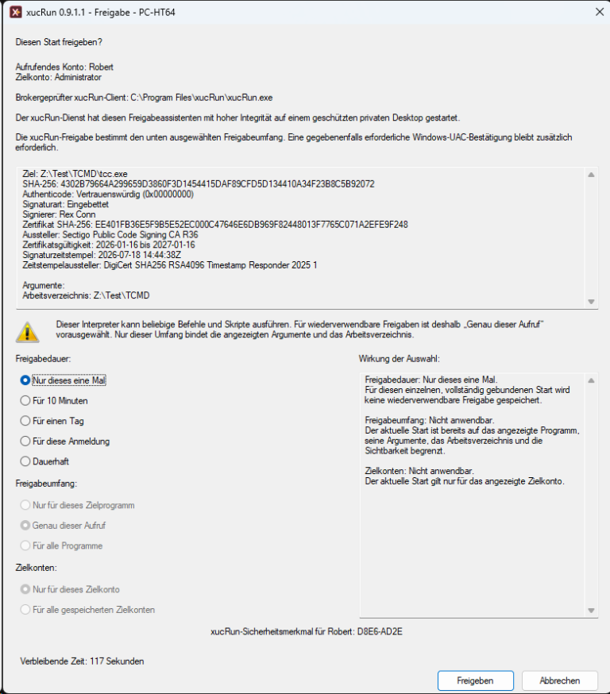
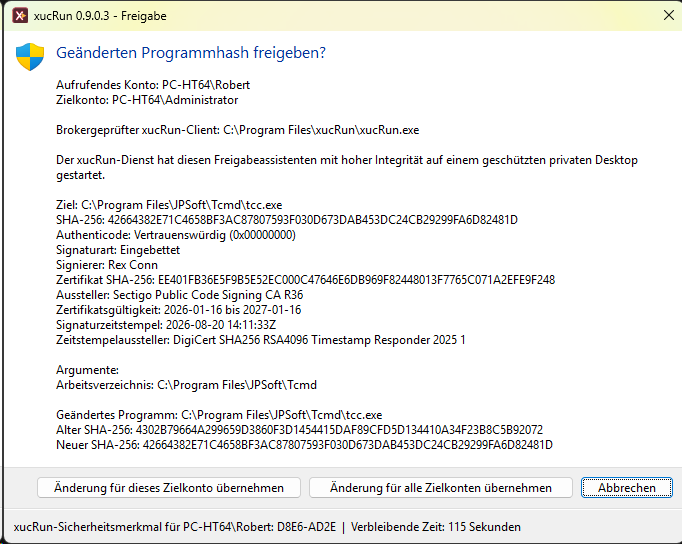
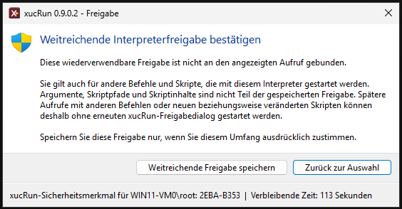

<!--
Purpose: Erklärt Sicherheitsmodell, Schutzmaßnahmen und verbleibende Risiken von xucRun.
Approach: Verbindet Kontentrennung, Freigaben, Broker-Vertrauensgrenzen, Vergleiche und Einschränkungen.
-->
# Sicherheitsmodell und Vertrauensgrenzen

**Sprache:** [English](../en/SECURITY_MODEL.md) | Deutsch

Dieses Dokument beschreibt Sicherheitsziele, Autorisierungsmodell, Vertrauensgrenzen, Schutzmaßnahmen und verbleibende Risiken von xucRun. Eine kurze Produkteinführung bietet zuerst die [Haupt-README](../../README.de.md).

### Warum mit einem Standardkonto arbeiten?

Unabhängig von xucRun kann ein Anwender für die tägliche Arbeit dauerhaft mit einem Konto, das
Mitglied der lokalen Administratorengruppe ist, oder mit einem Standardkonto angemeldet bleiben.
Ein Mitglied der Administratorengruppe ist berechtigt, Programme mit Administratorrechten
auszuführen. Je nach Konfiguration der Windows-Benutzerkontensteuerung (User Account Control, UAC)
stehen diese Rechte einem gestarteten Prozess bereits zur Verfügung oder werden über UAC
angefordert. Eine solche Anforderung kann grundsätzlich jedes Programm stellen.

Wer für die tägliche Arbeit ohnehin mit einem Konto arbeitet, das Mitglied der lokalen
Administratorengruppe ist, und gelegentlich Programme unter demselben Konto mit erhöhten Rechten
starten möchte, kann dafür die Windows-eigenen UAC-Mechanismen einschließlich Windows Sudo
verwenden. xucRun unterstützt auch diesen Anwendungsfall, bietet dafür allein gegenüber den
Windows-eigenen Funktionen jedoch keinen wesentlichen zusätzlichen Nutzen.

Ein Standardkonto besitzt selbst keine Administratorrechte und kann sie über UAC nicht für seine
eigene Identität erhalten. Systemweite Änderungen an Programmen, Diensten oder geschützten
Konfigurationen erfordern deshalb ein getrenntes Konto, das Mitglied der lokalen
Administratorengruppe ist; der erhöhte Prozess läuft dann unter dessen Identität. Dadurch wird
begrenzt, was versehentliche Aktionen und Prozesse im normalen Benutzerkontext ohne einen
getrennten, bewusst bestätigten Autorisierungsschritt ändern können.

Für administrative Aktionen aus dem Standardbenutzerkontext muss ein geeignetes Verfahren gewählt
werden. Dafür können Windows-eigene Funktionen oder zusätzliche Hilfsprogramme eingesetzt werden.
Insbesondere Werkzeuge, die Anmeldedaten speichern oder Autorisierungen wiederverwenden, erfordern
zusätzliche Schutzmaßnahmen und bringen eigene Risiken mit sich. Jeder Anwender muss deshalb
abwägen, ob der Nutzen der Kontotrennung den damit verbundenen Einrichtungs- und Bedienaufwand
sowie die Risiken des gewählten Verfahrens für ihn rechtfertigt.

Diese Abwägung sowie die sichere Einrichtung und Nutzung des gewählten Verfahrens setzen
ausreichende Kenntnisse der Windows-Konten-, UAC- und Berechtigungsmodelle voraus. xucRun richtet
sich deshalb an erfahrene Windows-Anwender.

### Wie xucRun administrative Aktionen aus einem Standardkonto unterstützt

**xucRun erhält die Trennung zwischen dem angemeldeten Standardkonto und dem für einen Start
gewählten Zielkonto aufrecht und behandelt Kontowahl und Rechteerhöhung als getrennte
Entscheidungen.** Es macht den Standardbenutzer nicht vorübergehend zum Administrator und erweitert
dessen Rechte nicht.

Mit xucRun kann der angemeldete Standardbenutzer für einen Start ein vom Anmeldekonto abweichendes
Zielkonto wählen. Das Zielkonto kann auch ein anderes Standardkonto sein. Für administrative
Aktionen kann stattdessen ein Konto gewählt werden, das der lokalen Administratorengruppe
angehört; nur dann ist optional ein Start mit erhöhten Rechten möglich. Der Prozess verwendet dann
die Identität und Berechtigungen des gewählten Zielkontos, etwa beim Zugriff auf Netzwerkfreigaben.
Außerdem wird das Benutzerprofil dieses Kontos geladen. Dazu gehören beispielsweise
benutzerbezogene Profildaten, in Anwendungen gespeicherte Anmeldungen für E-Mail-Konten und
Registry-Einstellungen. `HKEY_CURRENT_USER` verweist dementsprechend auf den Registry-Hive des
Zielkontos und nicht auf den des an Windows angemeldeten Benutzers. Auch Umgebungsvariablen wie
`%USERPROFILE%`, `%APPDATA%` und `%LOCALAPPDATA%` sowie bekannte Ordner wie Dokumente und Desktop
beziehen sich auf das Zielkonto.

xucRun kombiniert den Start unter einem anderen Benutzerkonto mit der optionalen Rechteerhöhung
über UAC und verwaltet die dafür benötigten Anmeldedaten selbst (siehe
[Aufgabe und Vertrauensgrenze des Brokers](#aufgabe-und-vertrauensgrenze-des-brokers)). Diese
Anmeldedaten werden nur verwendet, wenn eine passende
[xucRun-Freigabe](#freigabedialog-dauer-und-umfang) den angeforderten Start erlaubt. Eine an ein
bestimmtes Zielkonto gebundene Freigabe kann nur für Starts unter diesem Konto verwendet werden.

Für einen typischen Start genügt der Aufruf des Programms, Befehls oder Skripts mit seinen
Argumenten – ohne Kontoname oder Kennwort im Aufruf. Das gilt für Starts aus einer Konsole, über
ein Kontextmenü, eine Desktopverknüpfung oder ein Skript.

## Vergleich mit Windows-Funktionen und anderen Lösungen


Die folgenden Windows-Funktionen und anderen Lösungen decken einzelne Teilaspekte von xucRun ab.
Sie unterscheiden sich darin, ob und wie sie Kontowechsel, Sitzungen, Anmeldedaten und Freigaben
behandeln.

### Schneller Benutzerwechsel

Beim schnellen Benutzerwechsel bleibt die bisherige Windows-Sitzung mit ihren geöffneten Programmen
erhalten, während sich der Anwender unter einem anderen Benutzerkonto in einer separaten Sitzung
anmeldet oder in dessen bereits geöffnete Sitzung wechselt. Anschließend kann er in die bisherige
Sitzung zurückkehren. Dieser Weg ist auch dann sinnvoll, wenn eine vollständige interaktive
Arbeitsumgebung des anderen Benutzers benötigt wird.

Gegenüber dem schnellen Benutzerwechsel bleibt der Anwender mit xucRun in seiner aktuellen Sitzung
und startet nur das benötigte Programm unter dem gewählten anderen Benutzerkonto, mit oder ohne
erhöhte Rechte.

### Windows-UAC und Windows Sudo

Die Windows-Benutzerkontensteuerung (User Account Control, UAC) ist die Windows-Sicherheitsfunktion,
über die ein Benutzer den Start mit Administratorrechten ausdrücklich bestätigt. Abhängig vom
konkreten Startpfad und der Windows-Konfiguration kann auch ein Kontowechsel mit xucRun eine
UAC-Bestätigung erfordern; das Zusammenspiel beschreibt der Abschnitt
[Verhältnis zwischen xucRun-Freigaben und Windows-UAC](#verhältnis-zwischen-xucrun-freigaben-und-windows-uac).

[Windows Sudo](https://learn.microsoft.com/windows/advanced-settings/sudo/) startet aus einer
nicht erhöhten Konsole einen einzelnen Prozess über Windows-UAC mit Administratorrechten. Die
aktuelle Implementierung setzt dafür ein bereits administratives Konto voraus; ein
Standardbenutzer kann Windows Sudo nicht verwenden, und ein anderes Zielkonto lässt sich derzeit
nicht auswählen. Das verbreitete Unix/Linux-`sudo` kann mit der `sudoers`-Policy erfolgreiche
Authentifizierungen abhängig von
[`timestamp_timeout` und `timestamp_type`](https://www.sudo.ws/docs/man/sudoers.man/#User_Authentication)
zeitlich begrenzt wiederverwenden. Microsoft dokumentiert für Windows Sudo derzeit keinen
entsprechenden Timestamp-Mechanismus; jeder Aufruf führt über UAC.

Für die einmalige Erhöhung aus einer nicht erhöhten Konsole unter einem vorhandenen Konto, das
Mitglied der lokalen Administratorengruppe ist, ist Windows Sudo die Windows-eigene Möglichkeit.
xucRun behandelt zusätzlich den Anwendungsfall, Programme aus einem Standardkonto unter einem
anderen lokalen Konto mit gespeicherten Anmeldedaten und einmaligen oder zeitlich begrenzbaren
Freigaben zu starten. Wenn Windows für den Zielprogrammstart eine UAC-Bestätigung verlangt, bleibt
diese interaktiv.

### `runas.exe /savecred`

Eine weitere Windows-eigene Möglichkeit, die mehr Ähnlichkeit mit xucRun hat, ist
[`runas.exe`](https://learn.microsoft.com/windows-server/administration/windows-commands/runas).
Damit lassen sich einzelne Programme gezielt unter einem anderen Benutzerkonto starten. Mit dem
Parameter `/savecred` werden die dafür verwendeten Anmeldedaten nach der ersten Kennworteingabe in
der Windows-Anmeldeinformationsverwaltung des angemeldeten Benutzers gespeichert. Danach kann
`runas.exe` Programme wiederholt unter einem anderen Benutzerkonto starten, ohne das Kennwort
erneut abzufragen. Bei der Verwendung von `runas.exe` bestehen jedoch einige Einschränkungen:

- Das Zielkonto muss bei jedem Aufruf mit `/user:<Konto>` angegeben werden. Sein Name steht damit
  je nach Verwendung in Skripten, Verknüpfungen oder auf der Kommandozeile.
- `runas.exe` fordert keine Erhöhung über UAC an. Abhängig von der Windows-UAC-Konfiguration kann
  ein Konto, das Mitglied der lokalen Administratorengruppe ist, nur mit eingeschränkten Rechten
  starten, solange die Erhöhung nicht gesondert angefordert wird.
- Nach `/savecred` kann das Konto, dessen Anmeldedaten gespeichert wurden, ohne erneute Bestätigung
  für weitere Programmstarts verwendet werden. Dabei gibt es keine obligatorische Freigabe und
  keine Bindung an bestimmte Programme, Dateihashes, Argumente oder Arbeitsverzeichnisse. xucRun
  verlangt dagegen vor der Verwendung gespeicherter Anmeldedaten eine passende ausdrückliche
  Freigabe.
- `runas.exe` wählt nicht automatisch ein geeignetes Konto aus, dessen Anmeldedaten mit
  `/savecred` gespeichert wurden, und bietet keine integrierte Verwaltung unterschiedlich
  weitreichender oder zeitlich begrenzter Freigaben.
- `runas.exe` reagiert empfindlich auf komplexe Programmpfade, Argumente und Sonderzeichen. Bei der
  Verwendung in Skripten oder Verknüpfungen können durch eine zusätzliche Shell oder ein
  Elevationswerkzeug weitere Parsing- und Quoting-Ebenen hinzukommen. Dadurch steigt die
  Fehleranfälligkeit besonders dann, wenn dem erhöht auszuführenden Programm komplexe Argumente
  oder Argumente mit Sonderzeichen übergeben werden müssen.

xucRun greift die Idee gespeicherter und wiederverwendbarer Anmeldedaten von `runas.exe` auf und
ergänzt sie um kontrollierte Freigaben. Es lässt sich in Skripten, Desktop-Verknüpfungen und
anderen fest konfigurierten Aufrufen ebenso wie bei interaktiven Aufrufen über die Kommandozeile
verwenden. Der Start unter einem anderen Benutzerkonto, gespeicherte Anmeldedaten und eine bei
Bedarf weiterhin interaktive Erhöhung über UAC werden dabei in einem Werkzeug zusammengeführt.
Sind passende Anmeldedaten gespeichert, muss der Aufruf weder Zielkonto noch Kennwort enthalten.
Programmpfade, Argumente, Arbeitsverzeichnisse, Batchdateien und typische Shell-Sonderzeichen
werden kontrolliert über die notwendigen Prozessgrenzen hinweg behandelt.

Für den unter [Anwendungsbeispiele](USAGE.md#anwendungsbeispiele) gezeigten Gerätemanager-Aufruf könnte das
schematische Gegenstück mit `runas.exe /savecred` und einem separaten Elevationswerkzeug
beispielsweise so aussehen, wenn dieses Werkzeug die Syntax
`elevate.exe <Programm> [Argumente ...]` unterstützt:

```cmd
runas.exe /savecred /user:Administrator "elevate.exe C:\Windows\System32\mmc.exe C:\Windows\System32\devmgmt.msc"
```

Die genaue Syntax hängt vom gewählten Elevationswerkzeug ab. In der Werkzeugkette muss der
Kontoname im Aufruf stehen und die gesamte nachgelagerte Befehlszeile als ein Argument an
`runas.exe` übergeben werden. xucRun benötigt im Hauptanwendungsfall keinen Kontonamen und hält
Programm und Argumente in einem gemeinsamen Aufruf getrennt.

Ein Beispiel mit komplexeren Argumenten ist das Anlegen einer Firewallregel für ein Programm,
dessen Pfad Leerzeichen enthält:

```cmd
xucRun.exe /user-elevated "C:\Windows\System32\netsh.exe" advfirewall firewall add rule name="Lokaler Beispielserver" dir=in action=allow program="C:\Program Files\Beispielserver\server.exe" enable=yes profile=private
```

Dabei erhält `netsh.exe` mehrere Schlüssel-Wert-Argumente sowie einen Regelnamen und einen
Programmpfad mit Leerzeichen. Eine Werkzeugkette aus `runas.exe` und einem separaten
Elevationswerkzeug wäre daher deutlich komplizierter; ihre zuverlässige Verwendung mit
Sonderzeichen hinge außerdem vom konkreten Elevationswerkzeug und dessen Quoting-Regeln ab.

`runas.exe /savecred` und xucRun verwenden voneinander getrennte, nicht kompatible Speicherungen
für Anmeldedaten. Eine xucRun-Freigabe kann eng an das aufrufende Benutzerkonto, das Zielkonto, die
beteiligten Programme und deren Dateihashes gebunden sowie zeitlich begrenzt werden. Ändert sich
eines der gebundenen Programme, passt dessen SHA-256-Hash nicht mehr zur Freigabe. Vor einer
Übernahme der Freigabe auf die geänderte Programmversion verlangt xucRun eine ausdrückliche
Entscheidung.

### Lösungen anderer Anbieter und Wahl des Ansatzes

Neben den Windows-eigenen Möglichkeiten gibt es Lösungen anderer Anbieter für Benutzerwechsel,
Rechteerhöhungen und die Verwaltung administrativer Zugriffe. Sie setzen je nach Anwendungsfall
andere Schwerpunkte und können zum Beispiel für zentrale Administration, verwaltete
Unternehmensumgebungen oder unbeaufsichtigte Automatisierung besser geeignet sein.
Eine Aufzählung einzelner Produkte wäre zwangsläufig unvollständig und könnte
durch die Auswahl unbeabsichtigt Schwerpunkte setzen. Zudem wäre sie rasch veraltet und wegen
unterschiedlicher Einsatz- und Sicherheitsmodelle nur eingeschränkt vergleichbar.

Die passende Lösung richtet sich nach den jeweiligen Anforderungen.

Wer aus einem Standardbenutzerkonto heraus Programme unter einem anderen Benutzerkonto starten
möchte und bereit ist, dessen Anmeldedaten bei jedem Start erneut einzugeben, kann dafür die
Windows-eigenen Mechanismen verwenden.

Wer dagegen wiederholte Kennworteingaben vermeiden und genauer als mit `runas /savecred`
kontrollieren möchte, welche Programme gespeicherte Anmeldedaten und administrative Rechte
verwenden dürfen, für den bietet xucRun eine frei verfügbare Lösung.

## Freigaben und Windows-UAC


### Verhältnis zwischen xucRun-Freigaben und Windows-UAC

Wenn das aktuelle Windows-Konto Mitglied der Administratorengruppe ist, verwendet xucRun dieses
Konto standardmäßig auch für das gestartete Programm. Falls das Konto noch nicht erhöht ist,
fordert Windows die Zustimmung über die Benutzerkontensteuerung (UAC) an. In diesem Fall zeigt
xucRun keinen eigenen Freigabedialog; die Zustimmung erfolgt ausschließlich über Windows-UAC.

xucRun-Programmfreigaben gelten für Starts mit den gespeicherten Anmeldedaten eines anderen
Kontos. Im vorgesehenen Ablauf aus einem nicht erhöhten Standardbenutzerkonto bleibt ein
erforderlicher Kontowechsel beziehungsweise eine erforderliche Rechteerhöhung interaktiv. Bei
einem Start ohne Erhöhung kann UAC über den xucRun-Freigabehelper die Anwesenheit des Benutzers
bestätigen; das Zielprogramm läuft danach mit den nicht erhöhten Rechten des Zielkontos. Bei einer
Erhöhung kann UAC stattdessen den Start des Zielprogramms bestätigen und ihm die angeforderten
Administratorrechte erteilen. Welche UAC-Abfrage Windows tatsächlich zeigt, hängt vom konkreten
Startpfad und der Windows-Konfiguration ab.

Eine passende wiederverwendbare Freigabe verhindert nur einen erneuten xucRun-Freigabedialog. Sie
ersetzt keine für den konkreten Start erforderliche Windows-UAC-Bestätigung. Beide Entscheidungen
haben unterschiedliche Aufgaben: xucRun prüft, ob der Aufruf zur gespeicherten Freigabe passt;
Windows-UAC bestätigt, soweit erforderlich, den konkreten Start beziehungsweise die
Rechteerhöhung.

Der Windows-UAC-Dialog zeigt nicht an, welche xucRun-Freigabe verwendet wird, wie lange sie gilt
oder ob sie an den genauen Aufruf, ein Zielprogramm oder alle Programme gebunden ist. Diese
Reichweite ist beim Anlegen der Freigabe im xucRun-Freigabedialog und später in der
Freigabenverwaltung sichtbar.



Auch ein Start unter einem anderen Standardkonto kann eine solche UAC-Anwesenheitsbestätigung
erfordern; das dafür verwendete Konto der lokalen Administratorengruppe dient dann nur zum Öffnen
des Dialogs, wie unter [Kontowahl und Rechtemodus](USAGE.md#kontowahl-und-rechtemodus) beschrieben.

Ist keine passende Freigabe aktiv, erscheint der xucRun-Freigabedialog auf einem separaten
Windows-Desktop. Im vorgesehenen Ablauf trennt Windows diesen Desktop von normalen, nicht erhöhten
Programmen. Kann xucRun ihn dort nicht öffnen, wird der Vorgang abgebrochen. Für eine erhöht
auszuführende, vom Aufrufer beschreibbare Startdatei ist bei jedem Start eine einmalige
Risikobestätigung erforderlich; ist auch ihr Verzeichnis beschreibbar, blockiert xucRun den
erhöhten Start.

Der Abschnitt [Kontowahl und Rechtemodus](USAGE.md#kontowahl-und-rechtemodus) beschreibt, wie xucRun das
Konto bestimmt, fehlende Anmeldedaten abfragt und Starts mit und ohne Erhöhung unterscheidet.
Unabhängig vom gewählten Ablauf bleibt UAC interaktiv; **xucRun ist kein Mechanismus für
unbeaufsichtigte Rechteerhöhung.**

Kontoauswahl sowie Verwaltungs-, Informations- und Fehlerdialoge erscheinen auf dem normalen
Benutzerdesktop. Kennworteingaben, Freigabeentscheidungen und Risikobestätigungen zeigt xucRun auf
einem separaten Windows-Desktop; Windows-UAC verwendet davon getrennt den konfigurierten
UAC-Desktop.

Beim ersten solchen Dialog erzeugt xucRun für das aufrufende Windows-Benutzerkonto ein
zufälliges Sicherheitsmerkmal im Format `XXXX-XXXX`. Kennwort-, Freigabe- und Risikodialoge zeigen
es anschließend unverändert an. Nach der Prüfung der Installationsdatei sollte der Benutzer es
beim bewusst ausgelösten ersten Dialog einprägen oder geschützt notieren und spätere Dialoge nur
bei Übereinstimmung bestätigen. Das Merkmal weist auf einen Dialog des xucRun-Freigabehelpers hin, beweist aber
weder die Ungefährlichkeit noch den Ursprung einer Operation. Es bietet keinen vollständigen
Schutz auf einem kompromittierten System und hilft nur, wenn der Benutzer es tatsächlich
vergleicht.

### Freigabedialog, Dauer und Umfang

**Mit jeder Freigabe legt der Anwender das Verhältnis zwischen Bedienkomfort und enger Begrenzung
selbst fest:** Je länger und weiter eine Freigabe gilt, desto mehr passende spätere Aufrufe kommen
ohne erneute xucRun-Freigabeentscheidung aus. Eine kürzere oder genauer an Programm, Aufruf und
Zielkonto gebundene Freigabe verlangt häufiger eine neue Entscheidung, begrenzt dafür aber ihre
Wiederverwendung.



#### Dialogdetails und Freigabedauer

Der differenzierte Freigabedialog ermöglicht es, Freigabedauer, Programm- und Aufrufbindung sowie
die einbezogenen Zielkonten an den konkreten Anwendungsfall und das gewünschte Schutzniveau
anzupassen. Sein fester Kopfbereich oberhalb der scrollbaren Aufrufdetails kennzeichnet den
angezeigten xucRun-Clientpfad als erfolgreich vom Broker geprüft und zeigt aufrufendes Konto,
Zielkonto und geschützte Herkunft des xucRun-Freigabehelpers vor dem erläuternden UAC-Hinweis. Der
Scrollbereich zeigt ausführliche Authenticode-Informationen für das Zielprogramm. Bei einer
vertrauenswürdigen Zielsignatur umfassen sie Signierer, vollständigen
SHA-256-Zertifikatfingerabdruck, Aussteller, Zertifikatsgültigkeit, Signaturart sowie einen
vorhandenen Signaturzeitstempel und dessen Aussteller. Schlägt die Vertrauensprüfung fehl,
unterscheidet der Dialog eine fehlende Signaturzuordnung von häufigen Signatur-,
Zertifikatsketten-, Gültigkeits-, Widerrufs- und Richtlinienfehlern. Eine fehlende Zuordnung
bedeutet, dass keine auswertbare eingebettete Signatur und keine zum aktuellen Dateiinhalt passende
Windows-Katalogsignatur gefunden wurde. Eine Katalogsignatur ordnet die Datei über ihren Hash zu;
jede Byteänderung hebt diese Zuordnung auf, obwohl der Katalog und sein Zertifikat auf dem System
weiterhin existieren und der geänderten Datei nicht mehr zugerechnet werden dürfen. Der Dialog
zeigt außerdem Signierer- und Zertifikatsdetails an, die Windows für eine nicht vertrauenswürdige
Signatur noch bereitstellt. xucRun erkennt dabei sowohl direkt eingebettete
Authenticode-Signaturen als auch Windows-Katalogsignaturen. Ein unsigniertes oder nicht
vertrauenswürdiges Ziel bleibt freigebbar, weil die Signaturinformation die genaue Pfad- und
SHA-256-Identität ergänzt, aber nicht ersetzt. Als Freigabedauer stehen zur Verfügung:

- nur dieser eine Start,
- 10 Minuten,
- ein Tag,
- bis zur Abmeldung,
- dauerhaft.

#### Vorhandene Freigaben und Programmänderungen

Unterscheidet sich der aktuelle Start von bereits für dasselbe Zielprogramm gespeicherten
Freigaben, fassen die scrollbaren Details bis zu vier der relevantesten Freigaben zusammen und
nennen die abweichenden Bindungen, etwa Programmdatei, Zielkonto, Erhöhungsmodus, Argumente,
Arbeitsverzeichnis, Sichtbarkeit oder direktes Skript. Der Bereich „Wirkung der Auswahl“ erklärt,
ob die neue Auswahl eine separate Freigabe ergänzt, bestehende Freigaben erweitert, eine ansonsten
identische Freigabe mit anderem Erhöhungsmodus ersetzt oder weiterhin von einer weiterreichenden
Freigabe überlagert wird. Bestehende engere oder weiterreichende Freigaben werden nicht automatisch
gelöscht; `/showapprovals` bleibt die vollständige Verwaltungsansicht. Argumente werden nicht im
Klartext rekonstruiert oder angezeigt.

Bei „Nur dieses eine Mal“ gelten Freigabeumfang und Zielkontenauswahl nicht, weil die Freigabe
ausschließlich für den aktuell angezeigten Start gilt. Die betreffenden Auswahlfelder sind deshalb
deaktiviert. Eine wiederverwendbare Freigabe kann an ein bestimmtes Programm oder an alle Programme
sowie an ein bestimmtes Zielkonto oder an alle gespeicherten Konten des aktuellen Windows-Benutzers
gebunden werden. Programmspezifische Freigaben berücksichtigen den SHA-256-Hash der Startdatei.
Besitzt die Startdatei an einem freigegebenen Pfad einen anderen Hash, etwa nach einem
Programmupdate, verwendet xucRun die vorhandene Freigabe nicht automatisch weiter. Der Dialog
zeigt den alten und den neuen Hash sowie die betroffenen vorhandenen Freigaben. Der Anwender kann
die Änderung für das aktuelle Zielkonto oder für alle Zielkonten übernehmen, für die betroffene
Freigaben gelten. Beim Abbrechen bleiben die vorhandenen Freigaben unverändert und der aktuelle
Start wird abgelehnt. Die Übernahme erfasst auch Freigaben **„Genau dieser Aufruf“**; deren
Bindungen an Argumente, Arbeitsverzeichnis, Sichtbarkeit und direkt erkannte Skripte bleiben
unverändert.



#### Bindung an Aufruf und Skripte

Mit **„Genau dieser Aufruf“** kann eine wiederverwendbare Freigabe zusätzlich an die exakten
Argumente, das Arbeitsverzeichnis und daran gebunden werden, ob das Programm sichtbar oder
verborgen gestartet wird. Schon eine Änderung dieser Werte erfordert dann eine neue Freigabe. Die
Argumente werden dabei nicht im Klartext gespeichert, sondern nur durch ihren SHA-256-Hash
gebunden.

Eine Freigabe begrenzt nicht die Fähigkeiten des gestarteten Programms. Allgemeine oder dauerhafte
Freigaben für universelle Interpreter wie `cmd.exe`, PowerShell oder `wscript.exe` sind deshalb
besonders weitreichend.

Bei `cmd.exe`, `powershell.exe`, `pwsh.exe`, TCC und Windows Script Host weist der Freigabedialog
deshalb auf die weiterreichenden Fähigkeiten des Interpreters hin. Eine normale
Programmfreigabe bindet die angezeigten Argumente nicht. Deshalb ist bei diesen Shells und
Interpretern für eine wiederverwendbare Freigabe „Genau dieser Aufruf“ vorausgewählt.

Wird eine wiederverwendbare Freigabe für einen dieser Interpreter dennoch auf „Nur für dieses
Zielprogramm“ oder „Für alle Programme“ geändert, verlangt xucRun auf dem geschützten Desktop eine
zweite ausdrückliche Bestätigung. Sie erklärt, dass Argumente, Skriptpfade und Skriptinhalte nicht
Teil der gespeicherten Freigabe sind und später andere Befehle oder neue beziehungsweise veränderte
Skripte ohne erneuten xucRun-Freigabedialog gestartet werden können. „Zurück zur Auswahl“ ist die
Vorgabe. Eine bewusst gespeicherte weitreichende Freigabe behält diese Wirkung, wenn sie auf einen
späteren Aufruf passt.



Erkennt xucRun dabei ein direkt angegebenes PowerShell-, Batch-, TCC- oder
Windows-Script-Host-Skript, bindet es dessen vollständig aufgelösten Pfad und SHA-256-Hash
zusätzlich, sofern das aufrufende Konto keinen für den Austausch relevanten Ordner verändern kann.
Die Skriptdatei selbst darf beschreibbar sein: Ändert sich ihr Inhalt später, passt ihr Hash nicht
mehr und xucRun verlangt eine neue Freigabe. Unmittelbar vor jedem Start prüft der Broker finalen
Pfad und Hash erneut und hält die geprüfte Datei bis zum Programmstart gegen Änderung und
Austausch gesperrt. Eine aktive Skriptbindung ist daran erkennbar, dass oben im Freigabedialog
das direkte Skript mit Pfad und SHA-256-Hash angezeigt wird. Der Dialog zeigt außerdem dieselben
Authenticode- und Zertifikatsdetails für das direkte Skript. Diese Information setzt keine
Skriptsignatur voraus und ersetzt nicht die Pfad- und Hashbindung. Für PowerShell ist eine
wiederverwendbare Freigabe „Genau dieser Aufruf“ nur mit einer solchen sicher gebundenen direkten
Skriptdatei verfügbar. Insbesondere `-Command`, interaktive Aufrufe und andere nicht als direkte
`-File`-Ausführung erkannte Formen können nur einmalig oder bewusst mit einem weiterreichenden
Freigabeumfang bestätigt werden.

#### Grenzen einer Freigabe

Wird bei anderen Interpretern kein direktes Skript mit Pfad und SHA-256-Hash angezeigt, bindet
„Genau dieser Aufruf“ zwar Programmdatei, Argumente, Arbeitsverzeichnis und dieselbe Einstellung
für einen sichtbaren oder verborgenen Start, aber kein weiteres Programm und keinen Skriptinhalt.
Programme, Skripte und andere Dateien, die im Befehl genannt oder von ihm
direkt oder indirekt aufgerufen werden, können ersetzt oder inhaltlich verändert werden, ohne
dass die Freigabe dadurch ungültig wird. Das gilt beispielsweise für freien CMD-Befehlstext mit
`SET` und `CALL` sowie für Programme, die ein gebundenes Zielprogramm oder Skript anschließend
startet.

Kann dagegen ein austauschrelevanter Ordner verändert oder Pfad beziehungsweise Inhalt nicht
sicher geprüft werden, ist eine wiederverwendbare Freigabe für „Genau dieser Aufruf“ nicht
verfügbar. Der Dialog erklärt den Grund und behält die einmalige Freigabe als Vorgabe bei. Der
Anwender kann stattdessen bewusst eine wiederverwendbare Freigabe für den Interpreter oder für
alle Programme wählen. Eine solche weitreichende Freigabe bindet Argumente, Skriptpfad und
Skriptinhalt nicht und erfordert deshalb die oben beschriebene gesonderte ausdrückliche
Bestätigung. Vor jedem einzelnen Start prüft und sperrt der Broker ein erkanntes direktes Skript
dennoch erneut; diese Startprüfung bindet spätere Aufrufe nicht an den früheren Skriptinhalt. Bei
PowerShell kann eine administrativ erzwungene Richtlinie `AllSigned` Skriptdateien zusätzlich
absichern, schützt jedoch nicht vor direkten oder interaktiven Befehlen.

Aufrufende Skripte, Verknüpfungen und Konfigurationsdateien, aus denen der xucRun-Aufruf erst
erzeugt wird, werden weiterhin nicht allgemein gehasht. Die Freigabe bindet den daraus
entstehenden xucRun-Aufruf, nicht die Skript-, Verknüpfungs- oder Konfigurationsdatei, aus der er
stammt. Nachgelagerte Programme und dynamisch nachgeladene Skripte, Module,
Konfigurationsdateien, Plugins und Programmeingaben gehören ebenfalls nicht automatisch zur
Bindung. Solche Programme und Dateien sowie die für ihren Austausch relevanten Verzeichnisse
müssen deshalb weiterhin entsprechend geschützt sein; eine xucRun-Freigabe ersetzt diesen
[Schutz fest konfigurierter Aufrufe](USAGE.md#schutz-fest-konfigurierter-aufrufe) nicht. Die übrigen
Brokerprüfungen, insbesondere zu Konto,
angeforderten Rechten, Sichtbarkeit, Zielpfad und Zielprogrammhash, bleiben wirksam.

Rechte enden nicht mit dem Schließen eines Fensters. Prozesse, die ein über xucRun gestartetes
Programm selbst startet, behalten dessen Konto und Rechte und können im Hintergrund weiterlaufen,
auch wenn das ursprüngliche Fenster geschlossen wurde oder eine zeitlich begrenzte Freigabe
abgelaufen ist. Das optionale [xucRun Tray](USAGE.md#optionales-tray) listet die über xucRun gestarteten
Prozesse und ihre erkannten Folgeprozesse auf, auch solche ohne sichtbares Fenster.

## Umfang von xucRun


xucRun enthält:

- den Client `xucRun.exe`,
- den Brokerdienst `xucRunBroker`, der bei Bedarf automatisch gestartet wird, im Hintergrund die
  von xucRun gespeicherten Anmeldedaten verwaltet und Programmstarts unter dem gewählten
  Benutzerkonto ausführt,
- den xucRun-Freigabehelper `xucRunApproval.exe`,
- gemeinsame Protokoll-, Serialisierungs- und Sicherheitskomponenten,
- deutsche und englische Sprachressourcen.

xucRun ist eigenständig baubar, installierbar und nutzbar.

## Voraussetzungen und Einsatzbereich


xucRun unterstützt Windows 10 und Windows 11 auf x64-Systemen. Es benötigt die aktuelle
Microsoft Visual C++ Redistributable v14 für x64. Die für eine Veröffentlichung erforderliche
Mindestversion steht im zugehörigen Eintrag des [Änderungsprotokolls](../../CHANGELOG.de.md).

Für kontenübergreifende erhöhte Starts muss für das ausgewählte Konto, das Mitglied der lokalen
Administratorengruppe ist, der Windows-Administratorbestätigungsmodus aktiviert sein. Das betrifft
insbesondere das integrierte Konto `Administrator`, für das dieser Modus deaktiviert sein kann.
Andernfalls blockiert xucRun den Start, weil keine UAC-Bestätigung möglich wäre.

Für das integrierte Konto `Administrator` kann dieser Modus über die Windows-Sicherheitsrichtlinie
[Benutzerkontensteuerung: Administratorbestätigungsmodus für das integrierte Administratorkonto](https://learn.microsoft.com/en-us/windows/security/application-security/application-control/user-account-control/settings-and-configuration#user-account-control-settings-list)
aktiviert werden. Die entsprechende Registry-Einstellung ist der DWORD-Wert
`FilterAdministratorToken` unter
`HKEY_LOCAL_MACHINE\SOFTWARE\Microsoft\Windows\CurrentVersion\Policies\System`; der Wert `1`
aktiviert den Modus. Dadurch ändert sich das Verhalten des integrierten Kontos `Administrator`
systemweit und nicht nur bei der Verwendung mit xucRun. Anwendungen dieses Kontos werden
grundsätzlich mit einem gefilterten Token gestartet und verwenden bei benötigten
Administratorrechten das konfigurierte Windows-UAC-Erhöhungsverhalten. UAC muss systemweit
aktiviert bleiben. Nach der Änderung ist eine erneute Anmeldung erforderlich.

xucRun ist für erfahrene Privatanwender und Entwickler auf selbst verwalteten Rechnern sowie in
persönlichen Entwicklungs- und Testsystemen vorgesehen. Es ist keine Lösung für unbeaufsichtigte
Rechteerhöhung, zentrale Rechteverwaltung oder Systeme mit erhöhtem Schutzbedarf.

> **Wichtige Sicherheitshinweise:** xucRun verwendet Windows-APIs zur Speicherung von
> Anmeldedaten. Damit xucRun ein Programm unter einem anderen
> Benutzerkonto starten kann, muss xucRun die benötigten Anmeldedaten jedoch vorübergehend
> verarbeiten. Ein vollständiger Schutz vor dem Auslesen oder Missbrauch durch ausreichend
> privilegierte Malware oder ein bereits kompromittiertes System kann deshalb nicht gewährleistet
> werden. Der Quellcode von xucRun wird
> offengelegt, damit die eingesetzten technischen Maßnahmen, ihre Grenzen und die
> verbleibenden Risiken nachvollzogen und unabhängig geprüft werden können. Die Offenlegung allein
> ist jedoch weder eine Sicherheitsgarantie noch der Nachweis einer unabhängigen
> Sicherheitsprüfung. Der Einsatz erfolgt eigenverantwortlich. xucRun sollte nur auf
> vertrauenswürdigen, selbst verwalteten Systemen ohne erhöhten Schutzbedarf sowie
> möglichst mit dedizierten, minimal berechtigten Zielkonten eingesetzt werden.
> Skripte, Verknüpfungen, geplante Aufgaben und Konfigurationsdateien, die xucRun aufrufen oder
> seine Parameter vorgeben, müssen ebenfalls vertrauenswürdig und vor unbefugten Änderungen
> geschützt sein.
> Diese Sicherheitshinweise erheben keinen Anspruch auf Vollständigkeit; nicht alle Risiken und
> Sicherheitslücken können vorausgesehen oder ausgeschlossen werden.
> Soweit gesetzlich zulässig, übernehmen der Autor und die Mitwirkenden keine Haftung für Schäden,
> Datenverluste oder sonstige Folgen, die aus der Nutzung oder fehlerhaften Anwendung von xucRun,
> aus Softwarefehlern oder Sicherheitslücken sowie durch Malware oder ein kompromittiertes System
> entstehen. Dies umfasst insbesondere den Verlust, die Offenlegung oder den Missbrauch von
> Anmeldedaten. Maßgeblich sind der Gewährleistungsausschluss und die Haftungsbegrenzung der
> [Apache License 2.0](../../LICENSE).

## Sicherheitskonzept des Brokerdienstes


### Aufgabe und Vertrauensgrenze des Brokers

Eine mögliche Alternative zu einem Brokerdienst wäre, die Anmeldedaten ausschließlich durch das
normale Clientprogramm kryptografisch geschützt zu speichern. Ohne eine getrennte privilegierte
Komponente müssten ihre Entschlüsselung und Verwendung dann im Prozess und Sicherheitskontext des
aktuell angemeldeten Benutzers stattfinden. Das könnte die gespeicherten Daten gegen unmittelbares
Auslesen schützen. Die Fähigkeit zum Entschlüsseln, das vorübergehend benötigte Klartextkennwort
und die von Windows nach der Anmeldung erzeugte Berechtigung zum Starten von Prozessen lägen jedoch
im selben Sicherheitskontext wie der normale Client.

Eine Kompromittierung dieses Prozesses oder seines Benutzerkontexts könnte dann versuchen, die
legitime Entschlüsselungsfunktion zu missbrauchen, den Programmablauf zu manipulieren oder
Kennwort oder Anmeldeberechtigung aus dem Prozessspeicher auszulesen. Eine kryptografische
Speicherung allein löst dieses Problem nicht: Kann der normale Client die Daten entschlüsseln,
muss die dafür erforderliche Fähigkeit in seinem Sicherheitskontext verfügbar sein. Die
zuständige Komponente muss außerdem zuverlässig entscheiden, welcher Benutzer welches Programm
unter welchem Konto, mit welchen Argumenten und mit welchen Rechten starten darf.

xucRun trennt diese sicherheitskritische Fähigkeit deshalb in einen privilegierten Brokerdienst.
Nur der Broker speichert und entschlüsselt die Anmeldedaten, führt die Windows-Anmeldung aus und
startet das erlaubte Programm. Er prüft den tatsächlichen Aufrufer und bindet die Verwendung der
Anmeldedaten an den verifizierten Kontext des konkreten Programmstarts. Die Kennwortdaten speichert
der Broker als generische Anmeldedaten in der Windows-Anmeldeinformationsverwaltung des Kontos
`LocalSystem`. Sie erscheinen deshalb nicht in der Anmeldeinformationsverwaltung des an Windows
angemeldeten Benutzers. Vor der Speicherung verschlüsselt xucRun sie zusätzlich mit einem in
Windows integrierten Schutzmechanismus. Die verwendete Bindung ist so eingerichtet, dass Windows
die Daten nur im Sicherheitskontext von `LocalSystem` auf demselben Computer entschlüsselt. Auch
die internen Zuordnungen der Anmeldedaten werden nicht an den normalen Client ausgegeben. Ein
normaler Benutzerprozess kann die Kennwortdaten deshalb nicht in seinem eigenen Sicherheitskontext
entschlüsseln. Der normale Client erhält weder das gespeicherte Kennwort noch eine Berechtigung,
mit der er selbst Programme unter dem Zielkonto starten könnte. Schlägt eine erforderliche Prüfung
fehl, wird kein Programm mit den gespeicherten Anmeldedaten gestartet; es gibt keinen Rückfall auf
eine clientseitige Entschlüsselung.

Der dafür unter dem Windows-Systemkonto `LocalSystem` laufende Dienst besitzt jedoch weitreichende
Rechte und vergrößert damit selbst die sicherheitsrelevante Angriffsfläche. Die zusätzliche
Sicherheitsgrenze erfordert deshalb eine konsequente Absicherung des Brokers.

### Prüfung von Aufrufer und Startziel

Der Broker vertraut Identitäts-, Pfad- oder Freigabeangaben eines Clients nicht ungeprüft. Er
ermittelt den aufrufenden Prozess, den Benutzer, die Windows-Sitzung und dessen Berechtigungsstufe
über die tatsächliche lokale Verbindung und über Windows selbst. Für sicherheitsrelevante
Anfragen prüft er unter anderem den geschützten Installationsort, den tatsächlichen Programmpfad,
den Dateihash und die digitale Windows-Signatur. Der Client prüft umgekehrt, ob die Gegenstelle
seiner lokalen Verbindung tatsächlich zum registrierten xucRun-Dienst gehört. Unmittelbar vor dem
Programmstart prüft der Broker das Zielprogramm und das Arbeitsverzeichnis erneut. Er ermittelt
den tatsächlichen Programmpfad und dessen Dateihash sowie das tatsächliche Arbeitsverzeichnis
selbst und hält die geprüften Windows-Objekte bis zum Start fest. Dadurch soll verhindert werden,
dass ein bereits geprüftes Ziel zwischen Freigabe und Programmstart unbemerkt ausgetauscht wird.

Für jeden sensiblen Vorgang erzeugt der Broker einen kurzlebigen, nur einmal verwendbaren
Sicherheitsnachweis. Dieser gilt ausschließlich für den konkreten aufrufenden Prozess, Benutzer,
die Windows-Sitzung, das Zielkonto, das Zielprogramm und dessen Hash, die Argumente, das
Arbeitsverzeichnis sowie den gewünschten Start mit oder ohne erhöhte Administratorrechte. Eine
kopierte Kennung oder eine lediglich vom Client behauptete Prozessidentität genügt nicht.
Unterschiedliche xucRun-Komponenten erhalten außerdem nur die Funktionen, die sie benötigen. Das
optionale Tray kann beispielsweise Status- und Listendaten abrufen, aber keine Programme starten,
Anmeldedaten verändern oder Freigabeentscheidungen treffen.

### Härtung und Schutz der Anmeldedaten

Der Broker und seine installierten Dateien werden zusätzlich gegen Austausch und unbeabsichtigte
Erweiterung gehärtet. Vor dem produktiven Betrieb prüft der Broker unter anderem seine eigene
Signatur, den autorisierten Client, die geschützten Installationspfade sowie sicherheitsrelevante
Datei- und Verzeichnisberechtigungen. Er beschränkt, aus welchen Verzeichnissen zusätzliche
Programmbestandteile geladen werden dürfen, und verbietet bestimmte Möglichkeiten, zur Laufzeit
fremden Code einzubinden. Außerdem verwendet er in Windows integrierte Schutzmechanismen, die das
Ausnutzen von Programmfehlern erschweren. Sie verhindern unter anderem, dass reine Daten ohne
Weiteres als Programmcode ausgeführt werden, machen die Anordnung im Arbeitsspeicher weniger
vorhersehbar und erschweren die Manipulation des vorgesehenen Programmablaufs.
Programmbestandteile von Netzwerkpfaden und aus weniger vertrauenswürdigen Sicherheitskontexten
werden blockiert. Greift der Broker aufgrund eines Programmfehlers auf ein bereits geschlossenes
oder ungültiges Windows-Objekt zu, beendet Windows ihn sofort, statt ihn in einem möglicherweise
unsicheren Zustand weiterlaufen zu lassen. Ungültige, unvollständige, zu große oder für die
jeweilige xucRun-Komponente nicht erlaubte Anfragen werden abgelehnt, ohne den Vorgang
fortzusetzen. Kann der Broker eine der für ihn vorausgesetzten Windows-Schutzfunktionen nicht
aktivieren und anschließend bestätigen, nimmt er den Dienstbetrieb nicht auf.

Der Broker hält gespeicherte Kennwörter nicht dauerhaft im Klartext. Er entschlüsselt ein Kennwort
erst nach den Prüfungen und erforderlichen Freigaben für einen konkreten Vorgang und verwendet es
unmittelbar für die Windows-Anmeldung. Von xucRun kontrollierte Speicherbereiche mit dem
Klartextkennwort werden gegen Auslagerung auf den Datenträger gesperrt, nicht unnötig kopiert und
nach ihrer Verwendung überschrieben. Auch andere von xucRun verwendete Speicherbereiche mit
sensiblen Inhalten werden danach bereinigt. Kann xucRun den vorgesehenen Speicherschutz nicht
herstellen, wird der Vorgang abgebrochen. Automatische Speicherabbilder der
Windows-Fehlerberichterstattung sind für den Broker deaktiviert, damit ein Absturz nicht unnötig
sensible Speicherinhalte in einer solchen Diagnosedatei hinterlässt.

Bei der erstmaligen Eingabe eines Kennworts muss dieses zwangsläufig kurzzeitig im Speicher des
Windows-Anmeldedialogs und des geprüften xucRun-Freigabehelpers vorliegen. Der Freigabehelper
läuft dabei getrennt vom normalen Client mit erhöhten Rechten auf einem eigenen Windows-Desktop.
Im vorgesehenen Ablauf trennt Windows diesen Desktop von gewöhnlichen, nicht erhöhten Programmen.
Der Freigabehelper sendet das Kennwort über die authentisierte lokale Verbindung unmittelbar an
den Broker und überschreibt anschließend seine eigenen Speicherbereiche mit dem Kennwort. Der
normale xucRun-Client erhält das Kennwort auch in diesem Ablauf nicht.

### Dienstverhalten und verbleibende Risiken

Der Broker ist als bedarfsgestarteter Windows-Dienst konfiguriert und wird nicht allein für
Statusabfragen gestartet. Nach einer tatsächlichen Verwendung bleibt er bis zu einem
ausdrücklichen Stopp, dem Herunterfahren von Windows oder einem Dienstfehler aktiv. Im Leerlauf
hält er keine gespeicherten Kennwörter im Klartext und verursacht praktisch keine CPU-Last. Ein
automatischer Leerlauf-Stopp würde die verschlüsselt gespeicherten Anmeldedaten nicht zusätzlich
schützen, aber weitere Synchronisations- und Wiederanlaufpfade schaffen. Der Broker kann
ausdrücklich gestoppt oder deaktiviert werden; seine erneute Aktivierung erfordert Windows-UAC.

Zusammengenommen verkleinern diese Maßnahmen die Angriffsfläche, erschweren die Manipulation des
Dienstes und begrenzen die Auswirkungen eines kompromittierten normalen Benutzerprozesses. Sie
können Programmfehler, unbekannte Schwachstellen oder eine Kompromittierung des Systems jedoch
nicht vollständig ausschließen. Insbesondere bilden sie keine belastbare Schutzgrenze gegen
lokale Administratoren, andere bereits mit Systemrechten laufende und kompromittierte Prozesse,
Angriffe auf den Windows-Kernel oder eine kompromittierte Infrastruktur zum digitalen Signieren
der Programme. xucRun verwendet den Broker daher als bewusst gewählte und gehärtete
Sicherheitsgrenze, nicht als absolute Sicherheitsgarantie.
