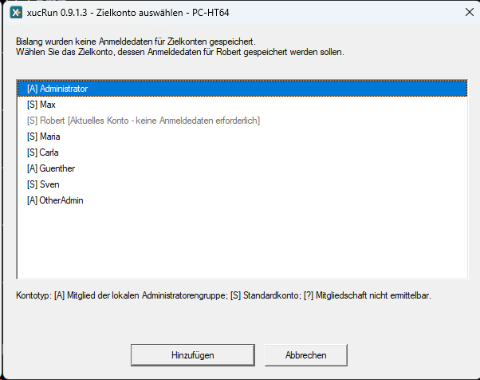
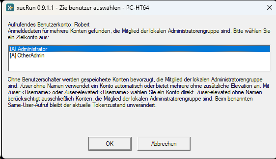
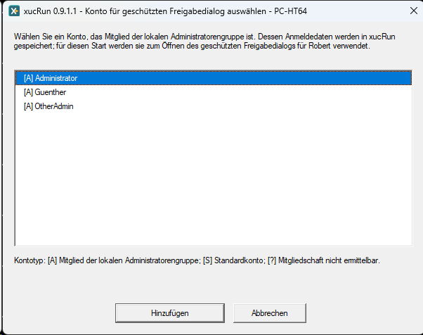
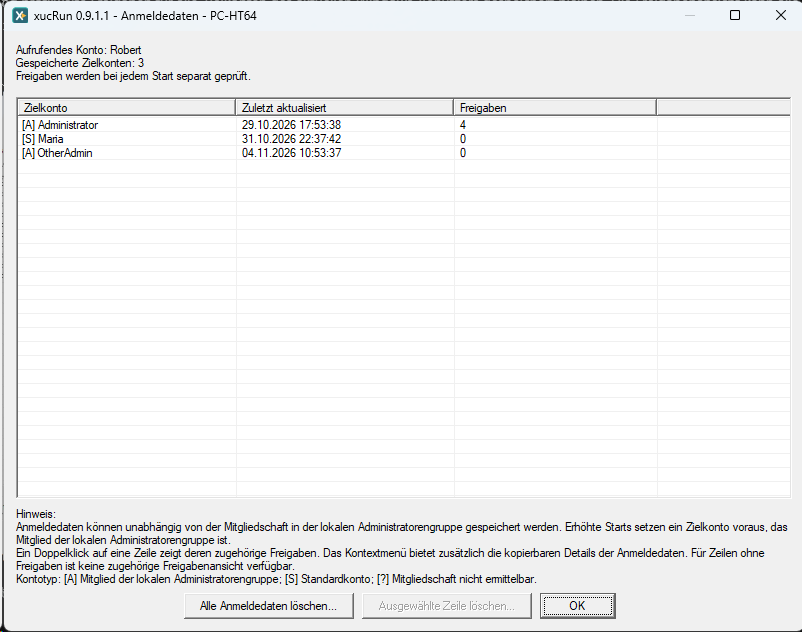
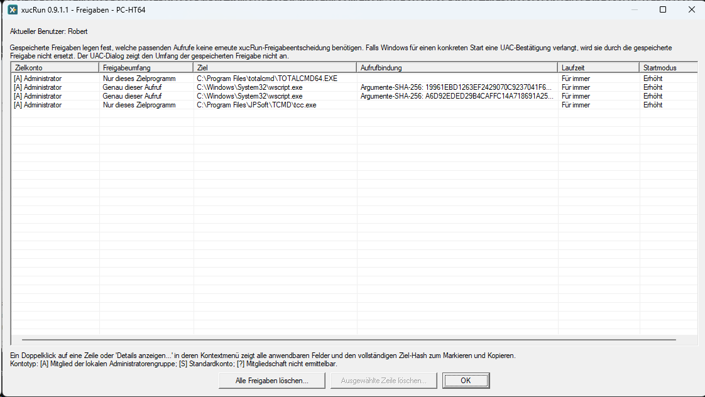
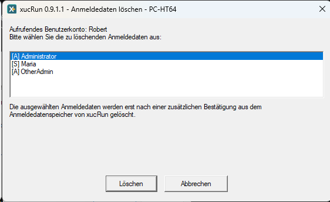
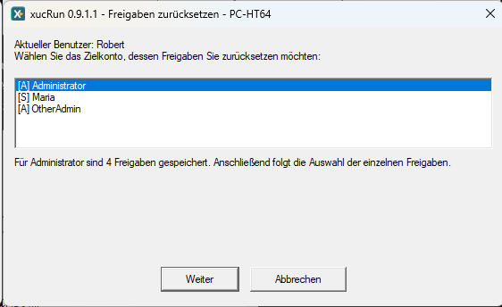
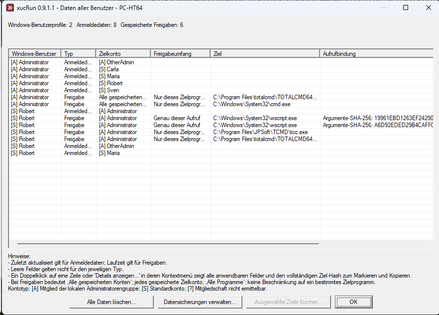

<!--
Purpose: Beschreibt alltägliche xucRun-Abläufe und Integrationen.
Approach: Bündelt Praxisbeispiele, Kontowahl, Verwaltung gespeicherter Daten und optionale Integrationen.
-->
# xucRun verwenden

**Sprache:** [English](../en/USAGE.md) | Deutsch

Dieses Handbuch beschreibt die alltägliche Verwendung von xucRun, die Kontowahl, die Verwaltung gespeicherter Daten und praktische Integrationen. Installation und ersten Start beschreibt zunächst die [Haupt-README](../../README.de.md).

## Anwendungsbeispiele

Die folgenden Beispiele zeigen, wie xucRun Kontowahl, optionale Rechteerhöhung, gespeicherte
Anmeldedaten, Freigaben und Argumentübergabe in einem Aufruf verbindet.

Gerätemanager aus einer Standardbenutzersitzung mit erhöhten Rechten öffnen:

```cmd
xucRun.exe /user-elevated "C:\Windows\System32\mmc.exe" "C:\Windows\System32\devmgmt.msc"
```

Der Aufruf enthält weder das Administratorkonto noch dessen Kennwort. `/user-elevated` wählt ein
geeignetes Konto aus der Administratorengruppe und fordert erhöhte Rechte an; xucRun behandelt
`devmgmt.msc` als Argument der ausdrücklich angegebenen `mmc.exe`.

Eine administrative PowerShell mit einem Skript starten:

```powershell
xucRun.exe /user-elevated powershell.exe -File "C:\Scripts\AdminScript.ps1"
```

Das [kurze PowerShell-Demonstrationsvideo](../media/xucRun-elevated-powershell.mp4) (34 Sekunden,
MP4, englische Benutzeroberfläche) zeigt, wie eine Abfrage aktivierter Windows-Komponenten ohne
Erhöhung fehlschlägt und erfolgreich ausgeführt wird, nachdem xucRun PowerShell mit erhöhten
Rechten unter dem Administratorkonto gestartet hat. `whoami` bestätigt das Zielkonto.

Einen Windows-Dienst über `cmd.exe` stoppen:

```cmd
xucRun.exe /user-elevated cmd.exe /c "net stop MyService"
```

Eine geschützte Datei mit erhöhten Rechten bearbeiten:

```powershell
xucRun.exe /user-elevated notepad.exe "C:\Windows\System32\drivers\etc\hosts"
```

PowerShell unter einem für diesen Start ausgewählten Konto öffnen:

```cmd
"C:\Program Files\xucRun\xucRun.exe" /user:* "C:\Windows\System32\WindowsPowerShell\v1.0\powershell.exe" -NoExit
```

`/user:*` öffnet immer die Auswahl aktivierter lokaler Konten und startet PowerShell ohne
zusätzliche Rechteerhöhung durch xucRun unter dem gewählten Konto. Fehlende Anmeldedaten werden vor
dem Start angefordert.

Thunderbird aus PowerShell unter dem Windows-Zielkonto `MailUser` mit dessen Benutzerprofil und
unverändertem Rechtemodus starten:

```powershell
& 'C:\Program Files\xucRun\xucRun.exe' `
    /user:MailUser `
    'C:\Program Files\Mozilla Thunderbird\thunderbird.exe'
```

Soll kein bestimmtes Zielkonto im Aufruf stehen, kann stattdessen `/user` ohne Kontonamen
verwendet werden. Gibt es genau ein Konto mit gespeicherten xucRun-Anmeldedaten, wählt xucRun es
automatisch. Bei mehreren solchen Konten erscheint die Zielkontoauswahl. Sind noch keine
xucRun-Anmeldedaten gespeichert, bietet xucRun die lokale Zielkontoauswahl und anschließend die
geschützte Kennworteingabe an.

xucRun wählt dabei das Windows-Konto aus, nicht ein Mailkonto innerhalb von Thunderbird. Der
Befehl setzt die Standardinstallationspfade von xucRun und Thunderbird voraus. Bei abweichenden
Pfaden sind die tatsächlichen absoluten Installationspfade einzusetzen.

Mehrere strukturierte Argumente einschließlich Werten und eines Pfads mit Leerzeichen direkt an
`netsh.exe` übergeben:

```cmd
xucRun.exe /user-elevated "C:\Windows\System32\netsh.exe" advfirewall firewall add rule name="Lokaler Beispielserver" dir=in action=allow program="C:\Program Files\Beispielserver\server.exe" enable=yes profile=private
```

xucRun hält das Zielprogramm und seine Argumente über die erforderlichen Prozessgrenzen hinweg
getrennt; der Aufruf benötigt keine verschachtelte Befehlszeile für eine Werkzeugkette aus
Kontowechsel und Rechteerhöhung.

Die aktuelle PowerShell durch eine PowerShell im automatisch gewählten Benutzer- und
Berechtigungskontext ersetzen:

```powershell
PS D:\Beispiel\Projekt> xucRun.exe
```

Bei diesem parameterlosen Aufruf erkennt xucRun die direkte Eltern-Shell, schließt die bisherige
Konsole nach erfolgreichem Start und öffnet dieselbe Shell im ursprünglichen Arbeitsverzeichnis
neu. Läuft die bisherige PowerShell unter einem Standardkonto und ist genau ein
Konto mit xucRun-Anmeldedaten gespeichert, das Mitglied der lokalen Administratorengruppe ist,
wählt xucRun dieses Konto automatisch, fordert die Windows-UAC-Bestätigung an und startet die neue
PowerShell erhöht unter diesem Konto wieder in `D:\Beispiel\Projekt`. Das ist der typische
Hauptanwendungsfall der Shell-Ersetzung.

Sind für mehrere solche Konten xucRun-Anmeldedaten gespeichert, erscheint stattdessen die
Kontoauswahl. Ist das aktuelle Konto selbst Mitglied der lokalen Administratorengruppe, verwendet
xucRun dieses Konto und nutzt bereits erteilte erhöhte Rechte direkt oder fordert andernfalls UAC
an. Nur wenn für ein Standardkonto keine xucRun-Anmeldedaten eines solchen Kontos gespeichert
sind, berücksichtigt xucRun Standardkonten, für die xucRun-Anmeldedaten gespeichert sind, und
startet die Ersatz-Shell ohne Erhöhung. Das Arbeitsverzeichnis bleibt in allen Fällen erhalten.

Die oben gezeigten Aufrufe mit einem Zielprogramm können auch in Skripten und
Desktop-Verknüpfungen verwendet werden. Kann xucRun das Zielkonto eindeutig automatisch bestimmen,
muss im Aufruf kein Kontoname stehen.

### Schutz fest konfigurierter Aufrufe

Für die Trennung zwischen Standardbenutzer und privilegiertem Zielkonto gilt der Grundsatz:
**Der Standardbenutzer darf die privilegierte Aktion anfordern, aber nicht unbemerkt deren
administrativ freigegebenen Inhalt verändern.**

Dieser Sicherheitsgrundsatz gilt unabhängig von xucRun: Ein weniger privilegiertes Konto darf
keine Dateien verändern können, die das Verhalten eines höher privilegierten Prozesses bestimmen.

Skripte, Verknüpfungen, geplante Aufgaben und Konfigurationsdateien, die einen xucRun-Aufruf
enthalten oder dessen Ziel, Argumente oder Arbeitsverzeichnis bestimmen, müssen deshalb selbst
vertrauenswürdig und vor unbefugten Änderungen geschützt sein. xucRun kann ihre Integrität nicht
allgemein prüfen. Konten, die solche Dateien verändern können, müssen bereits als berechtigt
gelten, den betreffenden privilegierten Aufruf zu kontrollieren. Das gilt auch für übergeordnete
Verzeichnisse, über die diese Dateien gelöscht, ersetzt, umbenannt oder umgeleitet werden könnten.
Solche Dateien dürfen nicht in gemeinsam oder unzureichend geschützten beschreibbaren
Verzeichnissen liegen. Sollen solche fest konfigurierten Aufrufe außerdem gegen eine Umleitung
ausführbarer Dateien geschützt sein, sollten deren Pfade beim Einrichten über Windows Known
Folders oder eine andere vertrauenswürdige Quelle ermittelt und anschließend absolut gespeichert
werden. Der spätere Aufruf hängt dann weder von veränderbaren Umgebungsvariablen noch von der
Programmsuche über `PATH` ab.

Die parameterlose Shell-Ersetzung ist dagegen für den interaktiven Aufruf aus einer unterstützten
Shell bestimmt. In einem Skript sollte sie nur verwendet werden, wenn das Schließen der bisherigen
Konsole und der interaktive Start einer Ersatz-Shell ausdrücklich beabsichtigt sind. Für eine
normale Desktop-Verknüpfung ist der parameterlose Aufruf nicht geeignet.

Unterstützte Eltern-Shells sind `cmd.exe`, `powershell.exe`, `pwsh.exe` und `tcc.exe`. (TCC ist
die Konsole von [Take Command von JP Software](https://jpsoft.com/).)

### Batchdatei bei Bedarf erhöht neu starten

Eine Batchdatei kann am Anfang prüfen, ob sie bereits mit erhöhten Rechten läuft. Andernfalls
startet sie sich über xucRun erneut und beendet den ursprünglichen, nicht erhöhten Durchlauf. Mit
`/user-elevated` verwendet xucRun das aktuelle Konto weiter, wenn es bereits ein
Mitglied der lokalen Administratorengruppe ist, und fordert nur bei Bedarf die UAC-Erhöhung an.
Andernfalls wählt xucRun ein Konto aus, das Mitglied dieser Gruppe ist:

```cmd
@echo off
NET SESSION >nul 2>&1
IF ERRORLEVEL 1 (
  "C:\Program Files\xucRun\xucRun.exe" /user-elevated "%~dpnx0" %*
  GOTO :eof
)

REM Ab hier folgen die Befehle, die erhöhte Rechte benötigen.
```

`%~dpnx0` liefert den vollständig qualifizierten Pfad der laufenden Batchdatei; `%*` reicht alle
ursprünglichen Argumente weiter. `GOTO :eof` verhindert, dass der nicht erhöhte Durchlauf nach dem
erneuten Start fortgesetzt wird. Die Prüfung mit `NET SESSION` setzt voraus, dass der Windows-Dienst
**Server** verfügbar ist. Das Beispiel nimmt die Windows-Standardpfade an. Beim Einrichten der
Batchdatei muss der xucRun-Pfad durch den tatsächlichen absoluten Installationspfad ersetzt werden.

### Desktop-Verknüpfung für einen erhöhten Explorer

Eine Desktop-Verknüpfung kann ein Explorer-Fenster für ein festgelegtes Verzeichnis direkt unter
einem geeigneten Konto mit erhöhten Rechten öffnen. Soll xucRun das Konto automatisch bestimmen,
steht im Feld **Ziel** der Verknüpfung beispielsweise:

```text
"C:\Program Files\xucRun\xucRun.exe" /user-elevated "C:\Windows\explorer.exe" "/root,"D:\Beispiel\Zielordner""
```

Mit `/user-elevated` verwendet xucRun das aktuelle Konto, wenn es Mitglied der lokalen
Administratorengruppe ist. Andernfalls bestimmt xucRun ein geeignetes Konto, das Mitglied der
lokalen Administratorengruppe ist und für das xucRun-Anmeldedaten gespeichert sind. Dadurch müssen
weder der Kontoname noch das Kennwort in der Verknüpfung stehen.

Soll die Verknüpfung immer ein bestimmtes Administratorkonto wählen, wird dessen Name an den
Schalter angehängt:

```text
"C:\Program Files\xucRun\xucRun.exe" /user-elevated:Administrator "C:\Windows\explorer.exe" "/root,"D:\Beispiel\Zielordner""
```

`Administrator` ist durch das gewünschte Konto zu ersetzen, das Mitglied der lokalen
Administratorengruppe ist und für das xucRun-Anmeldedaten gespeichert sind. Soll der Explorer
zwar unter einem bestimmten anderen Konto, aber ohne durch xucRun erzwungene Erhöhung starten,
wird stattdessen `/user:<Konto>` verwendet.

Die Beispiele nehmen die Windows-Standardpfade an. Beim Erstellen der Verknüpfung müssen die Pfade
zu `xucRun.exe` und `explorer.exe` durch die auf diesem System tatsächlich installierten absoluten
Pfade und der Beispielpfad durch das zu öffnende Verzeichnis ersetzt werden. `/root` setzt dieses
Verzeichnis als Wurzel des neuen Explorer-Fensters. Die verschachtelten Anführungszeichen müssen
unverändert erhalten bleiben. Die gespeicherten Anmeldedaten ersetzen nicht die interaktive
Windows-UAC-Bestätigung.

### Integration in das Explorer-Kontextmenü

Die optionale Datei [ExplorerKontextMenue.reg](../../ExplorerKontextMenue.reg) enthält ein vollständiges
Beispiel, das xucRun-Befehle für unterstützte Dateien, Ordner, Ordnerhintergründe und Laufwerke
ergänzt. Die Befehlseinträge für ausführbare Dateien und Ordnerhintergründe folgen beispielsweise
diesen Mustern:

```reg
[HKEY_LOCAL_MACHINE\SOFTWARE\Classes\exefile\shell\xucRun\command]
@="\"C:\\Program Files\\xucRun\\xucRun.exe\" /user-elevated \"%1\""

[HKEY_LOCAL_MACHINE\SOFTWARE\Classes\Directory\Background\shell\xucRunAdmin\command]
@="\"C:\\Program Files\\xucRun\\xucRun.exe\" /user-elevated \"C:\\Windows\\explorer.exe\" \"/root,\"%V\"\""
```

Die Datei ist ein Beispiel und kein Bestandteil des Installers. Sie entfernt zuerst die neun von
ihr verwalteten Einträge und erstellt sie anschließend unter `HKEY_LOCAL_MACHINE` neu, sodass sie
für alle Benutzer gelten. Der Import erfordert Administratorrechte, setzt eine xucRun-Installation
unter `C:\Program Files\xucRun` voraus und erzwingt für jeden enthaltenen xucRun-Befehl mit
`/user-elevated` ausdrücklich einen erhöhten Start unter einem Konto, das Mitglied der lokalen
Administratorengruppe ist.

Diese Einträge verwenden die klassische Win32-Registrierung für Explorer-Kontextmenüs unter
`Software\Classes\...\shell`. Im standardmäßigen kompakten Kontextmenü von Windows 11 stehen sie
normalerweise erst unter **Weitere Optionen anzeigen**. Wird stattdessen das klassische
Kontextmenü verwendet, erscheinen sie unmittelbar.

### Integration in Total Commander

Die folgenden Beispiele zeigen Ausschnitte der Total-Commander-Konfigurationsdatei `usercmd.ini`.
Sie wurden mit Total Commander 11.58 (64 Bit) getestet. Sie können auch mit anderen Versionen
funktionieren; deren Kompatibilität wurde jedoch nicht geprüft. Allgemeine Informationen zu Total
Commander bietet die
[offizielle Total-Commander-Webseite](https://www.ghisler.com/deutsch.htm).
Die Beispiele nehmen die Windows-Standardpfade und eine Total-Commander-Installation unter
`C:\totalcmd` an. Bei einer manuellen Übernahme müssen alle ausführbaren Pfade durch die
tatsächlichen absoluten Pfade ersetzt werden. Soll die Konfiguration gegen eine Umleitung dieser
Programme geschützt sein, muss ein Einrichtungswerkzeug die Pfade aus vertrauenswürdigen Quellen
ermitteln und ohne Umgebungsvariablen speichern.

xucRun kann eine neue erhöhte Total-Commander-Instanz nach seiner automatischen Kontostrategie
starten. Mitglieder der Administratorengruppe behalten ihr Konto und werden bei Bedarf über UAC
erhöht. Bei einem Standardbenutzer verwendet xucRun ein Konto, das Mitglied der lokalen
Administratorengruppe ist und für das xucRun-Anmeldedaten gespeichert sind. Der Aufruf übernimmt
den linken Pfad, den rechten Pfad und das aktive Dateipanel:

```ini
[em_TCStart_Elevated]
button=%COMMANDER_PATH%\icons\Tcmadm64000.ico
cmd="C:\Windows\System32\cmd.exe" /v:on /c
param=SET "P=%P." & SET "L=%X%P." & SET "R=%X%T." & SET Active=L & (IF "!P!" == "!R!" SET Active=R) & "C:\Program Files\xucRun\xucRun.exe" "C:\totalcmd\TOTALCMD64.EXE" /L="!L!" /R="!R!" /P=!Active!
menu=Start TC über xucRun mit erhöhten Rechten; Mitglieder der Administratorengruppe behalten ihr Konto, Standardbenutzer wechseln das Konto
iconic=1

[em_TCReStart_Elevated]
button=%COMMANDER_PATH%\icons\Tcmadm64000.ico
cmd=cm_Exit,em_TCStart_Elevated
param=
menu=Neustart TC mit erhöhten Rechten
iconic=1
```

Der zweite Befehl schließt die aktuelle Total-Commander-Instanz und ruft anschließend den ersten
Befehl auf. Für den Kontowechsel eines Standardbenutzers müssen in xucRun Anmeldedaten für
mindestens ein Konto gespeichert sein, das Mitglied der lokalen Administratorengruppe ist. Sind
mehrere passende Konten vorhanden, erscheint die Kontoauswahl. Eine erforderliche
Windows-UAC-Abfrage muss bestätigt werden.

Der folgende Befehl startet eine neue Total-Commander-Instanz als `LocalSystem`, das integrierte
Windows-Dienstkonto mit weitreichender Kontrolle über den Rechner. Dabei bleiben der linke Pfad,
der rechte Pfad und das aktive Dateipanel erhalten:

```ini
[em_TCStart_System]
button=%COMMANDER_PATH%\icons\Tcmadm64000.ico
cmd="C:\Program Files\xucRun\xucRun.exe"
param="/hidden-monitor "C:\Windows\System32\cmd.exe" /v:on /c SET "P=%P." & SET "L=%X%P." & SET "R=%X%T." & SET Active=L & (IF "!P!" == "!R!" SET Active=R) & "C:\Program Files\xucRun\xucRun.exe" /system "C:\totalcmd\TOTALCMD64.EXE" "/L=!L!" "/R=!R!" "/P=!Active!""
menu=Total Commander über xucRun als LocalSystem starten
iconic=1
```

Dieser Befehl muss xucRun zweimal aufrufen, weil `/system` nur aus dem erhöhten Kontext eines
Kontos verfügbar ist, das Mitglied der lokalen Administratorengruppe ist. Der äußere Aufruf
startet nach der zuvor beschriebenen automatischen Kontostrategie eine erhöhte zwischengeschaltete
Eingabeaufforderung und verbirgt sie durch `/hidden-monitor`. Der innere xucRun-Aufruf läuft
dadurch mit erhöhten Administratorrechten und startet Total Commander als `LocalSystem`. Jeder
SYSTEM-Start muss separat auf dem geschützten privaten xucRun-Desktop bestätigt werden.

Die zwischengeschaltete `cmd.exe /v:on /c` speichert die von Total Commander gelieferten Pfade
zuerst in Umgebungsvariablen und übergibt sie danach per verzögerter Variablenerweiterung an den
inneren xucRun-Aufruf. Dadurch werden auch Pfade mit Leer- und Sonderzeichen zuverlässig
verarbeitet. Der Vergleich der Pfade bestimmt zusätzlich, ob das linke oder rechte Panel aktiv
ist.

Total Commander besitzt anschließend uneingeschränkte `LocalSystem`-Rechte. Verwenden Sie diesen
Befehl nur bewusst für Wartung und Diagnose.

xucRun kann Total Commander außerdem unter einem ausdrücklich ausgewählten anderen Windows-Konto
starten, ohne dass dieses bereits interaktiv angemeldet ist. So lassen sich Dateioperationen aus
einer normalen Benutzersitzung heraus in einem anderen Kontokontext ausführen.

Für dieses Beispiel ist `<Konto>` durch den eingerichteten Kontonamen zu ersetzen; die
Total-Commander-Variablen und das Quoting müssen unverändert übernommen werden:

```ini
[em_TCStart_Konto]
button=C:\totalcmd\TOTALCMD64.EXE
cmd="C:\Program Files\xucRun\xucRun.exe"
param="/hidden-monitor "C:\Windows\System32\cmd.exe" /v:on /c SET "P=%P." & SET "L=%X%P." & SET "R=%X%T." & SET Active=L & (IF "!P!" == "!R!" SET Active=R) & "C:\Program Files\xucRun\xucRun.exe" /user:<Konto> "C:\totalcmd\TOTALCMD64.EXE" "/L=!L!" "/R=!R!" "/P=!Active!""
menu=Total Commander als <Konto> starten
iconic=1
```

Der Befehl verwendet xucRun erneut zweimal, damit ein Konto, das Mitglied der lokalen
Administratorengruppe ist, als zentraler Bevollmächtigter für die Anmeldedaten weiterer
Zielkonten dienen kann. Bei diesem Beispiel ist die Kaskade im Unterschied zum zuvor beschriebenen
LocalSystem-Beispiel für die eigentliche Startfunktion nicht erforderlich; sie ist hier eine
bewusste Designentscheidung für die Speicherung der Anmeldedaten. Der äußere Aufruf verwendet
dieselbe zuvor beschriebene verborgene, erhöhte Zwischenstufe unter diesem Konto. Der darin
ausgeführte innere xucRun-Aufruf läuft deshalb mit der Sicherheitskennung (SID), die dieses
Windows-Konto eindeutig identifiziert, und kann dessen für `<Konto>` gespeicherte Anmeldedaten
verwenden.

Dadurch müssen die Anmeldedaten der weiteren Zielkonten nicht für jeden Standardbenutzer erneut
gespeichert werden; jeder Standardbenutzer benötigt nur die für ihn gespeicherten Anmeldedaten des
zentralen Kontos. Ein einzelner xucRun-Aufruf des Standardbenutzers könnte dagegen nur dessen
eigene, an seine SID gebundenen Anmeldedaten verwenden. Der innere Aufruf verarbeitet
`/user:<Konto>` und startet die sichtbare Total-Commander-Instanz unter dem Zielkonto. Die
Erhöhung der äußeren Zwischenstufe wird nicht auf das Zielkonto übertragen; dessen Rechte bleiben
unverändert.

Die dokumentierten Startbefehle können beispielsweise in einem benutzerdefinierten Menü
zusammengefasst werden:

```text
POPUP "xucRun"
  MENUITEM "Mit erhöhten Rechten starten", em_TCStart_Elevated
  MENUITEM "Mit erhöhten Rechten neu starten", em_TCReStart_Elevated
  MENUITEM "Als LocalSystem starten", em_TCStart_System
  MENUITEM SEPARATOR
  POPUP "Als Benutzer starten"
    MENUITEM "<Konto>", em_TCStart_Konto
  END_POPUP
END_POPUP
```

Das [Demonstrationsvideo](../media/xucRun-with-total-commander.mp4) (1:33 Minuten, MP4,
englische Benutzeroberfläche) zeigt dieses Menü im praktischen Einsatz und veranschaulicht, wie
darüber Programme mit xucRun mit und ohne erhöhte Rechte sowie unter verschiedenen Konten
gestartet werden können.

Auf dieselbe Weise können weitere Konten ergänzt werden. Dazu können für jedes weitere Konto ein
eigener Befehl in `usercmd.ini` sowie ein darauf verweisender `MENUITEM` angelegt werden.

## Kontowahl und Rechtemodus


### Automatische Kontowahl und Schalter

Kontowahl und Rechtemodus sind getrennte Entscheidungen. Ohne Benutzerschalter bestimmt xucRun
anhand des angeforderten Rechtemodus einen passenden aktuellen Benutzerkontext oder ein Zielkonto
mit gespeicherten xucRun-Anmeldedaten. Gibt es genau ein passendes Konto, wird es automatisch
gewählt; bei mehreren erscheint eine Auswahl.

| Aufruf | Verhalten |
|---|---|
| `xucRun.exe <Programm> [Argumente ...]` | Konto automatisch bestimmen; bei Bedarf erhöhte Rechte anfordern |
| `xucRun.exe /user <Programm> [Argumente ...]` | Konto wählen, für das xucRun-Anmeldedaten gespeichert sind, ohne zusätzliche Erhöhung durch xucRun |
| `xucRun.exe /user:* <Programm> [Argumente ...]` | immer ein aktiviertes lokales Konto wählen, ohne zusätzliche Erhöhung durch xucRun |
| `xucRun.exe /user:<Konto> <Programm> [Argumente ...]` | bestimmtes Konto verwenden, ohne zusätzliche Erhöhung durch xucRun |
| `xucRun.exe /user-elevated <Programm> [Argumente ...]` | aktuelles Konto verwenden, wenn es Mitglied der lokalen Administratorengruppe ist, und bei Bedarf über UAC erhöhen; andernfalls passendes Konto mit gespeicherten xucRun-Anmeldedaten wählen |
| `xucRun.exe /user-elevated:* <Programm> [Argumente ...]` | immer ein aktiviertes lokales Konto wählen, das Mitglied der lokalen Administratorengruppe ist, und erhöht starten |
| `xucRun.exe /user-elevated:<Konto> <Programm> [Argumente ...]` | bestimmtes Konto verwenden und erhöht starten; ist es kein Mitglied der lokalen Administratorengruppe, wird der Start abgebrochen |

### Erste Verwendung und Kontoauswahl

Das [kurze Demonstrationsvideo zum Start unter einem anderen
Benutzerkonto](../media/xucRun-other-user-profile.mp4) (38 Sekunden, MP4, englische
Benutzeroberfläche) zeigt zunächst, wie xucRun den Windows-Dialog für Umgebungsvariablen unter einem
ausdrücklich angegebenen Standardkonto öffnet. Der dort angezeigte Name des Standardkontos und die
zugehörigen Profilpfade machen den Benutzerkontext des Zielkontos sichtbar. Anschließend zeigt
`/user:*` die interaktive Zielkontoauswahl; `whoami` bestätigt das ausgewählte Konto.

Findet `/user` keine gespeicherten xucRun-Anmeldedaten, öffnet xucRun statt eines Abbruchs
automatisch die lokale Zielkontoauswahl zum Anlegen von Anmeldedaten. Nachdem die Anmeldedaten des
gewählten Kontos über die geschützte Kennworteingabe gespeichert wurden, setzt xucRun den
ursprünglichen Programm- oder Konsolenstart fort. Das aktuelle Konto wird zum Anlegen von
Anmeldedaten nicht angeboten, weil xucRun für einen Start unter diesem Konto dessen vorhandenen
Windows-Zugriffstoken verwendet. Das aufrufende Konto muss nicht selbst Administrator sein; ein
Administratorkontext muss das geschützte Speichern jedoch interaktiv autorisieren.

Lehnt Windows die eingegebenen Anmeldedaten ab – beispielsweise weil leere Kennwörter durch die
lokale Sicherheitsrichtlinie eingeschränkt sind –, zeigt xucRun den von Windows gemeldeten Grund
auf dem geschützten Desktop an und öffnet anschließend den Eingabedialog erneut.



Die `:*`-Formen zeigen die lokale Zielkontoauswahl immer an, auch wenn nur ein geeignetes Konto
oder nur ein passender Anmeldedatensatz vorhanden ist. Der Dialog kennzeichnet das aktuelle Konto,
Konten mit gespeicherten xucRun-Anmeldedaten und die Mitgliedschaft in der lokalen
Administratorengruppe. Beim aktuellen Konto verwendet xucRun den vorhandenen Windows-Zugriffstoken.
Fehlen für ein anderes ausgewähltes Konto xucRun-Anmeldedaten, folgt die geschützte
Kennworteingabe; nach erfolgreicher Speicherung wird der ursprüngliche Startauftrag fortgesetzt.

Kann `/user-elevated` das aktuelle Konto nicht verwenden und findet xucRun mehrere Konten mit
gespeicherten xucRun-Anmeldedaten, die Mitglieder der lokalen Administratorengruppe sind, erscheint
die folgende Zielkontoauswahl:



Kann `/user-elevated` das aktuelle Konto nicht verwenden und findet xucRun kein Konto mit
gespeicherten xucRun-Anmeldedaten, das Mitglied der lokalen Administratorengruppe ist, bietet
xucRun automatisch eine auf Mitglieder dieser Gruppe eingeschränkte lokale Zielkontoauswahl und
anschließend die geschützte Kennworteingabe an. Das dabei gewählte Konto wird nach erfolgreicher
Speicherung seiner Anmeldedaten als Zielkonto für den erhöhten Start verwendet.

Auch bei einem nicht erhöhten Start unter einem anderen Standardkonto kann eine auf Mitglieder der
lokalen Administratorengruppe beschränkte lokale Kontoauswahl erscheinen, wenn xucRun für diesen
Start zusätzlich die Anmeldedaten eines Kontos ausschließlich zum Öffnen des geschützten
xucRun-Freigabedialogs benötigt. Anders als die zuvor gezeigte Zielkontoauswahl ist dieser Dialog
nicht auf Konten beschränkt, für die bereits xucRun-Anmeldedaten gespeichert sind; deshalb können
zusätzliche Konten erscheinen. In diesem Fall ist das zusätzlich gewählte Konto nicht das
Zielkonto. Das Zielprogramm läuft weiterhin unter dem zuvor ausgewählten Standardkonto.



Gespeicherte Anmeldedaten ersetzen keine erforderliche Windows-UAC-Bestätigung. Einzelheiten
beschreibt
[Verhältnis zwischen xucRun-Freigaben und Windows-UAC](SECURITY_MODEL.md#verhältnis-zwischen-xucrun-freigaben-und-windows-uac).

### Start unter einem stärker eingeschränkten Konto

Neben dem Start mit erhöhten Rechten unterstützt xucRun auch den umgekehrten Anwendungsfall: Ein
Programm kann ohne Erhöhung unter einem anderen, bewusst stärker eingeschränkten Konto ausgeführt
werden. Beispielsweise kann ein Programm unter einem dafür eingerichteten Standardkonto mit
engeren Datei- oder Netzwerkberechtigungen und einer eigenen benutzerbezogenen Konfiguration
ausgeführt werden. Der Prozess verwendet dabei den Windows-Zugriffstoken und das Benutzerprofil
des Zielkontos. Dies ist keine Sandbox: Die wirksamen Einschränkungen ergeben sich aus den
Gruppenmitgliedschaften, Berechtigungen und sonstigen Windows-Einstellungen des Zielkontos.

## Anmeldedaten und Freigaben verwalten


`/showcred` zeigt die Zielkonten, für die xucRun-Anmeldedaten gespeichert sind. `/showapprovals`
zeigt die aktiven Freigaben in getrennten Spalten für Umfang, Ziel und Aufrufbindung. Die
gespeicherten Kennwörter werden nicht angezeigt oder an den normalen xucRun-Client `xucRun.exe`
übertragen. Die verfügbaren Freigabeumfänge und ihre genaue Wirkung beschreibt der Abschnitt
[Freigabedialog, Dauer und Umfang](SECURITY_MODEL.md#freigabedialog-dauer-und-umfang).

In der Freigabenansicht öffnet ein Doppelklick auf eine Zeile oder **Details anzeigen...** in deren
Kontextmenü alle anwendbaren, nicht leeren Felder in einer schreibgeschützten, markierbaren Ansicht
zum Kopieren. Die Details enthalten den vollständigen SHA-256-Hash des Zielprogramms, sofern
vorhanden. Bei einer Freigabe für ein bestimmtes Zielkonto zeigen sie außerdem dessen SID, damit
sich das Konto eindeutig identifizieren lässt. Eine Freigabe für alle Zielkonten besitzt keine
einzelne Zielkonto-SID; deshalb wird dieses Feld dort nicht angezeigt.

In der Anmeldedatenansicht stellt **Details anzeigen...** dieselben kopierbaren Informationen zum
Zielkonto einschließlich seiner SID bereit. Ein Doppelklick auf ein Zielkonto mit Freigaben öffnet
die für dieses Konto geltenden Freigaben. Das Kontextmenü bietet dieselbe Aktion; für Zeilen ohne
Freigaben ist sie deaktiviert.

Löschaktionen bleiben ausschließlich auf den sichtbaren Schaltflächen unterhalb der Tabellen. In
beiden Ansichten kann die ausgewählte Zeile gelöscht werden. Die Anmeldedatenansicht kann außerdem
alle angezeigten Anmeldedaten löschen. Beim Löschen von Anmeldedaten werden deren kontogebundene
Freigaben mit entfernt, während profilweite Freigaben für alle Zielkonten des aktuellen
Windows-Benutzers gespeichert bleiben. Die Freigabenansicht kann alle angezeigten Freigaben
löschen. Jeder Löschvorgang verlangt eine eigene Bestätigung; ohne markierte Zeile bleibt die
Einzelaktion deaktiviert.

### Gespeicherte Anmeldedaten



### Aktive Freigaben



Ohne Kontonamen zeigt `/deletecred` eine Auswahl und verlangt vor der Löschung eine Bestätigung.
Für die Freigaben gelten dabei dieselben Löschregeln wie oben beschrieben.

Mit `/resetapprovals` können einzelne oder mehrere Freigaben ausgewählt und entfernt werden.
`/clear-all` ist der administrative Bereinigungsbefehl für aktive, vom Broker verwaltete Daten. Der
Befehl muss erhöht gestartet werden und löscht nach ausdrücklicher Bestätigung alle
xucRun-Anmeldedaten, Freigaben, in geschützten xucRun-Dialogen angezeigten benutzerbezogenen
Merkmale und zugehörigen Metadaten aller Windows-Benutzer dieses Rechners. Lokale Sicherungen
bleiben erhalten und können separat mit `/backup-delete-all` gelöscht werden.

| Gespeicherte Anmeldedaten löschen | Freigaben zurücksetzen |
|:---:|:---:|
|  |  |

Für eine rechnerweite Übersicht zeigt `/admin-status` die gespeicherten xucRun-Daten aller
Windows-Benutzer und stellt die verfügbaren administrativen Bereinigungsaktionen bereit. Ein
Doppelklick auf eine Zeile oder **Details anzeigen...** in deren Kontextmenü öffnet die anwendbaren,
nicht leeren Anmeldedaten- oder Freigabefelder zum Markieren und Kopieren. Für SIDs und Hashes
gelten die oben beschriebenen Detailregeln.



## Optionales Tray


Das separat installierte optionale
[xucRun-Tray-Add-on](https://github.com/HT64/xucRun-Tray) ergänzt eine Status- und
Bedienoberfläche, deren Symbol im Benachrichtigungsbereich der Windows-Taskleiste neben der Uhr
erscheint. Es ist ein eigenständiges Projekt, zeigt Informationen aus xucRun an und stellt den
Zugriff auf dessen vorhandene Verwaltungsfunktionen bereit. Über sein Menü lässt sich die
computerweite xucRun-Sprache auf Automatisch, Deutsch oder Englisch setzen. Einzelheiten zur
Wirkung der Einstellung enthält der Abschnitt
[Konfigurationsdatei und Sprache](REFERENCE.md#konfigurationsdatei-und-sprache).

Das Tray ist insbesondere bei der Inbetriebnahme, bei der Kontrolle des Betriebszustands und bei
späteren Änderungen an Anmeldedaten, Freigaben, Sprache, Protokollierung oder Brokerzustand
hilfreich. xucRun und sein Brokerdienst bleiben ohne ein installiertes oder laufendes Tray
vollständig nutzbar; das Tray kann daher dauerhaft oder nur bei Bedarf verwendet werden.
Einzelheiten zum manuellen Start und zum Start bei der Windows-Anmeldung enthält die Dokumentation
des Tray-Projekts.
