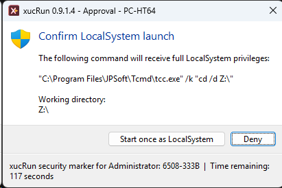
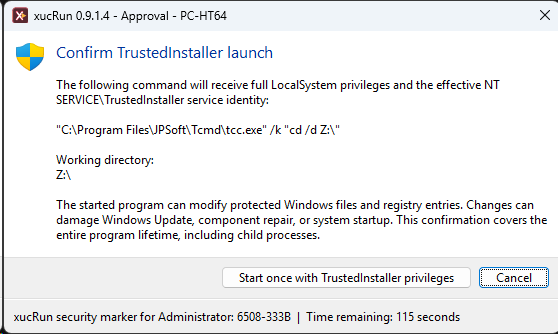
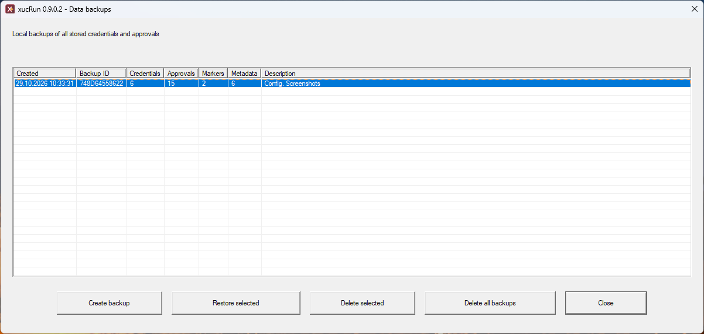
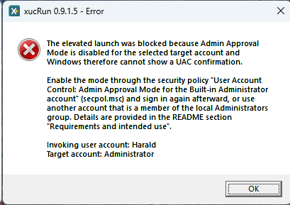
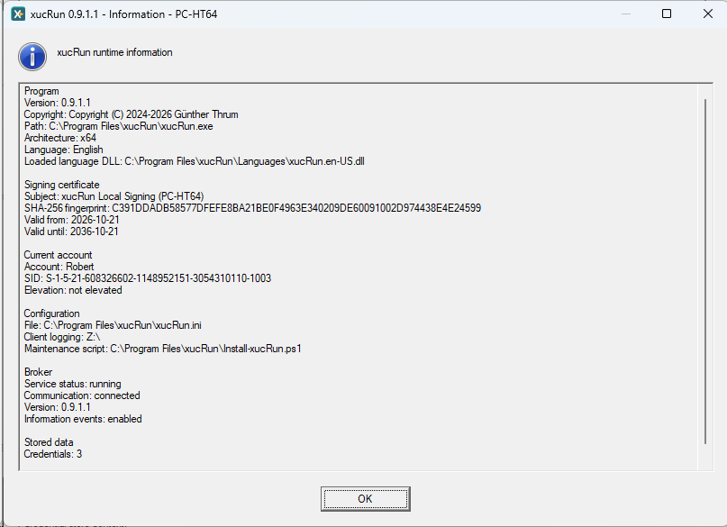
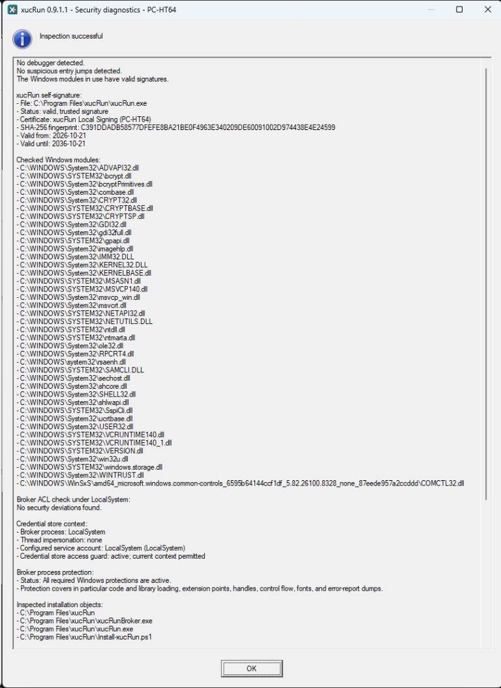

<!--
Purpose: Provides the complete xucRun command and configuration reference.
Approach: Organizes syntax, advanced commands, configuration, backups, and diagnostics for lookup.
-->
# Command and configuration reference

**Language:** English | [Deutsch](../de/REFERENCE.md)

This reference collects command syntax, advanced launch modes, configuration, backups, and diagnostics. For guided workflows, see [Using xucRun](USAGE.md).

## Programs, arguments, and special characters


The first argument that is not an xucRun switch is the target program. All following arguments
belong exclusively to that program:

```powershell
xucRun.exe cmd.exe /c dir
xucRun.exe /user:Administrator app.exe /config:value
```

Here, `/c` and `/config:value` are not interpreted by xucRun. Shell-internal commands must be run
through their shell, for example `cmd.exe /c dir` or
`powershell.exe -Command Get-Process`.

Enclose program paths and individual arguments containing spaces in quotation marks as usual.
xucRun also supports batch files and carries common shell special characters across the additional
process boundaries. Characters that `cmd.exe`, PowerShell, or another calling shell evaluates
before xucRun starts remain subject to that shell's rules.

For security reasons, xucRun rejects target arguments containing non-printing control characters,
such as tabs or line breaks, as well as certain invisible or bidirectional Unicode control
characters. The quoting and shell-metacharacter rules described above apply independently of this
restriction.

For a launch handled by the xucRun broker service—the privileged component that verifies and
performs permitted program starts—of a `.bat` or `.cmd` file whose file name contains one of the
CMD metacharacters `& | ( ) ! % ^`, the broker creates a temporary wrapper named
`xucRun_wrapper_<128-bit-random-value>.bat`. It stores the wrapper preferably on a suitable volume
named `RamDisk`, or otherwise in the target account's `%TEMP%` directory. The broker protects the
wrapper until the launched process exits and then attempts to delete it, or does so during error
cleanup if the launch fails. If a deletion error or unexpected broker termination leaves it
behind, a local administrator can remove it after it has been released. There is no later
automatic cleanup; the wrapper contains no credentials, stored arguments, or reusable
authorization.

## Useful commands


| Command | Purpose |
|---|---|
| `xucRun.exe /addcred [<Account>]` | store credentials |
| `xucRun.exe /deletecred [<Account>]` | select and delete stored credentials |
| `xucRun.exe /showcred` | show accounts for which xucRun credentials are stored |
| `xucRun.exe /showapprovals` | show stored approvals |
| `xucRun.exe /resetapprovals[:<Account>]` | reset approvals |
| `xucRun.exe /system [<Application> [Arguments...]]` | start a local application or replacement shell as `LocalSystem` |
| `xucRun.exe /trustedinstaller [<Application> [Arguments...]]` | start a local application or replacement shell with `LocalSystem` privileges and the TrustedInstaller service identity |
| `xucRun.exe /info` | show version, copyright, Apache License 2.0, signing certificate, broker status, and current configuration |
| `xucRun.exe /admin-status` | show and manage data for all Windows users with elevation |
| `xucRun.exe /backup` | manage local backups |
| `xucRun.exe /audit` | run security diagnostics |
| `xucRun.exe /enable-broker` | re-enable a disabled broker |
| `xucRun.exe /clear-all` | delete stored credentials, approvals, per-user identifiers shown in protected xucRun dialogs, and associated metadata |
| `xucRun.exe /help` | show complete help |

`/hidden` hides the directly started target program. `/hidden-monitor` also monitors its exit code
and displays a notice when it fails. Dialogs and child processes are not hidden or monitored by
these options.

`xucRun.exe` uses exit code `0` for a successful operation and exit code `1` when the operation
fails, is rejected, or is cancelled. The exit code of a launched target program is not returned as
the exit code of `xucRun.exe`.

### Starting an application or replacement shell as LocalSystem or TrustedInstaller

`xucRun.exe /system [<Application> [Arguments...]]` starts the specified local application as the
Windows `LocalSystem` account in the caller's interactive session.
`xucRun.exe /trustedinstaller [<Application> [Arguments...]]` starts it with `LocalSystem`
privileges plus the effective `NT SERVICE\TrustedInstaller` service identity.

Both modes are available only to members of the local Administrators group. An administrator who
is not already elevated receives one Windows UAC consent prompt; an already elevated
administrator performs the launch without another UAC prompt. Standard users are rejected before
an elevation request. The elevated account that is a member of the local Administrators group may
differ from the account signed in to the interactive session, so both modes can also be invoked
from an elevated replacement shell in another user's session.

Without an application, both modes replace an invoking TCC, Command Prompt, Windows PowerShell,
or PowerShell Core shell with the same shell type running under the selected identity. The
current working directory is preserved, the new shell is brought to the foreground, and the
previous shell is closed only after the confirmed replacement started successfully. Unknown
parent shells are rejected.

Neither mode uses stored credentials or approvals: `LocalSystem` and `TrustedInstaller` are not
user accounts with a password, and a stored approval would silently grant full system control to
every later launch of the same executable. Every invocation must therefore be confirmed
separately in the signed xucRun Approval Helper, the component that presents protected
confirmation dialogs.
The dialog appears on xucRun's protected private desktop and shows the exact executable, all
arguments, and the working directory; for `/trustedinstaller` it adds a specific warning about
changes to protected Windows files and registry entries. The confirmation applies only to that
invocation and cannot be stored, and it authorizes the selected program for its entire lifetime,
including operations performed through its user interface and child processes that inherit or
otherwise use its privileged context. A file manager, Registry Editor, shell, or script
interpreter therefore provides very broad system control. xucRun revalidates the executable
immediately before starting it.

| `/system` confirmation | `/trustedinstaller` confirmation with its specific warning |
|:---:|:---:|
|  |  |

The private desktop protects the confirmation from ordinary applications on the normal desktop.
It cannot protect against malicious software that is already running with elevated administrator
rights in the same logon session. Use both modes only from a trusted elevated administrator
session.

Applications running as `LocalSystem` have extensive control over the computer. In particular,
`HKEY_CURRENT_USER` refers to the `LocalSystem` profile rather than the signed-in user's profile.

TrustedInstaller is not a general privilege level above `LocalSystem`. This mode combines
`LocalSystem` rights with the TrustedInstaller service identity and therefore adds access only to
objects for which Windows grants that identity additional rights. If the required Windows service
is stopped, xucRun may start it but does not change its startup configuration or stop it
afterward. A service started this way therefore keeps running at first and usually stops itself
once Windows no longer needs it; a program that has already started keeps its rights regardless.
If xucRun cannot establish the required TrustedInstaller identity, the launch fails; there is no
fallback to a normal `/system` launch.

```cmd
xucRun.exe /system "C:\Windows\regedit.exe" /m
xucRun.exe /trustedinstaller "C:\Windows\regedit.exe"
```

Use both modes only for deliberate maintenance and diagnostic work. The TrustedInstaller identity
does not turn manual changes into supported Windows component servicing. Editing protected files
or registry data can make the component store inconsistent or damage Windows Update, component
repair, or system startup. Use Windows Update or another documented Windows servicing mechanism
whenever one exists.

## Backups


`xucRun.exe /backup` opens the interactive local backup manager. The following commands are also
available:



```text
xucRun.exe /backup-create [<Description>]
xucRun.exe /backup-list
xucRun.exe /backup-restore
xucRun.exe /backup-restore:<Backup-ID>
xucRun.exe /backup-delete-all
```

A backup contains stored credentials, approvals, xucRun dialog security identifiers, and
associated metadata.
Backups are stored separately from the active credentials and approvals under
`%ProgramData%\xucRun\BrokerBackups`. xucRun uses Windows APIs for storage and binds the backups to
the computer. xucRun restores them only on the same computer; they are not a portable password
export.

[Uninstalling xucRun](INSTALLATION.md#update) also removes local backups.

## Troubleshooting


`xucRun.exe /info` shows the shared client runtime information also used by the separately
installed optional xucRun Tray add-on: version, copyright, path, architecture, effective language
and loaded language DLL, signing certificate, current account including SID and elevation,
configuration file, and client logging. The common configuration section also identifies the
installed maintenance script. Core-specific sections add broker status, broker information
events, and stored-data counts.
`xucRun.exe /audit` checks security-relevant properties of the running installation and also
identifies the verified certificate when the client signature is valid. If xucRun Tray is
installed separately, the diagnostics also check its installed files and signatures, uninstall
registration, and per-user autostart tasks. If the broker service was disabled,
`xucRun.exe /enable-broker` enables it again. `xucRun.exe /help` displays the complete local command
overview.

The diagnostics explicitly verify the file protection, Authenticode trust, and expected signer
of the installed `Install-xucRun.ps1` maintenance script and, when Tray is installed,
`Install-xucRunTray.ps1`. The check uses this fixed product-file list rather than treating
arbitrary additional PowerShell files in the installation directory as xucRun components.
The report also confirms whether all required Windows protections of the running broker process
are active. A successful report summarizes the protected areas; a deviation identifies the
affected protection and provides a restart and reinstall recommendation.

If xucRun reports that an elevated launch was blocked because UAC confirmation was unavailable,
Windows Admin Approval Mode is not effective for the selected different account that is a member
of the local Administrators group. This can particularly affect the built-in `Administrator`
account.



### Runtime information



### Security diagnostics



For additional diagnostics, `ClientLogDirectory` can be configured to enable client log files
named `xucRun_YYYYMMDD.log`. Broker warnings and errors are always written to the Windows
Application event log under the `xucRunBroker` source and can be viewed in Windows Event Viewer
under **Windows Logs → Application**. See
[Configuration file and language](#configuration-file-and-language) for configuration details.

## Configuration file and language


xucRun uses the machine-wide configuration file
`%ProgramFiles%\xucRun\xucRun.ini`. The installer creates it and updates the selected language
during installation or an update without removing the other existing settings. Because the file
is located under `%ProgramFiles%`, administrator privileges are normally required to edit it
manually.

The supported structure is:

```ini
[xucRun]
Language=auto

[Logging]
ClientLogDirectory=
BrokerInformationEvents=false
```

Comment lines begin with a semicolon (`;`). Comments should be placed on separate lines rather
than appended to a setting.

- `Language=auto` follows the current user's Windows display language, selecting German for a
  German display language and English otherwise. `Language=de` selects German explicitly, and
  `Language=en` selects English explicitly. The change applies to newly started xucRun processes.
  Running Tray instances restart after a language change made through xucRun. Tray detects a
  manual external change when its context menu is next opened and then restarts itself. Other
  already running xucRun processes do not adopt the change. German and English are provided
  through separate, signed language resource files. The localization architecture can be extended
  with additional languages, but the current version supports only German and English.
- A missing or empty `ClientLogDirectory` disables client file logging. Specifying a path enables
  it. Environment variables are expanded in the context of each starting client. The path must
  be accessible to every client and wrapper account in use, with the permissions required to
  create, append to, and delete log files. xucRun does not change the directory's access
  permissions. If the configured directory, especially a network path, is unavailable, Windows
  file-system timeouts can also delay the opening of the Tray context menu. The Tray enumerates
  the existing log files at that point to update the corresponding actions and file count. For a
  shared path, the administrator must therefore define the intended readers
  and writers; accounts with modify access can also alter or delete the logs. Changes apply to
  newly started client and wrapper processes. Running Tray reloads the value when its context menu
  is next opened; until then, it continues to use its previous logging configuration. For each
  resolved log directory, xucRun appends to one dated log file per day but does not automatically
  rotate or delete client logs. These logs can contain program paths, account names, command
  lines, and target arguments. Do not pass passwords or other secrets as command-line arguments.
- The broker always writes warnings, errors, and service and ACL startup messages to the event log
  described under [Troubleshooting](#troubleshooting). `BrokerInformationEvents=true`
  additionally logs routine information about pipe request processing there. If the setting is
  missing, empty, `false`, or has any other value, only these additional information events remain
  disabled. Changes take effect after the broker service is restarted; restarting the client or
  Tray is not sufficient.

A missing configuration file, invalid language value, or missing or incorrectly signed language
file causes startup to fail for security reasons instead of silently falling back to another
language.
