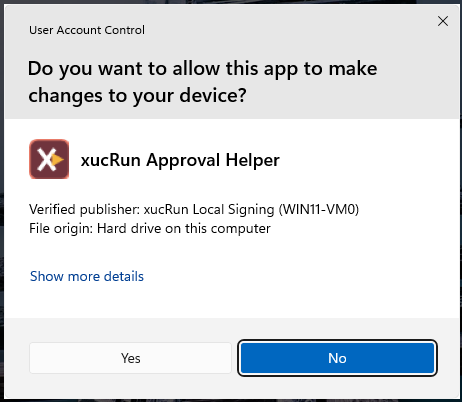
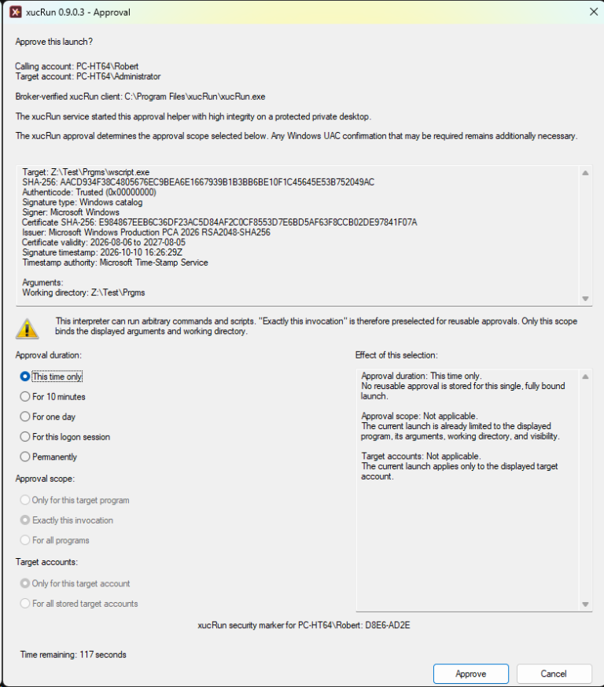
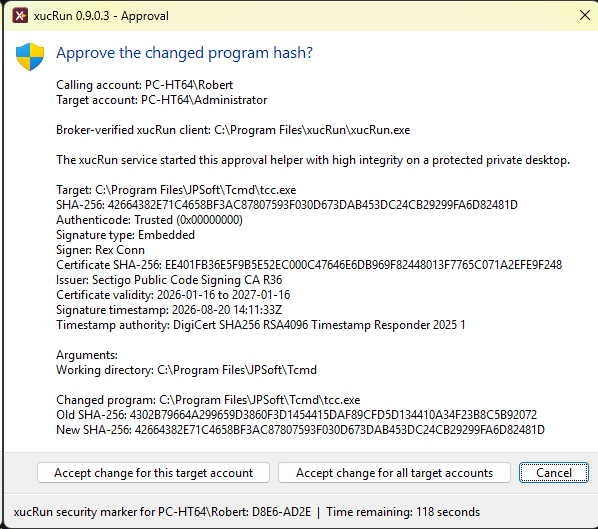
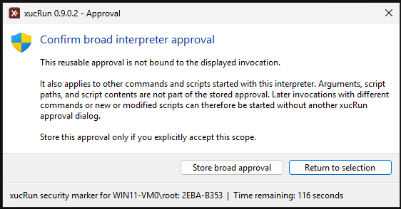

<!--
Purpose: Explains the xucRun security model, safeguards, and remaining risks.
Approach: Connects account separation, approvals, broker trust boundaries, comparisons, and limitations.
-->
# Security model and trust boundaries

**Language:** English | [Deutsch](../de/SECURITY_MODEL.md)

This document explains the security goals, authorization model, trust boundaries, safeguards, and remaining risks of xucRun. Read the [main README](../../README.md) first for a concise product introduction.

### Why work from a standard account?

Independently of xucRun, a user can remain signed in for everyday work with either an account that
belongs to the local Administrators group or a standard account. A member of the Administrators
group is authorized to run programs with administrator rights. Depending on the Windows User
Account Control (UAC) configuration, a launched process either already has those rights or
requests them through UAC. Any program can make such a request.

A user who already works from an account that belongs to the local Administrators group and wants
to occasionally launch programs with elevated privileges under that same account can use
Windows' built-in UAC mechanisms, including Sudo for Windows. xucRun also supports this use case,
but for that purpose alone offers no substantial additional benefit over the built-in Windows
features.

A standard account has no administrator rights of its own and cannot obtain them through UAC for
its own identity. System-wide changes to programs, services, or protected configuration therefore
require a separate account that belongs to the local Administrators group; the elevated process
runs under that account's identity. This limits what accidental actions and processes running in
the user's normal context can change without a separate, deliberate authorization step.

A suitable method must be chosen for performing administrative actions from the standard-user
context. Users can use built-in Windows features or additional tools for this purpose. In
particular, tools that store credentials or reuse authorization decisions require additional
safeguards and introduce risks of their own. Each user must therefore decide whether the benefit
of account separation justifies the associated setup and operational effort and the risks of the
chosen method.

Making this assessment and securely configuring and using the chosen method require sufficient
knowledge of Windows account, UAC, and permission models. xucRun is therefore intended for
experienced Windows users.

### How xucRun supports administrative actions from a standard account

**xucRun preserves the separation between the signed-in standard account and the target account
selected for a launch, and treats account selection and elevation as separate decisions.** It
does not temporarily turn the standard user into an administrator or add administrative
privileges to that account.

With xucRun, the signed-in standard user can select a target account other than the signed-in
account for a launch. The target account can also be another standard account. For administrative
actions, the user can instead select an account that belongs to the local Administrators group;
only then can the launch optionally use elevated privileges. The process then uses the identity
and permissions of the selected target account, including when accessing network shares. The user
profile of that account is also loaded. Examples include per-user profile data, email-account
sign-ins stored in applications, and registry settings. Accordingly, `HKEY_CURRENT_USER` refers to
the target account's registry hive, not to the signed-in user's hive. Environment variables such
as `%USERPROFILE%`, `%APPDATA%`, and `%LOCALAPPDATA%`, as well as known folders such as Documents
and Desktop, also refer to the target account.

xucRun combines launching under another user account with optional elevation through UAC and
manages the required credentials itself (see
[The broker's role and trust boundary](#the-brokers-role-and-trust-boundary)). These credentials are
used only when a matching [xucRun approval](#approval-dialog-duration-and-scope) permits the
requested launch. An approval bound to a specific target account can be used only for launches
under that account.

For a typical launch, it is sufficient to invoke the program, command, or script with its
arguments; neither the account name nor the password needs to appear in the invocation. This
applies to launches from a console, context menu, desktop shortcut, or script.

## Comparison with Windows features and other solutions


The following Windows features and other solutions cover individual aspects of xucRun. They
differ in whether and how they handle account switching, sessions, credentials, and approvals.

### Fast User Switching

Fast User Switching keeps the current Windows session and its open programs running while the user
signs in to a separate session under another account or switches to that account's existing
session. The user can then return to the previous session. This approach is also useful when the
complete interactive working environment of the other user is required.

In contrast to Fast User Switching, xucRun keeps the user in the current session and starts only
the required program under the selected other account, with or without elevated privileges.

### Windows UAC and Sudo for Windows

Windows User Account Control (UAC) is the Windows security feature through which a user explicitly
confirms a start with administrator privileges. Depending on the specific launch path and Windows
configuration, an account switch with xucRun can also require UAC confirmation; the interaction is
described under
[Relationship between xucRun approvals and Windows UAC](#relationship-between-xucrun-approvals-and-windows-uac).

[Sudo for Windows](https://learn.microsoft.com/windows/advanced-settings/sudo/) starts a single
process with administrator privileges from an unelevated console through Windows UAC. Its current
implementation requires the invoking account to already have administrator privileges; a standard
user cannot use Sudo for Windows, and another target account cannot currently be selected. The
commonly used Unix/Linux `sudo` with the `sudoers` policy can reuse successful authentication for
a period controlled by
[`timestamp_timeout` and `timestamp_type`](https://www.sudo.ws/docs/man/sudoers.man/#User_Authentication).
Microsoft currently documents no corresponding timestamp mechanism for Sudo for Windows; every
invocation goes through UAC.

For one-time elevation from an unelevated console under an existing account that is a member of
the local Administrators group, Sudo for Windows is the native Windows option. xucRun additionally
covers starting programs from a standard account under another local account by using stored
credentials and approvals that can be single-use or time-limited. If Windows requires UAC
confirmation for the target launch, that confirmation remains interactive.

### `runas.exe /savecred`

Another built-in Windows option with more similarity to xucRun is
[`runas.exe`](https://learn.microsoft.com/windows-server/administration/windows-commands/runas).
It can start individual programs under another account. With `/savecred`, the credentials used for
this are stored in the signed-in user's Windows Credential Manager after the password is entered
once.
Afterward, `runas.exe` can repeatedly start programs under the other account without asking for
the password again. However, `runas.exe` has several limitations:

- The target account must be specified with `/user:<Account>` on every invocation. Depending on
  usage, its name therefore appears in scripts, shortcuts, or the command line.
- `runas.exe` does not request elevation through UAC. Depending on the Windows UAC configuration,
  an account that is a member of the local Administrators group may start with restricted
  privileges unless elevation is requested separately.
- After `/savecred`, the account whose credentials were stored can be used for further program
  starts without another confirmation. There is no mandatory approval and no binding to
  particular programs, file hashes, arguments, or working directories. xucRun instead requires a
  suitable explicit approval before stored credentials are used.
- `runas.exe` does not automatically select a suitable account whose credentials were stored with
  `/savecred` and provides no integrated management of approvals with different scopes or
  expiration periods.
- `runas.exe` is sensitive to complex program paths, arguments, and special characters. When it
  is used in scripts or shortcuts, an additional shell or elevation tool can add further parsing
  and quoting layers. This increases the risk of errors, especially when the elevated program
  needs complex arguments or arguments containing special characters.

xucRun adopts the idea of stored and reusable credentials from `runas.exe` and adds controlled
approvals. It can be used in scripts, desktop shortcuts, other fixed invocations, and interactive
command-line use. Starting a program under another account, stored credentials, and interactive
UAC elevation when required are combined in one tool. When suitable credentials are stored, the
invocation needs neither the target account nor its password. Program paths, arguments, working
directories, batch files, and common shell special characters are handled in a controlled manner
across the required process boundaries.

For the Device Manager invocation shown under [Usage examples](USAGE.md#usage-examples), a schematic
equivalent using `runas.exe /savecred` and a separate elevation tool could look as follows if that
tool supports the syntax `elevate.exe <Program> [Arguments ...]`:

```cmd
runas.exe /savecred /user:Administrator "elevate.exe C:\Windows\System32\mmc.exe C:\Windows\System32\devmgmt.msc"
```

The exact syntax depends on the selected elevation tool. In this tool chain, the account name must
appear in the invocation, and the complete downstream command line must be passed to `runas.exe`
as one argument. In its main use case, xucRun does not require an account name and keeps the
program and its arguments separate within one invocation.

A more complex example creates a firewall rule for a program whose path contains spaces:

```cmd
xucRun.exe /user-elevated "C:\Windows\System32\netsh.exe" advfirewall firewall add rule name="Local example server" dir=in action=allow program="C:\Program Files\ExampleServer\server.exe" enable=yes profile=private
```

Here, `netsh.exe` receives several key-value arguments as well as a rule name and a program path
containing spaces. A toolchain consisting of `runas.exe` and a separate elevation tool would
therefore be considerably more complex; its reliable use with special characters would also
depend on the specific elevation tool and its quoting rules.

`runas.exe /savecred` and xucRun use separate, incompatible credential storage. An xucRun approval
can be bound closely to the calling user account, the target account, the participating programs
and their file hashes, and it can be time-limited. If one of the bound programs changes,
its SHA-256 hash no longer matches the approval. xucRun requires an explicit decision before
transferring the approval to the changed program version.

### Third-party solutions and choosing an approach

In addition to native Windows options, third-party solutions are available for switching user
accounts, elevating privileges, and managing administrative access. Depending on the use case,
they focus on different priorities and may be better suited, for example, to centralized
administration, managed enterprise environments, or unattended automation. Listing individual
products would inevitably be incomplete and might unintentionally emphasize certain options
through the selection. Such a list would also quickly become outdated and would allow only
limited comparison because the products use different operational and security models.

The appropriate solution depends on the specific requirements.

Users who want to start programs under another user account from a standard account and are
willing to re-enter that account's credentials for every launch can use the native Windows
mechanisms.

For users who instead want to avoid entering passwords repeatedly while retaining more precise
control than `runas /savecred` provides over which programs may use stored credentials and
administrative privileges, xucRun provides a freely available solution.

## Approvals and Windows UAC


### Relationship between xucRun approvals and Windows UAC

If the current Windows account is a member of the Administrators group, xucRun uses this account
for the started program by default. If the account is not yet elevated, Windows requests consent
through User Account Control (UAC). In this case, xucRun does not display its own approval dialog
and consent is handled exclusively by Windows UAC.

xucRun program approvals apply to starts using another account's stored credentials. In the
intended workflow from a non-elevated standard user account, a required account switch or
elevation remains interactive. For a launch without elevation, UAC can confirm the user's presence
through the xucRun Approval Helper, after which the target program runs with the target account's
non-elevated privileges. With elevation, UAC can instead confirm the target program start and
grant it the requested administrator privileges. The UAC prompt that Windows actually displays
depends on the specific launch path and Windows configuration.

A matching reusable approval only avoids another xucRun approval dialog. It does not replace any
Windows UAC confirmation required for the specific launch. The two decisions serve different
purposes: xucRun verifies that the invocation matches the stored approval; Windows UAC, where
required, confirms the specific launch or elevation.

The Windows UAC dialog does not show which xucRun approval is being used, how long it remains
valid, or whether it is bound to the exact invocation, one target program, or all programs. That
scope is shown when the approval is created in the xucRun approval dialog and later in the
approval management view.



Starting a program under another standard account can also require such a UAC presence
confirmation; the local Administrators group member used for it then serves only to open the
dialog, as described under
[Account selection and privilege mode](USAGE.md#account-selection-and-privilege-mode).

If no suitable approval is active, the xucRun approval dialog appears on a separate Windows
desktop. In the intended workflow, Windows separates this desktop from normal, non-elevated
programs. If xucRun cannot open it there, the operation is aborted. An elevated executable
writable by the caller requires a one-time risk confirmation for every start; if its directory is
also writable, xucRun blocks the elevated start.

[Account selection and privilege mode](USAGE.md#account-selection-and-privilege-mode) describes how
xucRun determines the account, requests missing credentials, and distinguishes starts with and
without elevation. Regardless of the selected path, UAC remains interactive; **xucRun is not a
mechanism for unattended elevation.**

Account selection, management, information, and error dialogs appear on the normal user desktop.
Password entry, approval decisions, and risk confirmations appear on a separate Windows desktop;
Windows UAC separately uses the configured UAC desktop.

For the first such dialog, xucRun creates a random xucRun dialog security identifier in the format
`XXXX-XXXX`. This is not a Windows account security identifier (SID). Password, approval, and risk
dialogs then display it unchanged. After verifying the installation, the user should remember or
securely record it during the first deliberately initiated dialog and confirm later dialogs only
when it matches. The identifier indicates an xucRun Approval Helper dialog but does not prove that an
operation is safe or user-initiated. It does not provide complete protection on a compromised
system and helps only when the user actually compares it.

### Approval dialog, duration, and scope

**With each approval, the user determines the balance between convenience and narrow scope:**
The longer and broader an approval is, the more matching later invocations can proceed without
another xucRun approval decision. A shorter approval or one bound more precisely to a program,
invocation, and target account requires a new decision more often but limits how broadly it can
be reused.



#### Dialog details and approval duration

The differentiated approval dialog allows the approval duration, program and invocation binding,
and included target accounts to be adapted to the specific use case and desired level of
protection. Its fixed header above the scrollable launch details identifies the xucRun client path
as successfully verified by the broker and shows the calling account, target account, and
protected Approval Helper origin before the explanatory UAC note. The scrollable area shows
detailed Authenticode information for the target program. For a trusted target signature, these
details include the signer, full SHA-256 certificate fingerprint, issuer, certificate validity
period, signature type, and any available timestamp and timestamp authority. If trust verification
fails, the dialog distinguishes a missing signature association from common signature,
certificate-chain, validity, revocation, and policy failures. A missing association means that no
usable embedded signature and no Windows catalog signature matching the current file contents was
found. A catalog signature associates the file through its hash; changing any byte breaks that
association, even though the catalog and its certificate continue to exist on the system and must
no longer be attributed to the changed file. The dialog also shows any signer and certificate
details that Windows can still provide for an untrusted signature. xucRun recognizes both embedded
Authenticode signatures and Windows catalog signatures. An unsigned or untrusted target remains
approvable because the signature information supplements rather than replaces the exact path and
SHA-256 identity. The available approval durations are:

- this start only,
- 10 minutes,
- one day,
- until sign-out,
- permanently.

#### Existing approvals and program changes

If the current launch differs from approvals already stored for the same target program, the
scrollable details summarize up to four of the most relevant approvals and name the differing
bindings, such as the program file, target account, elevation mode, arguments, working directory,
visibility, or direct script. The "Effect of this selection" area explains whether the new choice
adds a separate approval, broadens existing approvals, replaces an otherwise identical approval
with a different elevation mode, or remains overlaid by a broader approval. Existing narrower or
broader approvals are not deleted automatically; `/showapprovals` remains the complete management
view. Plain-text arguments are not reconstructed or displayed.

For "This start only," approval scope and target accounts do not apply because the approval applies only to
the currently displayed launch. The corresponding controls are therefore disabled. A reusable
approval can be bound to one program or all programs and to one target account or all stored
accounts of the current Windows user. Program-specific approvals include the SHA-256 hash of the
executable. If the executable at an approved path has a different hash, for example after a
program update, xucRun does not reuse the existing approval automatically. The dialog shows the
old and new hashes and the affected existing approvals. The user can transfer the change for the
current target account or for all target accounts covered by the affected approvals. Cancelling
leaves the existing approvals unchanged and rejects the current launch. The transfer also applies
to **"Exactly this invocation"** approvals; their argument, working-directory, visibility, and
direct-script bindings remain unchanged.



#### Invocation and script binding

With **"Exactly this invocation,"** a reusable approval can additionally be bound to the exact
arguments, the working directory, and whether the program is started visibly or hidden. Any change
to these values then requires a new approval. The arguments are not stored in clear text; only
their SHA-256 hash is retained as the binding.

An approval does not restrict what the started program can do. General or permanent approvals for
universal interpreters such as `cmd.exe`, PowerShell, or `wscript.exe` are therefore particularly
powerful.

For `cmd.exe`, `powershell.exe`, `pwsh.exe`, TCC, and Windows Script Host, the approval dialog
therefore warns about the interpreter's broader capabilities. A normal program approval does not
bind the displayed arguments. Therefore, "Exactly this invocation" is preselected for reusable
approvals involving these shells and interpreters.

If a reusable approval for one of these interpreters is nevertheless changed to "Only for this
target program" or "For all programs," xucRun requires a second explicit confirmation on the
protected desktop. It explains that arguments, script paths, and script contents are not part of
the stored approval and that different commands or new or modified scripts can later start without
another xucRun approval dialog. Returning to the selection is the default. An intentionally stored
broad approval retains this broad effect when it matches a later invocation.



If xucRun recognizes a directly specified PowerShell, batch, TCC, or Windows Script Host script, it
additionally binds the script's fully resolved path and SHA-256 hash, provided that the calling
account cannot modify a folder relevant to replacing the script. The script file itself may be
writable: if its contents change later, its hash no longer matches and xucRun requires a new
approval. Immediately before every launch, the broker rechecks the final path and hash and keeps
the verified file locked against modification and replacement until the program starts. An active
script binding is visible when the direct script's path and SHA-256 hash are shown at the top of
the approval dialog. The dialog also shows the same Authenticode and certificate details for the
direct script. This information does not require a script to be signed and does not replace the
path and hash binding. For PowerShell, a reusable "Exactly this invocation" approval is available
only with such a safely bound direct script. In particular, `-Command`, interactive invocations,
and other forms not recognized as direct `-File` execution can be approved only once or
deliberately with a broader approval scope.

#### Limits of an approval

For other interpreters, if no direct script with its path and SHA-256 hash is shown,
"Exactly this invocation" still binds the program file, arguments, working directory, and the
setting for a visible or hidden launch, but no additional program or script contents. Programs,
scripts, and other files named in the command or
invoked by it directly or indirectly can be replaced or modified without invalidating the
approval. Examples include free CMD command text using `SET` and `CALL` and programs subsequently
started by a bound target program or script.

If a folder relevant to replacement can be modified, or if the path or contents cannot be verified
safely, a reusable approval for "Exactly this invocation" is not available. The dialog explains
why and keeps the one-time approval as the default. The user can instead deliberately select a
reusable approval for the interpreter or for all programs. Such a broad approval does not bind
arguments, the script path, or script contents and therefore requires the separate explicit
confirmation described above. Before each individual launch, the broker still rechecks and locks
a recognized direct script; this launch-time check does not bind later invocations to the earlier
script contents. For PowerShell, an administratively enforced `AllSigned` policy can additionally
protect script files, but does not protect against direct or interactive commands.

Calling scripts, shortcuts, and configuration files from which the xucRun invocation is first
generated are still not generally hashed. The approval binds the resulting xucRun invocation, not
the script, shortcut, or configuration file from which it originated. Dynamically loaded scripts,
modules, configuration files, plugins, program inputs, and downstream programs are likewise not
automatically included. Such programs and files, as well as directories through which they could
be replaced, must therefore remain appropriately protected; an xucRun approval is not a substitute
for [protecting fixed invocations](USAGE.md#protecting-fixed-invocations). The other broker checks,
particularly those for the account, requested privileges, visibility, target path, and
target-program hash, remain effective.

Privileges do not end when a window is closed. Processes started by a program that was launched
through xucRun keep its account and privileges and can continue to run in the background after
the original window has been closed or a time-limited approval has expired. The optional
[xucRun Tray](USAGE.md#optional-tray) lists the processes started through xucRun and their recognized
follow-up processes, including those without a visible window.

## xucRun scope


xucRun contains:

- the `xucRun.exe` client,
- the `xucRunBroker` service, which starts automatically when needed, manages credentials stored by
  xucRun in the background, and starts programs under the selected user account,
- the xucRun Approval Helper `xucRunApproval.exe`,
- shared protocol, serialization, and security components,
- German and English language resources.

xucRun can be built, installed, and used independently.

## Requirements and intended use


xucRun supports Windows 10 and Windows 11 on x64 systems. It requires the current Microsoft
Visual C++ Redistributable v14 for x64. The minimum version required for a release is listed in
the corresponding [Changelog](../../CHANGELOG.md) entry.

For elevated cross-account launches, Windows Admin Approval Mode must be enabled for the selected
account that is a member of the local Administrators group. This particularly affects the built-in
`Administrator` account, for which this mode may be disabled. Otherwise, xucRun blocks the launch
because UAC confirmation would not be possible.

For the built-in `Administrator` account, this mode can be enabled through the Windows security
policy [User Account Control: Admin Approval Mode for the Built-in Administrator account](https://learn.microsoft.com/en-us/windows/security/application-security/application-control/user-account-control/settings-and-configuration#user-account-control-settings-list).
The corresponding registry setting is the `FilterAdministratorToken` DWORD value under
`HKEY_LOCAL_MACHINE\SOFTWARE\Microsoft\Windows\CurrentVersion\Policies\System`; a value of `1`
enables the mode. This changes the system-wide behavior of the built-in `Administrator` account,
not only its behavior when used with xucRun. Applications run by this account generally start with
a filtered token and use the configured Windows UAC elevation behavior when administrative
privileges are required. UAC must remain enabled system-wide. Sign out and back in after changing
the setting.

xucRun is intended for experienced private users and developers on self-managed computers and in
personal development and test systems. It is not a solution for unattended elevation, centralized
privilege management, or systems requiring an elevated level of protection.

> **Important security notices:** xucRun uses Windows APIs to store credentials. For xucRun to
> start a program under another user account, however, xucRun
> must process the required credentials temporarily. Complete protection against reading or
> misuse by sufficiently privileged malware or an already compromised system therefore cannot be
> guaranteed. The source code of xucRun is
> disclosed so that the implemented technical measures, their limits, and the remaining
> risks can be understood and independently reviewed. Disclosure alone is neither a security
> guarantee nor evidence of an independent security audit. Use xucRun at your own responsibility.
> xucRun should be used only on trusted, self-managed systems that do not require an elevated level
> of protection, and preferably with dedicated target accounts having the minimum
> required privileges. Scripts, shortcuts, scheduled tasks, and configuration files that invoke
> xucRun or provide its parameters must also be trusted and protected against unauthorized
> modification.
> These security notices are not exhaustive; not all risks and security vulnerabilities can be
> anticipated or ruled out.
> To the extent permitted by law, the author and contributors accept
> no liability for damage, data loss, or other consequences arising from the use or incorrect use
> of xucRun, software defects or security vulnerabilities, malware, or a compromised system. This
> includes, in particular, the loss, disclosure, or misuse of credentials. The disclaimer of
> warranty and limitation of liability in the [Apache License 2.0](../../LICENSE) govern.

## Broker service security model


### The broker's role and trust boundary

One possible alternative to a broker service would be for the normal client alone to store the
credentials under cryptographic protection. Without a separate privileged component, decryption
and use would then have to take place in the process and security context of the currently signed-
in user. This could protect the stored data against direct extraction. However, the ability to
decrypt it, the temporarily required clear-text password, and the permission Windows creates
after logon to start processes would be in the same security context as the normal client.

A compromise of that process or its user context could then attempt to misuse the legitimate
decryption function, manipulate the program flow, or read the password or logon permission from
process memory. Cryptographic storage alone does not solve this problem: if the normal client can
decrypt the data, the capability required to do so must be available in its security context. The
responsible component must also reliably decide which user may start which program under which
account, with which arguments, and with which privileges.

xucRun therefore separates this security-sensitive capability into a privileged broker service.
Only the broker stores and decrypts credentials, performs the Windows logon, and starts the
permitted program. It verifies the actual caller and binds credential use to the verified context
of the specific program start. The broker stores the password data as generic credentials in the
Windows Credential Manager of the `LocalSystem` account. They therefore do not appear in the
signed-in user's Credential Manager. Before storage, xucRun additionally encrypts them with a
protection mechanism built into Windows. The binding is configured so that Windows can decrypt the
data only in the security context of `LocalSystem` on the same computer. The internal credential
associations are also not provided to the normal client. A normal user process therefore cannot
decrypt the password data in its own security context. The normal client receives neither the
stored password nor a permission with which it could start programs under the target account
itself. If a required check fails, no program is started with the stored credentials; there is no
fallback to client-side decryption.

The service used for this purpose runs under the Windows `LocalSystem` account, has extensive
privileges, and therefore itself increases the security-relevant attack surface. This additional
security boundary requires systematic protection of the broker.

### Caller and launch-target validation

The broker does not trust identity, path, or approval information merely asserted by a client. It
derives the calling process, user, Windows session, and privilege level from the actual local
connection and from Windows itself. For security-sensitive requests, it checks, among other
properties, the protected installation location, actual program path, file hash, and Windows
digital signature. The client in turn verifies that the other end of its local connection belongs
to the registered xucRun service. Immediately before starting the program, the broker checks the
target program and working directory again. It determines the actual program path and its file
hash as well as the actual working directory itself and keeps the verified Windows objects open
until the start. This is intended to prevent a previously checked target from being replaced
unnoticed between approval and program start.

For each sensitive operation, the broker creates a short-lived security proof that can be used
only once. It applies only to the specific calling process, user, Windows session, target account,
target program and its hash, arguments, working directory, and the requested start with or without
elevated administrator privileges. A copied identifier or a process identity merely asserted by
the client is not sufficient. Different xucRun components also receive only the functions they
require. For example, the optional Tray can retrieve status and list data, but it cannot start
programs, change credentials, or make approval decisions.

### Hardening and credential protection

The broker and its installed files are additionally hardened against replacement and unintended
extension. Before entering productive operation, the broker checks, among other properties, its
own signature, the authorized client, protected installation paths, and security-relevant file
and directory permissions. It restricts the directories from which additional program components
may be loaded and prohibits certain ways of introducing foreign code at runtime. It also uses
built-in Windows protections that make exploitation of programming errors more difficult. Among
other measures, they prevent data from being executed as program code without further checks,
make the arrangement of process memory less predictable, and make manipulation of the intended
program flow more difficult. Program components from network locations and less trusted security
contexts are blocked. If a programming error causes the broker to access a closed or invalid
Windows object, Windows terminates it immediately instead of allowing it to continue in a
potentially unsafe state. Invalid, incomplete, oversized, or unauthorized requests from an xucRun
component are rejected without continuing the operation. If the broker cannot enable and then
verify one of its required Windows protections, it does not enter service operation.

The broker does not keep stored passwords permanently in clear text. It decrypts a password only
after the checks and required approvals for a specific operation and uses it immediately for the
Windows logon. Memory areas containing the clear-text password and controlled by xucRun are locked
against paging to disk, are not copied unnecessarily, and are overwritten after use. Other memory
areas used by xucRun for sensitive contents are also cleared afterward. If xucRun cannot establish
the required memory protection, the operation is aborted. Automatic Windows Error Reporting
memory dumps are disabled for the broker so that a crash does not unnecessarily place sensitive
memory contents in such a diagnostic file.

When a password is entered for the first time, it must necessarily be present briefly in the
memory of the Windows credential dialog and the verified xucRun Approval Helper. The Approval
Helper runs separately from the normal client with elevated privileges on its own Windows desktop.
In the intended workflow, Windows separates this desktop from ordinary, non-elevated programs. The
Approval Helper sends the password directly to the broker over the authenticated local connection
and then overwrites its own memory areas containing the password. The normal xucRun client does
not receive the password in this workflow either.

### Service behavior and residual risks

The broker is configured as a demand-start Windows service and is not started for status queries
alone. After actual use, it remains active until it is explicitly stopped, Windows shuts down, or
the service fails. While idle, it keeps no stored passwords in clear text and uses practically no
CPU time. An automatic idle stop would not further protect the encrypted stored credentials but
would create additional synchronization and restart paths. The broker can be explicitly stopped
or disabled; re-enabling it requires Windows UAC.

Taken together, these measures reduce the attack surface, make manipulation of the service more
difficult, and limit the consequences of a compromised normal user process. They cannot
completely exclude software defects, unknown vulnerabilities, or system compromise. In
particular, they do not provide a reliable security boundary against local administrators, other
compromised processes already running with system privileges, attacks on the Windows kernel, or
compromised infrastructure used to digitally sign the programs. xucRun therefore uses the broker
as a deliberately chosen and hardened security boundary, not as an absolute security guarantee.
