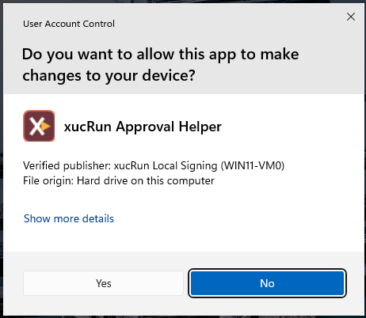
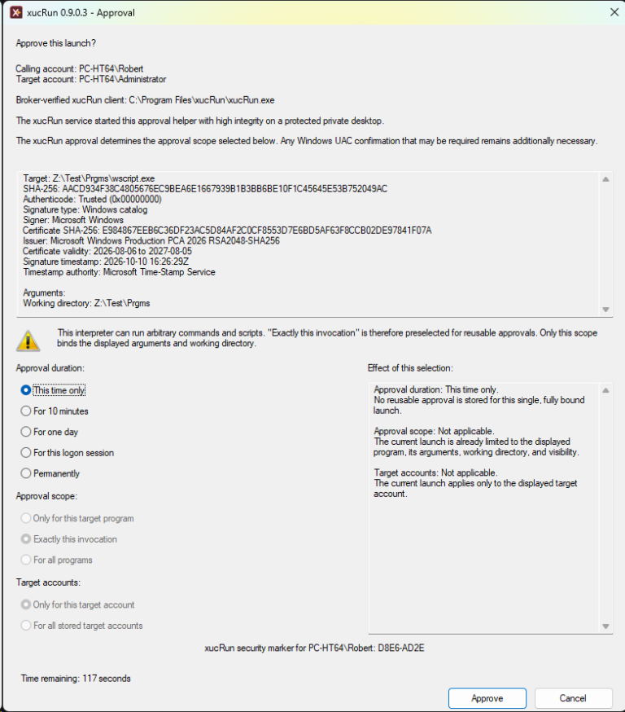
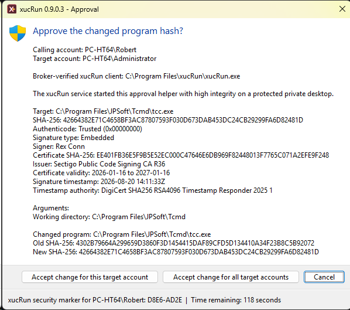
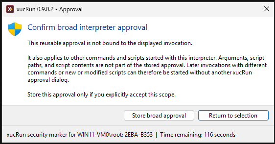

<!--
Purpose: Explains the xucRun security model, safeguards, and remaining risks.
Approach: Connects account separation, approvals, broker trust boundaries, and limitations.
-->
# Security model and trust boundaries

**Language:** English | [Deutsch](../de/SECURITY_MODEL.md)

This document explains the security goals, authorization model, trust boundaries, safeguards, and
remaining risks of xucRun. The [README](../../README.md) provides a concise product introduction.

## Account separation and security goals

### Why work from a standard account?

Independently of xucRun, a user can remain signed in for everyday work with either an account that
belongs to the local Administrators group or a standard account. A member of the Administrators
group is authorized to run programs with administrator rights. Depending on the Windows User
Account Control (UAC) configuration, a launched process either already has those rights or
requests them through UAC. Any program can make such a request.

A user who already works from an account that belongs to the local Administrators group and wants
to occasionally launch programs with elevated privileges under that same account can use
Windows' built-in UAC mechanisms, including Sudo for Windows. xucRun also supports this use case,
but for that purpose alone offers no substantial additional benefit over the built-in Windows
features.

A standard account has no administrator rights of its own and cannot obtain them through UAC for
its own identity. System-wide changes to programs, services, or protected configuration therefore
require a separate account that belongs to the local Administrators group; the elevated process
runs under that account's identity. This limits what accidental actions and processes running in
the user's normal context can change without a separate, deliberate authorization step.

A suitable method must be chosen for performing administrative actions from the standard-user
context. Users can use built-in Windows features or additional tools for this purpose. In
particular, tools that store credentials or reuse authorization decisions require additional
safeguards and introduce risks of their own. Each user must therefore decide whether the benefit
of account separation justifies the associated setup and operational effort and the risks of the
chosen method.

Making this assessment and securely configuring and using the chosen method require sufficient
knowledge of Windows account, UAC, and permission models.

### How xucRun supports administrative actions from a standard account

**xucRun preserves the separation between the signed-in standard account and the target account
selected for a launch, and treats account selection and elevation as separate decisions.** It
does not temporarily turn the standard user into an administrator or add administrative
privileges to that account.

With xucRun, the signed-in standard user can select a target account other than the signed-in
account for a launch. The target account can also be another standard account. For administrative
actions, the user can instead select an account that belongs to the local Administrators group;
only then can the launch optionally use elevated privileges. The process then uses the identity
and permissions of the selected target account, including when accessing network shares. The user
profile of that account is also loaded. Examples include per-user profile data, email-account
sign-ins stored in applications, and registry settings. Accordingly, `HKEY_CURRENT_USER` refers to
the target account's registry hive, not to the signed-in user's hive. Environment variables such
as `%USERPROFILE%`, `%APPDATA%`, and `%LOCALAPPDATA%`, as well as known folders such as Documents
and Desktop, also refer to the target account.

xucRun combines launching under another user account with optional elevation through UAC and
manages the required credentials itself (see
[The broker's role and trust boundary](#the-brokers-role-and-trust-boundary)). These credentials are
used only when a matching [xucRun approval](#approval-dialog-duration-and-scope) permits the
requested launch. An approval bound to a specific target account can be used only for launches
under that account.

For a typical launch, it is sufficient to invoke the program, command, or script with its
arguments; neither the account name nor the password needs to appear in the invocation. This
applies to launches from a console, context menu, desktop shortcut, or script.

## Requirements and intended use

For elevated cross-account launches, Windows Admin Approval Mode must be enabled for the selected
account that is a member of the local Administrators group. This particularly affects the built-in
`Administrator` account, for which this mode may be disabled. Otherwise, xucRun blocks the launch
because UAC confirmation would not be possible.

For the built-in `Administrator` account, this mode can be enabled through the Windows security
policy [User Account Control: Admin Approval Mode for the Built-in Administrator account](https://learn.microsoft.com/en-us/windows/security/application-security/application-control/user-account-control/settings-and-configuration#user-account-control-settings-list).
The corresponding registry setting is the `FilterAdministratorToken` DWORD value under
`HKEY_LOCAL_MACHINE\SOFTWARE\Microsoft\Windows\CurrentVersion\Policies\System`; a value of `1`
enables the mode. This changes the system-wide behavior of the built-in `Administrator` account,
not only its behavior when used with xucRun. Applications run by this account generally start with
a filtered token and use the configured Windows UAC elevation behavior when administrative
privileges are required. UAC must remain enabled system-wide. Sign out and back in after changing
the setting.

xucRun is intended for experienced private users and developers on self-managed computers and in
personal development and test systems. It is not a solution for unattended elevation, centralized
privilege management, or systems requiring an elevated level of protection.

> **Protection boundaries:** xucRun uses Windows APIs to store credentials and must process them
> temporarily to start a program under another user account. It cannot provide complete protection
> against reading or misuse by sufficiently privileged malware or an already compromised system.
> Dedicated target accounts with only the permissions required for their purpose limit the
> potential impact. Scripts, shortcuts, scheduled tasks, and configuration files that invoke
> xucRun or provide its parameters must also be trusted and protected against unauthorized
> modification.

## Approvals and Windows UAC

### Relationship between xucRun approvals and Windows UAC

If the current Windows account is a member of the Administrators group, xucRun uses this account
for the started program by default. If the account is not yet elevated, Windows requests consent
through User Account Control (UAC). In this case, xucRun does not display its own approval dialog
and consent is handled exclusively by Windows UAC.

xucRun program approvals apply to starts using another account's stored credentials. In the
intended workflow from a non-elevated standard user account, any Windows UAC confirmation required
for the specific launch remains interactive. For a launch without elevation, UAC can confirm the
user's presence through the xucRun Approval Helper, after which the target program runs with the
target account's non-elevated privileges. With elevation, UAC can instead confirm the target
program start and grant it the requested administrator privileges. The UAC prompt that Windows
actually displays depends on the specific launch path and Windows configuration.

A matching reusable approval only avoids another xucRun approval dialog. It does not replace any
Windows UAC confirmation required for the specific launch. The two decisions serve different
purposes: xucRun verifies that the invocation matches the stored approval; Windows UAC, where
required, confirms the specific launch or elevation.

The Windows UAC dialog does not show which xucRun approval is being used, how long it remains
valid, or whether it is bound to the exact invocation, one target program, or all programs. That
scope is shown when the approval is created in the xucRun approval dialog and later in the
approval management view.

Starting a program under another standard account can also require such a UAC presence
confirmation; the local Administrators group member used for it then serves only to open the
dialog, as described under
[Account selection and privilege mode](USAGE.md#account-selection-and-privilege-mode).

If no suitable approval is active, the xucRun approval dialog appears on a separate Windows
desktop. In the intended workflow, Windows separates this desktop from normal, non-elevated
programs. If xucRun cannot open it there, the operation is aborted. An elevated executable
writable by the caller requires a one-time risk confirmation for every start; if its directory is
also writable, xucRun blocks the elevated start.

[Account selection and privilege mode](USAGE.md#account-selection-and-privilege-mode) describes how
xucRun determines the account, requests missing credentials, and distinguishes starts with and
without elevation. Any required UAC confirmation remains interactive regardless of the selected
path.

Account selection, management, information, and error dialogs appear on the normal user desktop.
Password entry, approval decisions, and risk confirmations appear on a separate Windows desktop;
Windows UAC separately uses the configured UAC desktop.

For the first such dialog, xucRun creates a random xucRun dialog security identifier in the format
`XXXX-XXXX`. This is not a Windows account security identifier (SID). Password, approval, and risk
dialogs then display it unchanged. During the first deliberately initiated password, approval, or
risk dialog, the user should remember or securely record the security identifier and compare it
with later dialogs. The identifier indicates an xucRun Approval Helper dialog but does not prove
that an operation is safe or user-initiated. It does not provide complete protection on a
compromised system and helps only when the user actually compares it.

### Approval dialog, duration, and scope

**With each approval, the user determines the balance between convenience and narrow scope:**
The longer and broader an approval is, the more matching later invocations can proceed without
another xucRun approval decision. A shorter approval or one bound more precisely to a program,
invocation, and target account requires a new decision more often but limits how broadly it can
be reused.

#### Dialog details and approval duration

The differentiated approval dialog allows the approval duration, program and invocation binding,
and included target accounts to be adapted to the specific use case and desired level of
protection. The dialog shows the broker-verified xucRun client path, the calling account, the
target account, and the target program's path, SHA-256 hash, and Authenticode information. xucRun
considers embedded signatures and Windows catalog signatures. A catalog signature associates a
file through its hash; changing any byte breaks that association. An unsigned or untrusted target
remains approvable because signature information supplements rather than replaces the exact path
and SHA-256 identity. The available approval durations are:

- this start only,
- 10 minutes,
- one day,
- until sign-out,
- permanently.

#### Existing approvals and program changes

If the current launch differs from approvals already stored for the same target program, the
dialog shows the differing bindings and the effect of the new choice. Existing narrower or
broader approvals are not deleted automatically; `/showapprovals` remains the complete management
view. Plain-text arguments are not reconstructed or displayed.

A one-time approval applies only to the currently displayed launch. A reusable approval can be
bound to one program or all programs and to one target account or all stored accounts of the
current Windows user. Program-specific approvals include the SHA-256 hash of the executable. If
the executable at an approved path has a different hash, for example after a program update,
xucRun does not reuse the existing approval automatically. The dialog shows the old and new
hashes and the affected existing approvals. The user can transfer the change for the current
target account or for all target accounts covered by the affected approvals. Cancelling leaves
the existing approvals unchanged and rejects the current launch. The transfer also applies to
**"Exactly this invocation"** approvals; their argument, working-directory, visibility, and
direct-script bindings remain unchanged.

#### Invocation and script binding

With **"Exactly this invocation,"** a reusable approval can additionally be bound to the exact
arguments, the working directory, and whether the program is started visibly or hidden. Any change
to these values then requires a new approval. The arguments are not stored in clear text; only
their SHA-256 hash is retained as the binding.

An approval does not restrict what the started program can do. General or permanent approvals for
universal interpreters such as `cmd.exe`, PowerShell, or `wscript.exe` are therefore particularly
powerful.

For `cmd.exe`, `powershell.exe`, `pwsh.exe`, TCC, and Windows Script Host, the approval dialog
therefore warns about the interpreter's broader capabilities. A normal program approval does not
bind the displayed arguments. Therefore, "Exactly this invocation" is preselected for reusable
approvals involving these shells and interpreters.

If a reusable approval for one of these interpreters is nevertheless changed to "Only for this
target program" or "For all programs," xucRun requires a second explicit confirmation on the
protected desktop. It explains that arguments, script paths, and script contents are not part of
the stored approval and that different commands or new or modified scripts can later start without
another xucRun approval dialog. Returning to the selection is the default. An intentionally stored
broad approval retains this broad effect when it matches a later invocation.

If xucRun recognizes a directly specified PowerShell, batch, TCC, or Windows Script Host script, it
additionally binds the script's fully resolved path and SHA-256 hash, provided that the calling
account cannot modify a folder relevant to replacing the script. The script file itself may be
writable: if its contents change later, its hash no longer matches and xucRun requires a new
approval. Immediately before every launch, the broker rechecks the final path and hash and keeps
the verified file locked against modification and replacement until the program starts. An active
script binding is visible when the direct script's path and SHA-256 hash are shown at the top of
the approval dialog. The dialog also shows the same Authenticode and certificate details for the
direct script. This information does not require a script to be signed and does not replace the
path and hash binding. For PowerShell, a reusable "Exactly this invocation" approval is available
only with such a safely bound direct script. In particular, `-Command`, interactive invocations,
and other forms not recognized as direct `-File` execution can be approved only once or
deliberately with a broader approval scope.

#### Limits of an approval

For other interpreters, if no direct script with its path and SHA-256 hash is shown,
"Exactly this invocation" still binds the program file, arguments, working directory, and the
setting for a visible or hidden launch, but no additional program or script contents. Programs,
scripts, and other files named in the command or
invoked by it directly or indirectly can be replaced or modified without invalidating the
approval. Examples include free CMD command text using `SET` and `CALL` and programs subsequently
started by a bound target program or script.

If a folder relevant to replacement can be modified, or if the path or contents cannot be verified
safely, a reusable approval for "Exactly this invocation" is not available. The dialog explains
why and keeps the one-time approval as the default. The user can instead deliberately select a
reusable approval for the interpreter or for all programs. Such a broad approval does not bind
arguments, the script path, or script contents and therefore requires the separate explicit
confirmation described above. Before each individual launch, the broker still rechecks and locks
a recognized direct script; this launch-time check does not bind later invocations to the earlier
script contents. For PowerShell, an administratively enforced `AllSigned` policy can additionally
protect script files, but does not protect against direct or interactive commands.

Calling scripts, shortcuts, and configuration files from which the xucRun invocation is first
generated are still not generally hashed. The approval binds the resulting xucRun invocation, not
the script, shortcut, or configuration file from which it originated. Dynamically loaded scripts,
modules, configuration files, plugins, program inputs, and downstream programs are likewise not
automatically included. Such programs and files, as well as directories through which they could
be replaced, must therefore remain appropriately protected; an xucRun approval is not a substitute
for [protecting fixed invocations](USAGE.md#protecting-fixed-invocations). The other broker checks,
particularly those for the account, requested privileges, visibility, target path, and
target-program hash, remain effective.

Privileges do not end when a window is closed. Processes started by a program that was launched
through xucRun keep its account and privileges and can continue to run in the background after
the original window has been closed or a time-limited approval has expired. The optional
[xucRun Tray](USAGE.md#optional-tray) lists the processes started through xucRun and their recognized
follow-up processes, including those without a visible window.

## Broker service security model

### The broker's role and trust boundary

One possible alternative to a broker service would be for the normal client alone to store the
credentials under cryptographic protection. Without a separate privileged component, decryption
and use would then have to take place in the process and security context of the currently signed-
in user. This could protect the stored data against direct extraction. However, the ability to
decrypt it, the temporarily required clear-text password, and the permission Windows creates
after logon to start processes would be in the same security context as the normal client.

A compromise of that process or its user context could then attempt to misuse the legitimate
decryption function, manipulate the program flow, or read the password or logon permission from
process memory. Cryptographic storage alone does not solve this problem: if the normal client can
decrypt the data, the capability required to do so must be available in its security context. The
responsible component must also reliably decide which user may start which program under which
account, with which arguments, and with which privileges.

xucRun therefore separates this security-sensitive capability into a privileged broker service.
Only the broker stores and decrypts credentials, performs the Windows logon, and starts the
permitted program. It verifies the actual caller and binds credential use to the verified context
of the specific program start. The broker stores the password data as generic credentials in the
Windows Credential Manager of the `LocalSystem` account. They therefore do not appear in the
signed-in user's Credential Manager. Before storage, xucRun additionally encrypts them with a
protection mechanism built into Windows. The binding is configured so that Windows can decrypt the
data only in the security context of `LocalSystem` on the same computer. The internal credential
associations are also not provided to the normal client. A normal user process therefore cannot
decrypt the password data in its own security context. The normal client receives neither the
stored password nor a permission with which it could start programs under the target account
itself. If a required check fails, no program is started with the stored credentials; there is no
fallback to client-side decryption.

The service used for this purpose runs under the Windows `LocalSystem` account, has extensive
privileges, and therefore itself increases the security-relevant attack surface. This additional
security boundary requires systematic protection of the broker.

### Caller and launch-target validation

The broker does not trust identity, path, or approval information merely asserted by a client. It
derives the calling process, user, Windows session, and privilege level from the actual local
connection and from Windows itself. For security-sensitive requests, it checks, among other
properties, the protected installation location, actual program path, file hash, and Windows
digital signature. The client in turn verifies that the other end of its local connection belongs
to the registered xucRun service. Immediately before starting the program, the broker checks the
target program and working directory again. It determines the actual program path and its file
hash as well as the actual working directory itself and keeps the verified Windows objects open
until the start. This is intended to prevent a previously checked target from being replaced
unnoticed between approval and program start.

For each sensitive operation, the broker creates a short-lived authorization proof that can be
used only once. It applies only to the specific calling process, user, Windows session, target
account, target program and its hash, arguments, working directory, and the requested start with
or without elevated administrator privileges. A copied identifier or a process identity merely
asserted by the client is not sufficient. Different xucRun components also receive only the
functions they require. For example, the optional Tray can retrieve status and list data, but it
cannot start programs, change credentials, or make approval decisions.

### Broker service hardening

The broker and its installed files are additionally hardened against replacement and unintended
extension. Before entering productive operation, the broker checks, among other properties, its
own signature, the authorized client, protected installation paths, and security-relevant file
and directory permissions. It restricts the directories from which additional program components
may be loaded and prohibits certain ways of introducing foreign code at runtime. It also uses
built-in Windows protections that make exploitation of programming errors more difficult. Among
other measures, they prevent data from being executed as program code without further checks,
make the arrangement of process memory less predictable, and make manipulation of the intended
program flow more difficult. Program images from network locations or with a low Windows integrity
label are blocked. If a programming error causes the broker to access a closed or invalid Windows
object, Windows terminates it immediately instead of allowing it to continue in a potentially
unsafe state. Invalid, incomplete, oversized, or unauthorized requests from an xucRun component
are rejected without continuing the operation. If the broker cannot enable and then verify one of
its required Windows protections, it does not enter service operation.

### Credential protection

The broker does not keep stored passwords permanently in clear text. It decrypts a password only
after the checks and required approvals for a specific operation and uses it immediately for the
Windows logon. Memory areas containing the clear-text password and controlled by xucRun are locked
against paging to disk, are not copied unnecessarily, and are overwritten after use. Other memory
areas used by xucRun for sensitive contents are also cleared afterward. If xucRun cannot establish
the required memory protection, the operation is aborted. Automatic Windows Error Reporting
memory dumps are disabled for the broker so that a crash does not unnecessarily place sensitive
memory contents in such a diagnostic file.

When a password is entered for the first time, it must necessarily be present briefly in the
memory of the Windows credential dialog and the verified xucRun Approval Helper. The Approval
Helper runs separately from the normal client with elevated privileges on its own Windows desktop.
In the intended workflow, Windows separates this desktop from ordinary, non-elevated programs. The
Approval Helper sends the password directly to the broker over the authenticated local connection
and then overwrites its own memory areas containing the password. The normal xucRun client does
not receive the password in this workflow either.

### Service behavior and residual risks

The broker is configured as a demand-start Windows service and is not started for status queries
alone. After actual use, it remains active until it is explicitly stopped, Windows shuts down, or
the service fails. While idle, it keeps no stored passwords in clear text. The broker can be
explicitly stopped or disabled; re-enabling it requires Windows UAC.

Taken together, these measures reduce the attack surface, make manipulation of the service more
difficult, and limit the consequences of a compromised normal user process. They cannot
completely exclude software defects, unknown vulnerabilities, or system compromise. In
particular, they do not provide a reliable security boundary against local administrators, other
compromised processes already running with system privileges, attacks on the Windows kernel, or
compromised infrastructure used to digitally sign the programs. xucRun therefore uses the broker
as a deliberately chosen and hardened security boundary, not as an absolute security guarantee.
