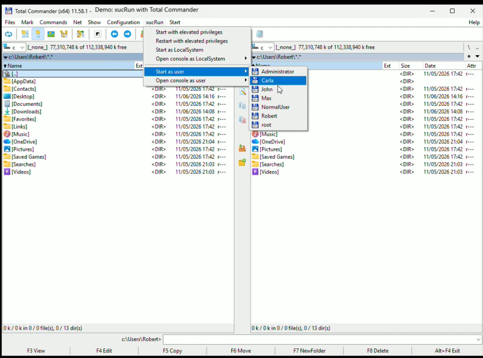
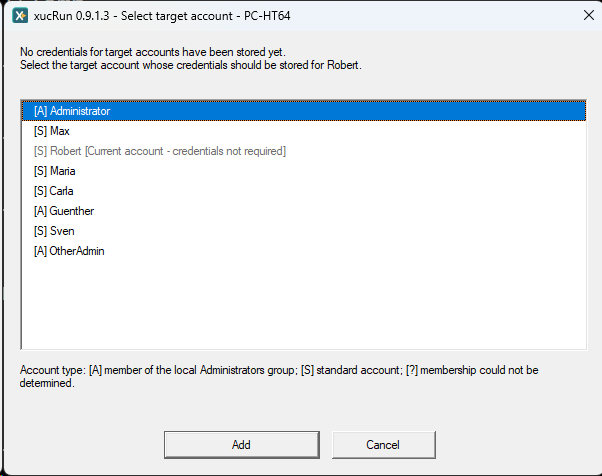
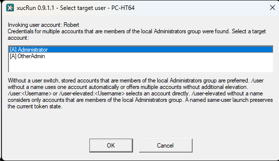
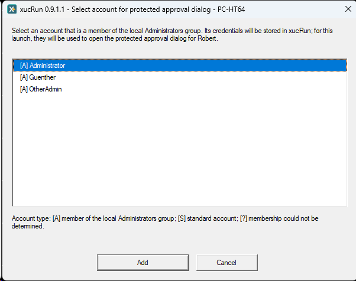
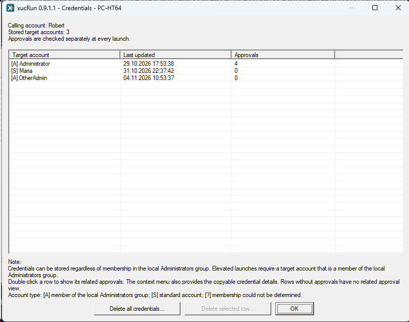
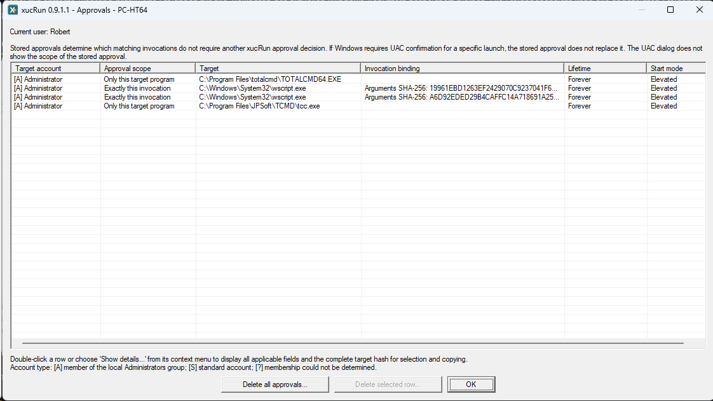
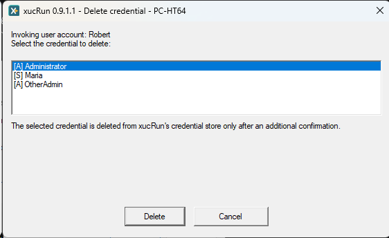
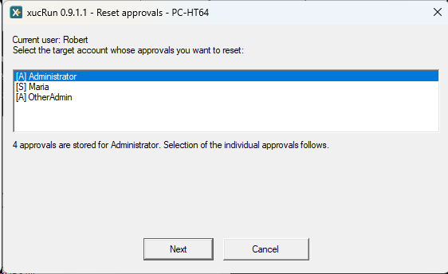
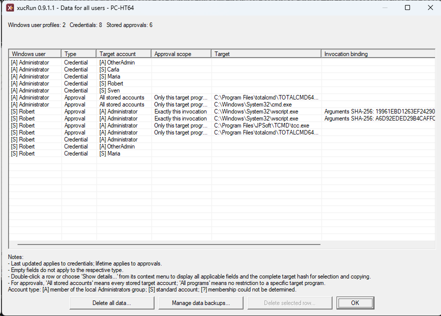

<!--
Purpose: Explains everyday xucRun workflows and integrations.
Approach: Groups practical examples, account selection, stored-data management, and optional integrations.
-->
# Using xucRun

**Language:** English | [Deutsch](../de/USAGE.md)

This guide explains everyday xucRun use, account selection, stored data management, and practical integrations. Start with the [main README](../../README.md) for installation and the first launch.

## Usage examples

The following examples show how xucRun combines account selection, optional elevation, stored
credentials, approvals, and argument forwarding in one invocation. Many of the single-line `cmd`
examples are also well suited as targets for desktop shortcuts when absolute program paths are
specified.

Open Windows administrative tools with elevated privileges from a standard-user session:

```cmd
xucRun.exe /user-elevated "C:\Windows\System32\mmc.exe" "C:\Windows\System32\devmgmt.msc"
xucRun.exe /user-elevated "C:\Windows\System32\mmc.exe" "C:\Windows\System32\diskmgmt.msc"
```

The first invocation opens Device Manager, and the second opens Windows Disk Management. Neither
invocation contains the administrator account or its password. `/user-elevated` selects a suitable
Administrators-group account and requests elevated privileges; xucRun treats the respective
`.msc` file as an argument to the explicitly identified `mmc.exe`. The switch is not required when
automatic account selection would already unambiguously choose a suitable Administrators-group
account and start elevated.

Start an administrative PowerShell script:

```powershell
xucRun.exe /user-elevated powershell.exe -File "C:\Scripts\AdminScript.ps1"
```

[Open or download the short PowerShell demonstration
video](../media/xucRun-elevated-powershell.mp4) (34 seconds, MP4, English user interface): It shows
an online Windows-feature query failing without elevation and succeeding after xucRun starts
PowerShell with elevated privileges under the administrator account. `whoami` confirms the target
account.

Stop a Windows service through `cmd.exe`:

```cmd
xucRun.exe /user-elevated cmd.exe /c "net stop MyService"
```

Edit a protected file with elevated privileges:

```powershell
xucRun.exe /user-elevated notepad.exe "C:\Windows\System32\drivers\etc\hosts"
```

Open PowerShell under an account selected for this launch:

```cmd
"C:\Program Files\xucRun\xucRun.exe" /user:* "C:\Windows\System32\WindowsPowerShell\v1.0\powershell.exe" -NoExit
```

`/user:*` always opens the selection of enabled local accounts and starts PowerShell under the
selected account without requesting additional elevation through xucRun. Missing credentials are
requested before the launch.

Start [Thunderbird](https://www.thunderbird.net/en-US/) from PowerShell under the `MailUser`
Windows target account with that account's user profile and unchanged privilege mode:

```powershell
& 'C:\Program Files\xucRun\xucRun.exe' `
    /user:MailUser `
    'C:\Program Files\Mozilla Thunderbird\thunderbird.exe'
```

To keep a specific target account out of the invocation, use `/user` without an account name
instead. If exactly one account has stored xucRun credentials, xucRun selects it automatically.
If several accounts do, the target-account selection is shown. If no xucRun credentials have been
stored yet, xucRun offers local target-account selection followed by protected password entry.

xucRun selects the Windows account, not a mail account within Thunderbird. The command assumes
the default installation paths of xucRun and Thunderbird. If either path differs, use the actual
absolute installation paths.

Pass several structured arguments, including values and a path with spaces, directly to
`netsh.exe`:

```cmd
xucRun.exe /user-elevated "C:\Windows\System32\netsh.exe" advfirewall firewall add rule name="Local example server" dir=in action=allow program="C:\Program Files\ExampleServer\server.exe" enable=yes profile=private
```

xucRun keeps the target program and its arguments separate across the required process boundaries;
the invocation does not need a nested command line for a separate account-switching and elevation
tool chain.

Graphical applications with multiple structured arguments can also be launched directly, for
example [Total Commander](https://www.ghisler.com/) with predefined panel paths:

```cmd
xucRun.exe /user-elevated "C:\totalcmd\TOTALCMD64.EXE" /L="C:\Windows\System32\config" /R="C:\Program Files" /P=L
```

The same application can instead be opened without requested elevation under the `Robert` Windows
account with that account's `%LOCALAPPDATA%` directory:

```cmd
xucRun.exe /user:Robert "C:\totalcmd\TOTALCMD64.EXE" /L=^%LOCALAPPDATA^% /R="C:\Program Files" /P=L
```

The carets prevent `cmd.exe` from expanding `%LOCALAPPDATA%` in the calling account's context; the
variable passes through xucRun unchanged, and the launched application expands it only after the
account switch. This invocation is intended for interactive entry in `cmd.exe`.

Replace the current PowerShell with a PowerShell running in the automatically selected user and
privilege context:

```powershell
PS D:\Example\Project> xucRun.exe
```

For this invocation without parameters, xucRun detects the direct parent shell, closes the
existing console after a successful start, and reopens the same shell in the original working
directory. If the existing PowerShell runs under a standard account and credentials for exactly
one account that is a member of the local Administrators group are stored in xucRun, xucRun
selects that account automatically, requests Windows UAC confirmation, and starts the new
PowerShell elevated under that account back in `D:\Example\Project`. This is the primary use case
for shell replacement.

If xucRun credentials are stored for several such accounts, an account selection dialog appears
instead. If the current account is itself a member of the local Administrators group, xucRun uses
that account and either uses its existing elevated privileges directly or requests UAC. Only when
no credentials for such an account are stored by xucRun for a standard account does xucRun
consider standard accounts for which xucRun credentials are stored and start the replacement shell
without elevation. The working directory is preserved in every case.

The invocations shown above that specify a target program can also be used in scripts and desktop
shortcuts. If xucRun can determine the target account unambiguously and automatically, the
invocation does not need to name an account.

### Protecting fixed invocations

The separation between the standard user and the privileged target account follows this
principle: **A standard user may request the privileged action, but must not be able to change its
administratively approved content without that change being detected.**

This security principle applies independently of xucRun: A less privileged account must not be
able to modify files that determine the behavior of a more privileged process.

Scripts, shortcuts, scheduled tasks, and configuration files that contain an xucRun invocation or
determine its target, arguments, or working directory must therefore themselves be trusted and
protected against unauthorized modification. xucRun cannot generally verify their integrity.
Accounts that can modify such files must already be trusted to control the corresponding
privileged invocation. This also applies to parent directories through which these files could be
deleted, replaced, renamed, or redirected. Such files must not be stored in shared or
insufficiently protected writable directories. To additionally protect these fixed invocations
against executable redirection, resolve their paths through Windows Known Folders or another
trusted source when configuring the integration and then store them as absolute paths. The later
invocation then depends on neither mutable environment variables nor executable search through
`PATH`.

Shell replacement without parameters, in contrast, is intended for interactive invocation from a
supported shell. It should be used in a script only when closing the existing console and
interactively starting a replacement shell is explicitly intended. An invocation without
parameters is not suitable for a normal desktop shortcut.

Supported parent shells are `cmd.exe`, `powershell.exe`, `pwsh.exe`, and `tcc.exe`. TCC is
[JP Software's command-line processor](https://jpsoft.com/products/tcc.html).

### Relaunch a batch file with elevated privileges when needed

A batch file can check at startup whether it is already running with elevated privileges.
Otherwise, it relaunches itself through xucRun and ends the original non-elevated run. With
`/user-elevated`, xucRun reuses the current account when it is already a member of the local
Administrators group and requests UAC elevation only if necessary. Otherwise, xucRun selects
another account that is a member of this group:

```cmd
@echo off
NET SESSION >nul 2>&1
IF ERRORLEVEL 1 (
  "C:\Program Files\xucRun\xucRun.exe" /user-elevated "%~dpnx0" %*
  GOTO :eof
)

REM Commands requiring elevated privileges follow here.
```

`%~dpnx0` returns the fully qualified path of the running batch file; `%*` forwards all original
arguments. `GOTO :eof` prevents the non-elevated run from continuing after the relaunch. The
`NET SESSION` check requires the Windows **Server** service to be available. The example assumes
the standard Windows paths. When configuring the batch file, replace the xucRun path with the
actual absolute installation path.

### Desktop shortcut for an elevated Explorer

A desktop shortcut can open an Explorer window for a fixed directory directly under a suitable
account with elevated privileges. To let xucRun determine the account automatically, enter the
following in the shortcut's **Target** field:

```text
"C:\Program Files\xucRun\xucRun.exe" /user-elevated "C:\Windows\explorer.exe" "/root,"D:\Example\TargetFolder""
```

With `/user-elevated`, xucRun uses the current account when it is a member of the local
Administrators group. Otherwise, xucRun determines a suitable account that is a member of the
local Administrators group and for which xucRun credentials are stored. This means that neither
the account name nor its password has to appear in the shortcut.

If the shortcut must always select one particular administrator account, append its name to the
switch:

```text
"C:\Program Files\xucRun\xucRun.exe" /user-elevated:Administrator "C:\Windows\explorer.exe" "/root,"D:\Example\TargetFolder""
```

Replace `Administrator` with the required account that is a member of the local Administrators
group and for which xucRun credentials are stored. If Explorer should run under a specific
different account without elevation being enforced by xucRun, use `/user:<Account>` instead.

The examples assume the standard Windows paths. When creating the shortcut, replace the paths to
`xucRun.exe` and `explorer.exe` with their actual absolute paths on that system, and replace the
example path with the directory to open. `/root` makes this directory the root of the new Explorer
window. The nested quotation marks must remain unchanged. Stored credentials do not replace the
interactive Windows UAC confirmation.

### Explorer context-menu integration

The optional [ExplorerKontextMenue.reg](../../ExplorerKontextMenue.reg) file contains a complete example
that adds xucRun commands for supported files, folders, folder backgrounds, and drives. For
example, its command entries for executable files and folder backgrounds follow these patterns:

```reg
[HKEY_LOCAL_MACHINE\SOFTWARE\Classes\exefile\shell\xucRun\command]
@="\"C:\\Program Files\\xucRun\\xucRun.exe\" /user-elevated \"%1\""

[HKEY_LOCAL_MACHINE\SOFTWARE\Classes\Directory\Background\shell\xucRunAdmin\command]
@="\"C:\\Program Files\\xucRun\\xucRun.exe\" /user-elevated \"C:\\Windows\\explorer.exe\" \"/root,\"%V\"\""
```

The file is an example rather than part of the installer. It first removes the nine entries it
manages and then recreates them under `HKEY_LOCAL_MACHINE`, so they apply to all users. Importing
it requires administrator rights, assumes that xucRun is installed under
`C:\Program Files\xucRun`, and makes every included xucRun command explicitly require an elevated
launch under an account that is a member of the local Administrators group through
`/user-elevated`.

These entries use the classic Win32 Explorer context-menu registration under
`Software\Classes\...\shell`. In the standard compact context menu on Windows 11, they normally
appear under **Show more options**. When the classic context menu is used instead, they appear
directly.

### Total Commander integration

The following examples show excerpts from Total Commander's `usercmd.ini` configuration file.
They were tested with Total Commander 11.58 (64-bit). They may also work with other versions, but
their compatibility has not been verified.
The examples assume the standard Windows paths and a Total Commander installation under
`C:\totalcmd`. When copying them manually, replace every executable path with the actual absolute
path. To protect the configuration against redirection of these programs, a setup tool must
resolve the paths from trusted sources and store them without environment variables.

xucRun can start a new elevated Total Commander instance according to its automatic account
strategy. Members of the Administrators group retain their account and are elevated through UAC
when necessary. For a standard user, xucRun uses an account that is a member of the local
Administrators group and for which xucRun credentials are stored. The invocation preserves the
left path, right path, and active file panel:

```ini
[em_TCStart_Elevated]
button=%COMMANDER_PATH%\icons\Tcmadm64000.ico
cmd="C:\Windows\System32\cmd.exe" /v:on /c
param=SET "P=%P." & SET "L=%X%P." & SET "R=%X%T." & SET Active=L & (IF "!P!" == "!R!" SET Active=R) & "C:\Program Files\xucRun\xucRun.exe" "C:\totalcmd\TOTALCMD64.EXE" /L="!L!" /R="!R!" /P=!Active!
menu=Start TC elevated through xucRun; Administrators-group members retain their account, standard users switch accounts
iconic=1

[em_TCReStart_Elevated]
button=%COMMANDER_PATH%\icons\Tcmadm64000.ico
cmd=cm_Exit,em_TCStart_Elevated
param=
menu=Restart TC with elevated privileges
iconic=1
```

The second command closes the current Total Commander instance and then invokes the first command.
For a standard-user account switch, xucRun credentials must be stored for at least one account
that is a member of the local Administrators group. If several matching accounts are available,
the account selection dialog is shown. Any required Windows UAC prompt must be confirmed.

The following command starts a new Total Commander instance as `LocalSystem`, Windows' built-in
service account with extensive control over the computer. It preserves the left path, right path,
and active file panel:

```ini
[em_TCStart_System]
button=%COMMANDER_PATH%\icons\Tcmadm64000.ico
cmd="C:\Program Files\xucRun\xucRun.exe"
param="/hidden-monitor "C:\Windows\System32\cmd.exe" /v:on /c SET "P=%P." & SET "L=%X%P." & SET "R=%X%T." & SET Active=L & (IF "!P!" == "!R!" SET Active=R) & "C:\Program Files\xucRun\xucRun.exe" /system "C:\totalcmd\TOTALCMD64.EXE" "/L=!L!" "/R=!R!" "/P=!Active!""
menu=Start Total Commander as LocalSystem through xucRun
iconic=1
```

This command must invoke xucRun twice because `/system` is available only from an elevated context
of an account that is a member of the local Administrators group. The outer invocation uses the
automatic account strategy described above to start an elevated intermediate Command Prompt and
hides it through `/hidden-monitor`. The inner xucRun invocation therefore runs with elevated
administrator rights and starts Total Commander as `LocalSystem`. Every SYSTEM launch must be
confirmed separately on xucRun's protected private desktop.

The intermediate `cmd.exe /v:on /c` first stores the paths supplied by Total Commander in
environment variables and then passes them to the inner xucRun invocation through delayed
variable expansion. This handles paths containing spaces and special characters reliably.
Comparing the paths additionally determines whether the left or right panel is active.

Total Commander then has unrestricted `LocalSystem` access. Use this command only for deliberate
maintenance and diagnostic work.

xucRun can also start Total Commander under an explicitly selected different Windows account
without that account already being signed in interactively. This allows file operations to be
performed in another account context from a standard user session.

For this example, replace `<Account>` with the configured account name and keep the Total
Commander variables and quoting unchanged:

```ini
[em_TCStart_Account]
button=C:\totalcmd\TOTALCMD64.EXE
cmd="C:\Program Files\xucRun\xucRun.exe"
param="/hidden-monitor "C:\Windows\System32\cmd.exe" /v:on /c SET "P=%P." & SET "L=%X%P." & SET "R=%X%T." & SET Active=L & (IF "!P!" == "!R!" SET Active=R) & "C:\Program Files\xucRun\xucRun.exe" /user:<Account> "C:\totalcmd\TOTALCMD64.EXE" "/L=!L!" "/R=!R!" "/P=!Active!""
menu=Launch Total Commander as <Account>
iconic=1
```

The command again invokes xucRun twice so that an account that is a member of the local
Administrators group can act as the central authorized principal for the credentials of additional
target accounts. In this example, unlike in the LocalSystem example above, the cascade is not
required for the launch itself; here it is a deliberate design decision about how the credentials
are stored. The outer invocation uses the same hidden, elevated intermediate stage under that
account described above. The inner xucRun invocation therefore runs with that account's security
identifier (SID), which uniquely identifies the Windows account, and can use the credentials it
stored for `<Account>`. This avoids storing the credentials of every additional target account
separately for every standard user; each standard user needs only the credentials stored for the
central account. A single xucRun invocation by the standard user could instead use only that
user's own SID-bound credentials. The inner invocation processes `/user:<Account>` and starts the
visible Total Commander instance under the target account. Elevation of the outer intermediate
stage is not transferred to the target account; its privileges remain unchanged.

For example, the documented start commands can be grouped in a custom menu:

```text
POPUP "xucRun"
  MENUITEM "Start with elevated privileges", em_TCStart_Elevated
  MENUITEM "Restart with elevated privileges", em_TCReStart_Elevated
  MENUITEM "Start as LocalSystem", em_TCStart_System
  MENUITEM SEPARATOR
  POPUP "Start as user"
    MENUITEM "<Account>", em_TCStart_Account
  END_POPUP
END_POPUP
```



[Open or download the Total Commander integration demonstration
video](../media/xucRun-with-total-commander.mp4) (1:33, MP4, English user interface): It shows this
menu in practical use and illustrates how it can start programs through xucRun with and without
elevated privileges and under different accounts.

Additional accounts can be added in the same way. For each additional account, you can create a
separate command in `usercmd.ini` and a corresponding `MENUITEM`.

## Account selection and privilege mode


### Automatic account selection and switches

Account selection and privilege mode are separate decisions. Without a user switch, xucRun uses
the requested privilege mode to determine a suitable current user context or target account with
stored xucRun credentials. If exactly one account matches, it is selected automatically; if
several match, a selection dialog is shown.

| Invocation | Behavior |
|---|---|
| `xucRun.exe <Program> [Arguments ...]` | determine the account automatically and request elevation when required |
| `xucRun.exe /user <Program> [Arguments ...]` | select an account for which xucRun credentials are stored, without additional elevation by xucRun |
| `xucRun.exe /user:* <Program> [Arguments ...]` | always select an enabled local account, without additional elevation by xucRun |
| `xucRun.exe /user:<Account> <Program> [Arguments ...]` | use a specific account without additional elevation by xucRun |
| `xucRun.exe /user-elevated <Program> [Arguments ...]` | use the current account when it is a member of the local Administrators group and request UAC elevation if necessary; otherwise select a suitable account with stored xucRun credentials |
| `xucRun.exe /user-elevated:* <Program> [Arguments ...]` | always select an enabled local account that is a member of the local Administrators group and start elevated |
| `xucRun.exe /user-elevated:<Account> <Program> [Arguments ...]` | use a specific account and start elevated; abort if it is not a member of the local Administrators group |

### First use and account selection

[Open or download the demonstration video about launching under another user
account](../media/xucRun-other-user-profile.mp4) (38 seconds, MP4, English user interface): It
first shows xucRun opening the Windows environment-variables dialog under an explicitly specified
standard account. The displayed standard-account name and associated profile paths make the
target account's user context visible. It then shows interactive target-account selection with
`/user:*`; `whoami` confirms the selected account.

If `/user` finds no stored xucRun credentials, xucRun automatically opens local target-account
selection for credential creation instead of aborting. After the selected account's credentials
have been stored through protected password entry, xucRun continues the original program or
console launch. The current account is not offered for credential creation because xucRun uses
its existing Windows access token for a launch under that account. The invoking account does not
itself have to be an administrator, but an administrator context must authorize protected
credential storage interactively.

If Windows rejects the entered credentials—for example because the local security policy
restricts blank passwords—xucRun displays the reason reported by Windows on the protected desktop
and then opens the credential dialog again.



The `:*` forms always show the local target-account selection, even when only one suitable
account or stored credential is available. The dialog identifies the current account, accounts
with stored xucRun credentials, and membership in the local Administrators group. For the current
account, xucRun uses the existing Windows access token. Selecting another account without stored
xucRun credentials starts protected password entry and continues the original launch after the
credentials have been stored successfully.

If `/user-elevated` cannot use the current account and xucRun finds multiple accounts with stored
xucRun credentials that are members of the local Administrators group, the following
target-account selection appears:



If `/user-elevated` cannot use the current account and xucRun finds no account with stored xucRun
credentials that is a member of the local Administrators group, xucRun instead automatically
offers local target-account selection restricted to members of that group, followed by protected
password entry. After its credentials have been stored successfully, the selected account is used
as the target account for the elevated launch.

A non-elevated launch under another standard account can show a local account selection restricted
to members of the local Administrators group when, for this launch, xucRun also requires
credentials for an account solely to open the protected xucRun approval dialog. Unlike the
target-account selection shown above, this dialog is not limited to accounts for which xucRun
credentials are already stored; additional accounts can therefore appear. In this case, the
additionally selected account is not the target account. The target program continues to run
under the previously selected standard account.



Stored credentials do not replace a required Windows UAC confirmation. For details, see
[Relationship between xucRun approvals and Windows UAC](SECURITY_MODEL.md#relationship-between-xucrun-approvals-and-windows-uac).

### Launching under a more restricted account

In addition to starting programs with elevated privileges, xucRun also supports the opposite use
case: a program can run without elevation under another, deliberately more restricted account.
For example, an application can run under a dedicated standard account with narrower file or
network permissions and its own user-specific configuration. The process uses the Windows access
token and user profile of the target account. This is not a sandbox: the effective restrictions
depend on the target account's group memberships, permissions, and other Windows settings.

## Managing credentials and approvals


`/showcred` lists target accounts for which xucRun credentials are stored. `/showapprovals` lists
active approvals in separate columns for scope, target, and invocation binding. Stored passwords
are neither displayed nor returned to the normal xucRun client, `xucRun.exe`. The available
approval scopes and their precise effects are described under
[Approval dialog, duration, and scope](SECURITY_MODEL.md#approval-dialog-duration-and-scope).

In the approval view, double-clicking a row or choosing **Show details...** from its context menu
opens all applicable nonempty fields in a read-only, selectable view for copying. The details
include the target program's complete SHA-256 hash when present. For approvals tied to a specific
target account, they also show its SID so that the account can be identified unambiguously. An
approval for all target accounts has no single target account SID, so that field is omitted.

In the credential view, **Show details...** provides the same copyable target account information,
including its SID. Double-clicking a target account with approvals opens the approvals that apply
to that account. The context menu provides the same action; it is unavailable for rows without
approvals.

Delete actions remain exclusively on the visible buttons below the tables. A selected row can be
deleted from either view. The credential view can also delete all displayed credentials. Deleting
credentials also removes their account-bound approvals, while profile-wide approvals that apply to
every target account of the current Windows user remain stored. The approval view can delete all
displayed approvals. Each deletion requires a separate confirmation, and the selected-row action
remains disabled until a row is selected.

### Stored credentials



### Active approvals



Without an account name, `/deletecred` presents a selection and asks for confirmation before
deletion. The same approval deletion rules described above apply.

Use `/resetapprovals` to select and remove individual or multiple approvals. `/clear-all` is the
administrative cleanup command for active broker-managed data. It must be run elevated and, after
explicit confirmation, deletes all xucRun credentials, approvals, per-user identifiers shown in
protected xucRun dialogs, and associated metadata for every Windows user on the computer. Local
backups are retained and can be removed separately with `/backup-delete-all`.

| Delete stored credentials | Reset approvals |
|:---:|:---:|
|  |  |

For a computer-wide overview, `/admin-status` displays the stored xucRun data of all Windows users
and provides the available administrative cleanup actions. Double-clicking a row or choosing
**Show details...** from its context menu opens the applicable nonempty credential or approval
fields for selection and copying. The detail rules for SIDs and hashes described above also apply.



## Optional Tray


The separately installed optional
[xucRun Tray add-on](https://github.com/HT64/xucRun-Tray) provides a status and control
interface whose icon appears in the notification area of the Windows taskbar next to the clock. It
is a separate project that displays information from xucRun and provides access to existing xucRun
management functions. Its menu can set the machine-wide xucRun language to Automatic, German, or
English. See [Configuration file and language](REFERENCE.md#configuration-file-and-language) for details
about the setting's effect.

The Tray is particularly helpful during initial setup, when checking the operating state, and when
later changing credentials, approvals, language, logging, or broker state. xucRun and its broker
service remain fully usable without the Tray being installed or running, so the Tray can be used
continuously or only when needed. Details about manual startup and startup at Windows logon are
documented in the Tray project.
